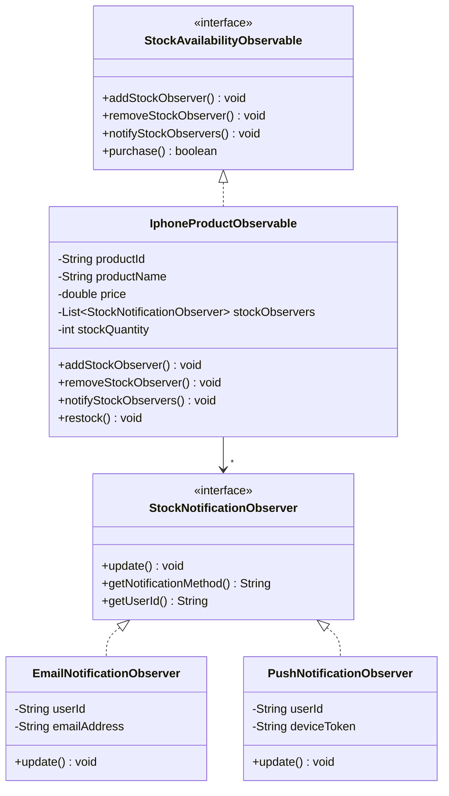
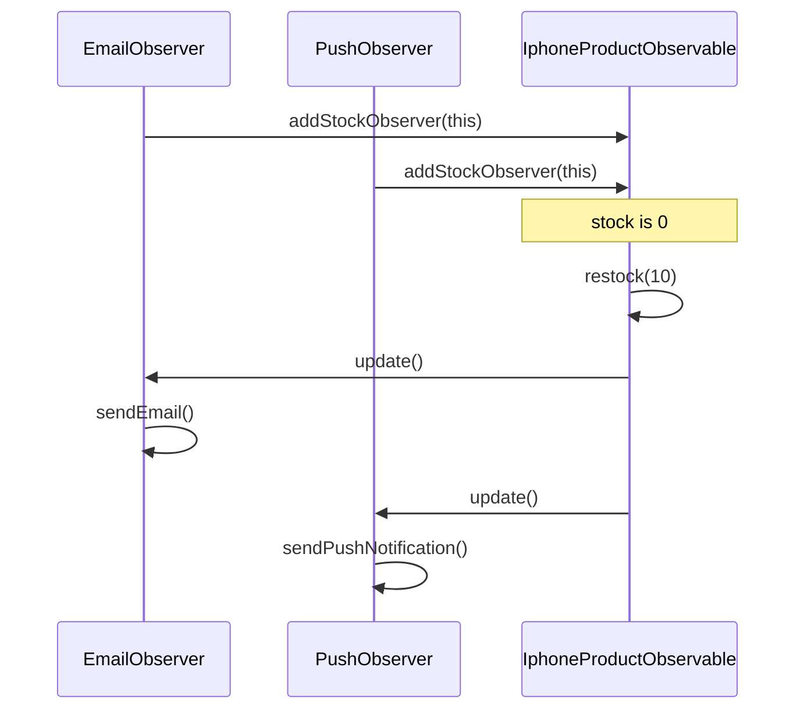
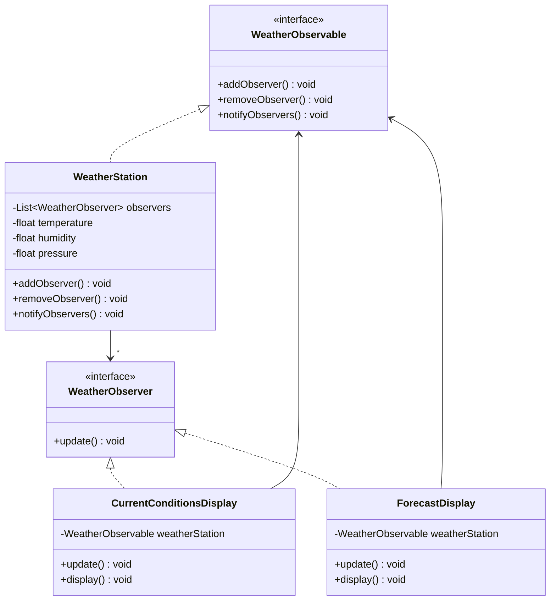

# Observer Pattern (LLD #3)

<!-- nav -->
⬅ [02 Strategy Pattern](02_Strategy_Pattern_Notes.md) · [Index](00_LLD_Index.md) · [04 Decorator Pattern](04_Decorator_Pattern_Notes.md) ➡
<!-- nav -->

Sources: [Observer PDF](https://drive.google.com/file/d/1l3T-TsuhWyQx8us5lxeh-bt4KR_8tr9w/view?usp=drive_link) · [Code on GitLab](https://gitlab.com/shrayansh8/lld-lowleveldesign/-/tree/main/src/main/java/com/conceptcoding/behavioralpatterns/observer)

## In simple words
**Observer** is "subscribe and get notified". One object (the **observable**, also called the subject or publisher) keeps a list of other objects (**observers**, or subscribers). When something changes in the observable, it automatically tells every observer. The observable does not need to know what the observers do with the news.

Think of YouTube: you subscribe to a channel, and each new video notifies all subscribers. The channel doesn't know or care what each subscriber does next.

## The problem it solves
An e-commerce app wants a **"Notify me when back in stock"** feature. Without the pattern, the product class would have to call the email code, the push-notification code, the SMS code and so on directly. Every new channel means editing the product class, and the product is tightly coupled to all of them.

## The solution
- **Observable interface** – `addObserver`, `removeObserver`, `notifyObservers`.
- **Concrete observable** – `IphoneProductObservable` keeps a list of observers and the stock count. When stock goes from 0 to more, it calls `notifyStockObservers()`.
- **Observer interface** – `StockNotificationObserver` with a single `update()` method.
- **Concrete observers** – `EmailNotificationObserver`, `PushNotificationObserver`. A new channel is just a new class.

**Diagram – Notify-me (back in stock) example**



**Diagram – what happens on restock**



*Restock tells every observer*

```java
public void restock(int quantity) {
    boolean wasOutOfStock = (stockQuantity == 0);
    stockQuantity += quantity;
    System.out.println("RESTOCKED: " + productName + " - Added " + quantity + " items " + " | " + "Current stock: " + stockQuantity);
    // Only notify if product was previously out of stock
    if (wasOutOfStock && stockQuantity > 0) {
        notifyStockObservers();
    }
}

// Method to purchase items
@Override
public boolean purchase(int quantity) {
    if (stockQuantity >= quantity) {
```

## Second example: weather station
`WeatherStation` (observable) holds temperature, humidity and pressure. `CurrentConditionsDisplay` and `ForecastDisplay` (observers) are updated whenever the readings change.

**Diagram – Weather station example**



## Two styles
- **Push:** the observable sends the new data inside `update(data)`.
- **Pull:** `update()` has no data and the observer asks the observable for what it needs (used in the weather example, where each display holds a reference to the station).

## When to use
- A change in one object must trigger updates in several others, and you don't know in advance how many.
- Event systems, notifications, UI updates (MVC), stock tickers, message topics.

## Pros and cons
- ✅ **Loose coupling:** observable and observers only know the interface.
- ✅ Add or remove observers at run time.
- ✅ Follows Open/Closed.
- ❌ Notification order is not guaranteed.
- ❌ Forgetting to unsubscribe can leak memory.
- ❌ A slow observer can delay the others if notifications are synchronous.

---

<!-- nav -->
⬅ [02 Strategy Pattern](02_Strategy_Pattern_Notes.md) · [Index](00_LLD_Index.md) · [04 Decorator Pattern](04_Decorator_Pattern_Notes.md) ➡
<!-- nav -->
