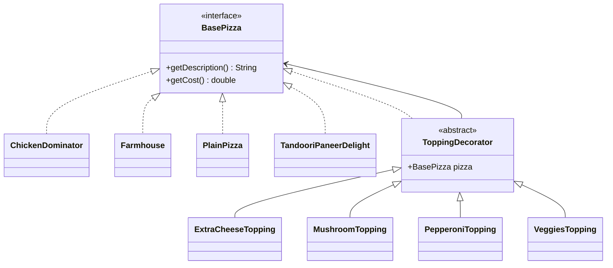
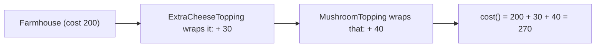
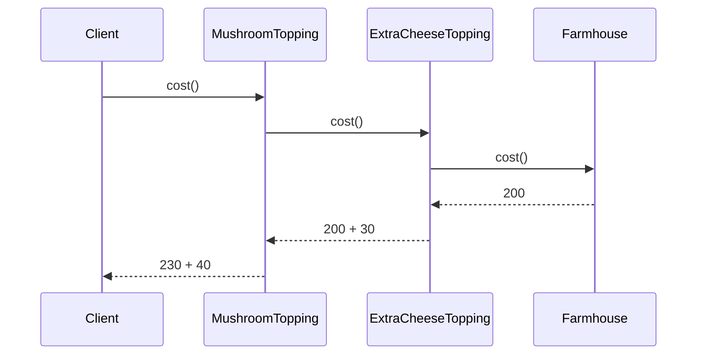

# Decorator Pattern (LLD #4)

<!-- nav -->
⬅ [03 Observer Pattern](03_Observer_Pattern_Notes.md) · [Index](00_LLD_Index.md) · [05 Abstract Factory](05_Abstract_Factory_Notes.md) ➡
<!-- nav -->

Sources: [Decorator PDF](https://drive.google.com/file/d/19W73JBOtOtOzIHmKBA-4ACqCXwv60pB0/view?usp=drive_link) · [Code on GitLab](https://gitlab.com/shrayansh8/lld-lowleveldesign/-/tree/main/src/main/java/com/conceptcoding/structuralpatterns/decorator)

## In simple words
**Decorator** adds extra behaviour to an object by **wrapping** it in another object that has the same interface. You can stack several wrappers, each adding something, and you never edit the original class.

Think of a pizza: you start with a plain base, then wrap it with "extra cheese", then wrap that with "mushroom". The price and description grow with each wrapper.

## The problem it solves
A pizza shop has many bases and many toppings. If every combination is a subclass (`FarmhouseWithCheeseAndMushroom`, ...), the number of classes explodes (a *class explosion*), and a new topping means a new class for every base.

## The solution
- **Component interface** – `BasePizza` (`cost()`, `description()`).
- **Concrete components** – the real pizzas: `PlainPizza`, `Farmhouse`, `ChickenDominator`, `TandooriPaneerDelight`.
- **Decorator (abstract)** – `ToppingDecorator` *is a* `BasePizza` and also *has a* `BasePizza` inside.
- **Concrete decorators** – `ExtraCheeseTopping`, `MushroomTopping`, `PepperoniTopping`, `VeggiesTopping`. Each calls the wrapped pizza and adds its own price.

**Diagram – Pizza and toppings**



**Diagram – how the wrapping works**





*A decorator adds its bit to the wrapped object's result*

```java
public class ExtraCheeseTopping extends ToppingDecorator {

    public ExtraCheeseTopping(BasePizza pizza) {
        super(pizza);
    }

    @Override
    public String getDescription() {
        return pizza.getDescription() + " + Extra Cheese";
    }

    @Override
    public double getCost() {
        return pizza.getCost() + 20;
    }
}
```

## How you use it
You build the object from the inside out:
`BasePizza pizza = new MushroomTopping(new ExtraCheeseTopping(new Farmhouse()));`
Every topping adds to the same pizza object.

## When to use
- You want to add features to individual objects at run time, in any combination.
- Subclassing would create too many classes.
- Real examples: Java I/O (`new BufferedReader(new FileReader(...))`), adding logging, caching, compression or encryption layers.

## Pros and cons
- ✅ Flexible alternative to inheritance; combine behaviours freely.
- ✅ Follows Open/Closed and Single Responsibility (each decorator does one thing).
- ❌ Many small objects; stack traces become harder to read.
- ❌ Order of wrapping can matter and is easy to get wrong.

**Related:** Decorator *adds* behaviour with the same interface; **Proxy** *controls access* to an object; **Adapter** *changes* the interface.

---

<!-- nav -->
⬅ [03 Observer Pattern](03_Observer_Pattern_Notes.md) · [Index](00_LLD_Index.md) · [05 Abstract Factory](05_Abstract_Factory_Notes.md) ➡
<!-- nav -->
