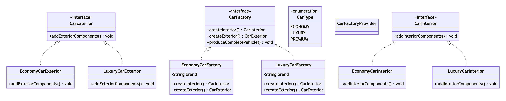
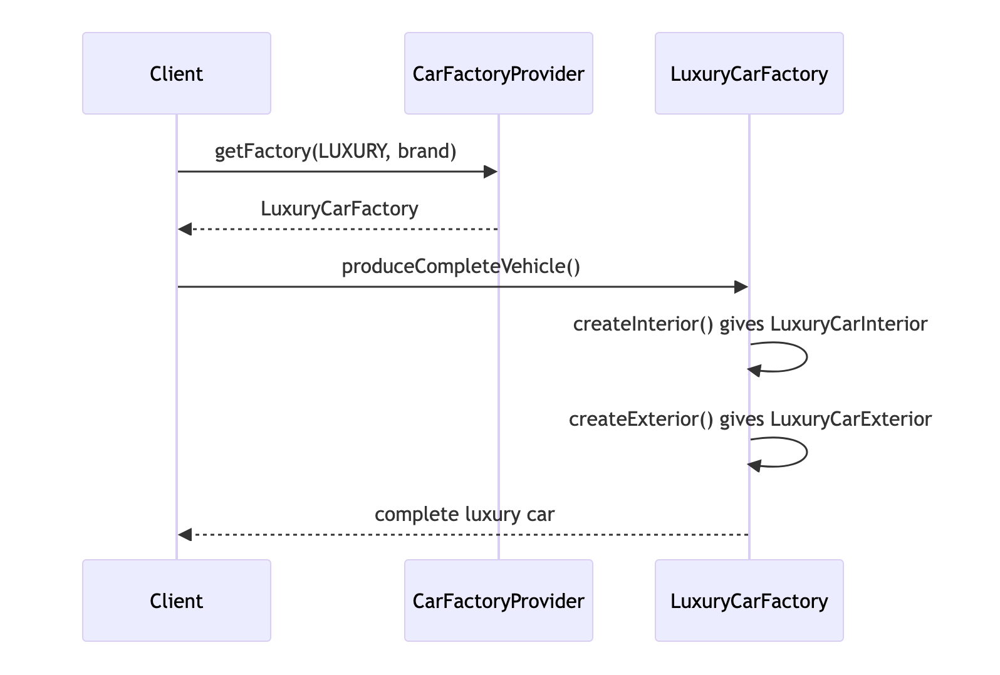

# Abstract Factory Pattern (LLD #5)

<!-- nav -->
⬅ [04 Decorator Pattern](04_Decorator_Pattern_Notes.md) · [Index](00_LLD_Index.md) · [05 Factory Method](05_Factory_Method_Notes.md) ➡
<!-- nav -->

Sources: [Abstract Factory PDF](https://drive.google.com/file/d/1iyouXyHYdbhTyptjN17oqFW8RmGKTQ87/view?usp=drive_link) · [Code on GitLab](https://gitlab.com/shrayansh8/lld-lowleveldesign/-/tree/main/src/main/java/com/conceptcoding/creationalpatterns/abstractfactory)

## In simple words
**Abstract Factory** creates a **whole family of related objects** that belong together, without naming their concrete classes. You pick one factory (for example "Luxury"), and it gives you matching parts (luxury interior *and* luxury exterior). You can never end up with a mismatched mix.

Think of a car company with three lines: Economy, Premium, Luxury. Each line has its own interior and exterior. Choose a line once, and every part you get fits it.

## The problem it solves
A car needs an interior and an exterior. If the client code does `new LuxuryInterior()` and `new EconomyExterior()`, someone can mix incompatible parts, and the client is tied to concrete classes. Adding a new line (say "Sports") means hunting through the client code.

## The solution
- **Abstract products** – `CarInterior`, `CarExterior` (interfaces).
- **Concrete products** – `EconomyCarInterior`, `EconomyCarExterior`, `LuxuryCarInterior`, `LuxuryCarExterior`.
- **Abstract factory** – `CarFactory` with `createInterior()`, `createExterior()` and `produceCompleteVehicle()`.
- **Concrete factories** – `EconomyCarFactory`, `LuxuryCarFactory`, each creating only its own family.
- **Provider** – `CarFactoryProvider` returns the right factory for a `CarType` (`ECONOMY`, `PREMIUM`, `LUXURY`).

**Car factories**



**building a luxury car**



*The provider picks the family*

```java
    public CarFactory getFactory(CarType type, String brand) {
        switch (type) {
            case ECONOMY:
                return new EconomyCarFactory(brand);
            case PREMIUM:
            case LUXURY:
                return new LuxuryCarFactory(brand);
            default:
                throw new IllegalArgumentException("Unknown car type: " + type);
        }
    }
}
```

## Abstract Factory vs Factory Method
| | Factory Method | Abstract Factory |
|---|---|---|
| Creates | **one** kind of product | a **family** of related products |
| How | a subclass overrides one `create` method | a factory object has several `create` methods |
| Use when | which class to create varies | several objects must match each other |

## When to use
- Products must be used together and be compatible (UI toolkits per operating system, themes, cars, database drivers).
- You want to swap a whole family by changing one line.

## Pros and cons
- ✅ Guarantees products in a family match.
- ✅ Client depends only on interfaces; easy to add a new family.
- ❌ Adding a *new kind of product* (say "CarEngine") means changing every factory.
- ❌ More classes and interfaces.

---

<!-- nav -->
⬅ [04 Decorator Pattern](04_Decorator_Pattern_Notes.md) · [Index](00_LLD_Index.md) · [05 Factory Method](05_Factory_Method_Notes.md) ➡
<!-- nav -->
