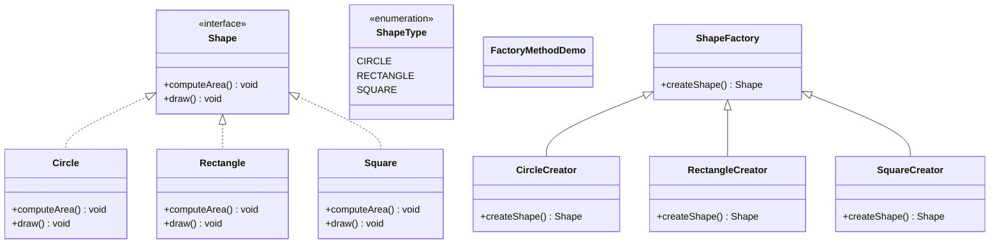
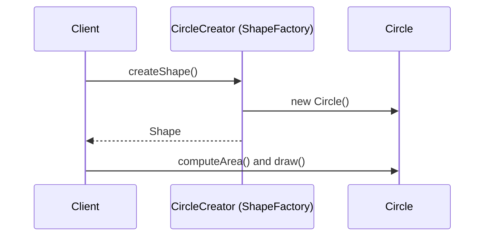

# Factory Method and Simple Factory (LLD #5)

<!-- nav -->
⬅ [05 Abstract Factory](05_Abstract_Factory_Notes.md) · [Index](00_LLD_Index.md) · [06 Parking Lot](06_Parking_Lot_Notes.md) ➡
<!-- nav -->

Sources: [Factory PDF](https://drive.google.com/file/d/1nsb2UJ1y8YTYSCllNDu7xx-YuxfRRUAg/view?usp=drive_link) · [Code on GitLab](https://gitlab.com/shrayansh8/lld-lowleveldesign/-/tree/main/src/main/java/com/conceptcoding/creationalpatterns/factory)

## In simple words
A **factory** is a piece of code whose only job is to create objects, so the rest of your program doesn't write `new Circle()` or `new Square()` all over the place. The caller asks for "a shape" and the factory decides which concrete class to build.

There are two common forms:
1. **Simple Factory** – one class with a method that uses an `if/switch` to decide what to create.
2. **Factory Method** – the creating method is declared in a base class, and **subclasses decide** which object to create.

## The problem it solves
Code like `if (type == CIRCLE) shape = new Circle(); else if ...` is repeated in many places. Each new shape means editing all of them, and the client is tightly bound to concrete classes.

## Simple Factory
`ShapeFactory.createShape(ShapeType)` returns a `Shape` (`Circle`, `Rectangle`, `Square`) based on an enum. Callers only know `Shape`.

*One method decides what to build*

```java
    public static Shape createShape(ShapeType shapeType) {
        if (shapeType == null) {
            return null;
        }
        return switch (shapeType) {
            case CIRCLE -> new Circle();
            case RECTANGLE -> new Rectangle();
            case SQUARE -> new Square();
            default -> throw new IllegalStateException("ShapeType doesn't exist.");
        };
    }
}
```

## Factory Method
`ShapeFactory` becomes a base class with an overridable `createShape()`. Each subclass (`CircleCreator`, `RectangleCreator`, `SquareCreator`) builds exactly one kind of shape. A new shape is a new creator class, and no existing code is edited (Open/Closed).

**Diagram – Shapes, simple factory and factory-method creators**



**Diagram – asking a creator for a shape**



## Simple Factory vs Factory Method
| | Simple Factory | Factory Method |
|---|---|---|
| Where is the decision? | one `if/switch` in the factory | spread over subclasses |
| Add a new product | edit the factory | add a new creator subclass |
| Open/Closed | ❌ not fully | ✅ |
| Complexity | very small | more classes |

## When to use
- You don't know in advance which exact class you need (depends on input, configuration or user choice).
- You want to hide creation details and keep the client simple.
- Examples: parsers per file type, notification senders, payment gateways, database drivers.

## Pros and cons
- ✅ Loose coupling; one place for creation logic.
- ✅ Easy to add new products (with Factory Method).
- ❌ Extra classes and indirection.

**Related:** [Abstract Factory](05_Abstract_Factory_Notes.md) creates *families* of products; **Builder** creates one *complex* object step by step.

---

<!-- nav -->
⬅ [05 Abstract Factory](05_Abstract_Factory_Notes.md) · [Index](00_LLD_Index.md) · [06 Parking Lot](06_Parking_Lot_Notes.md) ➡
<!-- nav -->
