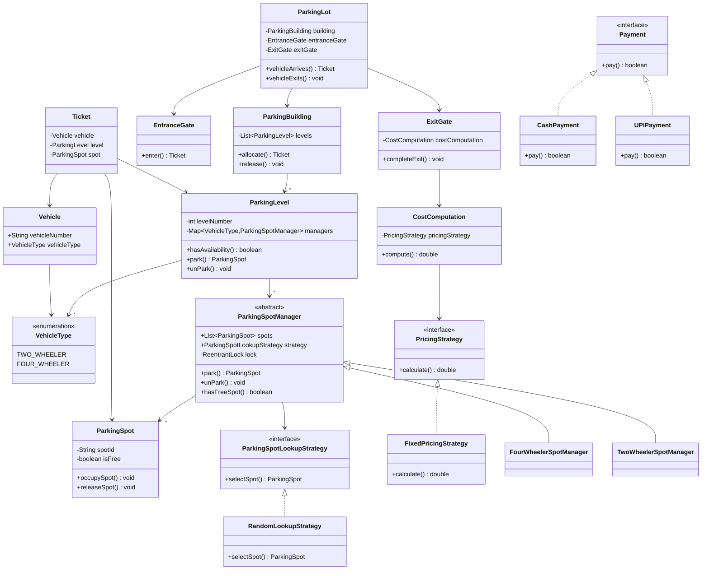
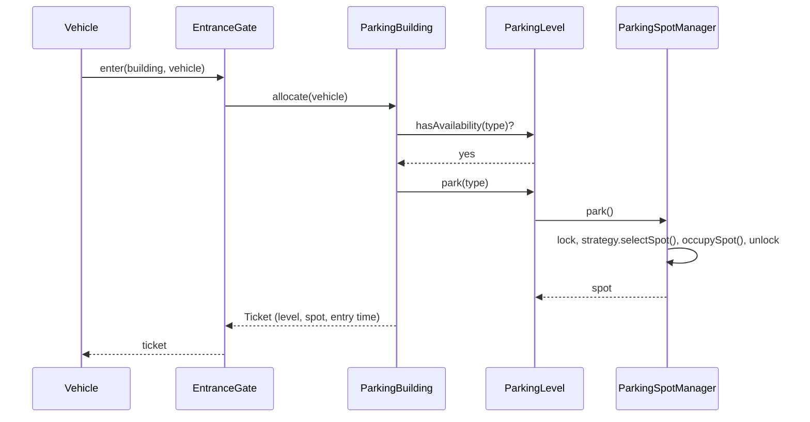
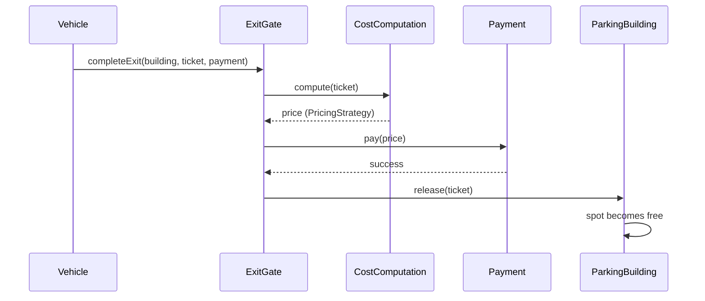

# Design Parking Lot (LLD #6)

<!-- nav -->
⬅ [05 Factory Method](05_Factory_Method_Notes.md) · [Index](00_LLD_Index.md) · [07 Tic Tac Toe](07_Tic_Tac_Toe_Notes.md) ➡
<!-- nav -->

Sources: [Parking Lot PDF](https://drive.google.com/file/d/1aE9QhlRZgtUDI-p_2NiPdVWaq3eP-Mn7/view?usp=drive_link) · [Code on GitLab](https://gitlab.com/shrayansh8/lld-lowleveldesign/-/tree/main/src/main/java/com/conceptcoding/interviewquestions/parking_lot?ref_type=heads)

## The problem
Design a multi-level parking lot. Vehicles enter at a gate, get a spot and a ticket, and pay at an exit gate. The spot is then freed.

## Requirements and flow
1. A vehicle arrives at an **entry gate** (there can be several).
2. A spot of the right **type** is searched (two-wheeler, four-wheeler, ...). The way to pick a spot should be flexible (random, nearest to the gate, ...).
3. The lot can have **multiple levels**.
4. **Concurrency:** two vehicles must never get the same spot, and we must not lock the whole lot for one vehicle.
5. A **ticket** is issued: vehicle number, level, spot and entry time.
6. At the **exit gate** the price is computed from the ticket. The pricing can be fixed, hourly, etc.
7. After **payment**, the spot becomes free again.

## Step 1 – Objects
| Object | Job |
|---|---|
| `Vehicle`, `VehicleType` | number and type (`TWO_WHEELER`, `FOUR_WHEELER`) |
| `ParkingSpot` | a plain data object: id, free or not, `occupySpot()`, `releaseSpot()` |
| `ParkingSpotManager` | the **intelligent** object: finds and reserves spots of one type, with its own lock and its own lookup strategy |
| `ParkingLevel` | one floor; holds a manager for each vehicle type |
| `ParkingBuilding` | all levels; `allocate(vehicle)` and `release(ticket)` |
| `EntranceGate`, `ExitGate` | entry creates the ticket; exit computes the cost, takes payment, releases the spot |
| `Ticket` | vehicle, level, spot and entry time |
| `Payment` (`CashPayment`, `UPIPayment`) | strategy for paying |
| `PricingStrategy`, `CostComputation` | strategy for the price |
| `ParkingSpotLookupStrategy` | strategy for choosing a spot |

## Step 2 – Class diagram

**Diagram – Parking lot**



## Step 3 – Flows
**Entering**



**Exiting**



## Design decisions worth explaining
- **Spot = dumb data, Manager = smart.** A `ParkingSpot` is just a POJO. A `ParkingSpotManager` holds the logic to search, reserve and release spots of **one type**, so each type can have its own strategy and its own lock.

*Locking only this manager's spots*

```java
public ParkingSpot park() {
    lock.lock();
    try {
        ParkingSpot spot = strategy.selectSpot(spots);
        if (spot == null) {
            return null;
        }

        spot.occupySpot();
        return spot;
    } finally {
        lock.unlock();
    }
}
```

- **Fine-grained locking.** The lock is held by one manager (for example two-wheelers on Level 1). A four-wheeler parking on the same level, or anything on another level, is not blocked.
- **Strategies** ([Strategy pattern](02_Strategy_Pattern_Notes.md)) for the three things that change: spot lookup (`ParkingSpotLookupStrategy`, e.g. random or nearest to the gate), pricing (`PricingStrategy`: fixed, hourly) and payment (`Payment`: cash, UPI). New behaviour is a new class.
- **Levels are independent.** Each level can support different vehicle types (Level 1 only bikes, Level 2 both).
- **Possible extensions:** truck and EV spots (a new manager and `VehicleType`), reservation, display boards, a spot-nearest-to-exit strategy.

---

<!-- nav -->
⬅ [05 Factory Method](05_Factory_Method_Notes.md) · [Index](00_LLD_Index.md) · [07 Tic Tac Toe](07_Tic_Tac_Toe_Notes.md) ➡
<!-- nav -->
