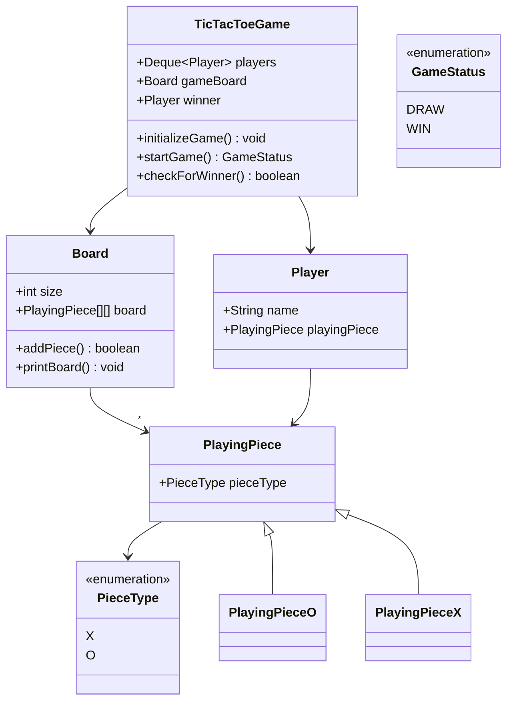
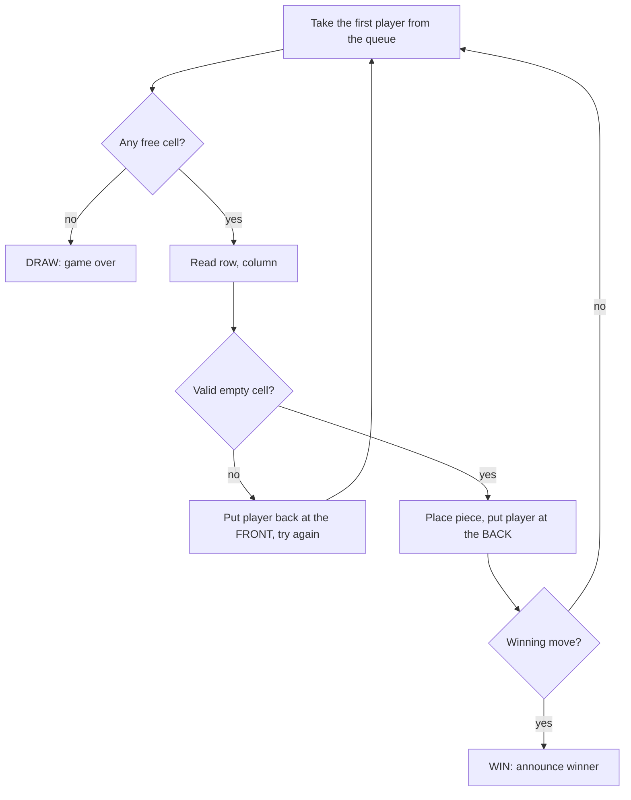
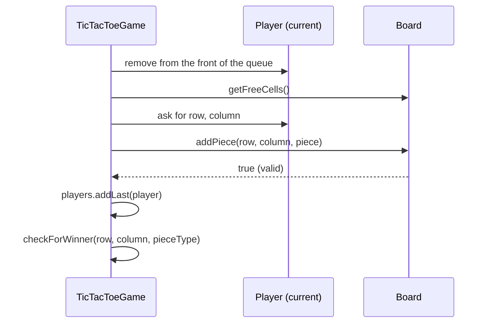
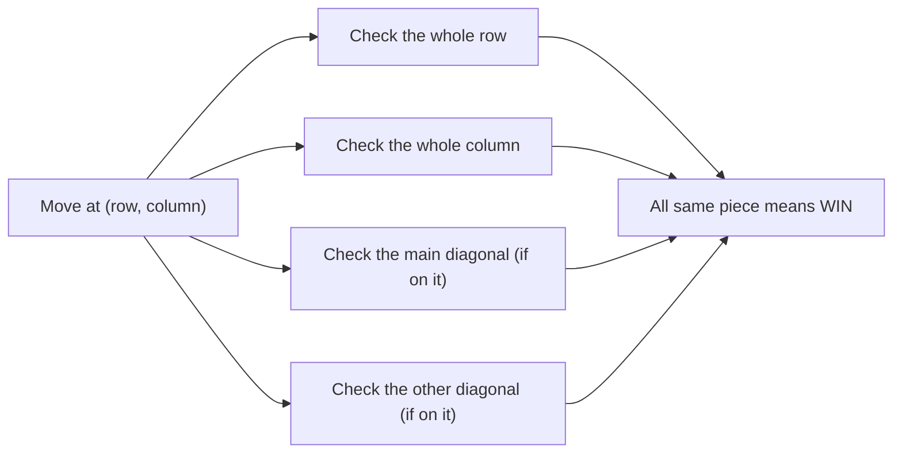

# Design Tic Tac Toe (LLD #7)

<!-- nav -->
⬅ [06 Parking Lot](06_Parking_Lot_Notes.md) · [Index](00_LLD_Index.md) · [08 Elevator System](08_Elevator_System_Notes.md) ➡
<!-- nav -->

Sources: [Tic Tac Toe PDF](https://drive.google.com/file/d/1JgTipI2hutFrd3YxDpE8L2KukIr0VC7H/view?usp=drive_link) · [Code on GitLab](https://gitlab.com/shrayansh8/lld-lowleveldesign/-/tree/main/src/main/java/com/conceptcoding/interviewquestions/tictactoe)

## The problem
Design a **two-player Tic-Tac-Toe** game on a 3×3 board. Players choose X or O and take turns. The first to place three of their pieces in a row, column or diagonal wins. If the board fills up with no winner, it is a draw.

## Requirements
- A 3×3 board (kept configurable, so a bigger grid is possible later).
- Two players, each with their own piece (X or O).
- The game ends on a win or a draw.
- Invalid moves (a taken cell, outside the board) must be rejected, and the same player tries again.

## Step 1 – Find the objects (the nouns)
| Object | Job |
|---|---|
| `PieceType` | enum of symbols: `X`, `O` |
| `PlayingPiece` | a piece; holds its `PieceType`. `PlayingPieceX` and `PlayingPieceO` are the concrete pieces. |
| `Board` | the grid (`PlayingPiece[][]`); places pieces and prints itself |
| `Player` | a name and the piece he or she plays with |
| `GameStatus` | enum: `WIN`, `DRAW` |
| `TicTacToeGame` | the controller: turns, validation, winner check |

## Step 2 – Class diagram

**Diagram – Tic Tac Toe**



## Step 3 – How the game runs
The game keeps the players in a **queue (Deque)**:
1. Take the first player out of the queue.
2. If there are no free cells left, the game is a draw.
3. Read the move `row, column`.
4. Try to place the piece. If the cell is taken or invalid, put the player **back at the front** so he or she tries again.
5. Otherwise add the player to the **back** of the queue (so turns alternate).
6. Check whether this move wins. If yes, the game is over.





*Placing a piece and handling an invalid move*

```java
// Place the piece in the board
boolean validMove = gameBoard.addPiece(inputRow, inputColumn, currentPlayer.playingPiece);
if (!validMove) {
    // Invalid Move: Player can not insert the piece into this cell, player has to choose another cell
    System.out.println("Incorrect position chosen, try again!");
    players.addFirst(currentPlayer); // Add the player back to the queue(in the front)
    continue;
}
players.addLast(currentPlayer); // Add the player to the end of the queue

// Check if the valid move is a winning move or not
boolean isWinner = checkForWinner(inputRow, inputColumn, currentPlayer.playingPiece.pieceType);
if (isWinner) {
    gameBoard.printBoard();
    winner = currentPlayer;
    return GameStatus.WIN;
```

## Winner check
After each move, only the **row, column and diagonals that pass through the new cell** need to be checked: if every cell in one of these lines holds the same `PieceType`, the player wins. This is cheaper than scanning the whole board.



## Design points to mention
- **Single Responsibility:** `Board` knows cells, `Player` knows identity, `TicTacToeGame` knows the rules and turn order.
- **Open/Closed:** a new symbol or a bigger board needs little change (board size is a field; `PlayingPiece` is a small hierarchy).
- **Extensions:** more than two players (the queue already supports it), an AI player, undo (see [Command](31_Command_Undo_Redo_Notes.md)), different winning rules (see [Strategy](02_Strategy_Pattern_Notes.md)).

---

<!-- nav -->
⬅ [06 Parking Lot](06_Parking_Lot_Notes.md) · [Index](00_LLD_Index.md) · [08 Elevator System](08_Elevator_System_Notes.md) ➡
<!-- nav -->
