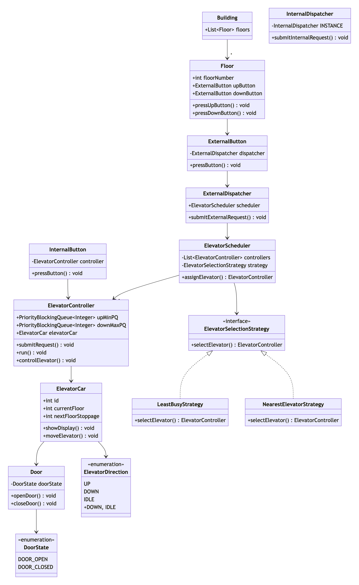
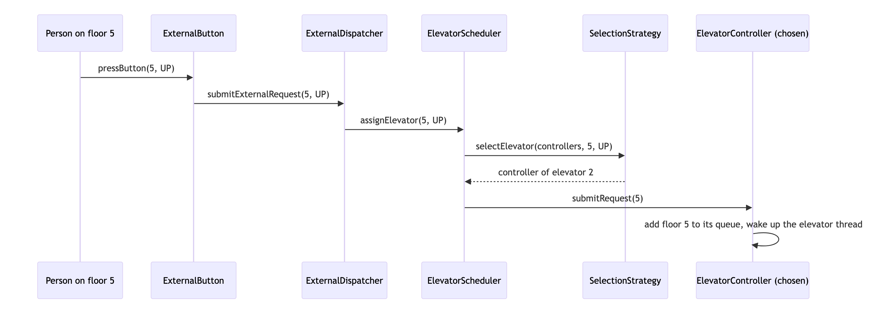
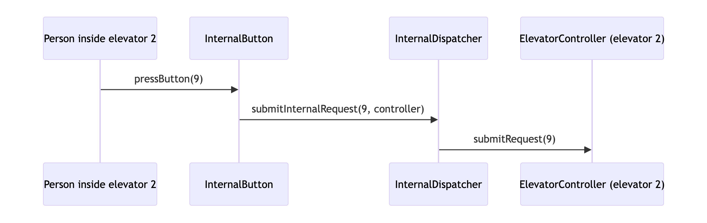
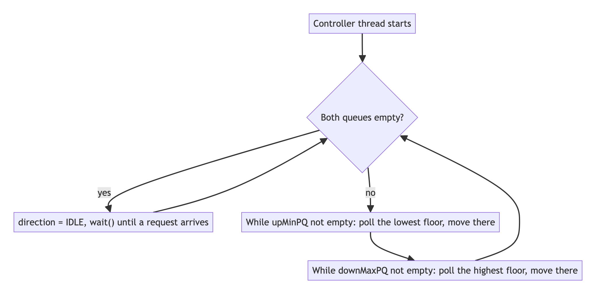
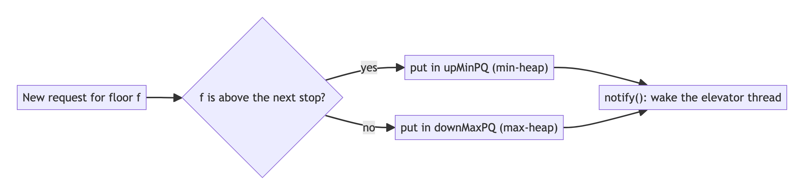

# Design an Elevator System (LLD #8)

<!-- nav -->
⬅ [07 Tic Tac Toe](07_Tic_Tac_Toe_Notes.md) · [Index](00_LLD_Index.md) · [09 Car Rental System](09_Car_Rental_System_Notes.md) ➡
<!-- nav -->

Sources: [Elevator System PDF](https://drive.google.com/file/d/1MGudMSiJj2JMC75qq3o34gW2Kz-UAYPl/view?usp=drive_link) · [Code on GitLab](https://gitlab.com/shrayansh8/lld-lowleveldesign/-/tree/main/src/main/java/com/conceptcoding/interviewquestions/elevator)

## The problem
A building has **several elevators and several floors**. People press Up or Down at a floor (an *external* request) and then a destination button inside the car (an *internal* request). Design the system so the right elevator is chosen and floors are served in a sensible order.

## Requirements
- Multiple elevators and floors.
- **External request:** Up/Down button on each floor. A strategy picks the *best* elevator, and the floor is added to that elevator's list of stops.
- **Internal request:** a button inside a car always goes to **that same car**.
- When no request exists, an elevator stays **idle (sleeps)** and wakes up when a request arrives.
- Stops are served **in order by direction**: going up, floors in ascending order; going down, in descending order.

## Step 1 – Objects
| Object | Job |
|---|---|
| `Building`, `Floor` | the building has floors; each floor has an `ExternalButton` for up and for down |
| `ElevatorCar` | a "dumb" car: knows its floor, direction, door and display. When told to go to a floor, it just moves (opens door, closes, moves, opens). |
| `Door`, `DoorState` | open and close |
| `ElevatorController` | the **brain of one elevator**: keeps its request queues and runs its own thread |
| `ExternalButton`, `ExternalDispatcher` | floor button → dispatcher → scheduler |
| `InternalButton`, `InternalDispatcher` | car button → the same elevator's controller (one place for logging and validation) |
| `ElevatorScheduler` | holds all controllers and an `ElevatorSelectionStrategy` to choose one |
| `ElevatorSelectionStrategy` (`NearestElevatorStrategy`, `LeastBusyStrategy`) | how to choose |

## Step 2 – Class diagram

**Elevator system**



## Step 3 – The two requests





## Step 4 – Selection strategy
When an external button is pressed we only know the **floor** and the **direction**. A strategy chooses a lift:
- **Nearest elevator:** prefer a lift already moving in the same direction that has not passed the floor, and pick the closest. If none, use an idle one.
- **Least busy:** pick the lift with the fewest pending requests.

New rules are new classes ([Strategy pattern](02_Strategy_Pattern_Notes.md)).

## Step 5 – Moving in order: the LOOK algorithm
Each elevator keeps **two priority queues**:
- `upMinPQ` (a **min-heap**): floors **above** the current stop, smallest first, used while going up.
- `downMaxPQ` (a **max-heap**): floors **below**, largest first, used while going down.

The related disk-scheduling ideas:
- **SCAN:** go all the way to one end (the top floor) even with no request, then reverse.
- **LOOK:** like SCAN, but **turn around as soon as there is no request further ahead**. This is the one used here.





*Requests go to the right queue, and the sleeping lift is woken*

```java
private void enqueueRequest(int destinationFloor) {
    System.out.println("Request details-> destinationFloor: " + destinationFloor + " accepted by elevator:" + elevatorCar.id);

    if (destinationFloor == elevatorCar.nextFloorStoppage){
        return;
    }
    if (destinationFloor >= elevatorCar.nextFloorStoppage) {
        if (!upMinPQ.contains(destinationFloor)) {
            upMinPQ.offer(destinationFloor);
        }
    } else {
        if (!downMaxPQ.contains(destinationFloor)) {
            downMaxPQ.offer(destinationFloor);
        }
    }

    synchronized (monitor) {
        monitor.notify();   // wake elevator thread
    }
}

@Override
```

## Concurrency
- Each `ElevatorController` is a `Runnable`: **one thread per elevator**.
- `PriorityBlockingQueue` is thread-safe, so requests can be added from other threads while the lift moves.
- `wait()` / `notify()` on a `monitor` lets an idle lift **sleep without burning CPU** and wake instantly.

## Design points to mention
- **Dumb car, smart controller:** `ElevatorCar` only moves; all decisions are in `ElevatorController` (the same split as spot vs manager in the parking lot).
- **Dispatchers as bridges:** they give one place to add logging, validation or security. The internal dispatcher also acts like a [Proxy](13_Proxy_Pattern_Notes.md).
- **Extensions:** weight limit, maintenance or out-of-service mode, emergency stop, priority floors (fire mode), express elevators.

---

<!-- nav -->
⬅ [07 Tic Tac Toe](07_Tic_Tac_Toe_Notes.md) · [Index](00_LLD_Index.md) · [09 Car Rental System](09_Car_Rental_System_Notes.md) ➡
<!-- nav -->
