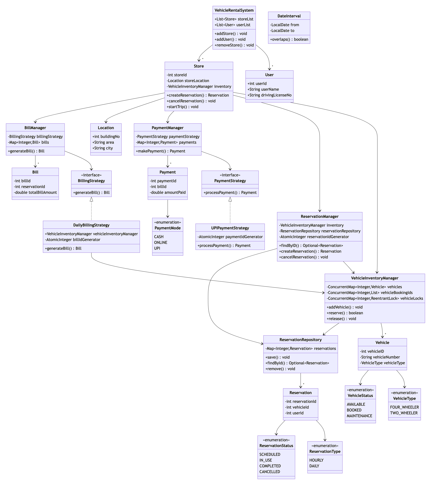
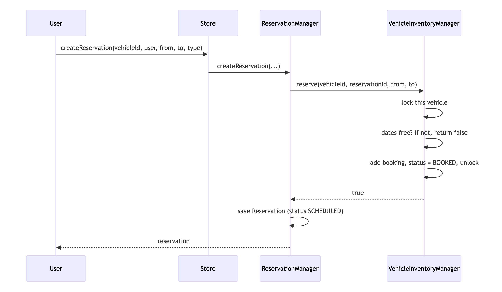
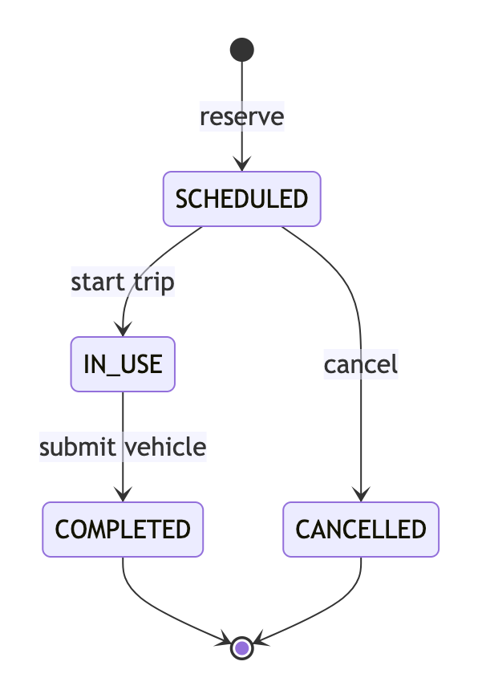
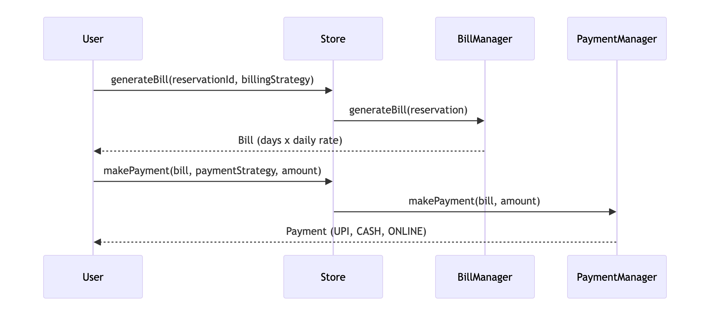

# Design a Car Rental System (LLD #9)

<!-- nav -->
⬅ [08 Elevator System](08_Elevator_System_Notes.md) · [Index](00_LLD_Index.md) · [10 Chain of Responsibility](10_Chain_of_Responsibility_Notes.md) ➡
<!-- nav -->

Sources: [Car Rental PDF](https://drive.google.com/file/d/1QR51mRs_1cM7Cq5aDlPLKAvrjHMtLiU0/view?usp=drive_link) · [Car Rental PDF (link 2)](https://drive.google.com/file/d/11UNsQAciYNTr1iDkkR_H9hJ5lj4A4kr4/view?usp=drive_link) · [Code on GitLab](https://gitlab.com/shrayansh8/lld-lowleveldesign/-/tree/main/src/main/java/com/conceptcoding/interviewquestions/carrental)

## The problem
A Zoomcar-style rental service. A user picks a **store** by location, searches vehicles by type and availability, **reserves** one, starts the trip, returns the vehicle, receives a **bill** and **pays**.

## Requirements and flow
1. User selects a store (by location).
2. Search vehicles by type (four-wheeler, two-wheeler) and availability.
3. **Reserve** a vehicle. Two users must never get the same vehicle for overlapping dates (concurrency).
4. **Start the trip**, then **submit** the vehicle.
5. A **bill** is generated for the reservation. Billing may be daily or hourly (strategy).
6. **Payment** is made against the bill. It may be UPI, card, etc. (strategy).

## Step 1 – Objects
| Object | Job |
|---|---|
| `Vehicle`, `VehicleType`, `VehicleStatus` | plain data about a vehicle (`AVAILABLE`, `BOOKED`, `MAINTENANCE`) |
| `VehicleInventoryManager` | the **smart** object per store: vehicles, bookings, **a lock per vehicle**, `reserve()` and `release()` |
| `Reservation`, `ReservationStatus`, `ReservationType` | one booking (`SCHEDULED`, `IN_USE`, `COMPLETED`, `CANCELLED`; hourly or daily). It stores only the vehicle id and user id. |
| `ReservationManager` | creates, cancels, starts and completes reservations |
| `ReservationRepository` | stores reservations; it also breaks the circular dependency between the two managers |
| `Bill`, `BillManager`, `BillingStrategy` (`DailyBillingStrategy`) | create the bill |
| `Payment`, `PaymentManager`, `PaymentStrategy` (`UPIPaymentStrategy`) | take payment |
| `Store` | **facade**: has an inventory, reservation manager, bill manager and payment manager and exposes `createReservation`, `startTrip`, `submitVehicle`, `generateBill`, `makePayment` |
| `VehicleRentalSystem` | list of stores and users |

## Step 2 – Class diagram

**Diagram – Car rental**



## Step 3 – Reservation flow



Then: **startTrip** (`SCHEDULED → IN_USE`), **submitVehicle** (`IN_USE → COMPLETED`, vehicle released), **generateBill**, **makePayment**.



## Step 4 – Concurrency (the key discussion point)
Two users try to reserve the same car at the same moment. We need two safeguards:
1. **Thread-safe collections** (`ConcurrentMap`) for vehicles and bookings.
2. **One lock per vehicle** (`ReentrantLock`). The *check* "is it free?" and the *write* "mark it booked" must happen together, atomically.

Locking per vehicle (not the whole store) means bookings of different cars don't block each other.

*Atomic check-and-reserve under a per-vehicle lock*

```java
public boolean reserve(int vehicleId, int reservationId, LocalDate from, LocalDate to) {
    ReentrantLock lock = lockForVehicle(vehicleId);
    lock.lock();
    try {
        if (!isAvailable(vehicleId, from, to)) {
            return false;
        }

        vehicleBookingIds.putIfAbsent(vehicleId, new ArrayList<>());
        vehicleBookingIds.get(vehicleId).add(reservationId);

        vehicles.get(vehicleId).setStatus(VehicleStatus.BOOKED);

        return true;
    } finally {
        lock.unlock();
    }
}
```

Availability uses `DateInterval.overlaps(other)`: a new booking is allowed only if its dates don't overlap any existing booking of that vehicle.

## Step 5 – Billing and payment (Strategy)

Adding hourly billing or card payment means adding a new `BillingStrategy` or `PaymentStrategy` class ([Strategy pattern](02_Strategy_Pattern_Notes.md)).

## Design points to mention
- **Manager objects** hold the logic; **entity objects** (`Vehicle`, `Reservation`, `Bill`) are plain data.
- **Per-store managers**, so they are not singletons.
- **Facade:** `Store` gives the outside world one simple entry point ([Facade](25_Facade_Pattern_Notes.md)).
- **Strategies** for billing and payment; **repository** to avoid circular dependencies.
- **Extensions:** vehicle search by type and date, late fees, deposits, multiple payment methods per bill, notifications.

---

<!-- nav -->
⬅ [08 Elevator System](08_Elevator_System_Notes.md) · [Index](00_LLD_Index.md) · [10 Chain of Responsibility](10_Chain_of_Responsibility_Notes.md) ➡
<!-- nav -->
