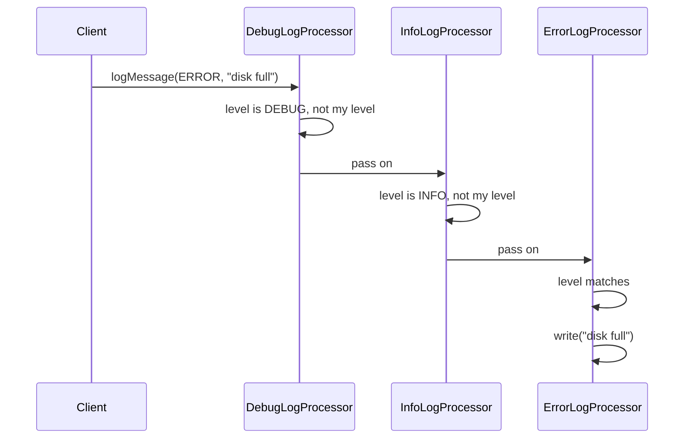

# Chain of Responsibility Pattern (LLD #10)

<!-- nav -->
⬅ [09 Car Rental System](09_Car_Rental_System_Notes.md) · [Index](00_LLD_Index.md) · [11 Snake and Ladder](11_Snake_and_Ladder_Notes.md) ➡
<!-- nav -->

Sources: [Chain of Responsibility PDF](https://drive.google.com/file/d/1niWAA5Vy3gC8i6xU96igcYVR_ygZmboT/view?usp=drive_link) · [Code on GitLab](https://gitlab.com/shrayansh8/lld-lowleveldesign/-/tree/main/src/main/java/com/conceptcoding/behavioralpatterns/chainofresponsibility)

## In simple words
**Chain of Responsibility** passes a request along a **chain of handlers**. Each handler either handles the request or hands it to the next one. The sender doesn't know which handler will end up dealing with it.

Think of a customer-care escalation: a call goes to the agent first, then the supervisor, then the manager, until someone can solve it.

## The problem it solves
A logger must route messages by level: `DEBUG`, `INFO`, `ERROR`, `FATAL`. With one big `if / else if` in one place, adding a new level or changing the order means editing that block, and the sender is coupled to every possible handler.

## The solution
- **Handler (abstract)** – `LogProcessor` holds its own `level` and a reference to the `nextLoggerProcessor`. `logMessage(level, message)` checks whether it matches; if yes, it writes, otherwise it forwards to the next one.
- **Concrete handlers** – `DebugLogProcessor`, `InfoLogProcessor`, `ErrorLogProcessor`, `FatalLogProcessor` implement `write()`.
- The **client** builds the chain once (`debug → info → error → fatal`) and sends everything to the first handler.

**Diagram – Log processors chain**

```mermaid
classDiagram
  class DebugLogProcessor {
    +write() void
  }
  class ErrorLogProcessor {
    +write() void
  }
  class FatalLogProcessor {
    +write() void
  }
  class InfoLogProcessor {
    +write() void
  }
  class LogProcessor {
    <<abstract>>
    +int level
    +LogProcessor nextLoggerProcessor
    +logMessage() void
    +write() void
  }
  class LoggerDemo {
  }
  LogProcessor <|-- DebugLogProcessor
  LogProcessor <|-- ErrorLogProcessor
  LogProcessor <|-- FatalLogProcessor
  LogProcessor <|-- InfoLogProcessor
```



**Diagram – a message travelling the chain**



*Handle it or pass it on*

```java
public void logMessage(int level, String message) {
    if (this.level == level) {
        write(message);
        return;
    }

    // Pass to next handler in chain if exists
    if (this.nextLoggerProcessor != null) {
        this.nextLoggerProcessor.logMessage(level, message);
    }
}
```

## When to use
- More than one object may handle a request, and the right one isn't known in advance.
- You want to add, remove or reorder handlers without changing the sender.
- Examples: logging levels, approval workflows (manager → director → CEO), servlet filters, middleware pipelines, ATM cash dispensing (₹2000 → ₹500 → ₹100 notes), event bubbling in UIs.

## Pros and cons
- ✅ Loose coupling; each handler has one job.
- ✅ Easy to rearrange the chain (Open/Closed).
- ❌ A request might reach the end of the chain and **not be handled** at all.
- ❌ Harder to debug a long chain.

**Variants:** in some chains **every** handler processes the message (like middleware); in others only the **first match** handles it and stops (like the logger above).

---

<!-- nav -->
⬅ [09 Car Rental System](09_Car_Rental_System_Notes.md) · [Index](00_LLD_Index.md) · [11 Snake and Ladder](11_Snake_and_Ladder_Notes.md) ➡
<!-- nav -->
