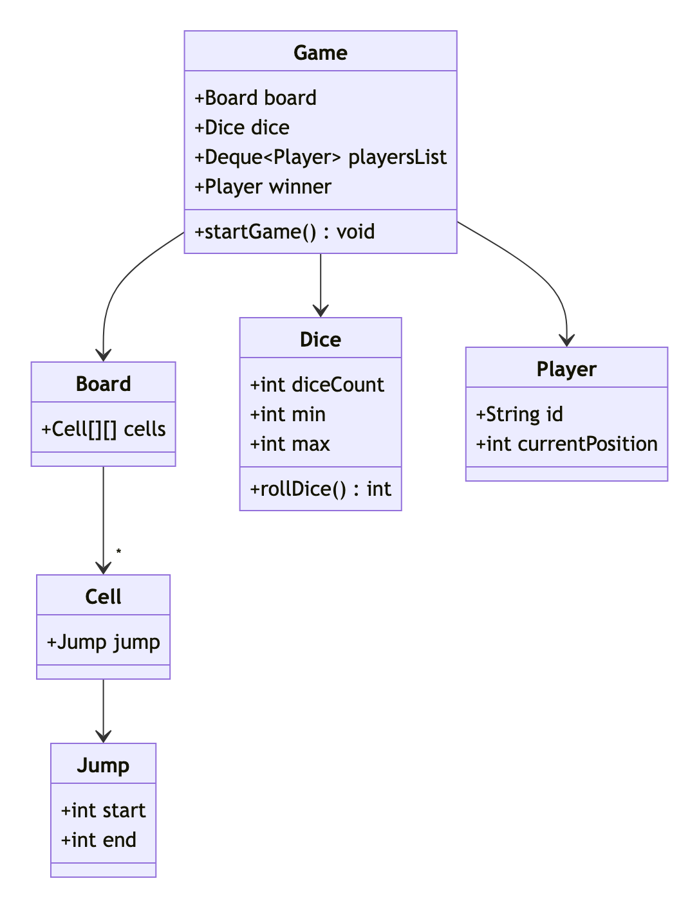
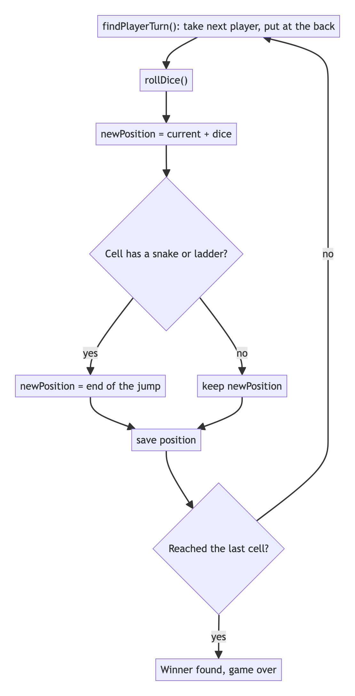
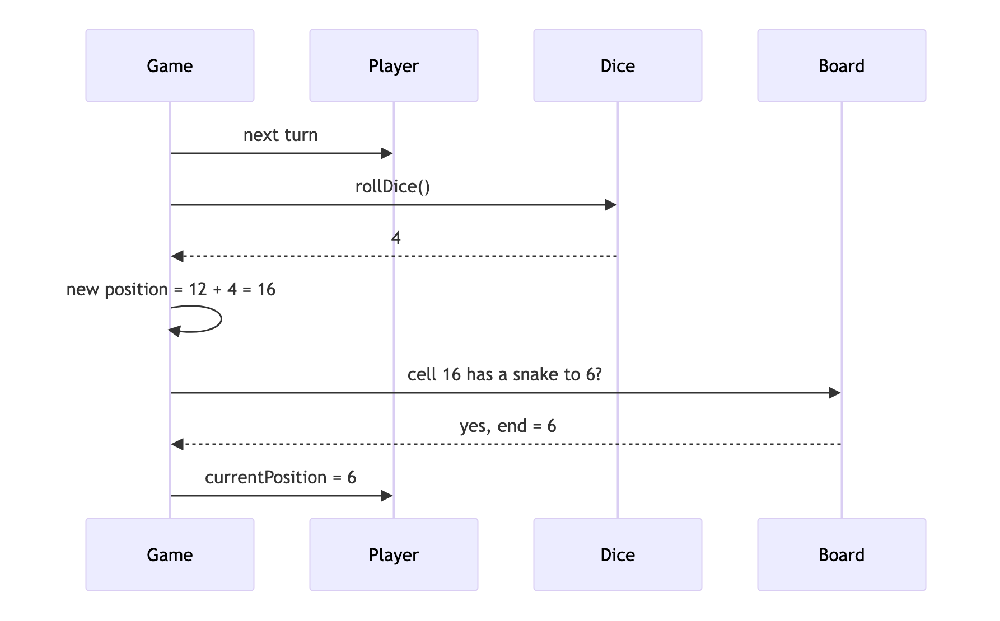

# Design Snake and Ladder (LLD #11)

<!-- nav -->
⬅ [10 Chain of Responsibility](10_Chain_of_Responsibility_Notes.md) · [Index](00_LLD_Index.md) · [12 HashMap Internal Implementation](12_HashMap_Internal_Implementation_Notes.md) ➡
<!-- nav -->

Sources: [Snake and Ladder PDF](https://drive.google.com/file/d/1cGyGGWOrp_b4Jm2xHFlI_FitPivDHgiN/view?usp=drive_link) · [Code on GitLab](https://gitlab.com/shrayansh8/lld-lowleveldesign/-/tree/main/src/main/java/com/conceptcoding/interviewquestions/snakeNladder?ref_type=heads)

## The problem
Design the Snake and Ladder board game. Players take turns, roll a dice and move forward on a 10×10 board (100 cells). A **ladder** moves a player up, a **snake** moves a player down. The first player to reach the last cell wins.

## Requirements
- Board of 10×10 = 100 cells (a fixed size here).
- One dice that returns a random number from 1 to 6 (kept scalable to more dice).
- Snakes and ladders can be defined dynamically.
- Two players by default, but configurable.
- Winner: the first player to reach the final cell.

## Step 1 – Objects
| Object | Job |
|---|---|
| `Player` | id and current position |
| `Dice` | how many dice and the min / max value; `rollDice()` returns a random total |
| `Jump` | a start cell and an end cell. **Snake:** start > end (go down). **Ladder:** start < end (go up) |
| `Cell` | one square of the board; may hold a `Jump` (if it is null, the cell is normal) |
| `Board` | a 2D array of cells; creates the cells and places snakes and ladders randomly |
| `Game` | the controller: players queue, dice, board, winner |

## Step 2 – Class diagram

**Diagram – Snake and Ladder**



## Step 3 – Game flow
1. `initializeGame()`: build the board, dice and players.
2. Take the next player from the queue (and add them back to the end).
3. Roll the dice and compute the new position.
4. `jumpCheck()`: if the new cell has a snake or ladder that **starts** there, move to its **end**.
5. Save the position. If it reaches the last cell, this player wins.





*The game loop*

```java
public void startGame() {
    while (winner == null) {
        //check whose turn now
        Player playerTurn = findPlayerTurn();
        System.out.println("Player turn:" + playerTurn.id + " current position is: " + playerTurn.currentPosition);

        //roll the dice
        int diceNumbers = dice.rollDice();

        //get the new position
        int playerNewPosition = playerTurn.currentPosition + diceNumbers;
        playerNewPosition = jumpCheck(playerNewPosition);
        playerTurn.currentPosition = playerNewPosition;

        System.out.println("Player turn:" + playerTurn.id + " new Position is: " + playerNewPosition);
        //check for winning condition
        if (playerNewPosition >= board.cells.length * board.cells.length - 1) {
            winner = playerTurn;
        }
    }
    System.out.println("\n===> The Winner is:" + winner.id);
}
```

## Design points to mention
- **A snake and a ladder are the same thing** (a `Jump` with start and end). Only the direction differs, so one class handles both, and the `Cell` just asks "do I have a jump?".
- **Players in a queue (Deque):** take the first, play, add to the end, which gives fair rotation for any number of players.
- **Extensions:** several dice, rules like "need exactly 100 to win" or "six gives another turn" (a *winning strategy*, see [Strategy](02_Strategy_Pattern_Notes.md)), more players, different board sizes.

---

<!-- nav -->
⬅ [10 Chain of Responsibility](10_Chain_of_Responsibility_Notes.md) · [Index](00_LLD_Index.md) · [12 HashMap Internal Implementation](12_HashMap_Internal_Implementation_Notes.md) ➡
<!-- nav -->
