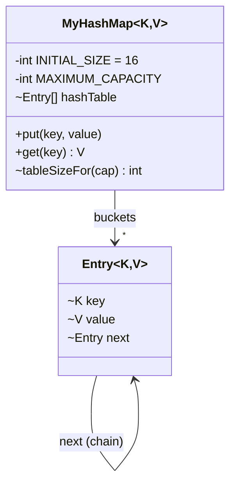
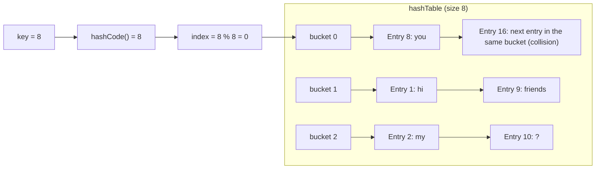
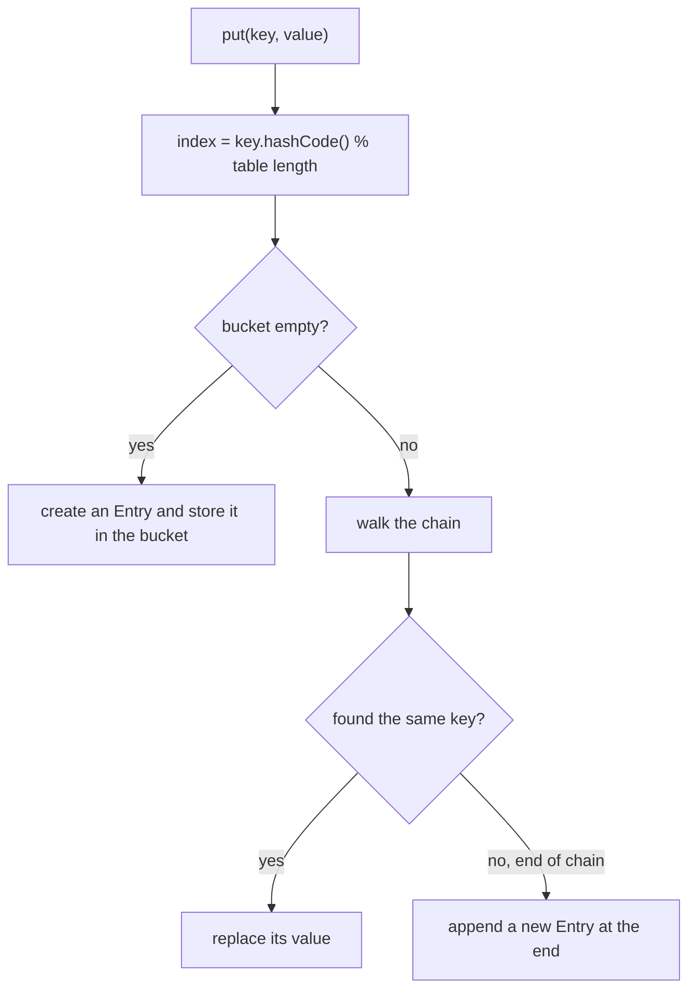
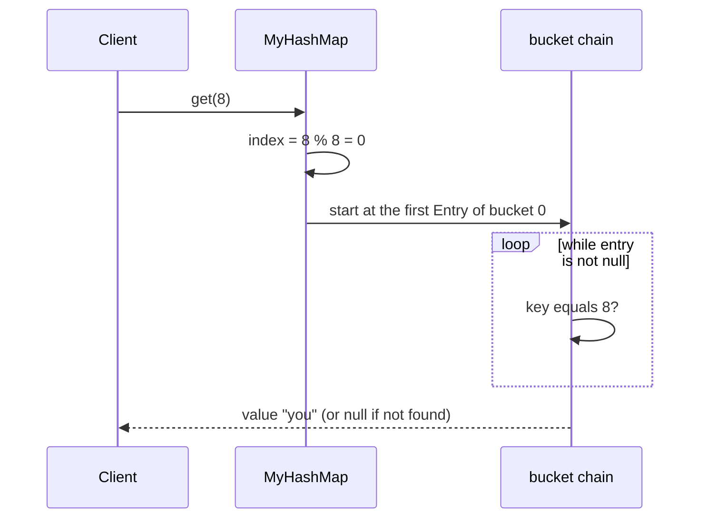

# HashMap Internal Implementation in Java (LLD #12)

<!-- nav -->
⬅ [11 Snake and Ladder](11_Snake_and_Ladder_Notes.md) · [Index](00_LLD_Index.md) · [13 Proxy Pattern](13_Proxy_Pattern_Notes.md) ➡
<!-- nav -->

Sources: [Code on GitLab (MyHashMap.java)](https://gitlab.com/shrayansh8/interviewcodingpractise/-/blob/main/src/main/java/com/conceptandcoding/LowLevelDesign/DesignDataStructures/MyHashMap.java?ref_type=heads) (no PDF for this topic in your links)

## In simple words
A **hash map** stores **key → value** pairs and finds a value from its key in (almost) constant time. Inside, it is just an **array of buckets**. The key's **hash code** decides which bucket a pair goes to. When two keys land in the same bucket (a **collision**), the pairs in that bucket are linked together as a **linked list** (this is called *chaining*).

## The three ideas
1. **Hashing:** turn a key into a number, `key.hashCode()`.
2. **Index:** squeeze that number into the array size, `hashCode % arrayLength`, so it lands in one bucket.
3. **Collision handling:** if a bucket already has entries, walk the list; update the entry if the key is already there, otherwise append a new one.

## The structure in the repo



- `hashTable` is the **array of buckets** (default size 16).
- `Entry` is a node with a `key`, a `value` and a `next` pointer to the next entry in the same bucket.
- `MyHashMap(int capacity)` rounds the capacity **up to the next power of two** using `tableSizeFor` (bit tricks that fill all lower bits with 1s, then add 1). For example 7 becomes 8, and 17 becomes 32.

## How a key goes into a bucket



*Keys 8 and 16 share bucket 0, 1 and 9 share bucket 1, and so on: those are chains.*

## put(key, value)



*put: find the bucket, then update or append*

```java
public void put(K key, V value) {

    int hashCode = key.hashCode() % hashTable.length;
    Entry node = hashTable[hashCode];

    if(node == null) {

        Entry newNode = new Entry(key, value);
        hashTable[hashCode] = newNode;
    } else {
        Entry previousNode = node;
        while (node != null) {

            if (node.key == key) {
                node.value = value;
                return;
            }
            previousNode = node;
            node = node.next;
        }
        Entry newNode = new Entry(key,value);
        previousNode.next = newNode;
    }
}
```

## get(key)



*get: same index, then walk the chain*

```java
    public V getValue() {
        return value;
    }

    public void setValue(V value) {
        this.value = value;
    }
}


public void put(K key, V value) {

    int hashCode = key.hashCode() % hashTable.length;
```

## Why it is fast, and when it is not
- **Average case O(1):** compute the index and the chain is short.
- **Worst case O(n):** if many keys fall in one bucket (a bad hash function, or the table is too small), the chain is long and `get` becomes a linear search.

## What this simple version leaves out (and the real `java.util.HashMap` does)
| Topic | This implementation | Real `HashMap` |
|---|---|---|
| **Resizing** | none; the table never grows | doubles the table when the **load factor** (0.75) is exceeded and re-distributes entries |
| **Index** | `hashCode % length` (can be negative for a negative hash code) | `(n - 1) & hash` on a power-of-two table, after mixing the high bits into the low bits (`hash ^ (hash >>> 16)`) |
| **Key compare in `put`** | uses `==` (reference compare) | `equals()` (with a hash check first) |
| **Long chains** | linked list only | converts a chain of 8 or more to a **balanced tree** (red-black) |
| **`null` key** | not handled (NPE) | allowed, stored in bucket 0 |
| **Thread safety** | none | none (use `ConcurrentHashMap`) |

## Interview questions this covers
- Why must the table size be a **power of two**? (so that `(n - 1) & hash` replaces the slow modulo.)
- Why override **both `equals()` and `hashCode()`** for keys? (equal keys must give the same hash, otherwise they land in different buckets and `get` fails.)
- What is a collision, and how is it handled? (chaining here; open addressing in other designs.)
- What is the load factor, and what happens on resize?

---

<!-- nav -->
⬅ [11 Snake and Ladder](11_Snake_and_Ladder_Notes.md) · [Index](00_LLD_Index.md) · [13 Proxy Pattern](13_Proxy_Pattern_Notes.md) ➡
<!-- nav -->
