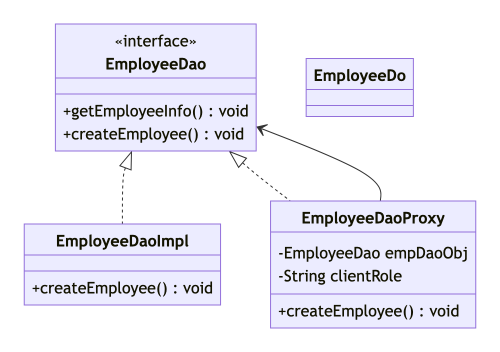
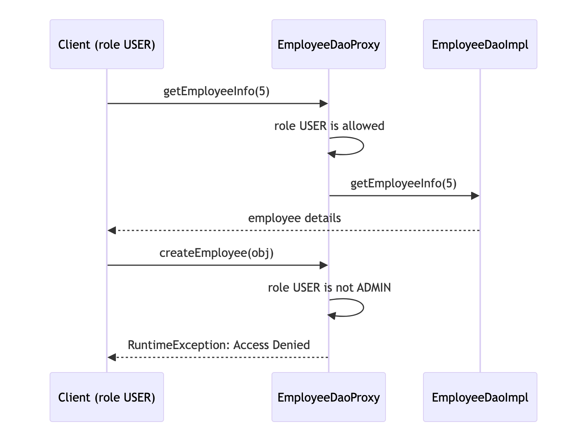

# Proxy Pattern (LLD #13)

<!-- nav -->
⬅ [12 HashMap Internal Implementation](12_HashMap_Internal_Implementation_Notes.md) · [Index](00_LLD_Index.md) · [14 BookMyShow](14_BookMyShow_Notes.md) ➡
<!-- nav -->

Sources: [Proxy PDF](https://drive.google.com/file/d/1S0fRkyGAmhGupC02Xqi6YEfMmeaBxi_K/view?usp=drive_link) · [Code on GitLab](https://gitlab.com/shrayansh8/lld-lowleveldesign/-/tree/main/src/main/java/com/conceptcoding/structuralpatterns/proxy)

## In simple words
**Proxy** puts a **stand-in object** in front of the real one, with the **same interface**. The client talks to the proxy as if it were the real thing, and the proxy decides what to do: check permissions, delay creation, cache results, log calls, or forward the request.

Think of a receptionist or a security guard: you don't walk straight into the manager's office; the guard checks who you are and lets you in or turns you away.

## The problem it solves
An `EmployeeDao` can read, create, update and delete employees. Not everyone should be allowed to do everything: a normal user may read, only an admin may create. Putting `if (role == ADMIN)` checks inside the real DAO mixes security with data access and repeats everywhere.

## The solution
- **Subject interface** – `EmployeeDao` (`getEmployeeInfo`, `createEmployee`, ...).
- **Real subject** – `EmployeeDaoImpl`: does the actual work.
- **Proxy** – `EmployeeDaoProxy`: has the same interface, **holds** the real DAO and the caller's role. For each call it checks the role, then either forwards to the real DAO or throws "Access Denied".

**Employee DAO with a protection proxy**



**allowed and denied**



*The proxy guards the real object*

```java
    public void createEmployee(EmployeeDo obj) {
        if (clientRole.equals("ADMIN")) {
            empDaoObj.createEmployee(obj);
        } else {
            throw new RuntimeException("Access Denied");
        }
    }
}
```

## Kinds of proxy
| Type | What it does | Example |
|---|---|---|
| **Protection proxy** | checks access rights | this note |
| **Virtual proxy** | delays creating a heavy object until first use | lazy-loaded images |
| **Remote proxy** | represents an object on another machine | RPC stubs, REST clients |
| **Caching proxy** | stores results to avoid repeating work | CDN, query cache |
| **Logging / smart proxy** | records or counts calls | Spring AOP, `@Transactional` |

## When to use
- You need access control, lazy loading, caching, logging or remote access *without changing the real class*.

## Pros and cons
- ✅ The client doesn't change; the real class stays focused (Single Responsibility).
- ✅ Can control the lifecycle of the real object.
- ❌ An extra layer adds a little delay and more classes.

**Related:** Proxy and **Decorator** have the same shape. A decorator *adds new features* and can be stacked; a proxy *controls access* to one object it usually creates itself.

---

<!-- nav -->
⬅ [12 HashMap Internal Implementation](12_HashMap_Internal_Implementation_Notes.md) · [Index](00_LLD_Index.md) · [14 BookMyShow](14_BookMyShow_Notes.md) ➡
<!-- nav -->
