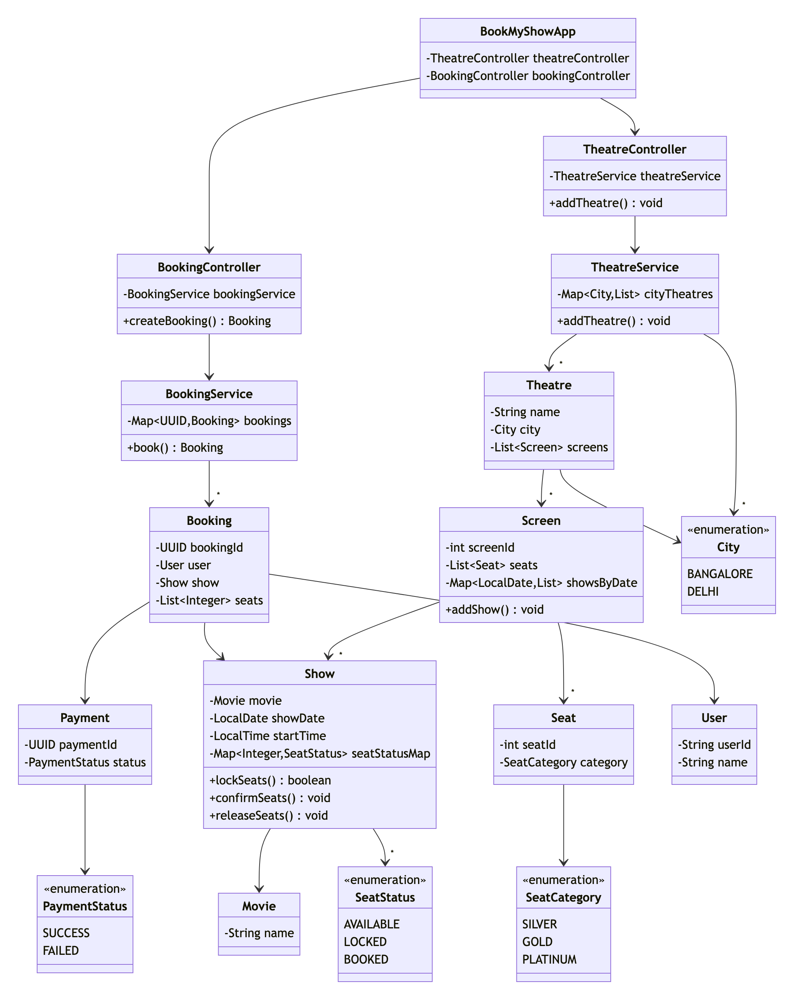
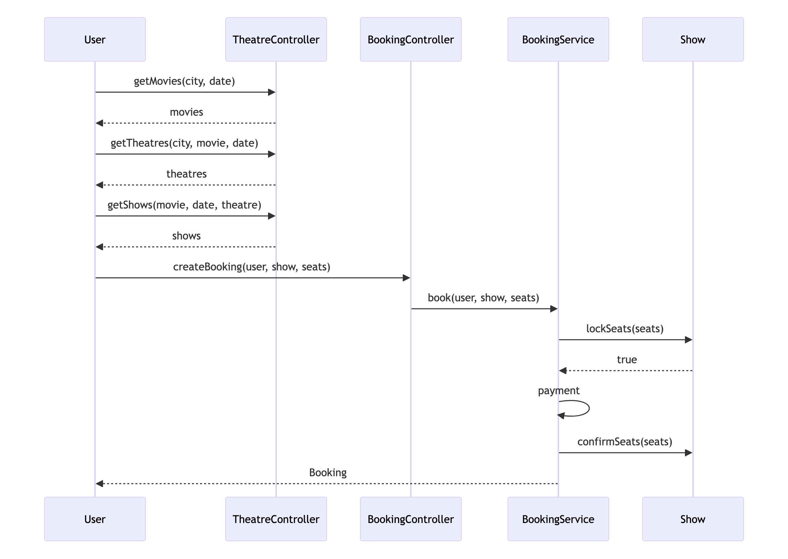
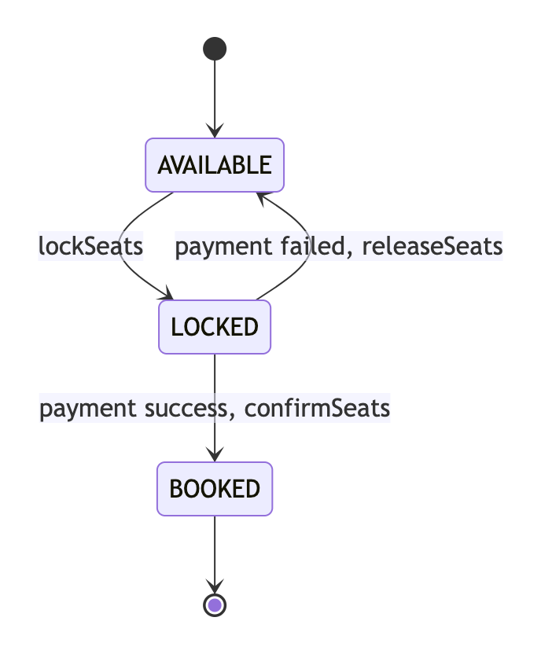
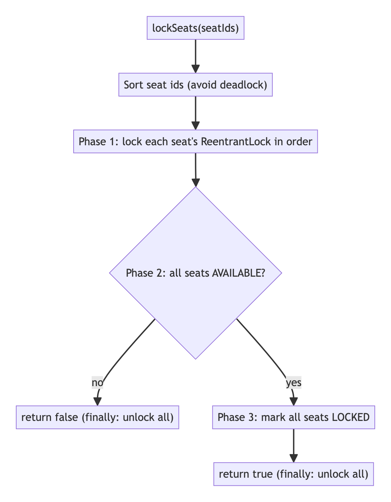

# Design BookMyShow – Movie Ticket Booking (LLD #14)

<!-- nav -->
⬅ [13 Proxy Pattern](13_Proxy_Pattern_Notes.md) · [Index](00_LLD_Index.md) · [15 Null Object Pattern](15_Null_Object_Pattern_Notes.md) ➡
<!-- nav -->

Sources: [BookMyShow PDF](https://drive.google.com/file/d/1XbWo8m1hOOdKGww0UO1x3zIskdQjqf2i/view?usp=drive_link) · [Code on GitLab](https://gitlab.com/shrayansh8/lld-lowleveldesign/-/tree/main/src/main/java/com/conceptcoding/interviewquestions/book_my_show?ref_type=heads)

## The problem
Design a movie ticket booking app. A user chooses a **city**, a **movie**, a **theatre** and a **show**, picks **seats**, pays and gets a booking. The hard part: many users may try to book the *same seats* at the same moment.

## Flow
1. Pick a city, then see the movies running there on a date.
2. Pick a movie and see the theatres that show it, then the shows (screen and time).
3. Pick seats for that show. The seats must be **held** while the user pays.
4. Payment succeeds → seats become **booked**, a booking is created. If payment fails → seats are **released**.

## Step 1 – Objects
| Object | Job |
|---|---|
| `City` (enum), `Theatre` | a theatre belongs to a city and has several screens |
| `Screen` | has seats and a map of shows by date (`showsByDate`) |
| `Seat`, `SeatCategory` | `SILVER`, `GOLD`, `PLATINUM` |
| `Movie` | the movie |
| `Show` | a movie on a screen at a date and time. It holds **`seatStatusMap`** (`AVAILABLE`, `LOCKED`, `BOOKED`) and **a lock per seat** |
| `User`, `Booking`, `Payment`, `PaymentStatus` | the booking record |
| `TheatreController` → `TheatreService` | search: movies by city, theatres by movie, shows by theatre |
| `BookingController` → `BookingService` | booking and payment flow |

Note the **Controller → Service** layering: controllers are the entry points; services hold the logic.

## Step 2 – Class diagram

**Diagram – BookMyShow**



## Step 3 – Browse and book



## Step 4 – Seat state



## Step 5 – Concurrency: booking the same seat twice
`Show.lockSeats(seatIds)` must be **all-or-nothing**: either every requested seat is locked for this user or none is. It works in four phases:
1. **Sort** the seat ids, then **acquire every seat's lock in that order**. A fixed order prevents **deadlock** (two users asking for seats A,B and B,A would otherwise each hold one lock and wait forever).
2. **Validate:** if any seat is not `AVAILABLE`, return `false`.
3. **Mark** all seats `LOCKED`.
4. **Release** the per-seat locks in `finally`.



*Atomic multi-seat locking*

```java
public boolean lockSeats(List<Integer> seatIds) {
    List<Integer> sorted = new ArrayList<>(seatIds);

    //sorting i am doing to avoid deadlock scenario
    Collections.sort(sorted);

    List<ReentrantLock> acquiredLocks = new ArrayList<>();

    try {
        // Phase 1: acquire all locks
        for (int seatId : sorted) {
            ReentrantLock lock = seatLocks.get(seatId);
            lock.lock();
            acquiredLocks.add(lock);
        }

        // Phase 2: validate availability
        for (int seatId : sorted) {
            if (seatStatusMap.get(seatId) != SeatStatus.AVAILABLE) {
                return false;
            }
        }

        // Phase 3: mark LOCKED
        for (int seatId : sorted) {
            seatStatusMap.put(seatId, SeatStatus.LOCKED);
        }

        return true;

    } finally {
        // Phase 4: release locks
        for (ReentrantLock lock : acquiredLocks) {
            lock.unlock();
        }
    }
```

Then the booking service finishes the transaction:

*Lock, pay, confirm (or release)*

```java
public Booking book(User user, Show show, List<Integer> seats) {

    if (!show.lockSeats(seats)) {
        throw new RuntimeException("Seat unavailable");
    }

    //simulated payment flow here, we can invoke Pay method of Payment Controller
    Payment payment = new Payment(PaymentStatus.SUCCESS);

    if (payment.getStatus() == PaymentStatus.SUCCESS) {
        show.confirmSeats(seats);
        Booking booking =  new Booking(user, show, seats, payment);
        bookings.put(booking.getBookingId(), booking);
        return booking;
    } else {
        show.releaseSeats(seats);
        throw new RuntimeException("Payment failed");
    }
}
```

## Design points to mention
- The **LOCKED** state is a temporary hold. In a real system the lock has a **time-out** (for example 10 minutes), after which a scheduler releases the seats if payment never arrives.
- **Per-seat locks** (not a lock on the whole show) mean different users booking different seats don't block each other.
- **Extensions:** pricing by `SeatCategory`, a pluggable payment gateway ([Payment Gateway note](42_Payment_Gateway_Notes.md)), cancellation and refund, seat-selection notifications, search filters.

---

<!-- nav -->
⬅ [13 Proxy Pattern](13_Proxy_Pattern_Notes.md) · [Index](00_LLD_Index.md) · [15 Null Object Pattern](15_Null_Object_Pattern_Notes.md) ➡
<!-- nav -->
