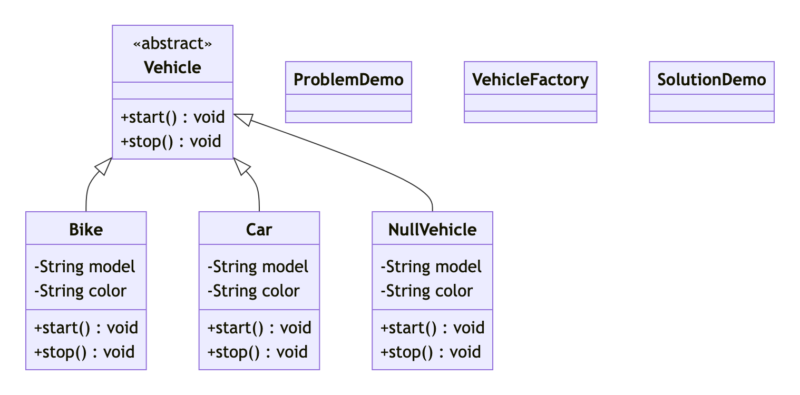
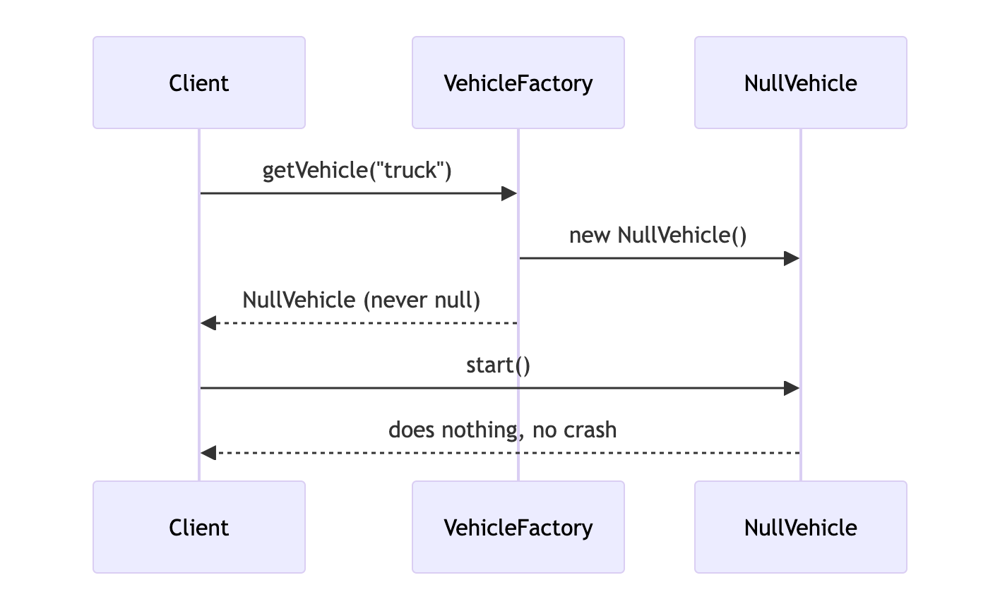

# Null Object Pattern (LLD #15)

<!-- nav -->
⬅ [14 BookMyShow](14_BookMyShow_Notes.md) · [Index](00_LLD_Index.md) · [16 Vending Machine State Pattern](16_Vending_Machine_State_Pattern_Notes.md) ➡
<!-- nav -->

Sources: [Null Object PDF](https://drive.google.com/file/d/1LUQFI4vDRn6mAsgmDMVCO4lmOXX50dDc/view?usp=drive_link) · [Code on GitLab](https://gitlab.com/shrayansh8/lld-lowleveldesign/-/tree/main/src/main/java/com/conceptcoding/additionalpatterns/nullobject)

## In simple words
**Null Object** replaces a `null` return value with a **real object that does nothing** (or does something harmless). Callers can use the result straight away, without checking `if (obj != null)` everywhere, and never get a `NullPointerException`.

Think of a fire-drill dummy or an empty seat reserved for "nobody": it looks like a person for the system, but it is a safe placeholder.

## The problem it solves
`VehicleFactory.getVehicle("truck")` doesn't know "truck" and returns `null`. The caller then calls `vehicle.start()` and the program crashes. To avoid that, every caller has to write `if (vehicle != null)` before every use, and one forgotten check is a bug.

## The solution
Return a special `NullVehicle` that **extends the same `Vehicle` class** and implements every method as a harmless no-op (it may print "do nothing"). The factory's last branch returns it instead of `null`.

- **Abstract object** – `Vehicle` (`start()`, `stop()`, `testDrive()`, `printVehicleDetails()`).
- **Real objects** – `Car`, `Bike`.
- **Null object** – `NullVehicle`: default values (model "Default", seats 0) and empty behaviour.

**Diagram – Vehicles and the null vehicle**



**Diagram – asking for an unknown vehicle**



*The factory never returns null*

```java
    public static Vehicle getVehicle(String type) {
        if (type.equals("car")) {
            return new Car("Toyota", "Red", 5, 60, true);
        } else if (type.equals("bike")) {
            return new Bike("Yamaha", "Black", 60);
        } else {
            return new NullVehicle(); // THE SOLUTION
        }
    }
}
```

## When to use
- A missing object should simply mean "do nothing" or "use defaults".
- You want to remove repeated null checks.
- Examples: a no-op logger, an empty discount (0 %), a guest user, an empty list instead of `null`.

## Pros and cons
- ✅ Cleaner code, no null checks, fewer `NullPointerException`s.
- ✅ The default behaviour is defined in one place.
- ❌ It can **hide real errors**: a missing object silently does nothing.
- ❌ One more class per abstraction.

**In modern Java** you can also return `Optional<T>`, which forces callers to decide what to do when the value is absent.

---

<!-- nav -->
⬅ [14 BookMyShow](14_BookMyShow_Notes.md) · [Index](00_LLD_Index.md) · [16 Vending Machine State Pattern](16_Vending_Machine_State_Pattern_Notes.md) ➡
<!-- nav -->
