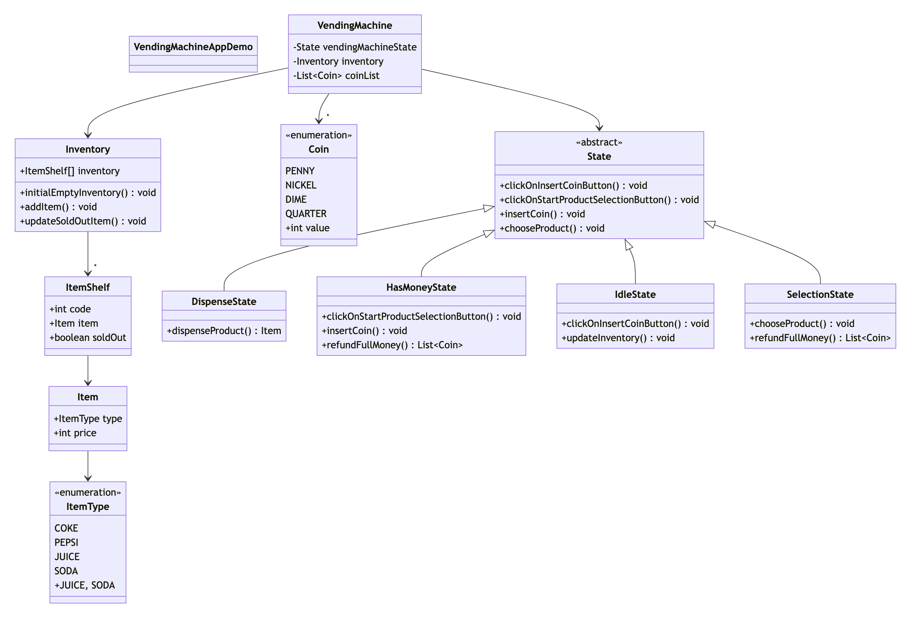
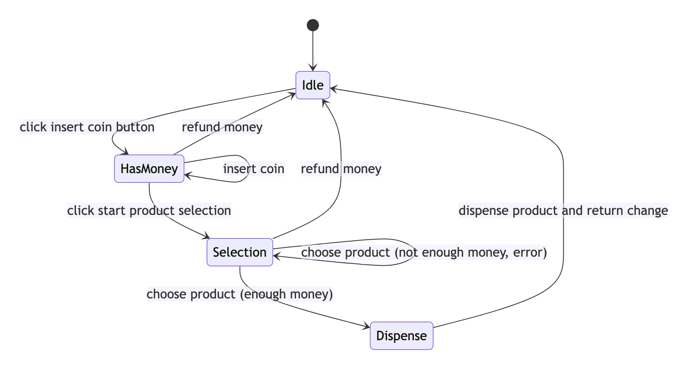
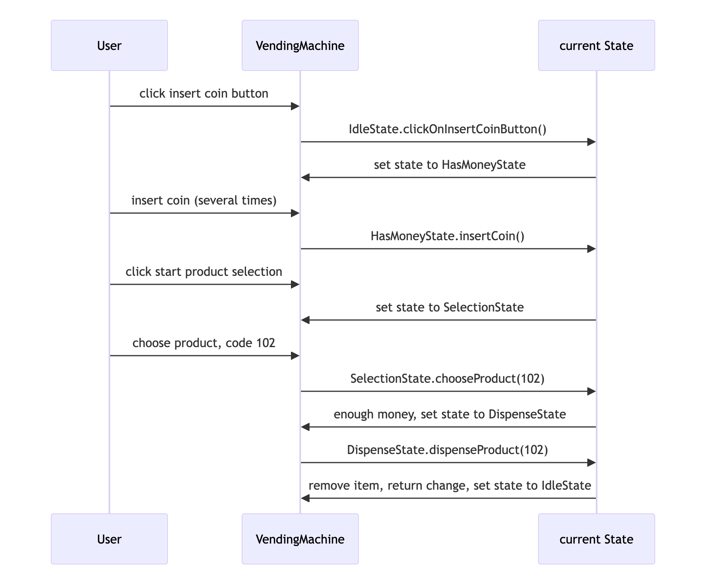

# Vending Machine – State Pattern (LLD #16)

<!-- nav -->
⬅ [15 Null Object Pattern](15_Null_Object_Pattern_Notes.md) · [Index](00_LLD_Index.md) · [17 ATM](17_ATM_Notes.md) ➡
<!-- nav -->

Sources: [State Pattern PDF](https://drive.google.com/file/d/1FDEdh2xhvlZpftC_392pml9h2lcl_q3A/view?usp=drive_link) · [Code on GitLab (state pattern)](https://gitlab.com/shrayansh8/lld-lowleveldesign/-/tree/main/src/main/java/com/conceptcoding/behavioralpatterns/state) · [Vending machine code](https://gitlab.com/shrayansh8/interviewcodingpractise)

## In simple words
**State** lets an object **change its behaviour when its internal state changes**, as if it became a different object. Instead of one class full of `if (state == X)` checks, each state is its own class that knows what to do and which state comes next.

A vending machine is the textbook example. Pressing a button does different things depending on whether the machine is *idle*, *has money*, *selecting a product* or *dispensing*.

## The problem it solves
If `VendingMachine` handles every action with `if / else` on a `state` flag (insert coin, choose product, dispense, refund), every method is full of conditions, and adding a new state edits all of them.

## The solution
- **Context** – `VendingMachine` holds the current `State`, the `Inventory` (shelves of `Item`s with a code) and the inserted coins. It *delegates* each action to the current state.
- **State (abstract / interface)** – `State` declares all the actions: `clickOnInsertCoinButton`, `insertCoin`, `clickOnStartProductSelectionButton`, `chooseProduct`, `dispenseProduct`, `refundFullMoney`, `updateInventory`. By default an action in the wrong state is **not allowed** (it throws).
- **Concrete states** – `IdleState`, `HasMoneyState`, `SelectionState`, `DispenseState`. Each implements only the actions that make sense for it and **sets the next state**.

**Vending machine with states**



**the state machine**



**buying a drink**



*A state decides the next state*

```java
public void clickOnInsertCoinButton(VendingMachine machine) throws Exception{
    machine.setVendingMachineState(new HasMoneyState());
}
```

*Choosing a product: check money, move to dispensing*

```java
public void chooseProduct(VendingMachine machine, int codeNumber) throws Exception{

    //1. get item of this codeNumber
    Item item = machine.getInventory().getItem(codeNumber);

    //2. total amount paid by User
    int paidByUser = 0;
    for(Coin coin : machine.getCoinList()){
        paidByUser = paidByUser + coin.value;
    }

    //3. compare product price and amount paid by user
    if(paidByUser < item.getPrice()) {
        System.out.println("Insufficient Amount, Product you selected is for price: " + item.getPrice() + " and you paid: " + paidByUser);
        refundFullMoney(machine);
        throw new Exception("insufficient amount");
    }
    else if(paidByUser >= item.getPrice()) {

        if(paidByUser > item.getPrice()) {
            getChange(paidByUser-item.getPrice());
        }
        machine.setVendingMachineState(new DispenseState(machine, codeNumber));
    }
```

## State vs Strategy
Both swap an object that implements an interface. The difference is *who changes it and why*:
- **Strategy:** the client picks an algorithm, and it usually stays the same.
- **State:** the object **changes its own state** as events happen, and states know about each other (the transitions).

## When to use
- An object behaves differently depending on its state, and there are many states or actions.
- Large state-based `if / switch` blocks. Examples: ATM, traffic light, order status (placed → shipped → delivered), media player, TCP connection.

## Pros and cons
- ✅ Each state's logic is in one class (Single Responsibility); new states don't change the others (Open/Closed).
- ✅ Removes big conditionals.
- ❌ Many small classes.
- ❌ Overkill for only two or three simple states.

---

<!-- nav -->
⬅ [15 Null Object Pattern](15_Null_Object_Pattern_Notes.md) · [Index](00_LLD_Index.md) · [17 ATM](17_ATM_Notes.md) ➡
<!-- nav -->
