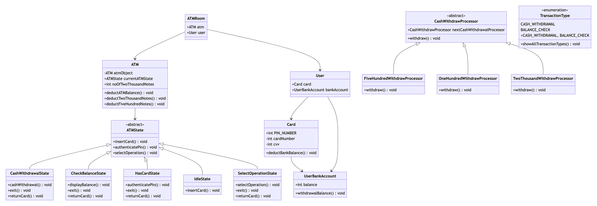
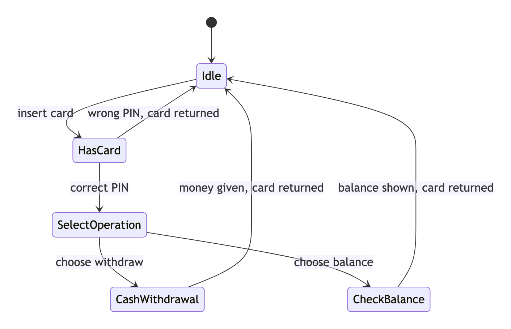
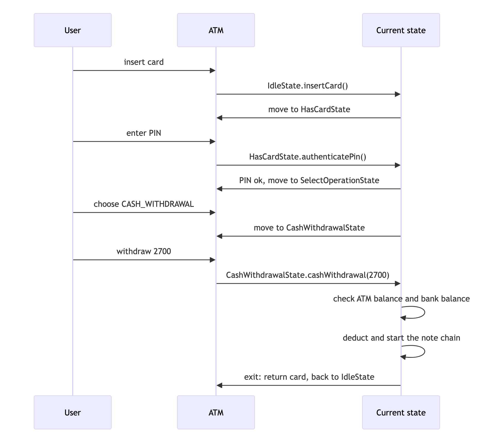
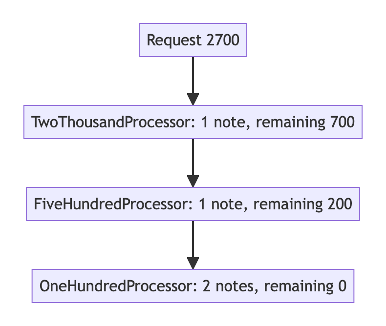

# Design an ATM (LLD #17)

<!-- nav -->
⬅ [16 Vending Machine State Pattern](16_Vending_Machine_State_Pattern_Notes.md) · [Index](00_LLD_Index.md) · [18 Chess](18_Chess_Notes.md) ➡
<!-- nav -->

Sources: [Code on GitLab (ATM)](https://gitlab.com/shrayansh8/lld-lowleveldesign/-/tree/main/src/main/java/com/conceptcoding/interviewquestions/atm?ref_type=heads) (no PDF for this topic in your links)

## The problem
Design an ATM. A user inserts a card, enters a PIN, chooses an operation (**withdraw cash** or **check balance**) and the ATM acts on it. It must also decide **which notes (₹2000, ₹500, ₹100) to hand out**.

## Requirements
- Insert card, authenticate with a PIN, select an operation, perform it, return the card.
- Withdrawal must check both the **ATM's cash** and the **user's bank balance**.
- Dispense the amount using the available notes of each denomination.
- Behaviour depends on where the machine is in the flow (a PIN can't be entered before a card is inserted).

## Step 1 – Objects
| Object | Job |
|---|---|
| `ATM` | the machine: holds its current state and the counts of ₹2000, ₹500 and ₹100 notes plus the total balance |
| `Card` | card number, PIN, expiry; linked to a `UserBankAccount` |
| `UserBankAccount` | the user's balance; `withdrawalBalance()` |
| `User` | owns a card and a bank account |
| `ATMState` (abstract) | every action the ATM supports: `insertCard`, `authenticatePin`, `selectOperation`, `cashWithdrawal`, `displayBalance`, `returnCard`, `exit` |
| `IdleState`, `HasCardState`, `SelectOperationState`, `CashWithdrawalState`, `CheckBalanceState` | one class per state |
| `CashWithdrawProcessor` chain | `TwoThousand`, `FiveHundred` and `OneHundred` processors decide the notes |
| `TransactionType` | enum: `CASH_WITHDRAWAL`, `BALANCE_CHECK` |

Two patterns do the heavy lifting: **State** (what the ATM allows right now) and **Chain of Responsibility** (counting out the notes).

## Step 2 – Class diagram

**ATM**



## Step 3 – The state machine
Each state only supports the actions that make sense. A wrong action prints an error.



## Step 4 – A cash withdrawal



*Check both balances, then hand over the work to the chain*

```java
public void cashWithdrawal(ATM atmObject, Card card, int withdrawalAmountRequest) {
    if (atmObject.getAtmBalance() < withdrawalAmountRequest) {
        System.out.println("Insufficient fund in the ATM Machine");
        exit(atmObject);
    } else if (card.getBankBalance() < withdrawalAmountRequest) {
        System.out.println("Insufficient fund in the your Bank Account");
        exit(atmObject);
    } else {
        card.deductBankBalance(withdrawalAmountRequest);
        atmObject.deductATMBalance(withdrawalAmountRequest);

        //using chain of responsibility for this logic, how many 2k Rs notes, how many 500 Rs notes etc, has to be withdrawal
        CashWithdrawProcessor withdrawProcessor =
                new TwoThousandWithdrawProcessor(new FiveHundredWithdrawProcessor(new OneHundredWithdrawProcessor(null)));

        withdrawProcessor.withdraw(atmObject, withdrawalAmountRequest);
        exit(atmObject);
    }
}
```

## Step 5 – Which notes? (Chain of Responsibility)
The chain is built as `₹2000 → ₹500 → ₹100`. Each processor takes as many notes of its value as it can, and passes the **remaining amount** to the next one.



If a denomination runs out of notes, the shortfall is pushed to the next (smaller) processor.

*Take what I can, pass the rest on*

```java
public void withdraw(ATM atm, int remainingAmount) {

    int required = remainingAmount / 2000;
    int balance = remainingAmount % 2000;

    if (required <= atm.getNoOfTwoThousandNotes()) {
        atm.deductTwoThousandNotes(required);
    } else if (required > atm.getNoOfTwoThousandNotes()) {
        atm.deductTwoThousandNotes(atm.getNoOfTwoThousandNotes());
        balance = balance + (required - atm.getNoOfTwoThousandNotes()) * 2000;
    }

    if (balance != 0) {
        super.withdraw(atm, balance);
    }
}
```

## Design points to mention
- **State pattern** removes giant `if (state == ...)` blocks: see [Vending Machine](16_Vending_Machine_State_Pattern_Notes.md), which is the same idea.
- **Chain of Responsibility** makes it easy to add a ₹200 note: add one more processor to the chain ([pattern note](10_Chain_of_Responsibility_Notes.md)).
- **Extensions:** deposits, PIN change, daily limit, transaction history, a real bank service (the account lookup would move behind an interface), concurrency control on the cash counters.

---

<!-- nav -->
⬅ [16 Vending Machine State Pattern](16_Vending_Machine_State_Pattern_Notes.md) · [Index](00_LLD_Index.md) · [18 Chess](18_Chess_Notes.md) ➡
<!-- nav -->
