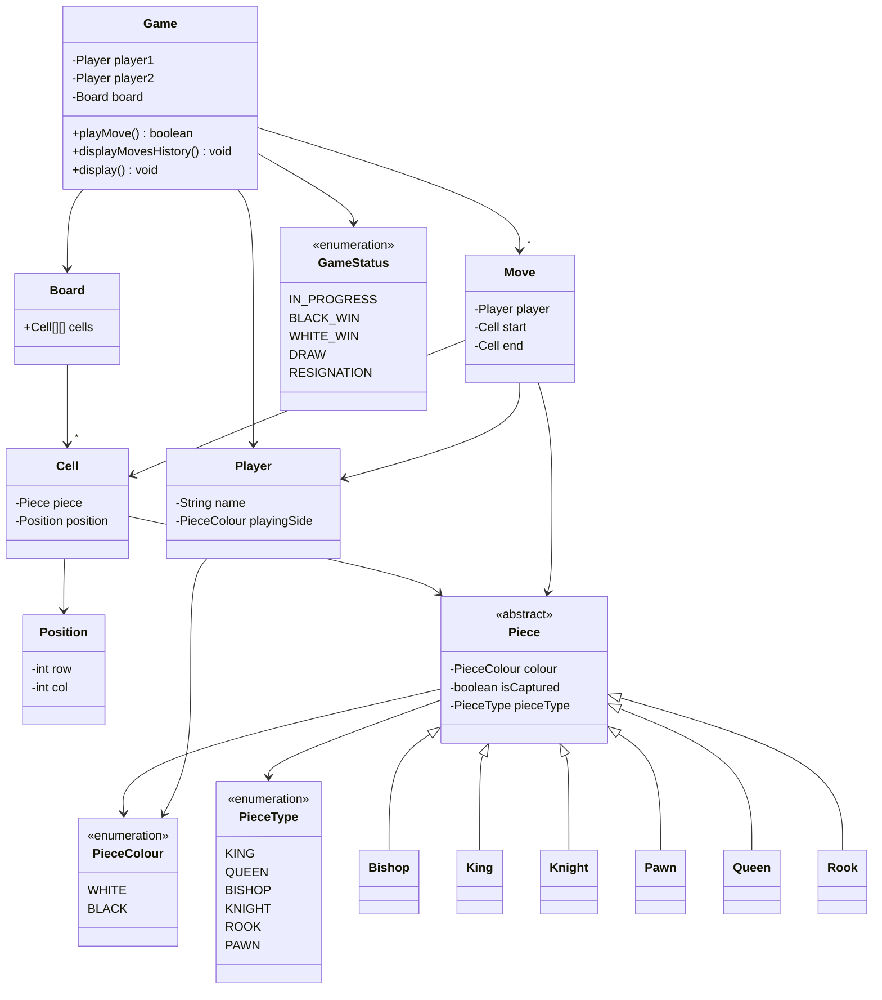
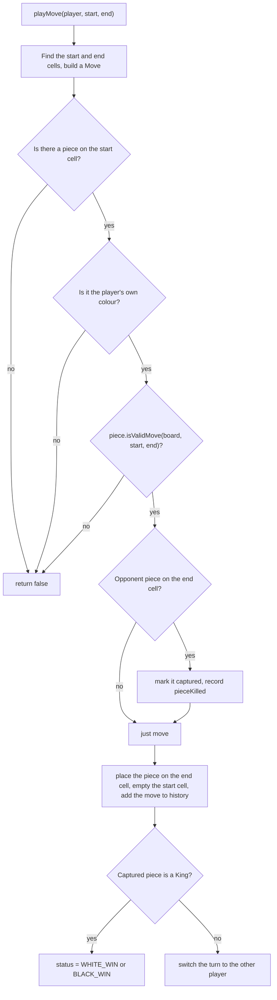
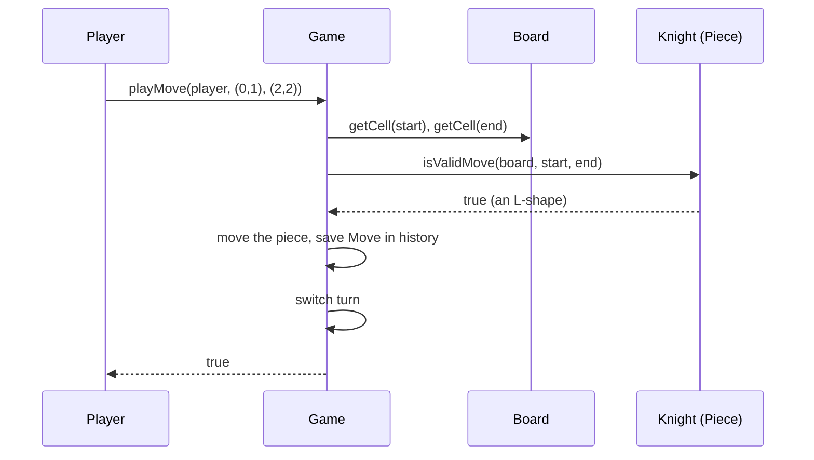

# Design Chess (LLD #18)

<!-- nav -->
⬅ [17 ATM](17_ATM_Notes.md) · [Index](00_LLD_Index.md) · [19 Composite File System](19_Composite_File_System_Notes.md) ➡
<!-- nav -->

Sources: [Code on GitLab (Chess mock interview)](https://gitlab.com/shrayansh8/lld-lowleveldesign/-/tree/main/src/main/java/com/conceptcoding/interviewquestions/chess?ref_type=heads) (no PDF for this topic in your links)

## The problem
Design a two-player chess game: an 8×8 board, six kinds of pieces with different movement rules, turns that alternate between White and Black, captures, and a result.

## Requirements
- 8×8 board with the standard starting position.
- Pieces: **King, Queen, Rook, Bishop, Knight, Pawn**, each in White or Black, each with its own movement rule.
- Players alternate; a move is rejected if it is invalid.
- Capturing removes the opponent's piece; the game keeps a **moves history**.
- The game ends when the king is captured (checkmate in this simplified version), with statuses `IN_PROGRESS`, `WHITE_WIN`, `BLACK_WIN`, `DRAW`, `RESIGNATION`.

## Step 1 – Objects
| Object | Job |
|---|---|
| `Piece` (abstract) | colour, `isCaptured`, `PieceType`, and the abstract method **`isValidMove(board, start, end)`** |
| `King`, `Queen`, `Rook`, `Bishop`, `Knight`, `Pawn` | each implements its own movement rule |
| `Position` | row and column |
| `Cell` | a square: a `Position` and an optional `Piece` |
| `Board` | an 8×8 grid of cells; `initPieces()` sets the start position |
| `Player` | name and side (`PieceColour`) |
| `Move` | who moved, start and end cell, piece moved, piece killed |
| `Game` | players, board, whose turn it is, status, moves history |
| Enums | `PieceColour`, `PieceType`, `GameStatus` |

## Step 2 – Class diagram

**Diagram – Chess**



## Step 3 – Playing a move





*Validate with the piece, then move*

```java
private boolean makeMove(Move move, Player player) {
    Piece startPiece = move.getStart().getPiece();
    Piece endPiece = move.getEnd().getPiece();

    if (startPiece == null) return false;
    if (startPiece.getColour() != player.getPlayingSide()) return false;
    if (!startPiece.isValidMove(board, move.getStart(), move.getEnd())) return false;

    if (endPiece != null) {
        endPiece.setCaptured(true);
        move.setPieceKilled(endPiece);
    }

    move.setPieceMoved(startPiece);
    move.getEnd().setPiece(startPiece);
    move.getStart().setPiece(null);

    this.movesHistory.add(move);

    if (endPiece instanceof King) {
```

## Step 4 – Each piece knows its own rule (polymorphism)
`Game` doesn't contain a giant `switch (pieceType)`. It just calls `piece.isValidMove(...)`, and each subclass answers for itself. For example, the Knight moves in an **L-shape**: two squares in one direction and one in the other (`rowDiff == 2 && colDiff == 1`, or the reverse), and it may not land on a piece of its own colour.

*Knight: an L-shaped move*

```java
public boolean isValidMove(Board board, Cell start, Cell end) {
    if (start.equals(end)) return false;

    // If the target cell has piece of same colour, then it is invalid move
    if (end.getPiece() != null && end.getPiece().getColour() == start.getPiece().getColour()) return false;

    // If the target cell is not L shape to the start cell, then it is invalid move
    int rowDiff = Math.abs(end.getPosition().getRow() - start.getPosition().getRow());
    int colDiff = Math.abs(end.getPosition().getCol() - start.getPosition().getCol());

    if ((rowDiff == 2 && colDiff == 1) || (rowDiff == 1 && colDiff == 2)) {
        Piece targetPiece = board.getCell(end.getPosition()).getPiece();
        return (targetPiece == null) || targetPiece.getColour() != start.getPiece().getColour();
    }
    return false;
}
```

| Piece | Rule (summary) |
|---|---|
| Rook | straight lines, any distance, path must be clear |
| Bishop | diagonals, any distance, path must be clear |
| Queen | rook + bishop |
| King | one square in any direction |
| Knight | L-shape, can jump over pieces |
| Pawn | forward one (two on its first move), captures diagonally |

## Design points to mention
- **Polymorphism instead of `if/else`:** a new piece type (for a chess variant) is a new subclass ([Open/Closed](01_SOLID_Principles_Notes.md)).
- **`Move` objects** give you a **history** and make **undo** possible ([Command](31_Command_Undo_Redo_Notes.md)).
- **Simplifications to discuss:** real check and checkmate detection, castling, en passant, pawn promotion, stalemate, a draw by repetition.
- **Extensions:** a clock per player, an AI player, saving and loading a game, a different board for another game (checkers).

---

<!-- nav -->
⬅ [17 ATM](17_ATM_Notes.md) · [Index](00_LLD_Index.md) · [19 Composite File System](19_Composite_File_System_Notes.md) ➡
<!-- nav -->
