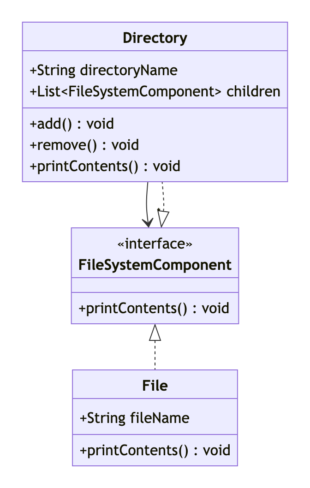
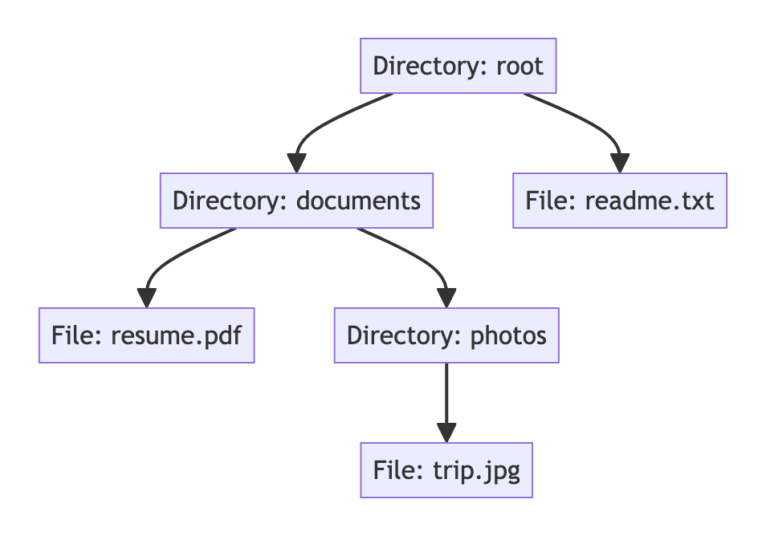
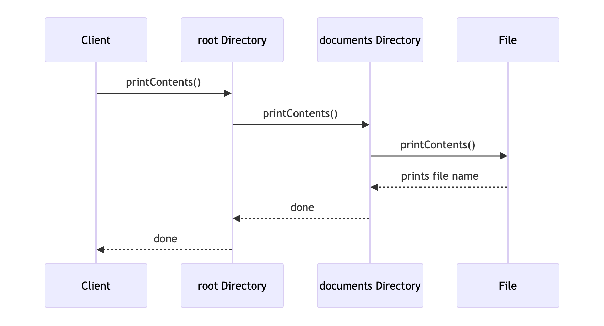
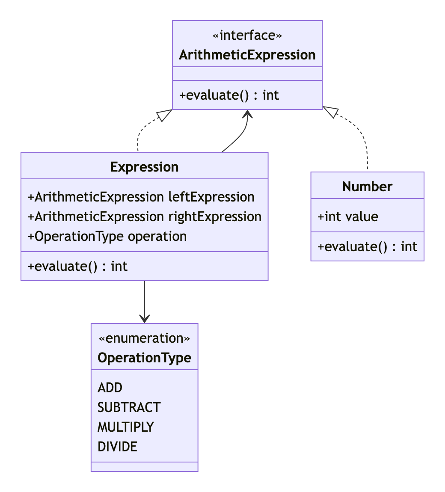

# Composite Pattern – File System (LLD #19)

<!-- nav -->
⬅ [18 Chess](18_Chess_Notes.md) · [Index](00_LLD_Index.md) · [20 Adapter Pattern](20_Adapter_Pattern_Notes.md) ➡
<!-- nav -->

Sources: [Composite PDF](https://drive.google.com/file/d/1FIBgNSJY-YkZYJO7WIKsY_io6tVIBkCa/view?usp=drive_link) · [Code on GitLab](https://gitlab.com/shrayansh8/lld-lowleveldesign/-/tree/main/src/main/java/com/conceptcoding/structuralpatterns/composite)

## In simple words
**Composite** lets you treat **a single object and a group of objects in the same way**. It is for tree structures: a folder contains files and other folders, and you can ask any of them to do the same thing (for example "show your contents") without caring which kind it is.

Think of folders on your computer: you can delete a file or delete a folder (with everything inside), and you use the same command.

## The problem it solves
A file system has `File`s and `Directory`s. A directory holds files and other directories, nested to any depth. Without the pattern the client needs `if (item is File) ... else loop over children ...` everywhere, and the code gets messy as nesting grows.

## The solution
- **Component** – `FileSystemComponent` interface with `printContents()`.
- **Leaf** – `File`: does the work itself.
- **Composite** – `Directory`: holds a list of `FileSystemComponent` children and **forwards** the call to each of them. `add()` and `remove()` manage the children.

Because a `Directory` is itself a `FileSystemComponent`, directories can contain directories.

**Diagram – File system**



**Diagram – a sample tree**





*The composite loops over its children*

```java
    public void printContents() {
        System.out.println("Directory Name: " + directoryName);
        for (FileSystemComponent child : children) {
            child.printContents();
        }
    }
}
```

## Second example: math expressions
`Number` (leaf) and `Expression` (composite with a left side, a right side and an operation) both implement `ArithmeticExpression.evaluate()`. An expression can contain numbers *or other expressions*, so `(2 + 3) * 4` becomes a tree and one call to `evaluate()` computes it.

**Diagram – Math expression tree**



## When to use
- Data is naturally a tree (folders, menus, organisation charts, UI components, expressions).
- The client should treat leaves and groups uniformly.

## Pros and cons
- ✅ Simple client code; easy to add new component types.
- ✅ Works recursively to any depth.
- ❌ Hard to restrict what a composite may contain; the common interface can become too general (a `File` has no real `add()`).

---

<!-- nav -->
⬅ [18 Chess](18_Chess_Notes.md) · [Index](00_LLD_Index.md) · [20 Adapter Pattern](20_Adapter_Pattern_Notes.md) ➡
<!-- nav -->
