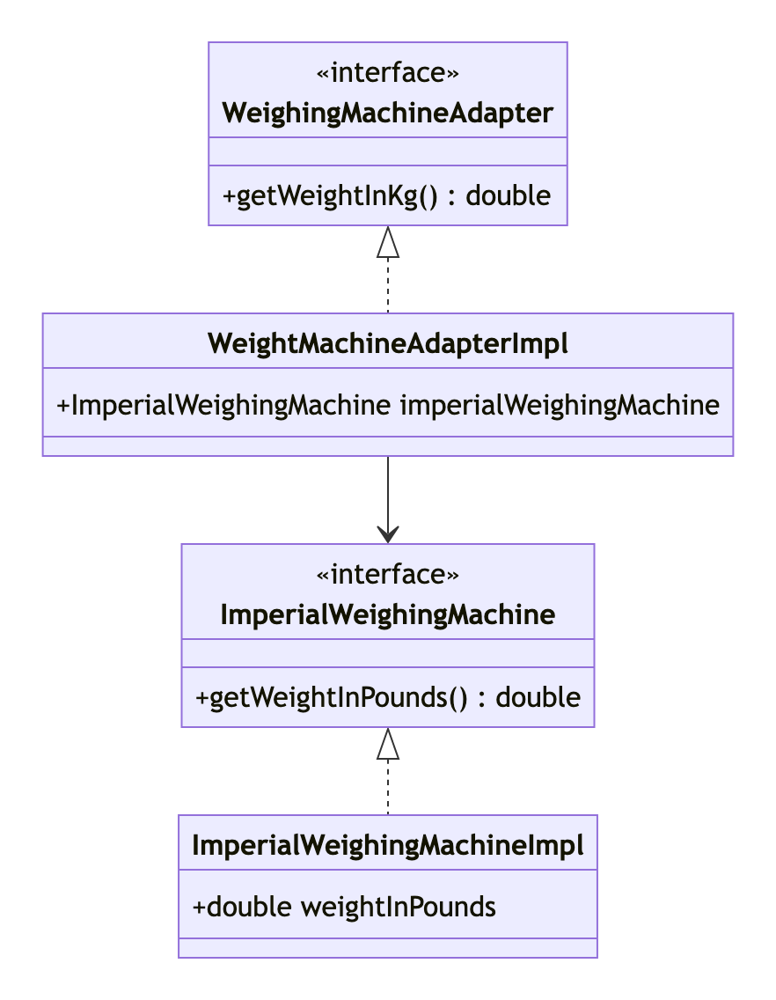
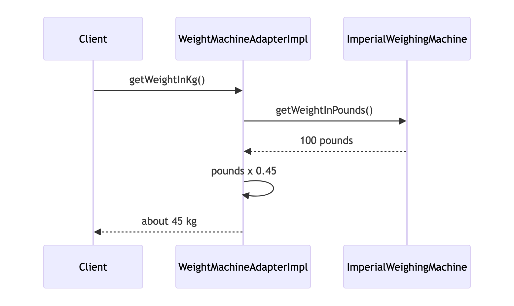

# Adapter Pattern (LLD #20)

<!-- nav -->
⬅ [19 Composite File System](19_Composite_File_System_Notes.md) · [Index](00_LLD_Index.md) · [21 Splitwise](21_Splitwise_Notes.md) ➡
<!-- nav -->

Sources: [Adapter PDF](https://drive.google.com/file/d/1BKx6HITzyw-c1RjX4372aH_L4b1-5S1w/view?usp=drive_link) · [Code on GitLab](https://gitlab.com/shrayansh8/lld-lowleveldesign/-/tree/main/src/main/java/com/conceptcoding/structuralpatterns/adapter)

## In simple words
**Adapter** makes two things with **incompatible interfaces** work together by putting a converter between them. It translates calls from the interface your code expects into the interface the existing class actually has.

Think of a travel plug adapter: your laptop charger has one plug shape, the foreign wall socket has another, and the adapter sits in between and doesn't change either.

## The problem it solves
Your app expects a weighing machine that returns **kilograms**. A supplier gives you a machine that returns **pounds**, and you can't (or shouldn't) edit its code. Changing your whole app to pounds is worse.

## The solution
- **Target interface** – `WeighingMachineAdapter` with `getWeightInKg()` (what your code wants).
- **Adaptee** – `ImperialWeighingMachine` / `ImperialWeighingMachineImpl` with `getWeightInPounds()` (the existing class).
- **Adapter** – `WeightMachineAdapterImpl` implements the target, **holds** the adaptee, and converts pounds to kilograms.
- The **client** only ever talks to the target interface.

**Weighing machine adapter**



**a call through the adapter**



*The conversion lives in the adapter*

```java
    public double getWeightInKg() {
        double weightInPound = imperialWeighingMachine.getWeightInPounds();
        // Conversion formula: 1 pound = 0.453592 kg
        return weightInPound * 0.45;
    }
}
```

## When to use
- You want to reuse an existing class whose interface doesn't match.
- You integrate a third-party library or legacy system.
- Examples: payment gateway wrappers, converting XML to JSON, `InputStreamReader` (bytes to characters).

## Pros and cons
- ✅ Single Responsibility: conversion code is in one place.
- ✅ Open/Closed: add adapters without changing client or adaptee.
- ❌ One more class (and one more call) per adapter.

**Related:** Adapter *changes* an interface; **Decorator** keeps the interface and *adds* behaviour; **Facade** *simplifies* a whole subsystem; **Proxy** keeps the interface and *controls access*.

---

<!-- nav -->
⬅ [19 Composite File System](19_Composite_File_System_Notes.md) · [Index](00_LLD_Index.md) · [21 Splitwise](21_Splitwise_Notes.md) ➡
<!-- nav -->
