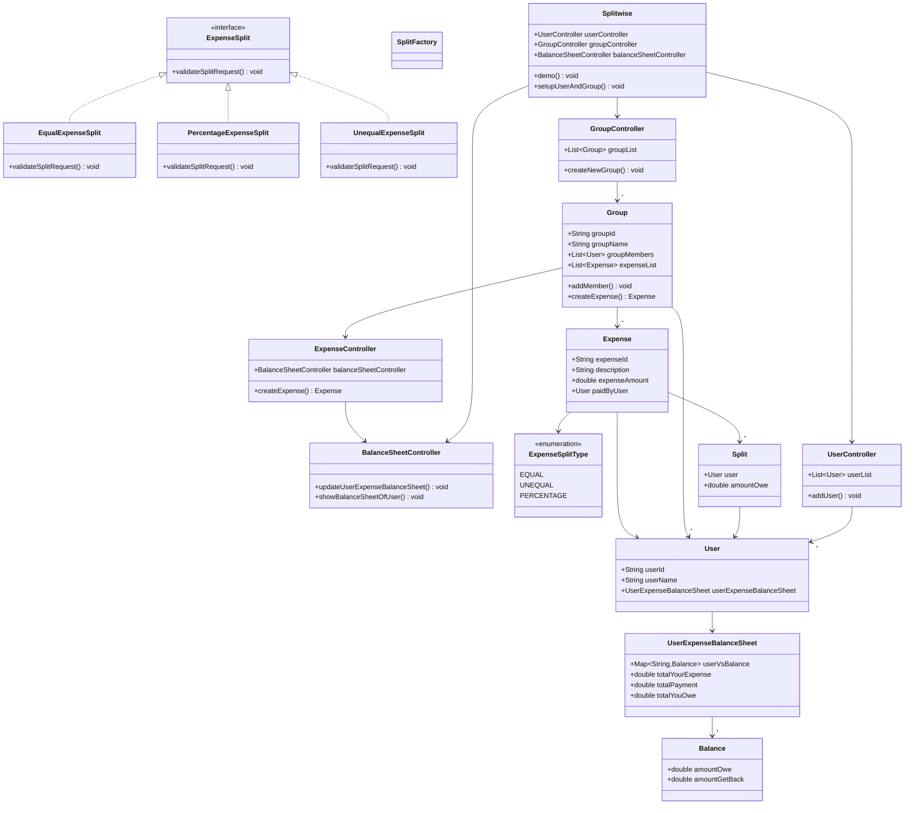
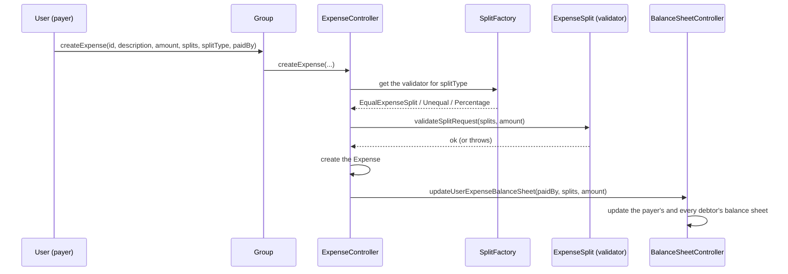
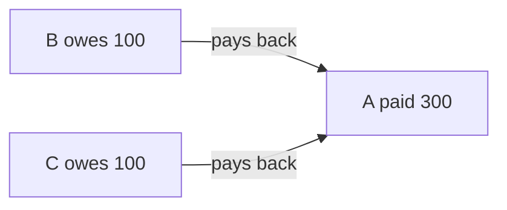

# Design Splitwise (LLD #21)

<!-- nav -->
⬅ [20 Adapter Pattern](20_Adapter_Pattern_Notes.md) · [Index](00_LLD_Index.md) · [23 Builder Pattern](23_Builder_Pattern_Notes.md) ➡
<!-- nav -->

Sources: [Code on GitLab (Splitwise)](https://gitlab.com/shrayansh8/lld-lowleveldesign/-/tree/main/src/main/java/com/conceptcoding/interviewquestions/splitwise?ref_type=heads) (no PDF for this topic in your links)

## The problem
Design an app where friends share expenses. Someone pays a bill, the app splits it among the people involved and always shows **who owes whom and how much**.

## Requirements
- Users and **groups** of users.
- A user adds an **expense** to a group: the amount, who paid, and how it is split.
- Split types: **EQUAL**, **UNEQUAL** (exact amounts) and **PERCENTAGE**.
- The split must be **validated** (for example, the exact amounts must add up to the total, and percentages to 100).
- Each user has a **balance sheet**: how much they paid, owe, and get back, and the balance with each other user.

## Step 1 – Objects
| Object | Job |
|---|---|
| `User`, `UserController` | a person; each has a `UserExpenseBalanceSheet` |
| `Group`, `GroupController` | members and the list of expenses; creates expenses |
| `Expense` | id, description, amount, who paid, split type and the list of `Split`s |
| `Split` | one person's share (`user`, `amountOwe`) |
| `ExpenseSplit` (interface) with `EqualExpenseSplit`, `UnequalExpenseSplit`, `PercentageExpenseSplit` | **validate** a split request (strategy) |
| `SplitFactory` | returns the right `ExpenseSplit` for an `ExpenseSplitType` (factory) |
| `ExpenseController` | creates the expense and updates balances |
| `BalanceSheetController` | updates each person's balance sheet; shows it |
| `UserExpenseBalanceSheet`, `Balance` | per user: total expense, total paid, total owed, total to get back, and a map of user to balance (`amountOwe`, `amountGetBack`) |
| `Splitwise` | the app entry point |

## Step 2 – Class diagram

**Diagram – Splitwise**



## Step 3 – Adding an expense



## Step 4 – Updating balances (a worked example)
A paid ₹300 for dinner, split equally between A, B and C (₹100 each).

| User | What changes |
|---|---|
| **A** (paid) | total payment +300; **gets back** +100 from B and +100 from C; own expense +100 |
| **B** | **owes** A +100; own expense +100 |
| **C** | **owes** A +100; own expense +100 |



For each split, the controller updates **both sides**: the payer's `amountGetBack` against the debtor, and the debtor's `amountOwe` against the payer. A person's own share is only added to their personal expense total.

*Updating the payer and each debtor*

```java
public void updateUserExpenseBalanceSheet(User expensePaidBy, List<Split> splits, double totalExpenseAmount) {

    //update the total amount paid of the expense paid by user
    UserExpenseBalanceSheet paidByUserExpenseSheet = expensePaidBy.getUserExpenseBalanceSheet();
    paidByUserExpenseSheet.setTotalPayment(paidByUserExpenseSheet.getTotalPayment() + totalExpenseAmount);

    for (Split split : splits) {

        User userOwe = split.getUser();
        UserExpenseBalanceSheet oweUserExpenseSheet = userOwe.getUserExpenseBalanceSheet();
        double oweAmount = split.getAmountOwe();

        if (expensePaidBy.getUserId().equals(userOwe.getUserId())) {
            paidByUserExpenseSheet.setTotalYourExpense(paidByUserExpenseSheet.getTotalYourExpense() + oweAmount);
        } else {

            //update the balance of paid user
            paidByUserExpenseSheet.setTotalYouGetBack(paidByUserExpenseSheet.getTotalYouGetBack() + oweAmount);

            Balance userOweBalance;
            if (paidByUserExpenseSheet.getUserVsBalance().containsKey(userOwe.getUserId())) {

                userOweBalance = paidByUserExpenseSheet.getUserVsBalance().get(userOwe.getUserId());
            } else {
```

## Step 5 – Split strategies and the factory
Each split type validates differently. A new type (say "by shares") is a new class, and the factory returns the right one ([Strategy](02_Strategy_Pattern_Notes.md) + [Factory](05_Factory_Method_Notes.md)).

| Type | Validation |
|---|---|
| `EQUAL` | shares are the total divided equally |
| `UNEQUAL` | the exact amounts must add up to the total |
| `PERCENTAGE` | percentages must add up to 100 |

*In the repository the equal-split check compares each share with total / number of people (it only marks where to throw); the unequal and percentage validators are left as stubs for you to fill in.*

## Design points to mention
- **Controllers** coordinate; **entities** hold data (`User`, `Expense`, `Split`).
- **Simplify debts:** an extension is to reduce the number of payments (if A owes B and B owes C, A can pay C). This is a graph problem on net balances.
- **Other extensions:** currencies, expense categories, settle-up payments, notifications, an activity feed, a history of changes.
- Money is stored as `double` here for simplicity; real systems use `BigDecimal` or integer paise to avoid rounding errors.

---

<!-- nav -->
⬅ [20 Adapter Pattern](20_Adapter_Pattern_Notes.md) · [Index](00_LLD_Index.md) · [23 Builder Pattern](23_Builder_Pattern_Notes.md) ➡
<!-- nav -->
