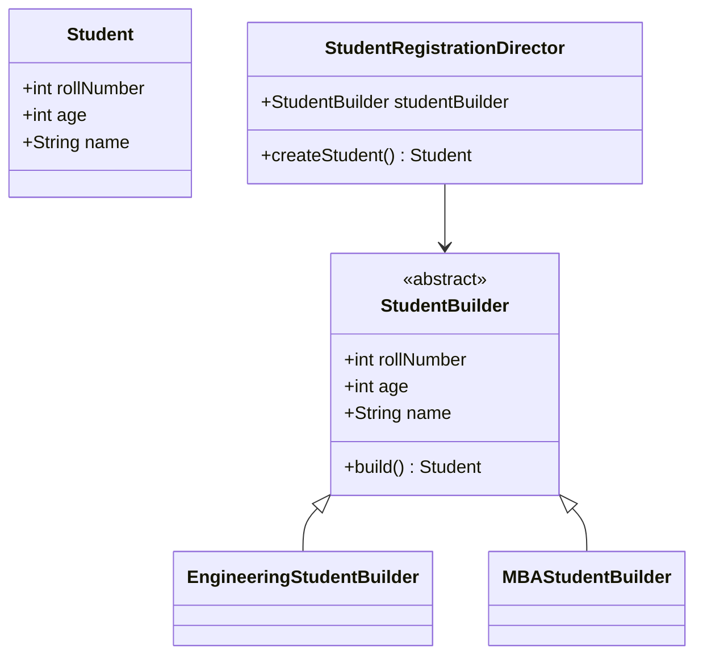
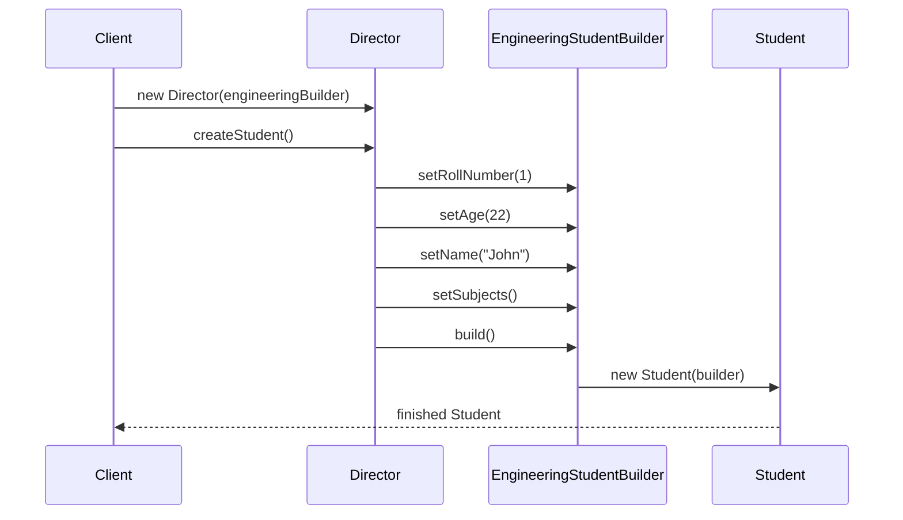

# Builder Pattern (LLD #23)

<!-- nav -->
⬅ [21 Splitwise](21_Splitwise_Notes.md) · [Index](00_LLD_Index.md) · [24 Cricbuzz](24_Cricbuzz_Notes.md) ➡
<!-- nav -->

Sources: [Builder PDF](https://drive.google.com/file/d/1V5qnfvYpNiEzb3bu9221HMD8QDaTkVC9/view?usp=drive_link) · [Code on GitLab](https://gitlab.com/shrayansh8/lld-lowleveldesign/-/tree/main/src/main/java/com/conceptcoding/creationalpatterns/builder)

## In simple words
**Builder** creates a complex object **step by step**. Instead of a constructor with ten parameters (where you can't tell which is which), you call small, named steps (`setName`, `setAge`, ...) and finish with `build()`.

Think of ordering a custom sandwich: you pick bread, then filling, then sauce, in any order, and the shop hands you the finished sandwich.

## The problem it solves
A `Student` has many fields, and some are optional (`mobileNo`, `emailId`, `subjects`). Writing `new Student(1, 22, "John", "CSE", "Paul", "Jane", subjects, null, null)` is confusing and error-prone (the *telescoping constructor* problem). Having many constructors for each combination is worse.

## The solution
- **Product** – `Student`. Its constructor takes a builder and copies the values.
- **Builder (abstract)** – `StudentBuilder` holds the fields, has chainable setters (`setName(...)` returns the builder) and a `build()` method.
- **Concrete builders** – `EngineeringStudentBuilder` and `MBAStudentBuilder` differ in how they fill things such as `subjects`.
- **Director** (optional) – `StudentRegistrationDirector` knows the *recipe* (which steps, in which order) for a standard student.

**Diagram – Student builders**



**Diagram – building an engineering student**



*The director calls the steps in order*

```java
private Student createEngineeringStudent() {
    return studentBuilder.setRollNumber(1) // EngineeringStudentBuilder
            .setAge(22)
            .setName("John")
            .setFatherName("Paul")
            .setMotherName("Jane")
            .setBranch("Computer Science and Engineering")
            .setSubjects() // Engineering-specific method
            .build();
}
```

## When to use
- An object has many parameters, many of them optional.
- The same construction process should produce different representations (engineering vs MBA student).
- You want objects to be **immutable** once built.
- Real-life examples: Java's `StringBuilder`, Lombok's `@Builder`, building HTTP requests or SQL queries.

## Pros and cons
- ✅ Readable code: each value is named.
- ✅ No huge constructors; optional values are easy.
- ✅ Same steps, different results.
- ❌ More code (builder classes).
- ❌ The builder must be kept in sync with the product's fields.

---

<!-- nav -->
⬅ [21 Splitwise](21_Splitwise_Notes.md) · [Index](00_LLD_Index.md) · [24 Cricbuzz](24_Cricbuzz_Notes.md) ➡
<!-- nav -->
