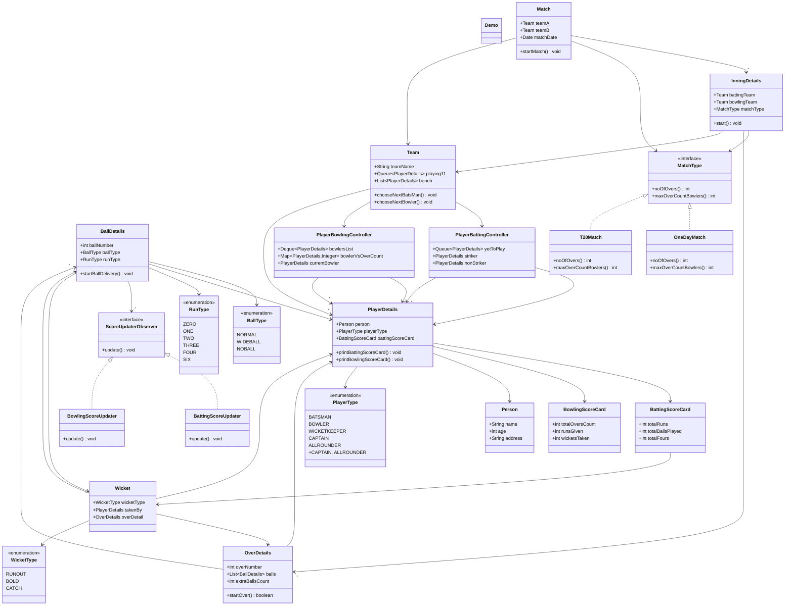
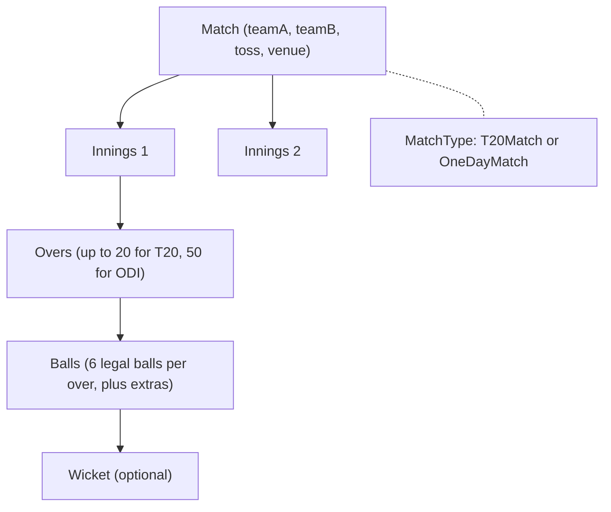
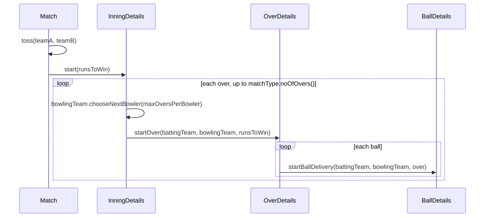
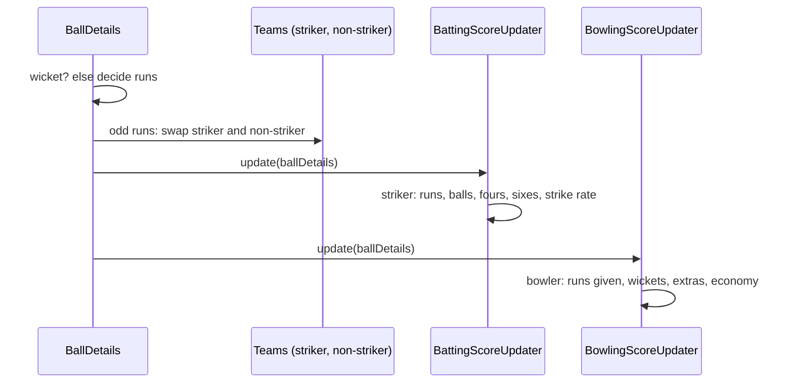

# Design Cricbuzz – a Cricket Scoreboard (LLD #24)

<!-- nav -->
⬅ [23 Builder Pattern](23_Builder_Pattern_Notes.md) · [Index](00_LLD_Index.md) · [25 Facade Pattern](25_Facade_Pattern_Notes.md) ➡
<!-- nav -->

Sources: [Code on GitLab (Cricbuzz)](https://gitlab.com/shrayansh8/lld-lowleveldesign/-/tree/main/src/main/java/com/conceptcoding/interviewquestions/cricbuzz?ref_type=heads) (no PDF for this topic in your links)

## The problem
Design the core of a cricket scoring application: teams, players, a match with innings, overs and balls, and **live scorecards** for every batsman and bowler that update after each ball.

## Requirements
- A **match** between two teams: toss, then innings.
- Match formats with different rules: **T20** (20 overs) and **One Day** (50 overs), each with a limit of overs per bowler.
- An **innings** is a list of **overs**; an over is a list of **balls**. Extras (wide, no-ball) add balls to an over.
- Each ball has an outcome: runs (0, 1, 2, 3, 4, 6) or a **wicket** (bowled, caught, run-out).
- Batting and bowling **scorecards** (runs, balls, fours, sixes, strike rate; overs, runs given, wickets, economy) update automatically.
- The strike changes after odd runs and at the end of an over; the next batsman and bowler must be chosen.

## Step 1 – Objects
| Group | Objects |
|---|---|
| People | `Person`, `PlayerDetails` (player type, batting and bowling scorecards), `PlayerType` (`BATSMAN`, `BOWLER`, `WICKETKEEPER`, `CAPTAIN`, `ALLROUNDER`) |
| Team | `Team` (playing 11, bench, striker, non-striker, current bowler), `PlayerBattingController` (queue of batsmen yet to play), `PlayerBowlingController` (bowler rotation, overs per bowler) |
| Match | `Match` (teams, venue, toss, two innings), `MatchType` interface with `T20Match` and `OneDayMatch` |
| Play | `InningDetails` → `OverDetails` → `BallDetails`, `BallType` (`NORMAL`, `WIDEBALL`, `NOBALL`), `RunType`, `Wicket`, `WicketType` |
| Scoring | `BattingScoreCard`, `BowlingScoreCard`, and the observers `BattingScoreUpdater`, `BowlingScoreUpdater` |

## Step 2 – Class diagram

**Diagram – Cricbuzz**



## Step 3 – Hierarchy of a match





## Step 4 – One ball and the scorecards (Observer pattern)
A ball decides its result (wicket or runs), changes the strike if needed, then **notifies observers**. The batting and bowling updaters each update their own scorecard, so the ball class does not know how scorecards work ([Observer pattern](03_Observer_Pattern_Notes.md)).



*A ball: outcome, strike change, notify observers*

```java
public void startBallDelivery(Team battingTeam, Team bowlingTeam, OverDetails over) {

    playedBy = battingTeam.getStriker();
    this.bowledBy = over.bowledBy;
    //THROW BALL AND GET THE BALL TYPE, assuming here that ball type is always NORMAL
    ballType = BallType.NORMAL;

    //wicket or no wicket
    if (isWicketTaken()) {
        runType = RunType.ZERO;
        //considering only BOLD
        wicket = new Wicket(WicketType.BOLD, bowlingTeam.getCurrentBowler(), over, this);
        //making only striker out for now
        battingTeam.setStriker(null);
    } else {
        runType = getRunType();

        if (runType == RunType.ONE || runType == RunType.THREE) {
            //swap striket and non striker
            PlayerDetails temp = battingTeam.getStriker();
            battingTeam.setStriker(battingTeam.getNonStriker());
            battingTeam.setNonStriker(temp);
        }
    }

    //update player scoreboard
    notifyUpdaters(this);
}

private void notifyUpdaters(BallDetails ballDetails) {
```

## Step 5 – Match formats (Strategy)
`MatchType` has `noOfOvers()` and `maxOverCountBowlers()`. `T20Match` returns 20 overs and 5 overs per bowler (as coded in the repo); `OneDayMatch` returns 50 and 10. The innings only asks the match type, so a new format (a ten-over match) is a new class ([Strategy pattern](02_Strategy_Pattern_Notes.md)).

## Design points to mention
- **Composition of the match** (match → innings → over → ball) mirrors the real game.
- **Patterns used:** Observer (scorecards), Strategy (match type), Queue (next batsman), Deque and map (bowler rotation and overs-per-bowler limit).
- **Simplifications in the code:** the ball type is always normal, the outcome is random, only bowled wickets are modelled. Real systems would add wides and no-balls (extra delivery), catches and run-outs (with the fielder), DRS, and the end-of-over strike swap.
- **Extensions:** live commentary, partnerships, fall of wickets, a leaderboard, players stats across matches, multiple innings (Test cricket).

---

<!-- nav -->
⬅ [23 Builder Pattern](23_Builder_Pattern_Notes.md) · [Index](00_LLD_Index.md) · [25 Facade Pattern](25_Facade_Pattern_Notes.md) ➡
<!-- nav -->
