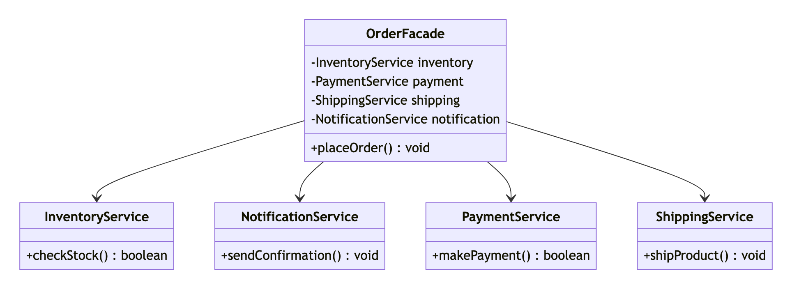
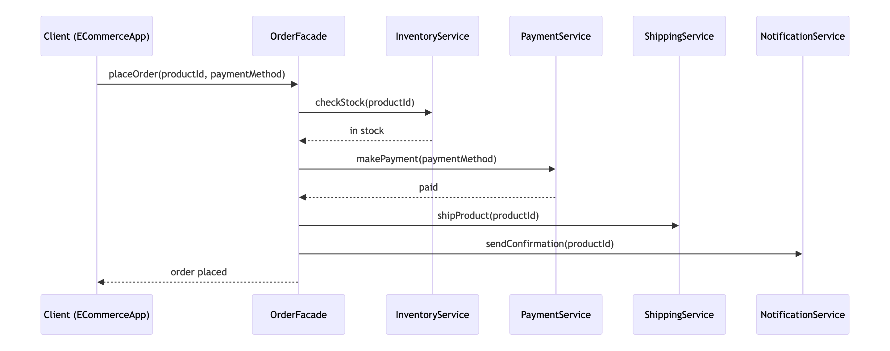

# Facade Pattern (LLD #25)

<!-- nav -->
⬅ [24 Cricbuzz](24_Cricbuzz_Notes.md) · [Index](00_LLD_Index.md) · [26 Bridge Pattern](26_Bridge_Pattern_Notes.md) ➡
<!-- nav -->

Sources: [Facade PDF](https://drive.google.com/file/d/1YpWHwZmOFIlFd-ftign3jtZWhOWEjwy0/view?usp=drive_link) · [Code on GitLab](https://gitlab.com/shrayansh8/lld-lowleveldesign/-/tree/main/src/main/java/com/conceptcoding/structuralpatterns/facade)

## In simple words
**Facade** gives a **single, simple front door** to a complicated group of classes. The client calls one method, and the facade works out which of the many subsystems to call, and in what order.

Think of a hotel reception: you say "I want to check in", and the reception handles the room, keys, billing and housekeeping for you.

## The problem it solves
To place an order, an e-commerce app has to call four services in the right order: check **inventory**, take **payment**, arrange **shipping** and send a **notification**. If every screen or controller repeats those steps, the logic is duplicated, easy to get wrong, and the client is tied to all four services.

## The solution
`OrderFacade` holds the four services and offers one method, `placeOrder(productId, paymentMethod)`, that runs the whole workflow. The client only knows the facade.

**Order facade**



**one call, four services**



*The facade runs the workflow*

```java
public void placeOrder(String productId, String paymentMethod) {

    // The following steps are hidden from the client and need to be executed in a specific order
    System.out.println("Placing order for product: " + productId);

    // Step 1: Check stock
    if (!inventory.checkStock(productId)) {
        System.out.println("Product out of stock!");
        return;
    }

    // Step 2: Make payment
    if (!payment.makePayment(paymentMethod)) {
        System.out.println("Payment failed!");
        return;
    }

    // Step 3: Ship product
    shipping.shipProduct(productId);
```

## When to use
- A subsystem is complex and you want a simple entry point.
- You want to reduce coupling between clients and many classes.
- Examples: a service layer in a web app, an SDK client, `JDBC` helper, a "one-click checkout".

## Pros and cons
- ✅ Simple API for clients; less coupling.
- ✅ Subsystem classes can change behind the facade.
- ❌ A facade can grow into a "god object" that knows too much.
- ❌ It does not stop advanced users from using the subsystem directly (and that is fine).

**Related:** Facade **simplifies** an interface to many classes; **Adapter** **converts** one interface to another.

---

<!-- nav -->
⬅ [24 Cricbuzz](24_Cricbuzz_Notes.md) · [Index](00_LLD_Index.md) · [26 Bridge Pattern](26_Bridge_Pattern_Notes.md) ➡
<!-- nav -->
