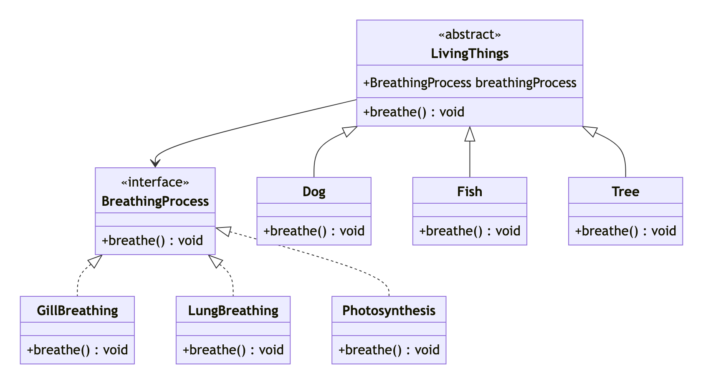
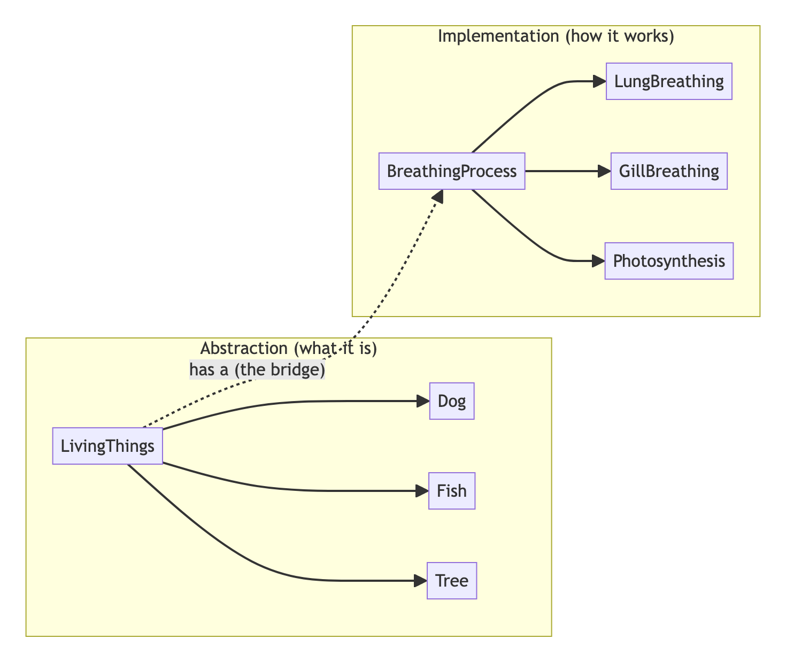

# Bridge Pattern (LLD #26)

<!-- nav -->
⬅ [25 Facade Pattern](25_Facade_Pattern_Notes.md) · [Index](00_LLD_Index.md) · [27 Prototype and Creational Overview](27_Prototype_and_Creational_Overview_Notes.md) ➡
<!-- nav -->

Sources: [Bridge PDF](https://drive.google.com/file/d/1byU7bYbjdkhIFU2je3Ck8IqjrFZvrRkr/view?usp=drive_link) · [Code on GitLab](https://gitlab.com/shrayansh8/lld-lowleveldesign/-/tree/main/src/main/java/com/conceptcoding/structuralpatterns/bridge)

## In simple words
**Bridge** splits a class into **two independent hierarchies** (an *abstraction* and an *implementation*) and connects them with a reference, so you can change or extend each side without touching the other.

Think of a TV remote: the remote (abstraction) and the TV (implementation) vary separately. A basic or an advanced remote can both control a Sony or a Samsung TV.

## The problem it solves
Living things all `breathe()`, but in different ways: dogs and whales use lungs, fish use gills, trees use photosynthesis. Using only inheritance you would write `Dog`, `Whale`, `Fish`, `Tree`, and several would repeat the same lung code. Every new animal or breathing style multiplies the classes.

## The solution
- **Abstraction** – `LivingThings` (abstract) *has a* `BreathingProcess`.
- **Refined abstractions** – `Dog`, `Fish`, `Tree`: they say *what* they are.
- **Implementor interface** – `BreathingProcess` with `breathe()`.
- **Concrete implementors** – `LungBreathing`, `GillBreathing`, `Photosynthesis`: they say *how* it is done.

A `Dog` is created with `LungBreathing`, a `Fish` with `GillBreathing`. A new animal reuses an existing way of breathing, and a new way of breathing works with every animal.

**Living things and breathing processes**



**the two hierarchies and the bridge**



*The bridge is the field*

```java
public abstract class LivingThings {
    // Reference to Implementor
    protected BreathingProcess breathingProcess;

    // Bridge connects Animal with Breathing
    public LivingThings(BreathingProcess breathingProcess) {
        this.breathingProcess = breathingProcess;
    }

    // Operation implemented by Implementor
    abstract public void breathe();
}
```

## When to use
- A class has two dimensions that can both grow (shape × colour, device × remote, message × sender, UI × platform).
- You want to avoid a large number of subclasses (N × M becomes N + M).
- You want to switch the implementation at run time.

## Pros and cons
- ✅ Two hierarchies change independently (Open/Closed).
- ✅ Hides implementation details from the client.
- ❌ More up-front design; can be over-engineering for a small problem.

**Related:** Bridge is designed up front to keep two parts separate. **Adapter** is applied afterwards to make existing parts fit. Bridge and **Strategy** look alike (an object holding an interface), but Strategy is about swapping one algorithm and Bridge is about a whole parallel hierarchy.

---

<!-- nav -->
⬅ [25 Facade Pattern](25_Facade_Pattern_Notes.md) · [Index](00_LLD_Index.md) · [27 Prototype and Creational Overview](27_Prototype_and_Creational_Overview_Notes.md) ➡
<!-- nav -->
