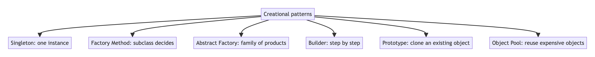
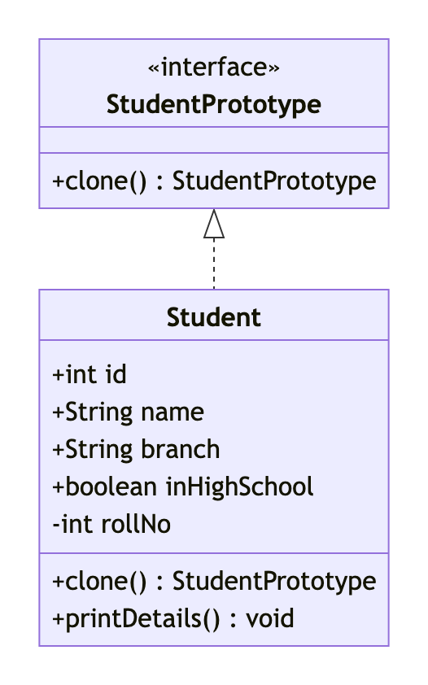
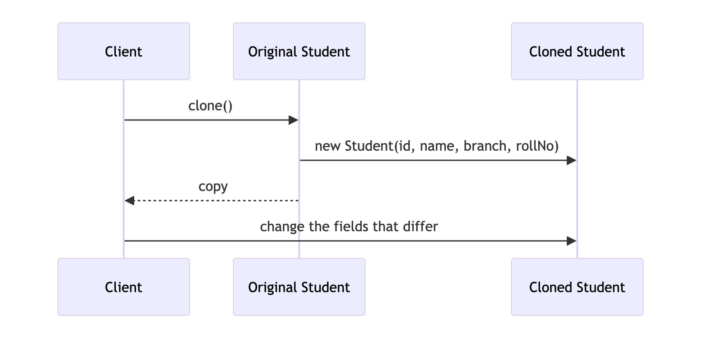

# Prototype Pattern and the Creational Patterns Overview (LLD #27)

<!-- nav -->
⬅ [26 Bridge Pattern](26_Bridge_Pattern_Notes.md) · [Index](00_LLD_Index.md) · [28 Singleton Pattern](28_Singleton_Pattern_Notes.md) ➡
<!-- nav -->

Sources: [All Creational PDFs (Drive folder)](https://drive.google.com/drive/folders/19th5gDxaDXI15eXolORUhWh_Uoclm8LP?usp=drive_link) · [Prototype PDF](https://drive.google.com/file/d/1vtusmYGILQfJoy99T7ynsjmeLIMmMswi/view) · [Code on GitLab](https://gitlab.com/shrayansh8/lld-lowleveldesign/-/tree/main/src/main/java/com/conceptcoding/creationalpatterns?ref_type=heads)

## The Creational patterns at a glance
Creational patterns are about **how objects get created** so the rest of the code doesn't depend on `new` and concrete classes.

| Pattern | Use it when | Note |
|---|---|---|
| **Singleton** | you need exactly **one** instance (config, DB connection) | [28 Singleton](28_Singleton_Pattern_Notes.md) |
| **Factory Method / Simple Factory** | you don't know which class to create until run time | [05 Factory Method](05_Factory_Method_Notes.md) |
| **Abstract Factory** | you need a **family** of matching objects | [05 Abstract Factory](05_Abstract_Factory_Notes.md) |
| **Builder** | an object is complex and built **step by step** | [23 Builder](23_Builder_Pattern_Notes.md) |
| **Prototype** | creating from scratch is costly, so **copy** an existing one | this note |
| **Object Pool** | creating is expensive, so **reuse** a fixed set of objects | [43 Object Pool](43_Object_Pool_Pattern_Notes.md) |



---

## Prototype pattern
### In simple words
**Prototype** creates a new object by **copying (cloning) an existing one** instead of building it from scratch. It is useful when creating an object is slow or complicated (loading from a database, heavy set-up) but a copy is cheap. Think of photocopying a filled-in form and changing a few fields instead of filling a blank one again.

### How it works
- A **prototype interface** declares `clone()`.
- A **concrete class** (`Student`) implements it and returns a copy of itself.
- The client copies an existing object and changes only what differs.

**Student prototype**



*clone() builds a copy*

```java
public StudentPrototype clone() {
    return new Student(id, name, branch, rollNo);
}
```



### Shallow copy vs deep copy
- **Shallow copy:** copies the fields, but objects inside (lists, other objects) are *shared* between the original and the copy. Changing one changes the other.
- **Deep copy:** copies the inner objects too, so the two are fully independent. Use a deep copy when the object contains mutable references.

### When to use
- Objects are expensive to create but cheap to copy.
- You need many similar objects that differ in a few fields (game characters, documents, graphic shapes).
- You want to avoid building a class hierarchy of factories.

### Pros and cons
- ✅ Faster than creating from scratch; hides creation details.
- ❌ Copying objects with circular references or deep structures is tricky.
- ❌ Each class must implement its own `clone()` correctly.

---

<!-- nav -->
⬅ [26 Bridge Pattern](26_Bridge_Pattern_Notes.md) · [Index](00_LLD_Index.md) · [28 Singleton Pattern](28_Singleton_Pattern_Notes.md) ➡
<!-- nav -->
