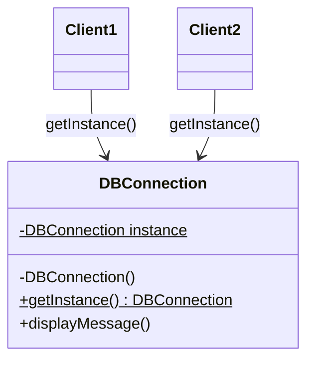
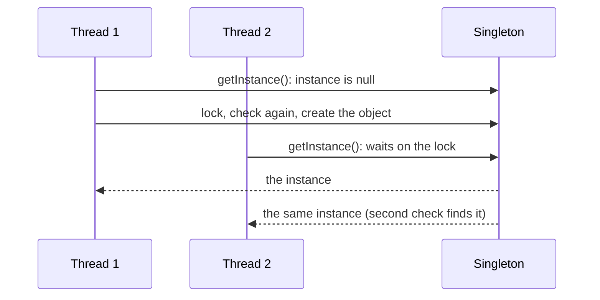

# Singleton Pattern (LLD #28)

<!-- nav -->
⬅ [27 Prototype and Creational Overview](27_Prototype_and_Creational_Overview_Notes.md) · [Index](00_LLD_Index.md) · [29 Inventory Order Management](29_Inventory_Order_Management_Notes.md) ➡
<!-- nav -->

Sources: [Singleton PDF](https://drive.google.com/file/d/1P_ptiVovd0ERLtMqVbgJVd9r5mYme-k_/view?usp=drive_link) · [Code on GitLab](https://gitlab.com/shrayansh8/lld-lowleveldesign/-/tree/main/src/main/java/com/conceptcoding/creationalpatterns/singleton)

## In simple words
**Singleton** guarantees that a class has **only one instance** in the whole program and gives everyone one global way to reach it. Think of the country's president: there is exactly one, and anyone who asks "who is the president?" gets the same person.

Typical uses: a database connection manager, configuration, a logger, a cache.

## How to build one
1. Make the **constructor private** so nobody can call `new`.
2. Keep a **private static field** that holds the single instance.
3. Expose a **public static method** (`getInstance()`) that returns it.

The five versions below differ only in *when* the instance is created and *how thread-safe* it is.



*Both clients receive the same object.*

## Version 1 – Eager initialization
The instance is created when the class loads. Simple and thread-safe, but the object exists even if it is never used.

*Eager*

```java
private static final DBConnectionEager instance = new DBConnectionEager();

// The private constructor prevents instantiation
private DBConnectionEager() {
}

// Method to return the unique instance of this class
public static DBConnectionEager getInstance() {
    return instance;
}

// Method to display a message
public void displayMessage() {
    System.out.println("Eager Initialization - Singleton - " + this);
```

## Version 2 – Lazy initialization
The instance is created the first time it is requested. Saves memory, but **not thread-safe**: two threads can both see `null` and each create an object.

*Lazy (not thread-safe)*

```java
private static DBConnectionLazy instance = null;

// The private constructor prevents instantiation
private DBConnectionLazy() {
}

// Singleton Object is created only when it is required
// This method returns the unique instance of this class
// Drawback: This implementation is not thread-safe.
public static DBConnectionLazy getInstance() {
    if (instance == null) {
        instance = new DBConnectionLazy();
    }
    return instance;
```

## Version 3 – Synchronized method
Make `getInstance()` `synchronized`. Safe, but every call takes a lock, which is **slow** under heavy use.

*Synchronized*

```java
public static synchronized DBConnectionThreadSafe getInstance() {
    if (instance == null) {
        instance = new DBConnectionThreadSafe();
    }
    return instance;
}

// Method to display a message
```

## Version 4 – Double-checked locking
Check for `null`, lock only if it is `null`, then check again. Fast after the first call.

*Double-checked locking*

```java
public static DBConnectionDoubleLocking getInstance() {
    if (instance == null) { // First check
        synchronized (DBConnectionDoubleLocking.class) {
            if (instance == null) { // Second check
                instance = new DBConnectionDoubleLocking();
            }
        }
    }
    return instance;
}

// Method to display a message
public void displayMessage() {
    System.out.println("Double Locking Singleton - " + this);
```

## Version 5 – Double-checked locking with `volatile` (the correct one)
Without `volatile`, the JVM may let another thread see a **half-built object** (the instance reference is set before the constructor finishes). Marking the field `volatile` forbids that reordering. The repo shows the bug and the fix:

*Fix: volatile*

```java
private static volatile DBConnectionDoubleCheckedLockFix connectionObj = null;

int portNumber;

private DBConnectionDoubleCheckedLockFix(int portNumberValue) {
    portNumber = portNumberValue;
}

// Thread Safe Method to return the unique instance of this class
public static DBConnectionDoubleCheckedLockFix getConnectionObj(int portNumberValue) {
    if (connectionObj == null) {
        synchronized (DBConnectionDoubleCheckedLockFix.class) {
            if (connectionObj == null) {
                connectionObj = new DBConnectionDoubleCheckedLockFix(portNumberValue);
            }
        }
    }
    return connectionObj;
}

// Method to display a message
public void displayMessage() {
    System.out.println("Singleton - Double Checked Locking - Fix - " + this);
}
```



## Other ways (good to know)
- **Enum singleton** (`enum Config { INSTANCE }`): thread-safe and safe against reflection and serialization tricks. Often the simplest best choice in Java.
- **Static holder (Bill Pugh):** a private static inner class holds the instance, giving lazy and thread-safe creation with no locking.

## Pros and cons
- ✅ One shared object; controlled access; saves resources.
- ❌ Global state makes testing hard and hides dependencies.
- ❌ Can break with reflection, serialization or multiple class loaders unless guarded.
- ❌ Violates Single Responsibility (it controls its own creation *and* does its job).
- Prefer dependency injection where possible: let a framework (e.g. Spring beans) hold the single instance.

---

<!-- nav -->
⬅ [27 Prototype and Creational Overview](27_Prototype_and_Creational_Overview_Notes.md) · [Index](00_LLD_Index.md) · [29 Inventory Order Management](29_Inventory_Order_Management_Notes.md) ➡
<!-- nav -->
