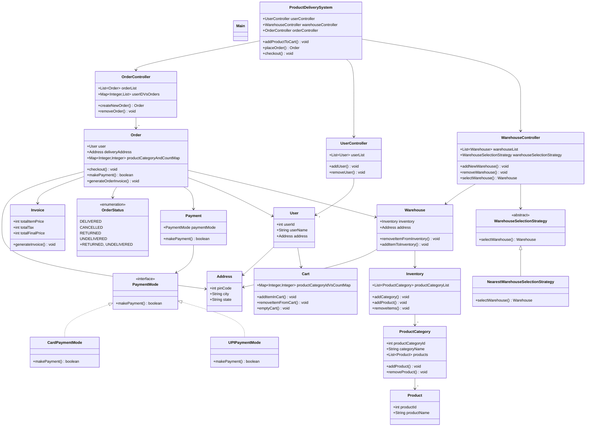
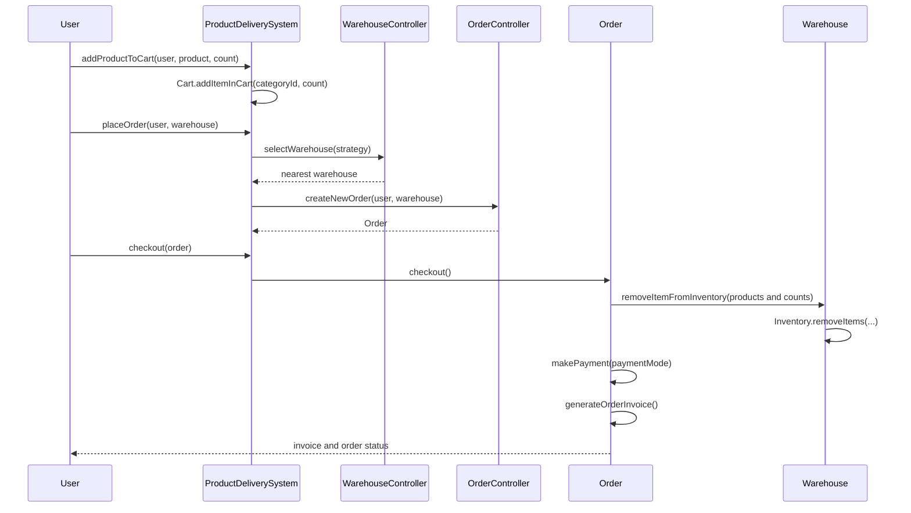
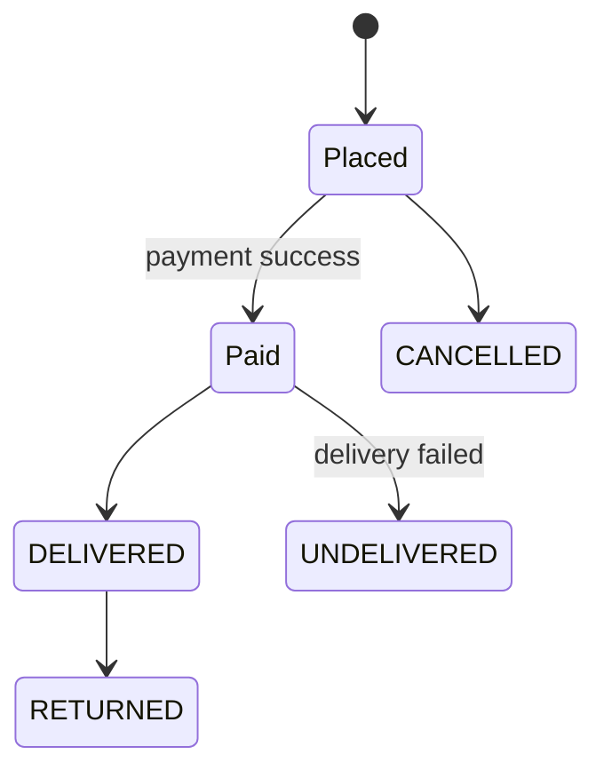
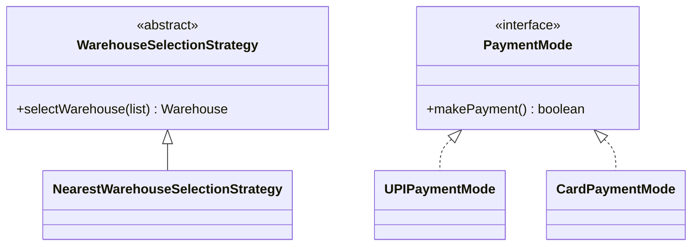

# Design an Inventory and Order Management System (LLD #29)

<!-- nav -->
⬅ [28 Singleton Pattern](28_Singleton_Pattern_Notes.md) · [Index](00_LLD_Index.md) · [30 Flyweight Word Processor](30_Flyweight_Word_Processor_Notes.md) ➡
<!-- nav -->

Sources: [Code on GitLab (Order management system)](https://gitlab.com/shrayansh8/interviewcodingpractise/-/tree/main/src/main/java/com/conceptandcoding/LowLevelDesign/DesignOrderManagementSystem?ref_type=heads) (no PDF for this topic in your links)

## The problem
Design an Amazon-style product delivery system with **warehouses and inventory**. A user adds products to a cart, the system picks a **warehouse** that will fulfil the order, the order is checked out and paid, the **inventory is reduced** and an **invoice** is generated.

## Requirements
- Users with an address and a **cart** (products and counts).
- **Warehouses**, each with an address and its own **inventory** (stock of products grouped by category).
- Choose a warehouse by a strategy (for example **nearest**).
- Place an order, **pay** by different modes (UPI, card), generate an **invoice** (item total, tax, final price), and track the **order status**.
- Stock must be **removed from the warehouse** when the order is checked out.

## Step 1 – Objects
| Area | Classes |
|---|---|
| **Catalogue and stock** | `Product`, `ProductCategory` (id, name, price, list of products), `Inventory` (list of categories; `addCategory`, `addProduct`, `removeItems`) |
| **Warehouse** | `Warehouse` (inventory + address), `WarehouseController`, `WarehouseSelectionStrategy` (abstract) with `NearestWarehouseSelectionStrategy` |
| **User** | `User`, `Address`, `Cart` (map of category id to count: `addItemInCart`, `removeItemFromCart`, `emptyCart`), `UserController` |
| **Order** | `Order` (user, address, products, warehouse, invoice, payment, status), `OrderStatus`, `OrderController` |
| **Payment** | `Payment` with `PaymentMode` (`UPIPaymentMode`, `CardPaymentMode`) |
| **Invoice** | `Invoice` (item price, tax, final price; `generateInvoice(order)`) |
| **Facade** | `ProductDeliverySystem` ties it all together |

## Step 2 – Class diagram

**Diagram – Order management**

## Step 3 – The order flow

*The enum `OrderStatus` has `DELIVERED`, `CANCELLED`, `RETURNED`, `UNDELIVERED`. The earlier states in the diagram are the natural flow around them.*

## Step 4 – Strategies

**Warehouse selection (Strategy).** `WarehouseSelectionStrategy.selectWarehouse(list)` is overridden by `NearestWarehouseSelectionStrategy`. A new rule (the warehouse with the most stock, or the cheapest delivery) is a new class ([Strategy pattern](02_Strategy_Pattern_Notes.md)).

**Payment (Strategy).** `PaymentMode.makePayment()` is implemented by `UPIPaymentMode` and `CardPaymentMode`; `Payment` holds one and calls it.

## Design points to mention
- **Facade:** `ProductDeliverySystem` gives callers one entry point ([Facade](25_Facade_Pattern_Notes.md)).
- **Controllers** (`UserController`, `OrderController`, `WarehouseController`) manage collections; **entities** hold data.
- **Inventory is grouped by category** (`ProductCategory` has a price and a list of products), so counts are easy to deduct.
- **Concurrency (discuss):** two users must not buy the last item. Deduct stock atomically with a lock per product category (see [Car Rental](09_Car_Rental_System_Notes.md)), or reserve stock before payment, then confirm or release (see [BookMyShow](14_BookMyShow_Notes.md)).
- **Extensions:** low-stock alerts, restocking, returns that add stock back, splitting an order across warehouses, discounts (see [Coupons](35_Coupon_Shopping_Cart_Notes.md)).

---

<!-- nav -->
⬅ [28 Singleton Pattern](28_Singleton_Pattern_Notes.md) · [Index](00_LLD_Index.md) · [30 Flyweight Word Processor](30_Flyweight_Word_Processor_Notes.md) ➡
<!-- nav -->
