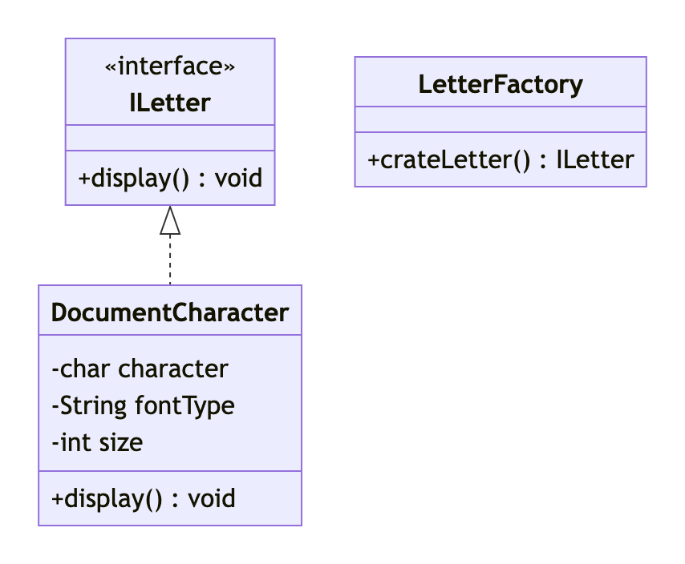
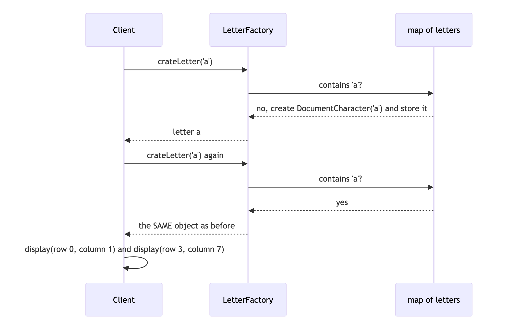
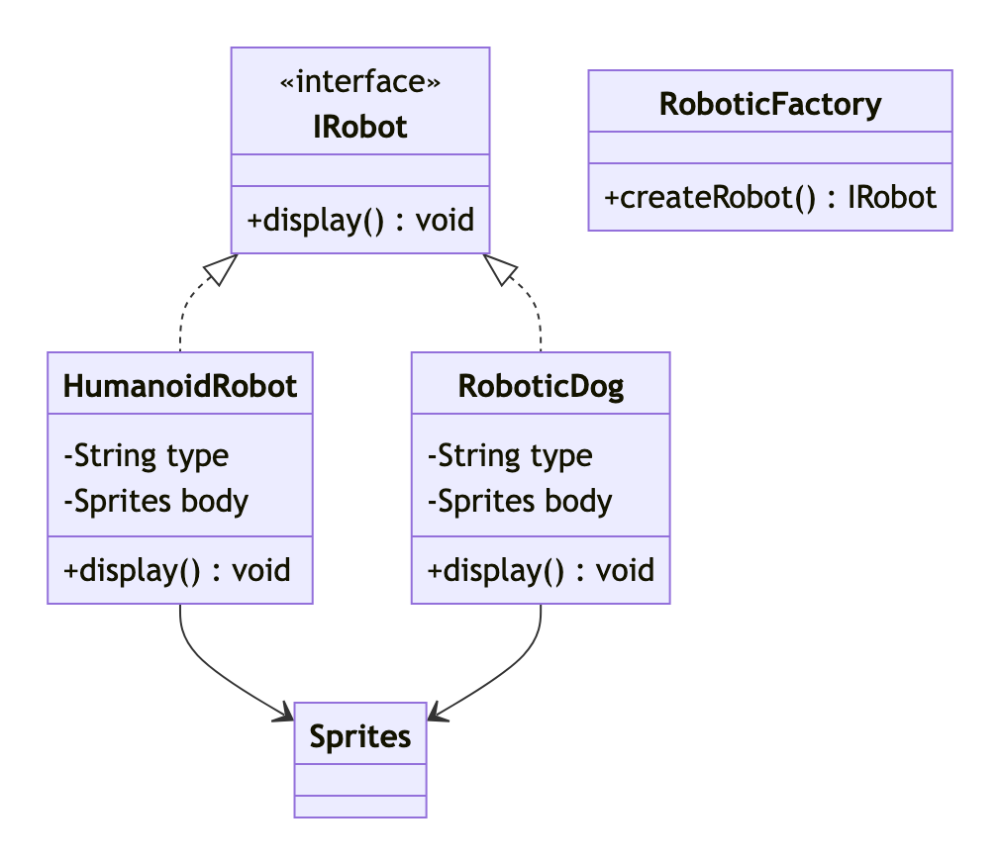

# Flyweight Pattern – Word Processor (LLD #30)

<!-- nav -->
⬅ [29 Inventory Order Management](29_Inventory_Order_Management_Notes.md) · [Index](00_LLD_Index.md) · [31 Command Undo Redo](31_Command_Undo_Redo_Notes.md) ➡
<!-- nav -->

Sources: [Flyweight PDF](https://drive.google.com/file/d/1oCmas08vpcpiEMqYkIYEvjkNWIQ9lDGm/view?usp=drive_link) · [Code on GitLab](https://gitlab.com/shrayansh8/lld-lowleveldesign/-/tree/main/src/main/java/com/conceptcoding/structuralpatterns/flyweight)

## In simple words
**Flyweight** saves memory by **sharing** the parts of objects that are the same, instead of storing a copy in every object. You split an object's data into two kinds:
- **Intrinsic state** – data that is the *same* for many objects and can be shared (the letter `A`, its font, its size).
- **Extrinsic state** – data that is *different* each time and is passed in when needed (the row and column where it appears).

Think of a printing press: there is one metal stamp for the letter "e", and it is used thousands of times on a page. You don't make a new stamp for every "e".

## The problem it solves
A word processor shows a million characters. If each `Character` object stores its letter, font, size **and** position, you create a million objects, most of them identical except for position. That wastes huge amounts of memory.

## The solution
- **Flyweight interface** – `ILetter` with `display(row, column)`.
- **Concrete flyweight** – `DocumentCharacter`: stores only the shared data (`character`, `fontType`, `size`). Position is passed in as arguments.
- **Flyweight factory** – `LetterFactory.crateLetter(char)`: keeps a map of letters already created. If the letter exists it returns the same object; otherwise it creates and stores one.
- The client keeps only positions and asks the factory for the shared letter.

**Diagram – Word processor flyweights**



**Diagram – sharing letters**



*The factory reuses existing letters*

```java
public static ILetter crateLetter(char characterValue) {
    if (characterCache.containsKey(characterValue)) {
        // if exists, return the cached character object.
        return characterCache.get(characterValue);
    } else {
        // if not exists, create the character object and cache it.
        DocumentCharacter characterObj = new DocumentCharacter(characterValue, "Arial", 10);
        // add to cache
        characterCache.put(characterValue, characterObj);
        return characterObj;
    }
}

public static int getTotalCharacters() {
```

## Second example: robotic game
Many robots of the same type share one heavy `Sprites` object (the image data). Each robot stores only its position. `RoboticFactory.createRobot(type)` returns a cached `HumanoidRobot` or `RoboticDog`.

**Diagram – Robot flyweights**



## When to use
- You need a very large number of similar objects.
- Most of each object's state can be made shared and read-only (immutable).
- Memory is the bottleneck. Examples: text editors, game particles and trees, map tiles, string interning (`String` pool).

## Pros and cons
- ✅ Big memory savings.
- ❌ More complicated code (you split the state).
- ❌ Shared objects must be immutable, otherwise one change affects everyone.
- ❌ Extrinsic data must be calculated or passed around, which costs CPU.

**Related:** Flyweight shares objects across *many users at once* (read-only). **Object Pool** lends objects *to one user at a time*.

---

<!-- nav -->
⬅ [29 Inventory Order Management](29_Inventory_Order_Management_Notes.md) · [Index](00_LLD_Index.md) · [31 Command Undo Redo](31_Command_Undo_Redo_Notes.md) ➡
<!-- nav -->
