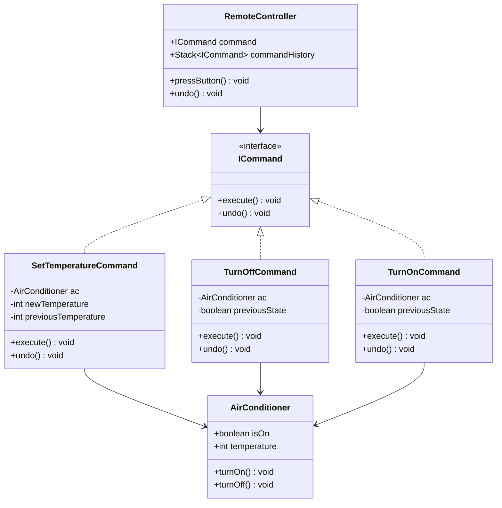
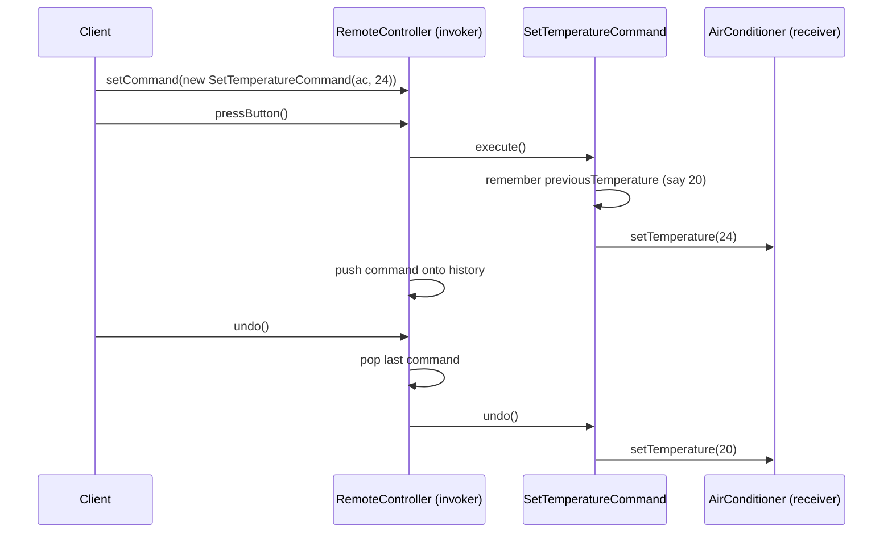
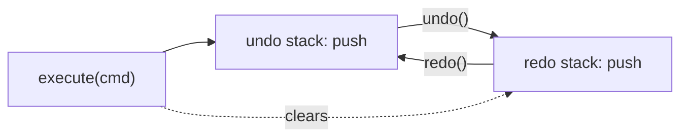

# Command Pattern – Undo / Redo (LLD #31)

<!-- nav -->
⬅ [30 Flyweight Word Processor](30_Flyweight_Word_Processor_Notes.md) · [Index](00_LLD_Index.md) · [32 Structural Patterns Overview](32_Structural_Patterns_Overview_Notes.md) ➡
<!-- nav -->

Sources: [Command PDF](https://drive.google.com/file/d/183IjgJ6pQDHswDQiwWMazetTpdK6SWaV/view?usp=drive_link) · [Code on GitLab](https://gitlab.com/shrayansh8/lld-lowleveldesign/-/tree/main/src/main/java/com/conceptcoding/behavioralpatterns/command)

## In simple words
**Command** turns a **request into an object**. Instead of calling `ac.turnOn()` directly, you create a `TurnOnCommand` object that knows *what to do* and *how to undo it*. Because commands are objects, you can store them, queue them, log them, and undo or redo them.

Think of ordering at a restaurant: the waiter writes your order on a slip (the command). The kitchen later executes it. The slip can be queued, repeated or cancelled.

## The problem it solves
A remote control with buttons for an air conditioner. If each button calls the AC directly, the remote is tied to every device action, and there is no way to **undo** the last action.

## The solution
- **Command interface** – `ICommand` with `execute()` and `undo()`.
- **Concrete commands** – `TurnOnCommand`, `TurnOffCommand`, `SetTemperatureCommand`. Each holds the **receiver** (the AC) and remembers the *previous* state (previous temperature or on/off) so it can undo.
- **Receiver** – `AirConditioner`: does the real work (`turnOn`, `turnOff`, `setTemperature`).
- **Invoker** – `RemoteController`: stores the current command and a **history stack** of executed commands. It doesn't know what the commands do.

**Diagram – Remote control with undo**



**Diagram – execute then undo**



*Invoker with a history stack*

```java
    public void pressButton() {
        command.execute();
        commandHistory.push(command);
    }

    public void undo() {
        if (!commandHistory.isEmpty()) {
            ICommand lastCommand = commandHistory.pop();
            lastCommand.undo();
        }
    }
}
```

## How redo works
The code above keeps one stack (`commandHistory`) for **undo**. To add **redo**, keep a second stack:
- `undo()`: pop from the undo stack, call `undo()`, **push onto the redo stack**.
- `redo()`: pop from the redo stack, call `execute()`, push back onto the undo stack.
- Any *new* command clears the redo stack (the old future is no longer valid).



This is how text editors implement Ctrl+Z / Ctrl+Y.

## When to use
- You need undo/redo, history or an audit log.
- You want to queue, schedule or retry operations (job queues, macros, transactions).
- You want to decouple *who asks* from *who does*.

## Pros and cons
- ✅ Decouples sender and receiver; new commands without changing the invoker (Open/Closed).
- ✅ Easy undo/redo, macros (a command made of commands), queues and logging.
- ❌ One small class per action.
- ❌ Undo needs the command to store enough state to reverse itself.

**Related:** **Memento** stores a snapshot of state (useful for undo too); **Strategy** swaps algorithms, while Command encapsulates a *request*.

---

<!-- nav -->
⬅ [30 Flyweight Word Processor](30_Flyweight_Word_Processor_Notes.md) · [Index](00_LLD_Index.md) · [32 Structural Patterns Overview](32_Structural_Patterns_Overview_Notes.md) ➡
<!-- nav -->
