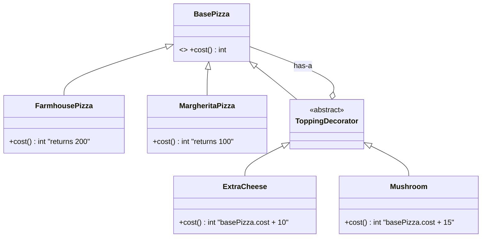
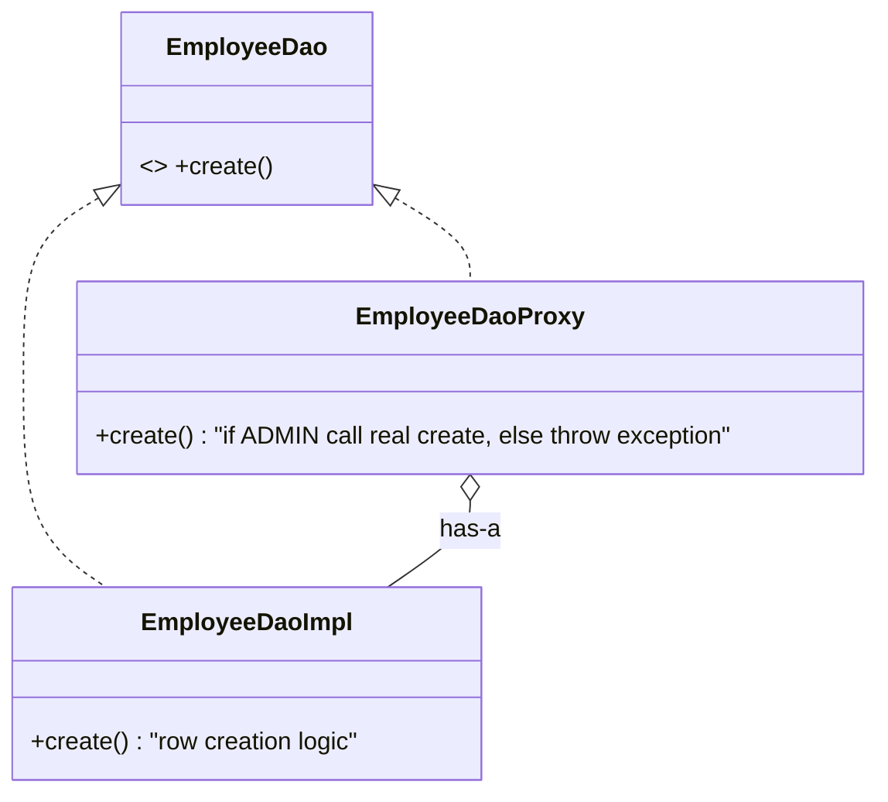
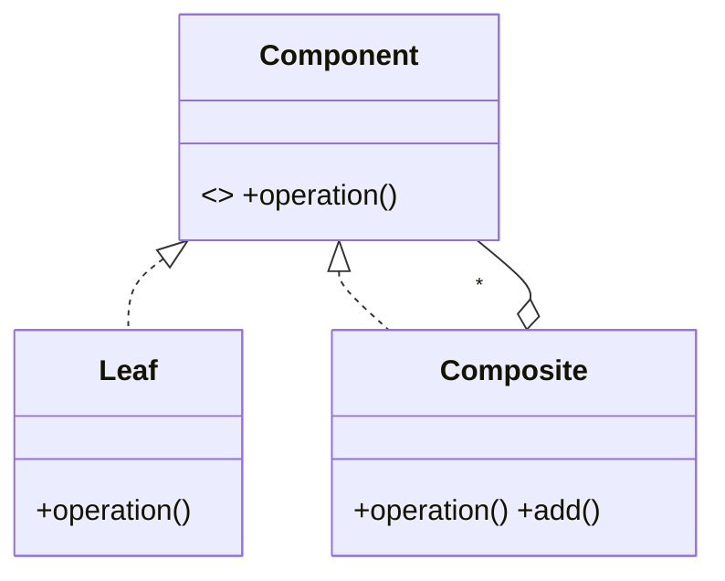
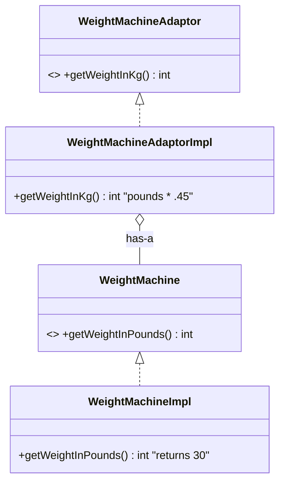
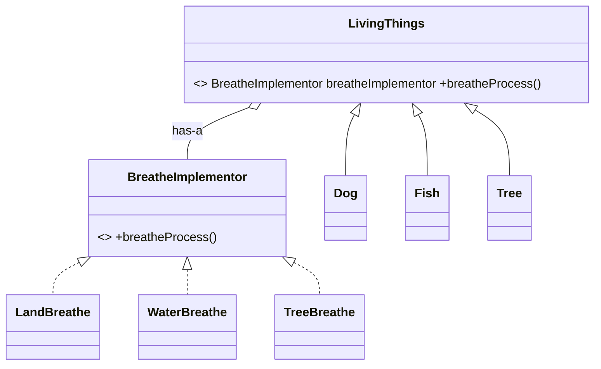
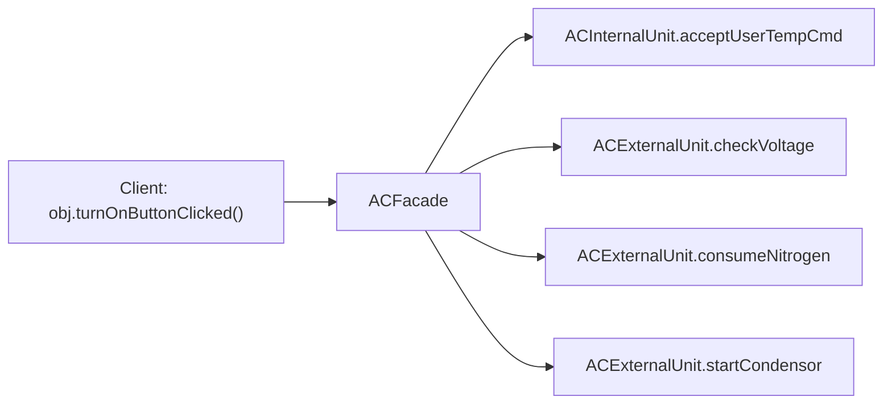
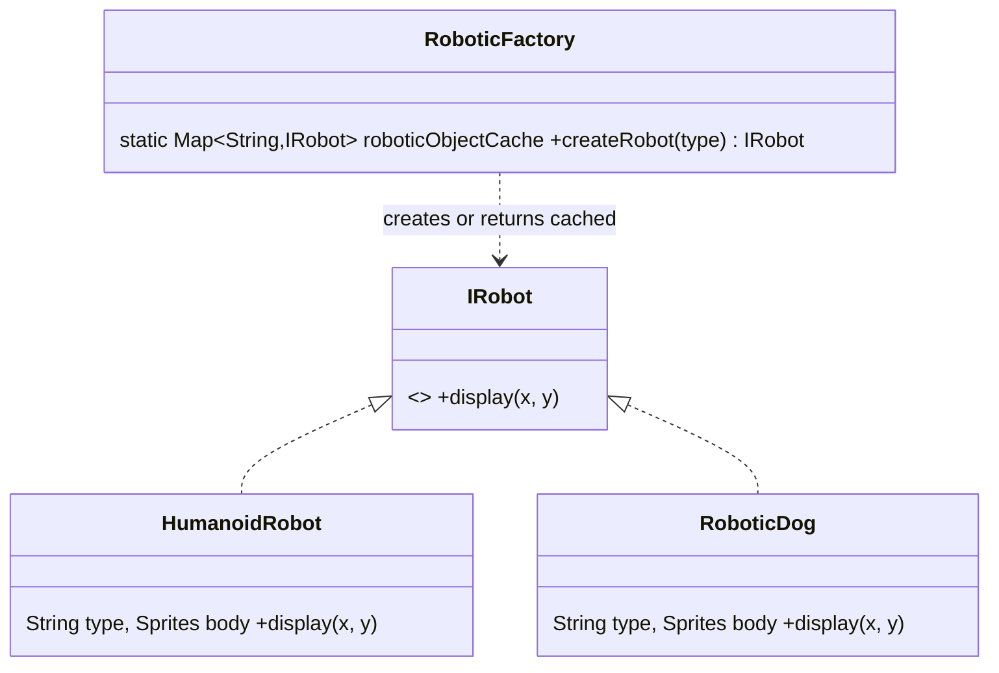
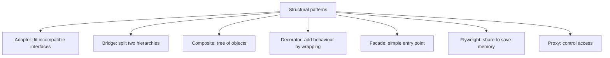
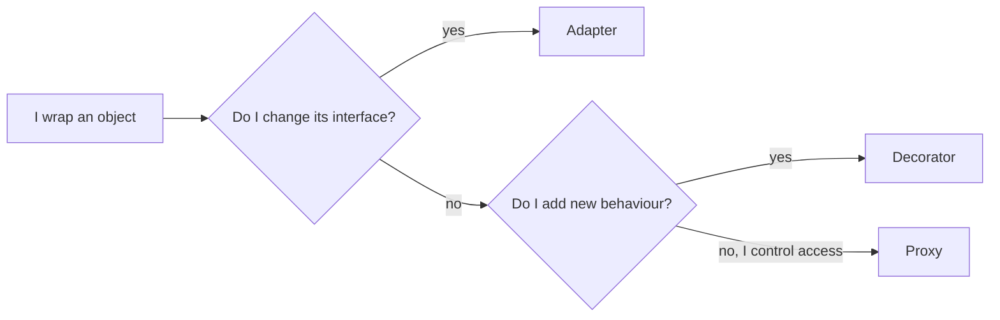

# Structural Design Patterns – Overview (LLD #32)

<!-- nav -->
⬅ [31 Command Undo Redo](31_Command_Undo_Redo_Notes.md) · [Index](00_LLD_Index.md) · [33 Iterator Pattern](33_Iterator_Pattern_Notes.md) ➡
<!-- nav -->

Sources: [All Structural PDFs (Drive folder)](https://drive.google.com/drive/folders/13hg1N0piFmP4uBEH3jd9fvjIoA4SK4Dt?usp=drive_link) · [Zoho note](https://notebook.zohopublic.in/public/notes/74tdo33c5b7060d544b1c986e519dd3ba4d1b) (typed Zoho note, now read from its rendered images) · [Code on GitLab](https://gitlab.com/shrayansh8/lld-lowleveldesign/-/tree/main/src/main/java/com/conceptcoding/structuralpatterns?ref_type=heads)

## From the Zoho note

The Zoho page says: a **structural design pattern is a way to combine or arrange different classes and objects to form a complex or bigger structure to solve a particular requirement.** It lists seven types: Decorator, Proxy, Composite, Adapter, Bridge, Facade, Flyweight. Each one has a small example.

### 1. Decorator – add more functionality to an existing object without changing its structure



`BasePizza pizza = new Mushroom(new ExtraCheese(new Farmhouse()));`

**In simple words:** a topping *is a* pizza and *has a* pizza inside. Each topping calls the inner pizza's `cost()` and adds its own price, so toppings can be stacked: 200 + 10 + 15.

### 2. Proxy – provide controlled access to the original object



`EmployeeDao empProxyObj = new EmployeeDaoProxy(); empProxyObj.create();`

**In simple words:** the proxy looks exactly like the real DAO but checks permission first: only an ADMIN gets through to the real `create()`.

### 3. Composite – object inside object (tree-like structure)
Examples on the page: **Delivery Box** (contains items and more delivery boxes) and **File System** (contains files and directories, which contain more files and directories).



File system example: `interface FileSystem { ls(); }`, `File implements FileSystem` (`ls()` prints the file name), `Directory implements FileSystem` (keeps a `List<FileSystem>`, `add(fs)` adds to it, `ls()` loops over the list and calls `ls()` on each).

```
Directory parentDir = new Directory();
FileSystem fileObj1 = new File();
parentDir.add(fileObj1);
Directory childDir = new Directory();
FileSystem fileObj2 = new File();
childDir.add(fileObj2);
parentDir.add(childDir);
```

**In simple words:** a directory and a file both answer `ls()`, so you can call `ls()` on the top directory and it walks the whole tree.

### 4. Adapter – a bridge between two incompatible interfaces
Drawn as a plug (Client), a travel adapter (Adaptor) and a wall socket (Adaptee).



`WeightMachineAdaptor machineAdaptorObj = new WeightMachineAdaptorImpl(new WeightMachineImpl()); machineAdaptorObj.getWeightInKg();`

**In simple words:** the client wants kilograms, the machine only gives pounds. The adapter holds the machine, asks it for pounds and multiplies by 0.45.

### 5. Bridge – decouple an abstraction from its implementation so the two can vary independently
First the problem: `abstract LivingThings { abstract void breatheProcess(); }` with `Dog` (nose, inhale oxygen, exhale carbon dioxide), `Fish` (gills, absorb oxygen, release carbon dioxide) and `Tree` (leaves, absorb carbon dioxide, release oxygen). The page asks: **how to add a new breathing process without adding any class of LivingThings?**

Solution:



Each of `Dog`, `Fish`, `Tree` takes a `BreatheImplementor` in its constructor and its `breatheProcess()` just calls `breatheImplementor.breatheProcess()`. `LandBreathe` = nose / oxygen in / CO2 out; `WaterBreathe` = gills / absorb oxygen / release CO2; `TreeBreathe` = leaves / absorb CO2 / release oxygen.

`LivingThings fishObj = new Fish(new WaterBreathe()); fishObj.breatheProcess();`

**In simple words:** the *what* (Dog, Fish, Tree) and the *how it breathes* are split into two class families joined by a has-a link, so a new breathing method is one new class.

### 6. Facade – hide the system complexity from the client
- **Example 1: expose only the necessary details to the client.** `EmployeeClient` creates `EmployeeFacade` and calls `obj.insert()`. The facade holds an `EmployeeDAO` and forwards `insert()`, while the DAO also has `delete()` and `updateByID()` that the client does not see.
- **Example 2: hide the system complexity.** The client creates `ACFacade` and calls `turnOnButtonClicked()`. Inside, the facade calls `internalUnit.acceptUserTempCmd()`, then `externalUnit.checkVoltage()`, `consumeNitrogen()` and `startCondensor()`. (The "complex system" is `ACExternalUnit` with `checkVoltage / consumeNitrogen / startCondensor` and `ACInternalUnit` with `acceptUserTempCmd / acceptUserOnCmd / acceptUserOffCmd`.)



**In simple words:** one button press for the client, many calls behind the scenes.

### 7. Flyweight – reduce memory usage by sharing data among multiple objects
**Issue (memory is 21 GB):** a `Robot` has `coordinateX` (4 bytes), `coordinateY` (4 bytes), `String type` (50 bytes) and `Sprites body` (a 2D bitmap, 31 KB), so about **31 KB** per robot. The code creates 5,000,000 humanoid robots and 5,000,000 robotic dogs, each with its own `new Sprites()`: **10 lakh × ~31 KB = 31 GB, which is an ISSUE as memory is 21 GB only.**

- **Intrinsic data:** shared among objects and the same once defined. Here **type and body**.
- **Extrinsic data:** changes with client input and differs from one object to another. Here the **X and Y axis**.
- Remove all extrinsic data from the object and keep only intrinsic data (this object is the **Flyweight object**).
- Extrinsic data is passed as a **parameter** to the flyweight class.
- **Caching** can be used for the flyweight object and reused whenever required.



`RoboticFactory.createRobot("HUMANOID")` returns the cached object if one exists for that type, otherwise creates it (with one `Sprite`), stores it in `roboticObjectCache` and returns it. Then `humanoidRobot1.display(1, 2)` and `humanoidRobot2.display(10, 20)` reuse the same object with different coordinates.

**In simple words:** instead of a million heavy robots, keep one robot per type and just tell it where to draw itself each time.

## In simple words
**Structural patterns** are about **how classes and objects are put together** to form bigger structures, while keeping the structure flexible and easy to change. Each of the seven answers a different "how do I connect these?" question.

| Pattern | The question it answers | Key idea | Note |
|---|---|---|---|
| **Adapter** | "This class has the wrong interface." | convert one interface to another | [20](20_Adapter_Pattern_Notes.md) |
| **Bridge** | "Two things vary independently." | separate abstraction from implementation | [26](26_Bridge_Pattern_Notes.md) |
| **Composite** | "I have a tree of objects." | treat one and many uniformly | [19](19_Composite_File_System_Notes.md) |
| **Decorator** | "I want to add features at run time." | wrap an object to add behaviour | [04](04_Decorator_Pattern_Notes.md) |
| **Facade** | "This subsystem is too complicated." | one simple front door | [25](25_Facade_Pattern_Notes.md) |
| **Flyweight** | "I have too many similar objects." | share the common data | [30](30_Flyweight_Word_Processor_Notes.md) |
| **Proxy** | "I need to control access to an object." | stand-in with the same interface | [13](13_Proxy_Pattern_Notes.md) |



## Look-alikes: which one do I need?
Adapter, Decorator and Proxy all *wrap* an object. They differ in intent:



- **Adapter** – different interface, same job.
- **Decorator** – same interface, *more* behaviour (and you can stack wrappers).
- **Proxy** – same interface, *same* behaviour, but with control (security, caching, lazy loading).
- **Facade** – a *new, simpler* interface over many classes.

## Memory aid
- Simplify: **Facade**.
- Convert: **Adapter**.
- Add: **Decorator**.
- Guard: **Proxy**.
- Share: **Flyweight**.
- Tree: **Composite**.
- Split in two: **Bridge**.

---

<!-- nav -->
⬅ [31 Command Undo Redo](31_Command_Undo_Redo_Notes.md) · [Index](00_LLD_Index.md) · [33 Iterator Pattern](33_Iterator_Pattern_Notes.md) ➡
<!-- nav -->
