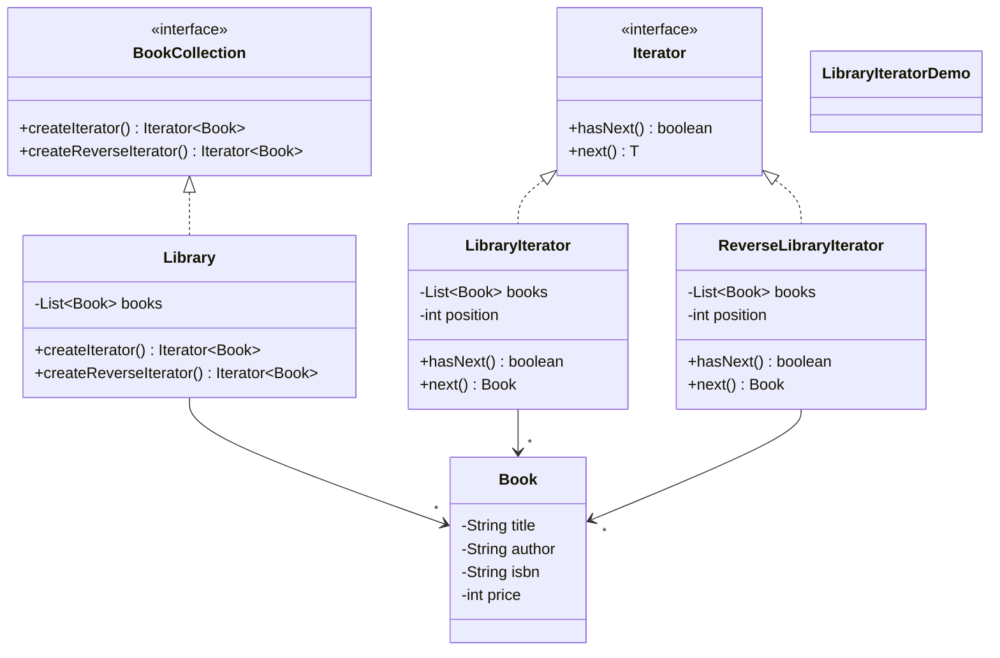
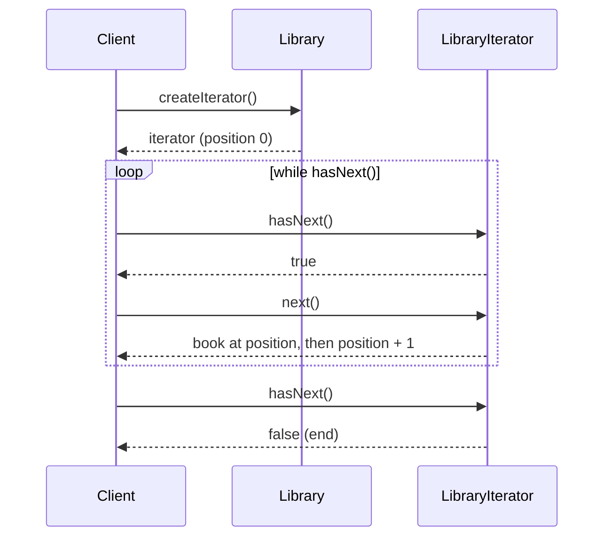

# Iterator Pattern (LLD #33)

<!-- nav -->
⬅ [32 Structural Patterns Overview](32_Structural_Patterns_Overview_Notes.md) · [Index](00_LLD_Index.md) · [34 Mediator Pattern](34_Mediator_Pattern_Notes.md) ➡
<!-- nav -->

Sources: [Iterator PDF](https://drive.google.com/file/d/1-AR6mJkZydatqHIxA58EreRzDt33_MqQ/view?usp=drive_link) · [Code on GitLab](https://gitlab.com/shrayansh8/lld-lowleveldesign/-/tree/main/src/main/java/com/conceptcoding/behavioralpatterns/iterator)

## In simple words
**Iterator** gives you a standard way to **walk through the items of a collection one by one**, without knowing how the collection stores them (array, list, tree, linked list). The collection hands you an iterator, and you just ask `hasNext()` and `next()`.

Think of a TV remote's "next channel" button: you don't need to know how channels are stored inside the TV.

## The problem it solves
A `Library` stores `Book`s in a list. If the client loops over the internal list with indexes, it depends on the list type. If the library later changes its storage (say, to a tree) every client breaks. Also, you may want different orders (forward, reverse) without changing the library.

## The solution
- **Iterator interface** – `Iterator<T>` with `hasNext()` and `next()`.
- **Concrete iterators** – `LibraryIterator` (forward) and `ReverseLibraryIterator` (backward). Each keeps its own `position`.
- **Aggregate interface** – `BookCollection` with `createIterator()` and `createReverseIterator()`.
- **Concrete aggregate** – `Library` stores the books and creates the iterators.

**Diagram – Library and iterators**



**Diagram – walking the library**



*The iterator remembers where it is*

```java
    public boolean hasNext() {
        return position < books.size();
    }

    @Override
    public Book next() {
        return books.get(position++);
    }
}
```

## In Java
Java's own collections already use this pattern: `for (String s : list)` calls `list.iterator()` behind the scenes. Implement `Iterable<T>` and `Iterator<T>` in your own class to get the enhanced `for` loop for free. (The repo also shows `LinkedHashSet` examples.)

## When to use
- You want to hide how a collection is built.
- You need several ways of traversing the same data (forward, reverse, filtered), possibly at the same time (each iterator has its own position).

## Pros and cons
- ✅ Single Responsibility: traversal is separated from storage.
- ✅ Several independent traversals at once; new traversals without changing the collection.
- ❌ Overkill for a simple array or list.
- ❌ An external iterator can be slightly slower than a plain loop.

---

<!-- nav -->
⬅ [32 Structural Patterns Overview](32_Structural_Patterns_Overview_Notes.md) · [Index](00_LLD_Index.md) · [34 Mediator Pattern](34_Mediator_Pattern_Notes.md) ➡
<!-- nav -->
