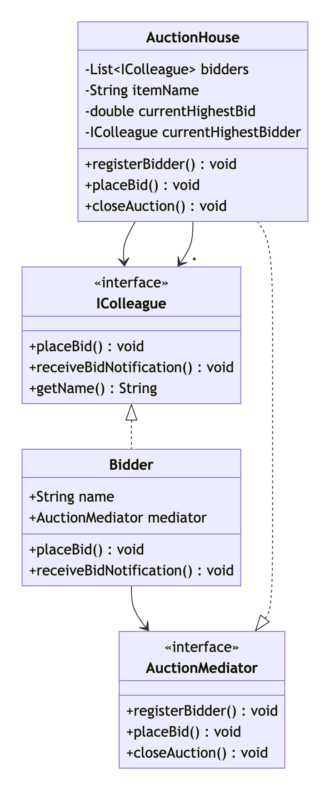
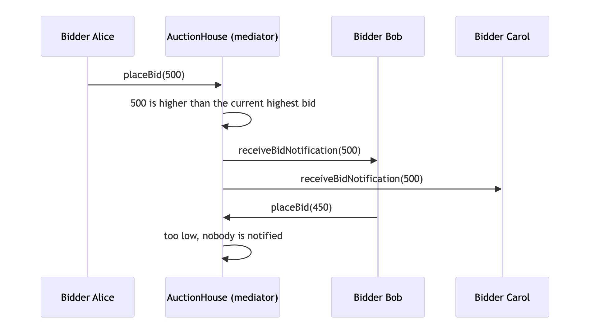
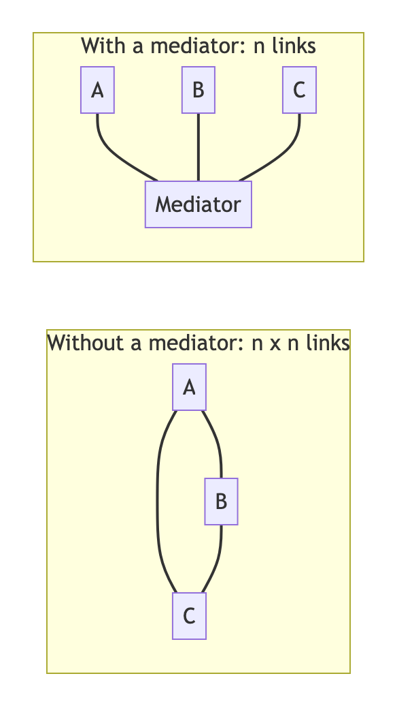

# Mediator Pattern (LLD #34)

<!-- nav -->
⬅ [33 Iterator Pattern](33_Iterator_Pattern_Notes.md) · [Index](00_LLD_Index.md) · [35 Coupon Shopping Cart](35_Coupon_Shopping_Cart_Notes.md) ➡
<!-- nav -->

Sources: [Mediator PDF](https://drive.google.com/file/d/1SVx1ZYrJ_nqdHQ6Uq390wSt1TMX5vPOU/view?usp=drive_link) · [Code on GitLab](https://gitlab.com/shrayansh8/lld-lowleveldesign/-/tree/main/src/main/java/com/conceptcoding/behavioralpatterns/mediator)

## In simple words
**Mediator** puts a **go-between** in the middle so that objects don't talk to each other directly. Everyone talks only to the mediator, and the mediator decides who needs to be told what. This removes the tangled web of "everybody knows everybody".

Think of an air-traffic controller: planes never talk to each other. They all talk to the tower, and the tower coordinates them.

## The problem it solves
In an auction, every bidder would have to know every other bidder to announce new bids. With *n* bidders that is *n × (n-1)* connections, and adding a bidder means updating all the others.

## The solution
- **Mediator interface** – `AuctionMediator` with `registerBidder`, `placeBid`, `closeAuction`.
- **Concrete mediator** – `AuctionHouse`: keeps the list of bidders, the current highest bid and highest bidder. It validates each bid and notifies everyone else.
- **Colleague interface** – `IColleague` (`placeBid`, `receiveBidNotification`).
- **Concrete colleagues** – `Bidder`: knows only the mediator. It sends bids to it and receives notifications from it.

**Auction house**



**a new bid**





*The mediator applies the rules and notifies*

```java
public void placeBid(IColleague bidder, double bidAmount) {
    // Check if the bid is valid
    if (bidAmount <= currentHighestBid) {
        System.out.println(bidder.getName() + " bid of $" + bidAmount + " is too low. Current highest bid is $" + currentHighestBid);
        // Colleagues are not notified about the bid
        return;
    }

    // Update the highest bid
    currentHighestBid = bidAmount;
    currentHighestBidder = bidder;
    System.out.println("\n===> [New Bid Accepted]" + " Info: {Bidder: " + bidder.getName() + ", Bid Amount: " + bidAmount + "}");
    for (IColleague colleague : bidders) {
        if (!colleague.getName().equals(bidder.getName())) {
            // Notify other bidders about the new bid
            colleague.receiveBidNotification(bidAmount);
        }
    }
}

@Override
public void closeAuction() {
```

## When to use
- Many objects interact in complicated ways and the dependencies are hard to follow.
- Examples: chat rooms, air-traffic control, UI dialogs (controls that enable or disable each other), a smart-home hub.

## Pros and cons
- ✅ Less coupling: colleagues are independent and reusable.
- ✅ All the interaction rules are in one place.
- ❌ The mediator can become a huge "god object" that knows too much.

**Related:** [Observer](03_Observer_Pattern_Notes.md) lets many objects *subscribe* to one source; Mediator *coordinates two-way* communication between many objects through a hub.

---

<!-- nav -->
⬅ [33 Iterator Pattern](33_Iterator_Pattern_Notes.md) · [Index](00_LLD_Index.md) · [35 Coupon Shopping Cart](35_Coupon_Shopping_Cart_Notes.md) ➡
<!-- nav -->
