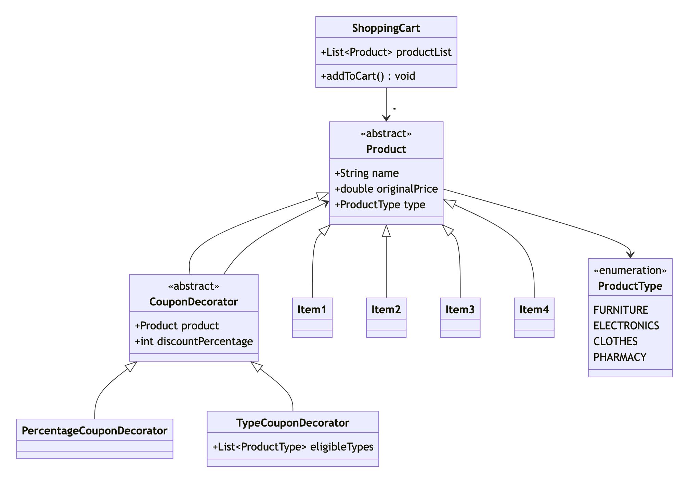
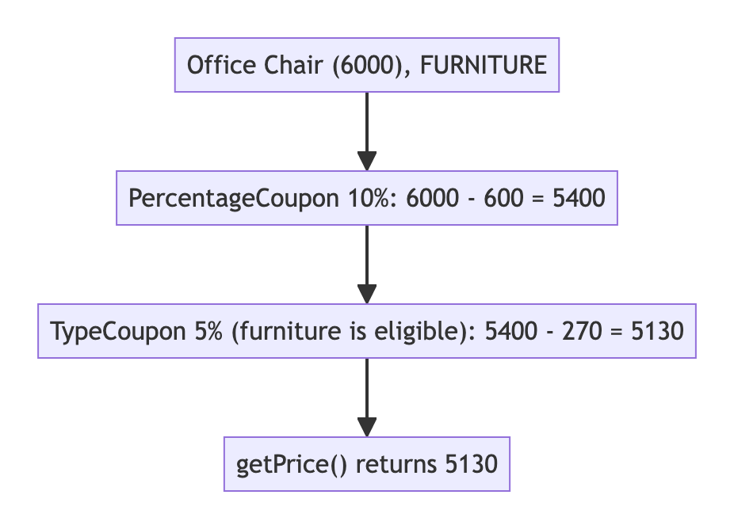
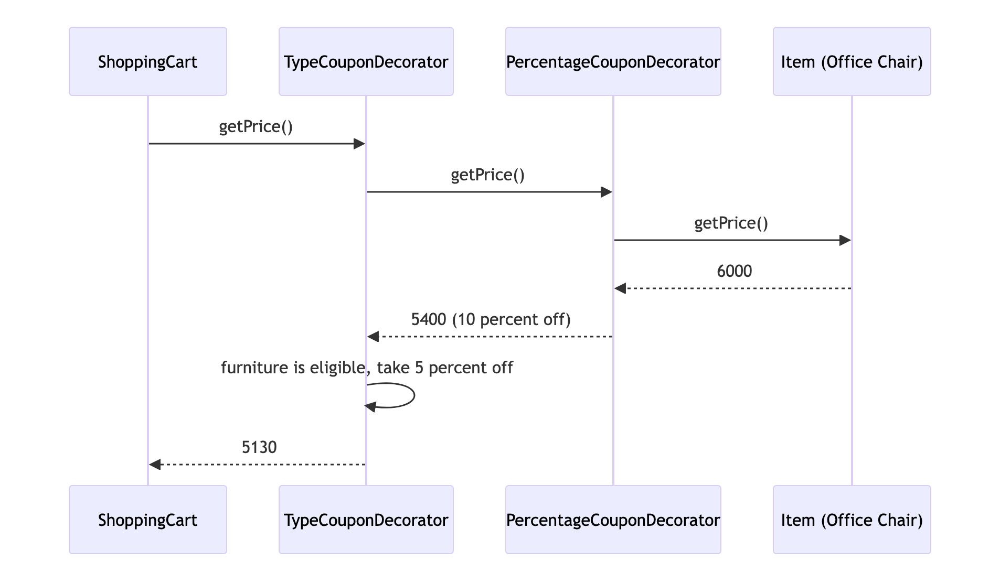

# Apply Coupons on a Shopping Cart (LLD #35)

<!-- nav -->
⬅ [34 Mediator Pattern](34_Mediator_Pattern_Notes.md) · [Index](00_LLD_Index.md) · [36 Visitor Pattern](36_Visitor_Pattern_Notes.md) ➡
<!-- nav -->

Sources: [Code on GitLab (Coupon application)](https://gitlab.com/shrayansh8/lld-lowleveldesign/-/tree/main/src/main/java/com/conceptcoding/interviewquestions/couponappln?ref_type=heads) (no PDF for this topic in your links)

## The problem
A shopping cart has products. Different **coupons** apply to them (a flat percentage on everything, or a discount only on certain product types). More than one coupon can apply to the same product. The design must stay easy when new coupons appear.

## Requirements
- Products with a name, price and **type** (`ELECTRONICS`, `FURNITURE`, `CLOTHES`, `PHARMACY`).
- A cart with many products; the cart total is the sum of the **discounted** prices.
- Coupon kinds: a **percentage coupon** (applies to any product) and a **type coupon** (applies only to eligible types, for example furniture and electronics).
- Coupons can be **combined**, and a new coupon type must not need changes to existing code.

## Step 1 – The idea: decorate the product
Instead of a big `if (couponA) ... if (couponB) ...` in the cart, each coupon **wraps a product** and changes the price it returns. This is the [Decorator pattern](04_Decorator_Pattern_Notes.md): the same trick as pizza toppings, but here a decorator *reduces* the price.

## Step 2 – Objects
| Object | Job |
|---|---|
| `Product` (abstract) | name, original price, `ProductType`; `getPrice()` |
| `Item1` to `Item4` | concrete products (Fan, Office Chair, Omega3-Tabs, Shirt in the demo) |
| `CouponDecorator` (abstract) | **is a** `Product` and **has a** `Product`; also a discount percentage |
| `PercentageCouponDecorator` | reduces any product's price by x % |
| `TypeCouponDecorator` | reduces the price only if the product's type is eligible (furniture, electronics) |
| `ShoppingCart` | a list of products and the cart total |

## Step 3 – Class diagram

**Coupon application**



## Step 4 – How prices are calculated
Each decorator asks the product it wraps for its price, then applies its own discount. Wrapping several decorators stacks the discounts.





*Discount only for eligible product types*

```java
    public double getPrice() {
        double price = this.product.getPrice();
        if (eligibleTypes.contains(this.product.getType())) {
            double priceAfterDiscount = price - (price * discountPercentage) / 100;
            System.out.println("Applying specific product type coupon of " + discountPercentage + "% on " + product.getName() + ", original price : " + price + ", price after discount : " + priceAfterDiscount);
            return priceAfterDiscount;
        }
        return price;
    }
}
```

A cart is then built by wrapping each product with the coupons that apply to it, and the cart total adds up each product's `getPrice()`.

## Design points to mention
- **Open/Closed:** a new coupon (buy-one-get-one, a flat ₹100 off, a coupon on the cart total) is a new decorator. The cart and the products don't change.
- **Order of coupons can matter** (10 % then ₹100 gives a different result from ₹100 then 10 %); decide and document the order.
- **Alternative designs:** a *Strategy* per coupon with a list in the cart (simpler when coupons don't need to stack on one product), or a *Chain of Responsibility* of coupon handlers.
- **Extensions:** coupon validity dates, usage limits, minimum cart value, mutually exclusive coupons, applying coupons at cart level instead of product level.

---

<!-- nav -->
⬅ [34 Mediator Pattern](34_Mediator_Pattern_Notes.md) · [Index](00_LLD_Index.md) · [36 Visitor Pattern](36_Visitor_Pattern_Notes.md) ➡
<!-- nav -->
