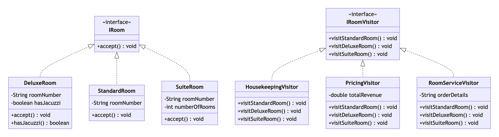
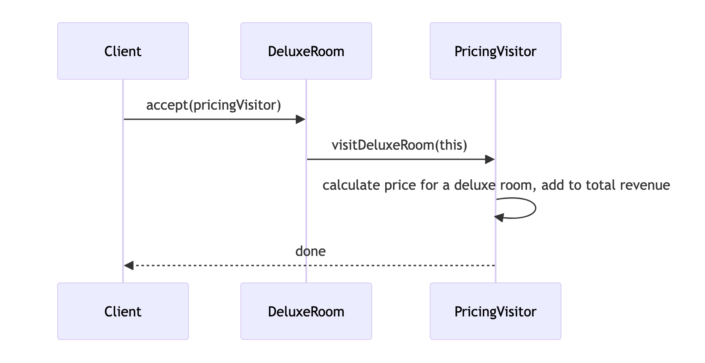

# Visitor Pattern (LLD #36)

<!-- nav -->
⬅ [35 Coupon Shopping Cart](35_Coupon_Shopping_Cart_Notes.md) · [Index](00_LLD_Index.md) · [37 MVC](37_MVC_Notes.md) ➡
<!-- nav -->

Sources: [Visitor PDF](https://drive.google.com/file/d/1vX_USKxmI-wqOwsV3tMD4OGj6a-usJdn/view) · [Code on GitLab](https://gitlab.com/shrayansh8/lld-lowleveldesign/-/tree/main/src/main/java/com/conceptcoding/behavioralpatterns/visitor)

## In simple words
**Visitor** lets you **add new operations to a group of classes without changing those classes**. You move the operation into a separate *visitor* object that "visits" each element. The element just says "accept this visitor", and the visitor does the work.

Think of a hotel with different rooms: the housekeeper, the room-service waiter and the accountant each visit every room, and each does a different job there. The rooms don't change when a new visitor type (say, a maintenance engineer) arrives.

## The problem it solves
A hotel has `StandardRoom`, `DeluxeRoom` and `SuiteRoom`. We need operations such as **cleaning**, **room service** and **price calculation**. If each operation becomes a method in each room class, the room classes keep growing and must be edited every time a new operation is needed (violating Open/Closed).

## The solution
- **Element interface** – `IRoom` with `accept(IRoomVisitor visitor)`.
- **Concrete elements** – `StandardRoom`, `DeluxeRoom`, `SuiteRoom`: each implements `accept` by calling the matching method on the visitor (*double dispatch*).
- **Visitor interface** – `IRoomVisitor` with one method per room type: `visitStandardRoom`, `visitDeluxeRoom`, `visitSuiteRoom`.
- **Concrete visitors** – `HousekeepingVisitor`, `RoomServiceVisitor`, `PricingVisitor`: each class is one whole operation applied to every room type.

**Diagram – Hotel rooms and visitors**



**Diagram – a visit (double dispatch)**



The **first dispatch** picks `accept` by the room type; the **second dispatch** (inside `accept`) picks the visitor method by the room type again, so the visitor gets the exact room type without any `instanceof` checks.

*An element only accepts the visitor*

```java
public void accept(IRoomVisitor visitor) {
    visitor.visitDeluxeRoom(this);
}
```

## When to use
- You have a stable set of element classes and want to add **many different operations** over them.
- Operations need to work differently for each element type (reports, price, export to XML/JSON, compiler passes over a syntax tree).

## Pros and cons
- ✅ Add a new operation by adding a new visitor, without touching the elements (Open/Closed).
- ✅ Related logic is kept together in one visitor (Single Responsibility).
- ✅ A visitor can collect state while walking the elements (such as `totalRevenue`).
- ❌ Adding a **new element type** forces changes in every visitor.
- ❌ Visitors may need access to the elements' internals, weakening encapsulation.
- ❌ Hard to understand at first.

**Rule of thumb:** use Visitor when the *elements rarely change* but the *operations change often*.

---

<!-- nav -->
⬅ [35 Coupon Shopping Cart](35_Coupon_Shopping_Cart_Notes.md) · [Index](00_LLD_Index.md) · [37 MVC](37_MVC_Notes.md) ➡
<!-- nav -->
