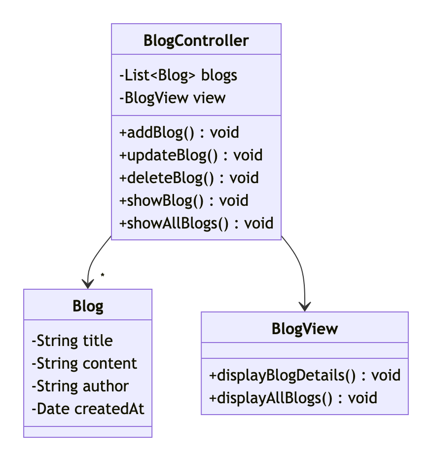
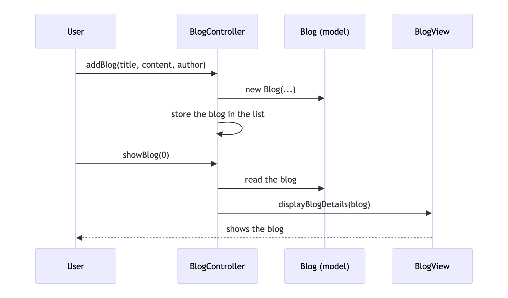
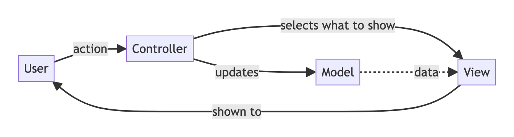

# MVC – Model View Controller (LLD #37)

<!-- nav -->
⬅ [36 Visitor Pattern](36_Visitor_Pattern_Notes.md) · [Index](00_LLD_Index.md) · [38 Memento Pattern](38_Memento_Pattern_Notes.md) ➡
<!-- nav -->

Sources: [MVC PDF](https://drive.google.com/file/d/1oKEaL_-2SnfeRIJUDzX7WNEOtqqcMTJ0/view?usp=drive_link) · [Code on GitLab](https://gitlab.com/shrayansh8/lld-lowleveldesign/-/tree/main/src/main/java/com/conceptcoding/additionalpatterns/mvc?ref_type=heads)

## In simple words
**MVC** splits an application into three parts so that data, screen and logic don't get tangled:
- **Model** – the **data** and business rules (a `Blog`: title, content, author, date).
- **View** – what the user **sees** (`BlogView` prints blog details or a list).
- **Controller** – the **go-between**: receives the user's action, updates the model and tells the view what to show (`BlogController`).

Think of a restaurant: the **kitchen** is the model (it makes the food), the **menu and plates** are the view (how it is presented), and the **waiter** is the controller (takes your order and brings the food).

## The problem it solves
If one class both stores the data, prints it and handles user commands, changing the screen (say, from console to web) means editing the logic, and nothing can be tested alone.

## The solution
- `Blog` (model) just holds data.
- `BlogView` (view) only knows how to display a `Blog` or a list of blogs. It has no logic.
- `BlogController` keeps the list of blogs and a view. Its methods `addBlog`, `updateBlog`, `deleteBlog`, `showBlog` and `showAllBlogs` change the model and then ask the view to display.

**Blog application**



**adding and showing a blog**





*The controller updates the model*

```java
public void addBlog(String title, String content, String author) {
    Blog blog = new Blog(title, content, author, new Date());
    blogs.add(blog);
    System.out.println("[+] Blog added successfully!");
}

// Update an existing blog by index
public void updateBlog(int index, String newTitle, String newContent) {
```

## When to use
- Almost any UI-based application: web (Spring MVC, Django, Rails), desktop and mobile apps.
- When you want to change the view without touching the rules, or test the logic without a screen.

## Pros and cons
- ✅ **Separation of concerns:** each part has one job and can change separately.
- ✅ Several views for the same model (web page, mobile, report).
- ✅ Easier to test the model and controller on their own.
- ❌ More classes and structure for small apps.
- ❌ In practice the controller can grow large ("fat controller"). Keep the business rules in the model or a service layer.

**Related:** MVC uses **Observer** (the view can be notified when the model changes) and often **Strategy** (swap views or controllers).

---

<!-- nav -->
⬅ [36 Visitor Pattern](36_Visitor_Pattern_Notes.md) · [Index](00_LLD_Index.md) · [38 Memento Pattern](38_Memento_Pattern_Notes.md) ➡
<!-- nav -->
