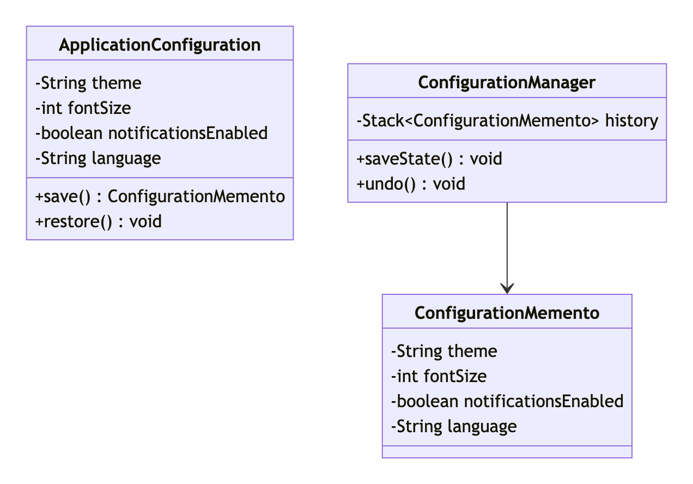
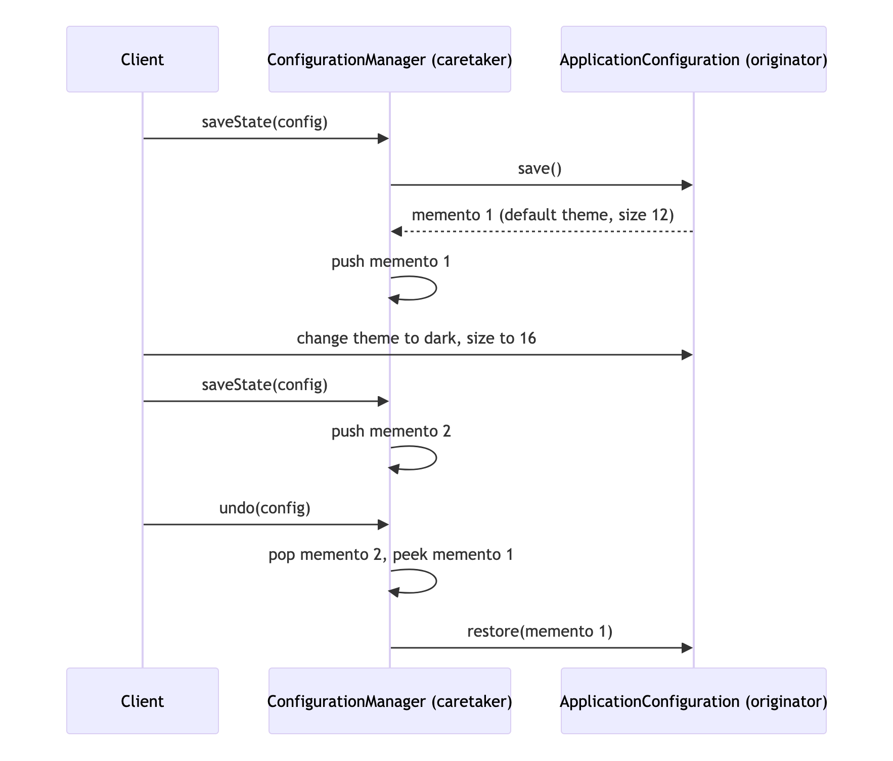

# Memento Pattern (LLD #38)

<!-- nav -->
⬅ [37 MVC](37_MVC_Notes.md) · [Index](00_LLD_Index.md) · [39 Template Method Pattern](39_Template_Method_Pattern_Notes.md) ➡
<!-- nav -->

Sources: [Memento PDF](https://drive.google.com/file/d/1hc0cbjPKURcsvlMMkfMsq4yFXisS9Z2b/view?usp=drive_link) · [Code on GitLab](https://gitlab.com/shrayansh8/lld-lowleveldesign/-/tree/main/src/main/java/com/conceptcoding/behavioralpatterns/memento)

## In simple words
**Memento** lets you **save a snapshot of an object's state** and **restore it later** (undo), without exposing the object's private details. The snapshot is a small object (the *memento*) that only the original object can open.

Think of a video-game save point: you save, play on, and if you fail you load the save and are exactly back where you were.

## The problem it solves
An application has settings (`theme`, `fontSize`, `notificationsEnabled`, `language`). Users change them and want to **undo** the changes. If another class reads and writes the private fields to save and restore them, encapsulation is broken and every change to the fields breaks that class.

## The solution
- **Originator** – `ApplicationConfiguration`: the object whose state changes. `save()` creates a memento from its current values, and `restore(memento)` loads one back.
- **Memento** – `ConfigurationMemento`: an immutable snapshot of the fields.
- **Caretaker** – `ConfigurationManager`: keeps a **stack** of mementos (the history) but never looks inside them. `saveState()` pushes one, `undo()` pops the latest and restores the one before it.

**Application configuration with undo**



**save, change, undo**



*The caretaker restores the previous snapshot*

```java
public void undo(ApplicationConfiguration appConfig) {
    if (history.size() > 1) {
        history.pop(); // removes and returns the last saved state
        ConfigurationMemento mementoToBeRestored = history.peek(); // returns the previous state to be restored
        appConfig.restore(mementoToBeRestored); // restores the application configuration to the previous saved state
        System.out.println("[+] Undo performed. History size: " + history.size());
        System.out.println(history.size() == 1 ? "[+] Default State: " + mementoToBeRestored : "[+] Current State: " + mementoToBeRestored);
    } else {
        System.out.println("[+] No more states to undo!");
        System.out.println("[+] Default State: " + history.peek());
    }
}
```

## When to use
- Undo/rollback, checkpoints, "restore defaults".
- You need snapshots but must keep the object's internals private.
- Examples: editors, games, transactions, settings screens.

## Pros and cons
- ✅ Keeps encapsulation; the originator stays in control of its own state.
- ✅ Simple undo history.
- ❌ Many snapshots use a lot of memory (limit the history size, or store only differences).
- ❌ The caretaker must manage the lifecycle of mementos.

**Memento vs Command for undo:** Memento stores *a copy of the state* and restores it; Command stores *how to reverse the action*. Memento is simpler when the state is small; Command is lighter when actions are easy to reverse. Many editors combine both.

---

<!-- nav -->
⬅ [37 MVC](37_MVC_Notes.md) · [Index](00_LLD_Index.md) · [39 Template Method Pattern](39_Template_Method_Pattern_Notes.md) ➡
<!-- nav -->
