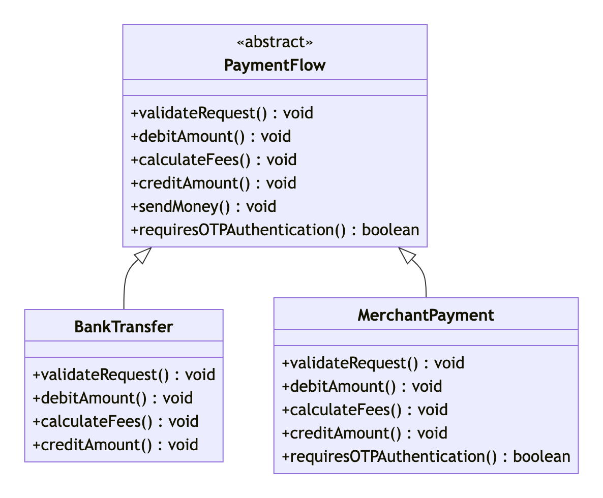
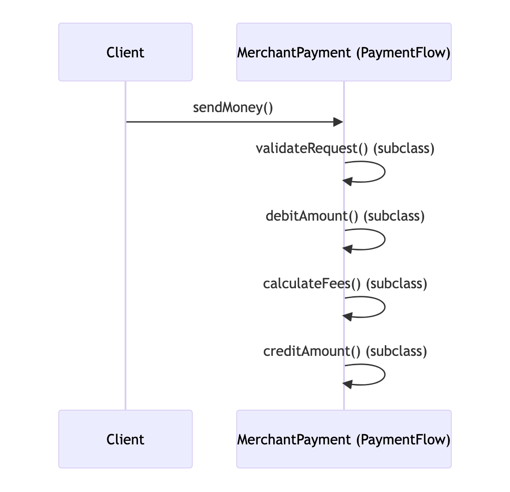

# Template Method Pattern (LLD #39)

<!-- nav -->
⬅ [38 Memento Pattern](38_Memento_Pattern_Notes.md) · [Index](00_LLD_Index.md) · [41 Interpreter Pattern](41_Interpreter_Pattern_Notes.md) ➡
<!-- nav -->

Sources: [Template Method PDF](https://drive.google.com/file/d/15qaWbbBxXeZD3uC_7jfVHwPZxxiAm-jV/view) · [Code on GitLab](https://gitlab.com/shrayansh8/lld-lowleveldesign/-/tree/main/src/main/java/com/conceptcoding/behavioralpatterns/templatemethod)

## In simple words
**Template Method** fixes the **steps of an algorithm in a base class** and lets subclasses fill in the details of individual steps. The overall order never changes; only some steps differ.

Think of a recipe card: "1. prepare, 2. cook, 3. serve". Every dish follows the same three steps, but *how* you prepare and cook differs.

## The problem it solves
Sending money always follows the same flow: **validate → debit → calculate fees → credit**. A bank transfer and a merchant payment share this flow but differ in each step. Copying the flow into both classes duplicates code, and one copy can drift out of order.

## The solution
- **Abstract class** – `PaymentFlow` contains:
  - the **template method** `sendMoney()`, `final` so subclasses can't change the order: it calls `validateRequest()`, `debitAmount()`, `calculateFees()`, `creditAmount()` in that order;
  - **abstract steps** that subclasses must implement;
  - a **hook** `requiresOTPAuthentication()` with a default (`false`) that subclasses *may* override;
  - a **common step** `logTransaction()` shared by everyone.
- **Concrete classes** – `BankTransfer` and `MerchantPayment` implement the steps (the merchant one also overrides the hook to require an OTP).

**Payment flow**



**the template in action**



*The final template method fixes the order*

```java
public final void sendMoney() {
    // step 1
    validateRequest();
    // step 2
    debitAmount();
    // step 3
    calculateFees();
    // step 4
    creditAmount();
}
```

## Kinds of steps
| Step type | Meaning |
|---|---|
| Abstract step | must be implemented by the subclass |
| Hook | has a default; the subclass *may* override it |
| Concrete step | shared code that everyone uses as it is |

## When to use
- Several classes share the same algorithm skeleton but differ in some steps.
- You want to prevent subclasses from changing the order.
- Examples: data-import pipelines (read → parse → save), test frameworks (`setUp → test → tearDown`), game turns, report generation, Spring's `JdbcTemplate`.

## Pros and cons
- ✅ Removes duplicated code; the order is enforced in one place.
- ✅ Easy to add a new variant (a new subclass).
- ❌ Uses **inheritance**, which is rigid; changing the skeleton affects all subclasses.
- ❌ Too many steps make subclasses hard to understand.

**Related:** Template Method varies parts of an algorithm by **inheritance**; **Strategy** swaps the whole algorithm by **composition**.

---

<!-- nav -->
⬅ [38 Memento Pattern](38_Memento_Pattern_Notes.md) · [Index](00_LLD_Index.md) · [41 Interpreter Pattern](41_Interpreter_Pattern_Notes.md) ➡
<!-- nav -->
