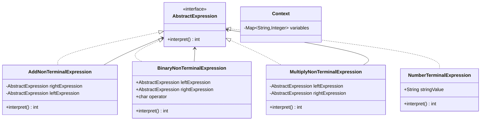
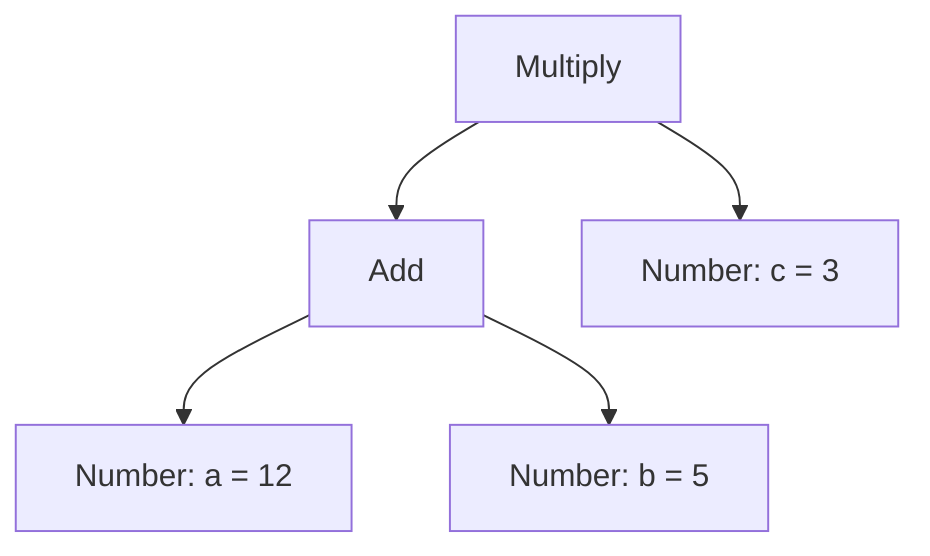
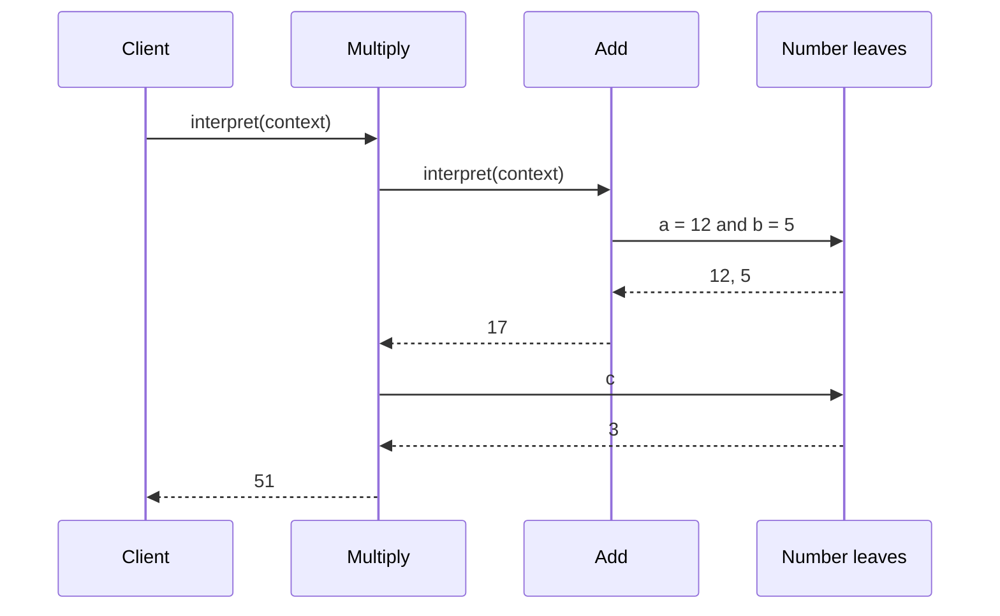

# Interpreter Pattern (LLD #41)

<!-- nav -->
⬅ [39 Template Method Pattern](39_Template_Method_Pattern_Notes.md) · [Index](00_LLD_Index.md) · [42 Payment Gateway](42_Payment_Gateway_Notes.md) ➡
<!-- nav -->

Sources: [Interpreter PDF](https://drive.google.com/file/d/1jnzOCqy1ICoPkI0d-N9HolZacVtlbeJD/view?usp=drive_link) · [Code on GitLab](https://gitlab.com/shrayansh8/lld-lowleveldesign/-/tree/main/src/main/java/com/conceptcoding/behavioralpatterns/interpreter)

## In simple words
**Interpreter** defines a tiny **language** (a grammar) and builds an **object tree** that can evaluate sentences in that language. Each rule of the grammar is a small class. To evaluate an expression, you call one method on the top of the tree and it recursively asks its children.

Think of a calculator: the expression `(a + b) * c` is not a string to the computer, it is a tree of "add" and "multiply" objects with variables at the leaves.

## The problem it solves
You must evaluate expressions such as `a + b` or `(a + b) * c` where the values come from variables. Hard-coding each formula (or parsing strings with `if`s) does not scale when new operators and rules appear.

## The solution
- **Context** – `Context` holds the variable values (`a = 12`, `b = 5`, ...).
- **Abstract expression** – `AbstractExpression` with `interpret(Context)`.
- **Terminal expression** – `NumberTerminalExpression`: a leaf (a variable or number); returns its value from the context.
- **Non-terminal expressions** – `AddNonTerminalExpression`, `MultiplyNonTerminalExpression`, `BinaryNonTerminalExpression`: hold a left and right `AbstractExpression` and combine their results.

**Diagram – Expression tree**



**Diagram – the tree for (a + b) * c**





*A non-terminal combines its children*

```java
public int interpret(Context context) {
    return leftExpression.interpret(context) + rightExpression.interpret(context);
}
```

*Building a tree for a + b*

```java
AbstractExpression expression1 = new AddNonTerminalExpression(
        new NumberTerminalExpression("a"),
        new NumberTerminalExpression("b"));
System.out.println("Expression: (a+b) = " + expression1.interpret(context)); // Output: 17
```

## When to use
- You have a **simple, stable grammar** that needs evaluating: math expressions, rule engines, search filters, regular expressions, SQL-like mini languages.

## Pros and cons
- ✅ Easy to add a new rule (a new class).
- ✅ The grammar is visible in the class structure.
- ❌ Not good for large or complex grammars: you get many classes. Use a parser generator instead.
- ❌ Evaluating deep trees can be slow.

**Related:** the tree structure is the **Composite** pattern; evaluating each node is like **Visitor**. Interpreter is rarely used in everyday application code.

---

<!-- nav -->
⬅ [39 Template Method Pattern](39_Template_Method_Pattern_Notes.md) · [Index](00_LLD_Index.md) · [42 Payment Gateway](42_Payment_Gateway_Notes.md) ➡
<!-- nav -->
