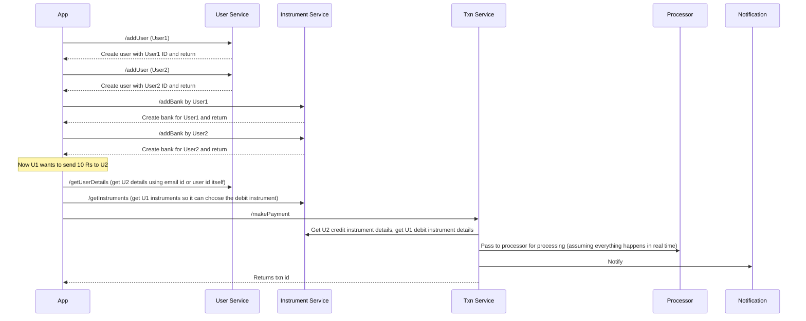
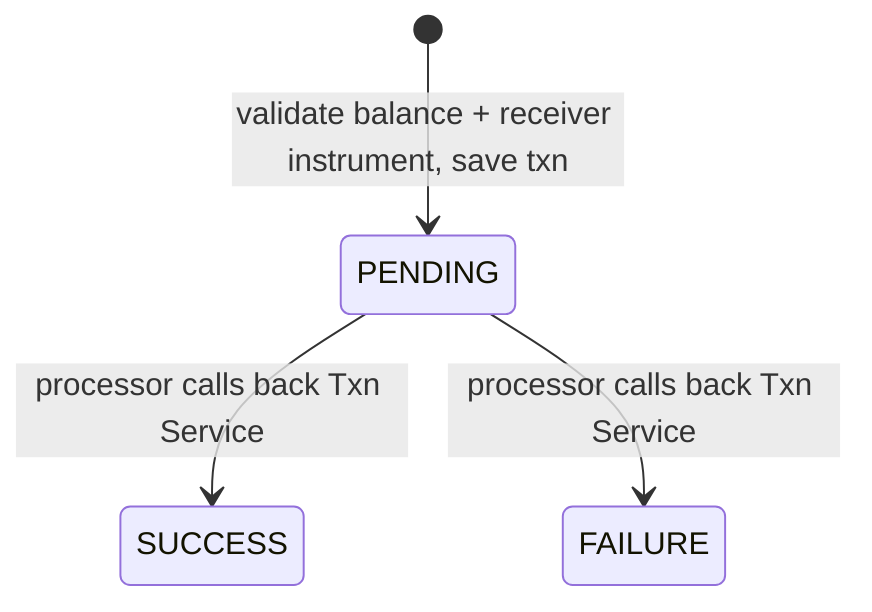
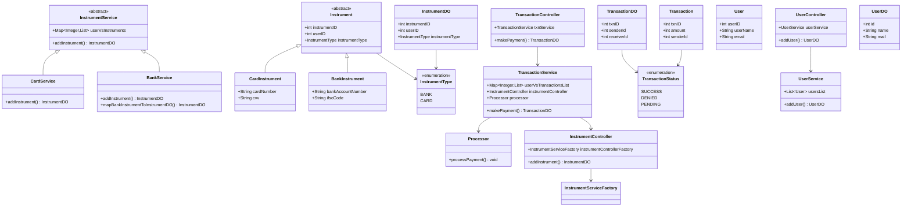
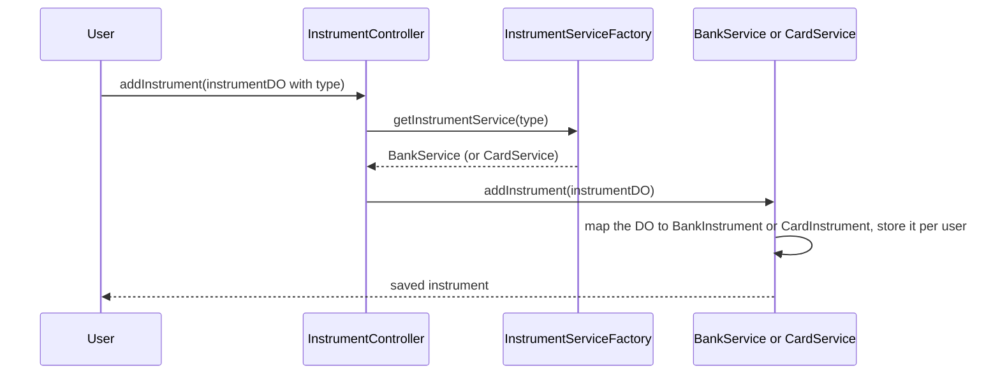
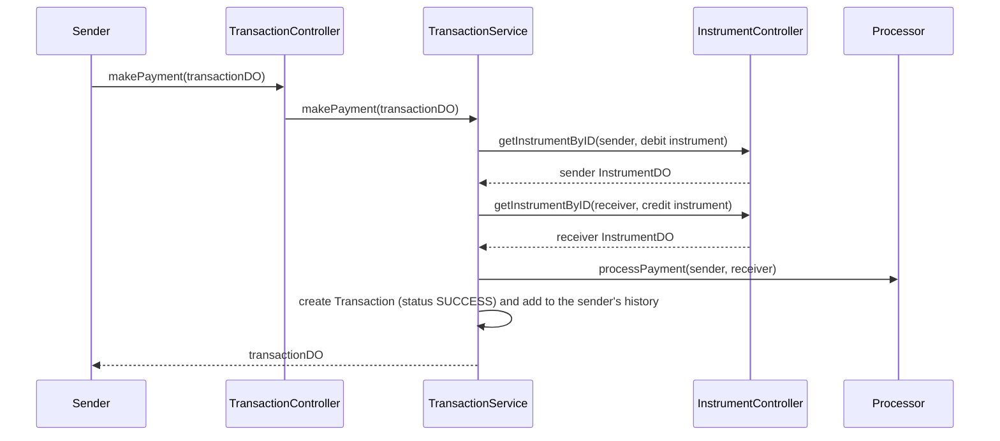
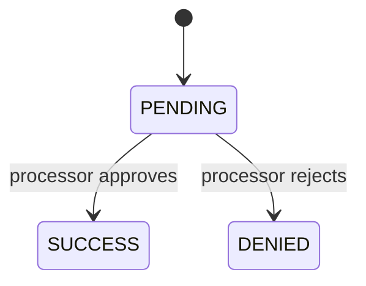

# Design a Payment Gateway (LLD #42)

<!-- nav -->
⬅ [41 Interpreter Pattern](41_Interpreter_Pattern_Notes.md) · [Index](00_LLD_Index.md) · [43 Object Pool Pattern](43_Object_Pool_Pattern_Notes.md) ➡
<!-- nav -->

Sources: [Zoho note](https://notebook.zohopublic.in/public/notes/bietv6993f5a023ec4e9f89436149ac3ed2f7) (typed Zoho note, now read from its rendered images) · [Code on GitLab](https://gitlab.com/shrayansh8/lld-lowleveldesign/-/tree/main/src/main/java/com/conceptcoding/interviewquestions/paymentgateway?ref_type=heads). *The sections under "From the Zoho note" come from the Zoho page; the code sections come from the GitLab repo (the Zoho page's last pages are screenshots of the same code).*

## The problem
Design a payment gateway like a simplified UPI or wallet system: users register **payment instruments** (a bank account or a card) and then send money to each other. The system records every **transaction**.

## Requirements
- Add users.
- A user can add instruments of different types: **BANK** (account number and IFSC) or **CARD** (card number and CVV).
- A user makes a payment: choose the sender's debit instrument and the receiver's credit instrument and the amount.
- A **processor** moves the money. Each transaction has a status (`SUCCESS`, `DENIED`, `PENDING`) and is stored in the user's history.
- New instrument types must be easy to add.

## From the Zoho note

### What is a payment gateway?
A payment gateway **acts as a mediator between the user and the financial institution and helps to transfer money.**

Two kinds are named: **peer to peer** and **peer to merchant** (peer to merchant adds things like **refund** and **multi-tenancy**). The page says **"let's focus on" peer to peer.**

### 1. Clarify the requirements / understand the flow
From the **App**, the following should be possible:
- A **user** can be **added / updated / deleted**.
- An **instrument** can be **added / updated / deleted** (**Bank**, **Card** etc.).
- **Make payment from U1 to U2:** search the user to whom the amount needs to be transferred, select the amount and the funding instrument, pass the information to the **processor**.
- **Notification** for operations such as add/remove user, debit payment, credit payment etc.
- Users are able to **see the transaction history**.

### 2. Main entities involved in the flow
1. User
2. Instrument (i. Bank, ii. Card etc.)
3. Transaction
4. Transaction History
5. Notification
6. Processor

### 3. Sequence diagram of one happy flow



**In simple words:** first the two users and their banks are created. Then, to pay, the app looks up the receiver, lists the sender's instruments to pick the debit one, and calls `/makePayment`. The transaction service fetches both instruments, hands the work to the processor, notifies, and returns a transaction id.

### Follow-up question that can come
**Payment processing can take up to 3-5 days.** Answer on the page: use an **async operation**:
1. Invoke the **processor to validate**: (a) if U1 has sufficient money to fund this transaction, (b) if the U2 instrument is valid.
2. Then **save the transaction in PENDING.**
   - Invoke the processing **in async** and complete the transaction while it is in PENDING state.
   - Once the process finishes, it invokes our **Txn Service** and we **update the transaction to either SUCCESS or FAILURE.**



(The class diagram on the page lists the status enum as `SUCCESS, PENDING, DENIED`.)

### 4. Class diagram (as drawn on the page)
The page's class diagram has the same shape as the diagram in Step 2 below:
- `PaymentGateway` holds `UserController`, `InstrumentController`, `TxnController`.
- `UserController → UserService (static List<User>) → User` (`userId, name, email`); `UserDO` is the data object (`id, firstName, mail`).
- `TxnController → TxnService` (holds `InstrumentController`, `Map<UserID, List<Transaction>>`, `Processor`), methods `makePayment(transactionDO)` and `getTxnHistory(userId)`; `Processor.processPayment(Transaction)`.
- `Transaction` has `txnID, Amount, senderUserID, receiverUserID, debitInstrumentID, creditInstrumentID, status`; `TransactionStatus = SUCCESS, PENDING, DENIED`.
- `InstrumentController → InstrumentServiceFactory.getInstrumentService(InstrumentType) → InstrumentService` (abstract class, `static Map<UserID, List<Instrument>>`, `addInstrument`, `getInstrument`) with `BankService` and `CardService`.
- `Instrument` (abstract: `instrumentID, userID, type`) with `BankInstrument (bankAccountNo, ifscCode)` and `CardInstrument (cardNumber, cvvNumber)`; `InstrumentType` enum = `BANK, CARD`.

### 5. Code on the page
The remaining pages of the Zoho note are screenshots of the code: `UserService` (keeps a static list of users and creates a user with a random id), `InstrumentServiceFactory` (returns `BankService` or `CardService` by `InstrumentType`), and the driver, which makes a payment of 10 from user 1's bank instrument to user 2's card instrument, then prints each user's instruments and transaction history. These match the code sections below.

## Step 1 – Objects
The code follows a layered pattern: **Controller → Service → entity**, and uses a `*DO` (data object) class to pass data between layers.

| Area | Classes |
|---|---|
| **User** | `UserController`, `UserService`, `User`, `UserDO` |
| **Instrument** | `Instrument` (abstract) with `BankInstrument`, `CardInstrument`; `InstrumentType` (`BANK`, `CARD`); `InstrumentDO`; `InstrumentController`; `InstrumentService` (abstract) with `BankService`, `CardService`; `InstrumentServiceFactory` |
| **Transaction** | `Transaction`, `TransactionDO`, `TransactionStatus`, `TransactionController`, `TransactionService`, `Processor` |
| **Entry point** | `PaymentGateway` |

## Step 2 – Class diagram

**Diagram – Payment gateway**



## Step 3 – Adding an instrument (Factory pattern)
Banks and cards store different details and need different handling, so each has its own service. The controller asks a **factory** for the right service for the instrument type ([Factory](05_Factory_Method_Notes.md)).



*The factory picks the service*

```java
public InstrumentService getInstrumentService(InstrumentType instrumentType) {
    if (instrumentType == InstrumentType.BANK)
        return new BankService();
    else if (instrumentType == InstrumentType.CARD)
        return new CardService();

    return null;
```

## Step 4 – Making a payment





*Load both instruments, process, record the transaction*

```java
public TransactionDO makePayment(TransactionDO txnDO) {
    // validate details

    // load sender instrument details which need to be passed to processors
    InstrumentDO senderInstrumentDO = instrumentController.getInstrumentByID(txnDO.getSenderId(), txnDO.getDebitInstrumentId());

    // load receiver instrument details which need to be passed to processors
    InstrumentDO receiverInstrumentDO = instrumentController.getInstrumentByID(txnDO.getReceiverId(), txnDO.getCreditInstrumentId());

    // pass the instrument details to processor
    processor.processPayment(senderInstrumentDO, receiverInstrumentDO);

    //based on processor response, we will set the status. for now har coding it to SUCCESS
    Transaction txn = new Transaction();
    txn.setAmount(txnDO.getAmount());
    txn.setTxnID(txnDO.getTxnID());
    txn.setSenderId(txnDO.getSenderId());
    txn.setReceiverId(txnDO.getReceiverId());
    txn.setDebitInstrumentId(txnDO.getDebitInstrumentId());
    txn.setCreditInstrumentId(txnDO.getCreditInstrumentId());
```

*In the repo the status is hard-coded to SUCCESS and the processor is a placeholder, so this is the skeleton to extend.*

## Design points to mention
- **Layering:** controllers are thin; services hold the logic; DOs separate the API shape from the stored entities.
- **Open/Closed:** a new instrument (wallet, UPI) is a new `Instrument` subclass, a new service and one line in the factory.
- **Processor** is where real work lives: different processors per instrument pair (bank to bank, card to bank), possibly as [Strategy](02_Strategy_Pattern_Notes.md).
- **Things to discuss for a real gateway:** idempotency (a payment must not be applied twice, see the HLD note on [idempotent APIs](../HLD/14_Idempotent_POST_API_Notes.md)), debit-then-credit consistency (see [distributed transactions](../HLD/20_Distributed_Transactions_Notes.md)), retries, refunds, fraud checks, audit logs, and encrypting card data.

---

<!-- nav -->
⬅ [41 Interpreter Pattern](41_Interpreter_Pattern_Notes.md) · [Index](00_LLD_Index.md) · [43 Object Pool Pattern](43_Object_Pool_Pattern_Notes.md) ➡
<!-- nav -->
