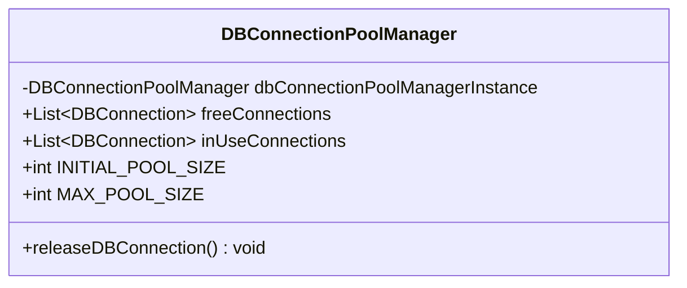
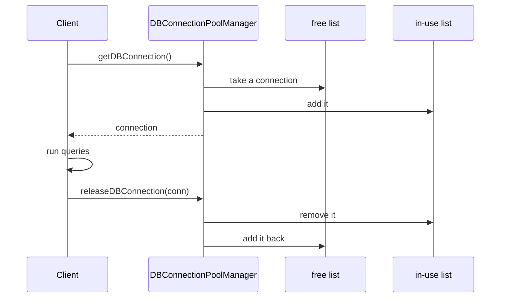
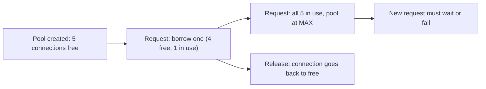

# Object Pool Pattern (LLD #43)

<!-- nav -->
⬅ [42 Payment Gateway](42_Payment_Gateway_Notes.md) · [Index](00_LLD_Index.md) · [44 Meeting Scheduler](44_Meeting_Scheduler_Notes.md) ➡
<!-- nav -->

Sources: [Object Pool PDF](https://drive.google.com/file/d/1NymzCEjJq7c_w1XQrjpt77xk-M1KrvWo/view?usp=drive_link) · [Code on GitLab](https://gitlab.com/shrayansh8/lld-lowleveldesign/-/tree/main/src/main/java/com/conceptcoding/creationalpatterns/objectpool?ref_type=heads)

## In simple words
**Object Pool** keeps a fixed set of **ready-made, expensive objects** and lends them out. A caller *borrows* one, uses it and *returns* it, so it can be reused. You skip the cost of creating and destroying objects again and again.

Think of a car-rental lot: the company owns a limited number of cars, you take one, and when you return it, someone else can use it.

Typical examples: database connection pools, thread pools, socket connections.

## The problem it solves
Opening a database connection is slow and expensive. If every request creates a new connection and closes it afterwards, the application wastes time, and under load it may open more connections than the database can handle.

## The solution
- **Reusable object** – `DBConnection` (the costly resource).
- **Pool manager** – `DBConnectionPoolManager` (itself a **Singleton**) keeps two lists: `freeConnections` and `inUseConnections`.
- It creates an **initial pool size** at start-up and never grows beyond a **maximum pool size**.
- `getDBConnection()` moves one from *free* to *in use* (creating a new one only if the pool is below the max).
- `releaseDBConnection(conn)` moves it back to *free*.

**Diagram – Connection pool**



**Diagram – borrow and return**





*Borrowing a connection*

```java
public synchronized DBConnection getDBConnection() {
    DBConnection dbConnection = null;
    if (freeConnections.isEmpty() && inUseConnections.size() < MAX_POOL_SIZE) {
        freeConnections.add(new DBConnection());
        System.out.println("New DBConnection created and added to freeConnections list.");
        System.out.println("freeConnections size: " + freeConnections.size());
        System.out.println("inUseConnections size: " + inUseConnections.size());
    } else if (freeConnections.isEmpty() && inUseConnections.size() >= MAX_POOL_SIZE) {
        System.out.println("Pool is full. Cannot create new DBConnection.");
        return null;
    }
    dbConnection = freeConnections.remove(freeConnections.size() - 1);
    inUseConnections.add(dbConnection);
    System.out.println("DBConnection retrieved from freeConnections list and added to inUseConnections list.");
    System.out.println("freeConnections size: " + freeConnections.size());
    System.out.println("inUseConnections size: " + inUseConnections.size());
    return dbConnection;
}

// Thread-safe: Only one thread can access this method at a time
```

## Things to handle in a real pool
- **Thread safety:** `synchronized` methods or concurrent collections (many threads borrow at once).
- **Limits:** a maximum size and what to do when it is reached (wait, time out or fail).
- **Validation:** check a connection is still alive before lending it.
- **Always return** objects (use `try/finally`), otherwise the pool empties.
- **Reset state** before reuse, so the next user does not see the last user's data.

## When to use
- Creating the object is costly (connections, threads, large buffers).
- You need many short uses of a limited resource.

## Pros and cons
- ✅ Faster (no repeated creation) and predictable resource usage.
- ❌ Added complexity; leaked (never returned) objects starve the pool.
- ❌ Idle objects still use memory.

**Related:** Singleton (the pool manager is one); Flyweight shares *immutable* state, while a pool lends out objects one user at a time.

---

<!-- nav -->
⬅ [42 Payment Gateway](42_Payment_Gateway_Notes.md) · [Index](00_LLD_Index.md) · [44 Meeting Scheduler](44_Meeting_Scheduler_Notes.md) ➡
<!-- nav -->
