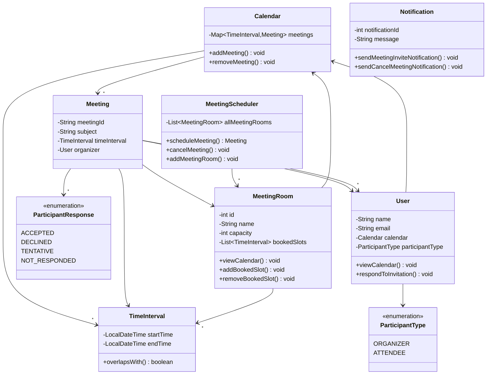
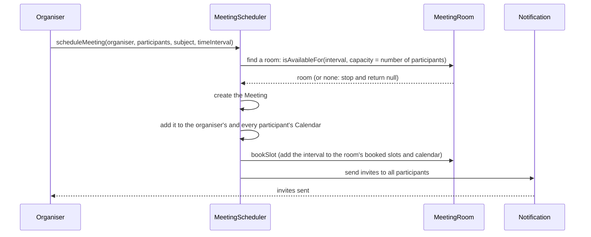
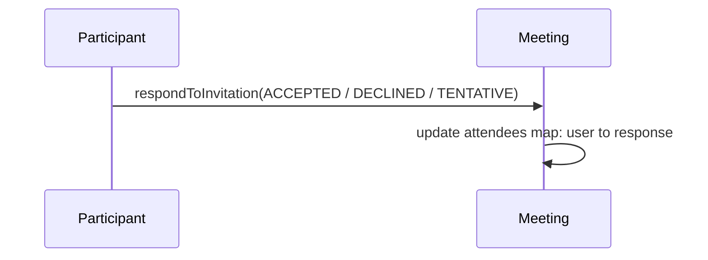
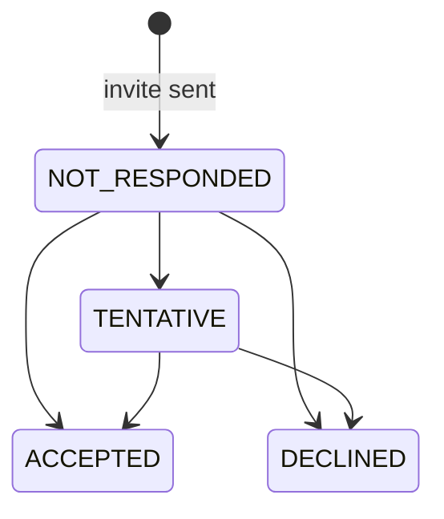
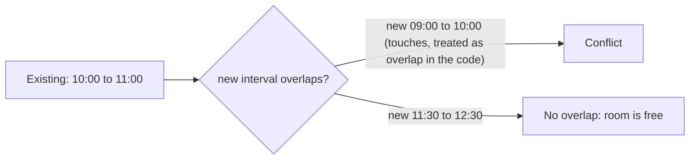

# Design a Meeting Scheduler (LLD #44)

<!-- nav -->
⬅ [43 Object Pool Pattern](43_Object_Pool_Pattern_Notes.md) · [Index](00_LLD_Index.md)
<!-- nav -->

Sources: [Code on GitLab (Meeting scheduler mock interview)](https://gitlab.com/shrayansh8/lld-lowleveldesign/-/tree/main/src/main/java/com/conceptcoding/interviewquestions/meetingscheduler?ref_type=heads) (this topic has no number or PDF in your links)

## The problem
Design a system like a calendar and room-booking tool. An organiser invites people to a meeting at a given time. The system finds a **free meeting room** big enough, books it, puts the meeting in everyone's calendar and sends **invites**. People respond, and meetings can be cancelled.

## Requirements
- Users, each with a **calendar**.
- Meeting rooms with a **capacity** and their own booked time slots.
- Schedule a meeting: pick a room that fits all participants and is free during the interval.
- Notify participants of the invite (and of a cancellation).
- Participants respond: `ACCEPTED`, `DECLINED`, `TENTATIVE` or `NOT_RESPONDED`.
- Cancel a meeting: free the room and remove it from the calendars.

## Step 1 – Objects
| Object | Job |
|---|---|
| `User` | name, email, a `Calendar`; can view the calendar and respond to an invitation |
| `ParticipantType`, `ParticipantResponse` | `ORGANIZER` / `ATTENDEE`; the four response values |
| `TimeInterval` | start and end time; `overlapsWith(other)` |
| `Meeting` | id, subject, interval, organiser, room and a map of attendee to response |
| `Calendar` | a map of `TimeInterval` to `Meeting`; add and remove a meeting |
| `MeetingRoom` | id, name, capacity, booked slots, its own calendar; `isAvailableFor(interval, capacity)` |
| `Notification` | sends invite and cancellation messages |
| `MeetingScheduler` | the coordinator: owns all rooms; `scheduleMeeting`, `cancelMeeting`, room search and booking |

## Step 2 – Class diagram

**Diagram – Meeting scheduler**



## Step 3 – Scheduling a meeting







*Find a room, create the meeting, book, notify*

```java
public Meeting scheduleMeeting(User organiser, Map<User, ParticipantResponse> participants, String subject, TimeInterval timeInterval) {
    // Check for available meeting rooms with available time slots
    MeetingRoom room = checkForAvailableRooms(participants.size(), timeInterval);
    if (room == null) {
        System.out.println("===>>> No available meeting room");
        return null;
    }
    System.out.println("\n===>>> Available meeting room found");
    // Create meeting
    Meeting meeting = new Meeting(getMeetingId(), subject, timeInterval, organiser, participants, room);

    // Add meeting to participants(both organiser and participants) calendar
    organiser.getCalendar().addMeeting(meeting);
    for (User user : participants.keySet()) {
        user.getCalendar().addMeeting(meeting);
    }
    // Add meeting to meeting room calendar
    bookSlot(room, meeting);

    // Notify participants
    notifyParticipantsWithInvites(meeting);
    simulateUserResponsesForInvites(meeting);
    System.out.println("[+] Meeting scheduled successfully!!");

    return meeting;
}
```

## Step 4 – Time overlap (the key logic)
Two intervals **overlap** unless one ends before the other starts. A room is free for a new meeting only if it has **no booked slot that overlaps** the new interval, and its capacity is at least the number of participants.



*Overlap test*

```java
public boolean overlapsWith(TimeInterval newInterval) {
    // if the current interval ends before the new interval starts - valid: overlaps? false
    // if the current interval starts after the new interval ends - valid: overlaps? false
    return !this.endTime.isBefore(newInterval.startTime) &&
            !this.startTime.isAfter(newInterval.endTime);
}
```

*The code treats meetings that touch at the end point (one ends at 10:00 and the next starts at 10:00) as overlapping. Many designs use strict `<` and `>` so back-to-back meetings are allowed.*

## Design points to mention
- **Rooms and users each have a calendar**, so you can ask "what is booked?" for either one.
- **Search strategy:** the code takes the first suitable room. You can add a strategy for choosing (smallest room that fits, nearest floor, ...) ([Strategy](02_Strategy_Pattern_Notes.md)).
- **Notifications** can be made pluggable (email, Slack, push) with the [Observer pattern](03_Observer_Pattern_Notes.md).
- **Concurrency:** two organisers booking the same room at once need an atomic check-and-book (the same idea as [Car Rental](09_Car_Rental_System_Notes.md) and [BookMyShow](14_BookMyShow_Notes.md)).
- **Extensions:** recurring meetings, time zones, finding a common free time for all attendees, room equipment, waiting list for rooms.

---

<!-- nav -->
⬅ [43 Object Pool Pattern](43_Object_Pool_Pattern_Notes.md) · [Index](00_LLD_Index.md)
<!-- nav -->
