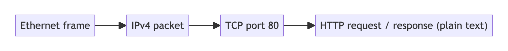
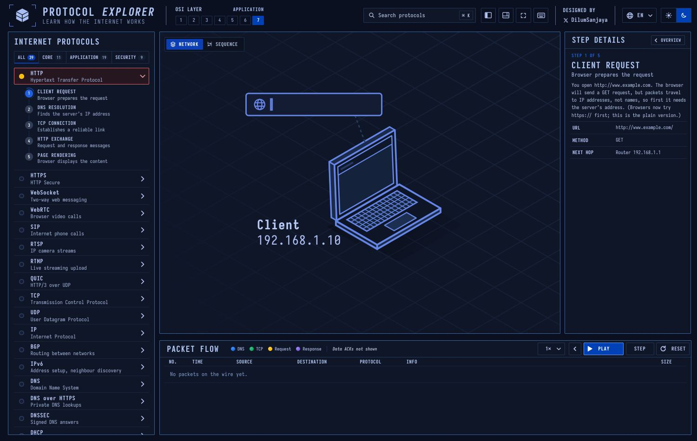
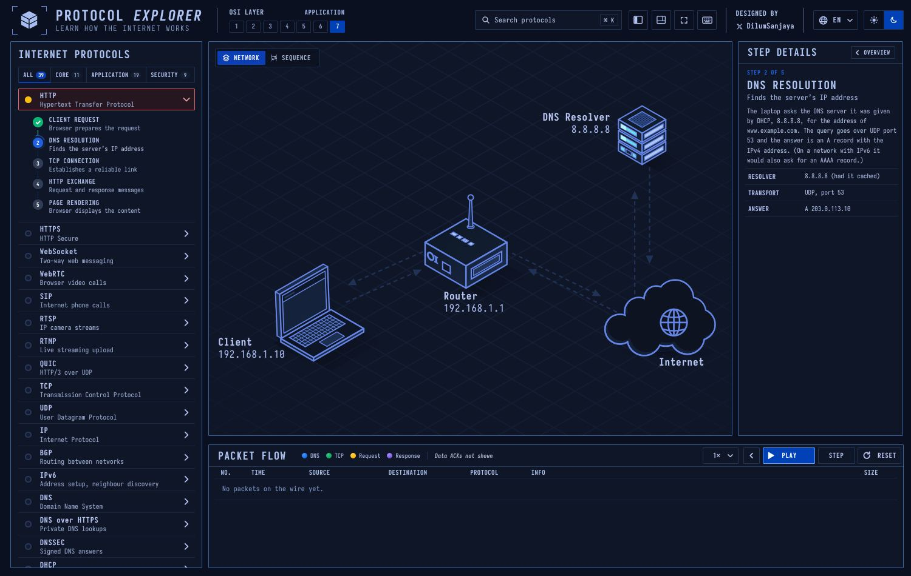
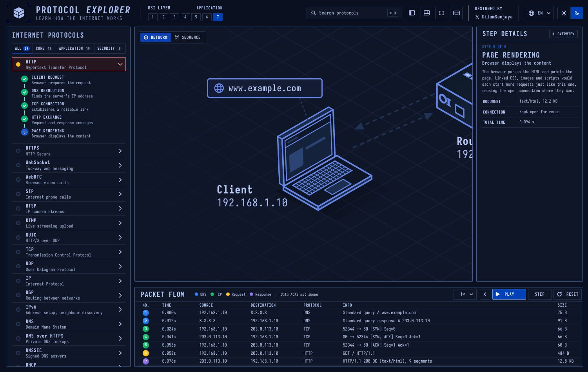
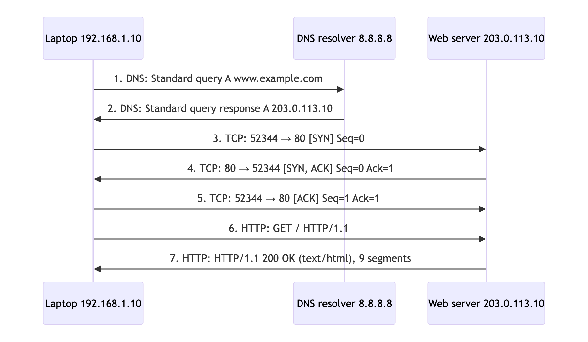
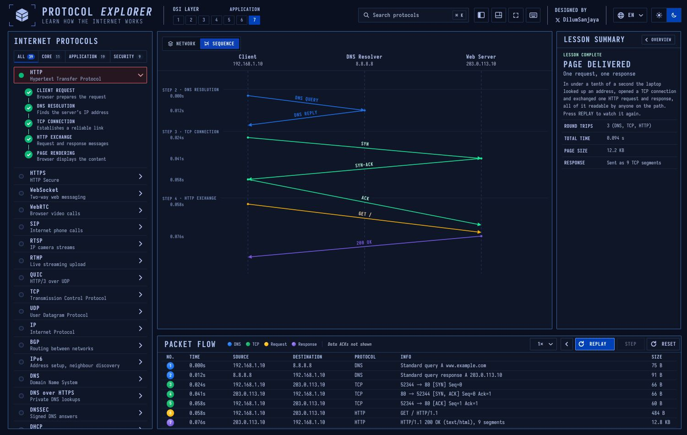
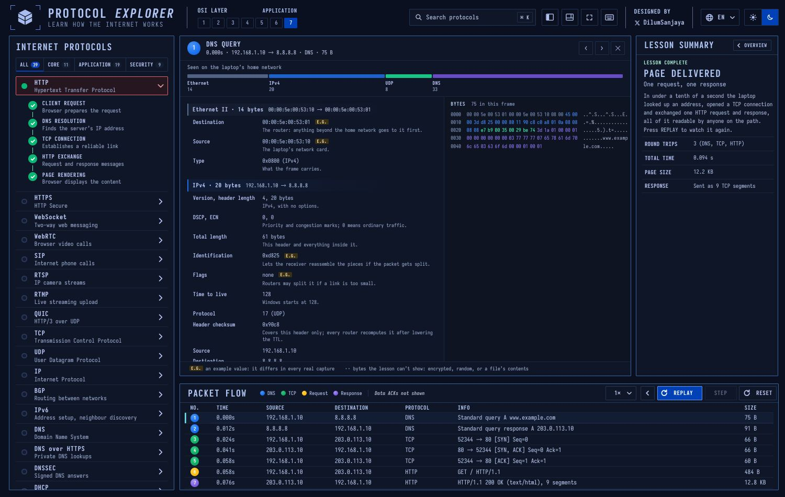
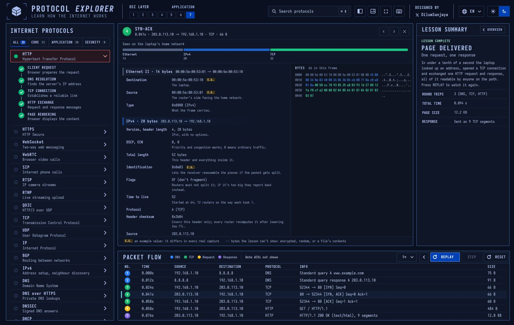
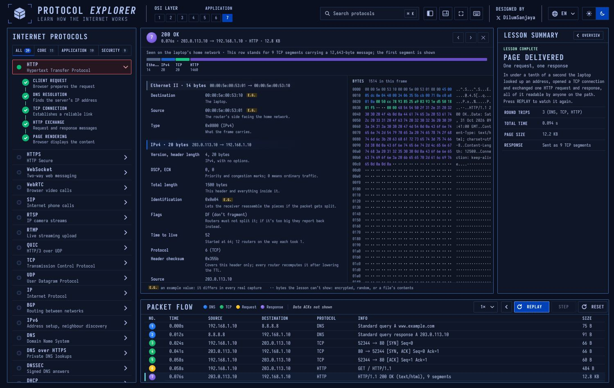

# HTTP – Hypertext Transfer Protocol

<!-- nav -->
[Index](00_Protocols_Index.md) · [02 HTTPS](02-https.md) ➡
<!-- nav -->

*Source: Protocol Explorer – https://protocol-explorer-alpha.vercel.app/ (interactive lesson #1). Screenshots captured from the live lesson; packet decodes are the site's example capture (values marked **E.G.** differ in every real capture).*

## Overview


### How the layers fit together (outer to inner)



## In-depth explanation of the example (plain-language version)

### The big picture in one minute
You type `http://www.example.com` into a browser and press Enter. A moment later a web page appears. This lesson shows **everything that travels over the wire** to make that happen: **7 small messages (packets) in about 0.09 seconds.**

Think of it like **ordering food by phone**:
1. You look up the restaurant's phone number (**DNS** – 2 messages).
2. You call and wait for them to pick up, so you both know the line works (**TCP handshake** – 3 messages).
3. You say what you want, and they send it (**HTTP** – 2 messages).

**The key idea:** HTTP is only the *last* step. Before the browser can ask for the page, it needs (a) the server's *address* and (b) a *reliable connection* to it. HTTP is just the polite, plain-text conversation that happens once those are ready.

### Who is who
| Name | Address | Role |
|---|---|---|
| **Client** (your laptop) | `192.168.1.10` | asks for the page |
| **Router** (your home box) | `192.168.1.1` | the door out of your home network |
| **DNS resolver** | `8.8.8.8` | a "phone book" server that turns names into numbers |
| **Web server** | `203.0.113.10` | holds the website and replies |

> **Words you'll see:** a *packet* is one small chunk of data sent over a network. An *IP address* is a computer's number on the network (like a house number). A *port* is a numbered "door" on a computer – web servers listen at port **80** for HTTP.

---

### Step 1 – The browser gets ready
You typed `http://www.example.com/`. The browser splits it into three pieces:
- `http` → "talk in plain, unencrypted web language, on port 80"
- `www.example.com` → the **name** of the website
- `/` → the **page** you want (the front page)

It decides to send a request called **GET** ("please give me this page"). But computers on the internet find each other by **number**, not by name. So before it can send anything, the browser needs the number for `www.example.com`.

*Why does the packet go to the router?* Your laptop only talks directly to devices in your own home network (`192.168.1.x`). Anything outside goes to the **router**, which forwards it onward – like handing your letter to the post office.

---

### Step 2 – Looking up the address (DNS) – packets 1 and 2
**Packet 1 – the question.** The laptop asks the DNS server `8.8.8.8`: *"What is the number for `www.example.com`?"* This is called an **A query** (an "A record" is just "name → IPv4 address").
- It uses **UDP port 53**. UDP is a "just send it" method – perfect for one tiny question and one tiny answer.
- The question carries a random label (`0x3d1a`). The answer must carry the same label, which stops an imposter from slipping in a fake answer.

**Packet 2 – the answer.** `8.8.8.8` replies: *"`www.example.com` is `203.0.113.10`."* It also says *"you can remember this for 1,745 seconds"* (about 29 minutes). That "remember for" time is called the **TTL**, and remembering answers is called **caching**.

⏱ This took only 12 milliseconds because the DNS server already knew the answer.

**Result:** the browser now has the server's number: `203.0.113.10`.

---

### Step 3 – Opening a connection (TCP "three-way handshake") – packets 3, 4, 5
HTTP needs a connection that **doesn't lose or scramble data**. That's what **TCP** provides, but both sides must agree to start first. They do it with three quick messages – like a phone call:

| Packet | Who says it | In plain words |
|---|---|---|
| 3 – **SYN** | laptop → server | "Hello, can we talk?" |
| 4 – **SYN-ACK** | server → laptop | "Yes, I hear you. Can *you* hear me?" |
| 5 – **ACK** | laptop → server | "Yes, I hear you. Let's go." |

A few details inside these packets:
- The laptop uses a **temporary port** (`52344`) as its "return door". The server uses **port 80**. Together with the two IP addresses, that pair identifies this conversation.
- Each side picks a **starting number** for counting the bytes it sends. (The lesson shows "0" to keep it simple; the real numbers start at a random value.) Counting every byte is how TCP notices if something goes missing.
- In the first two packets the sides also announce their limits – for example *"don't send me more than 1,460 bytes at a time"* (this limit is called the **MSS**).

After packet 5 the connection is open in both directions.

---

### Step 4 – The actual HTTP request and reply – packets 6 and 7
Now the real conversation begins. HTTP messages are **plain text** you could read with your eyes.

**Packet 6 – the request (laptop → server).** It looks like this:
```
GET / HTTP/1.1
Host: www.example.com
Connection: keep-alive
User-Agent: Mozilla/5.0 ... Chrome/142 ...
Accept: text/html,...
Accept-Language: en-US
```
Line by line:
- `GET / HTTP/1.1` → "Give me the front page, using HTTP version 1.1."
- `Host: www.example.com` → "I mean *this* website." (One server can host many websites, so you have to say which.)
- `Connection: keep-alive` → "Don't hang up after this – I may ask for more."
- `User-Agent` → "I'm Chrome on Windows."
- `Accept` / `Accept-Language` → "I can read HTML pages, and I prefer English."

A blank line marks the end of the request.

**Packet 7 – the reply (server → laptop).** It starts like this:
```
HTTP/1.1 200 OK
Content-Type: text/html; charset=utf-8
Content-Length: 12500
Connection: keep-alive

<the 12,500 bytes of the web page's HTML>
```
- `200 OK` → "Success – here it is." (You've seen `404 Not Found` – that's another status code.)
- `Content-Type` → "This is an HTML page."
- `Content-Length: 12500` → "The page is 12,500 bytes long," so the browser knows when it has everything.
- Then the page itself.

*Why does the lesson say "9 segments"?* One network packet can carry at most about **1,460 bytes** of your data. The page is 12,500 bytes, so TCP cuts it into **9 pieces** and sends them one after another. The lesson draws them as one big box to keep the picture simple. The laptop puts the pieces back together in order.

---

### Step 5 – The browser draws the page
The browser reads the HTML and paints the page on screen. The page will usually mention other files – images, styles, scripts. Each one needs another `GET` request, but they **reuse the same open connection** (that's what `keep-alive` was for), so there's no new DNS lookup and no new handshake.

**Total time for this whole story: 0.094 seconds.**

---

### The 7 messages at a glance
| # | What | Why it's needed |
|---|---|---|
| 1–2 | DNS question and answer | to learn the server's number |
| 3–5 | TCP handshake | to open a safe, ordered connection |
| 6 | HTTP request (`GET /`) | to ask for the page |
| 7 | HTTP reply (`200 OK` + page) | to receive the page |

### What to remember
- **Three trips back and forth** happen before you see anything: DNS, TCP handshake, HTTP. That is why caching and keeping connections open make websites faster.
- **HTTP is plain text.** Anyone who can see the network (for example on public Wi-Fi) can read the page address, cookies and content. This is the reason **HTTPS** exists – covered in the next note.
- The messages are built like **nested envelopes**: your HTTP text sits inside a TCP packet, which sits inside an IP packet, which sits inside an Ethernet frame. Each layer only adds its own "address label".

## Under the hood – technical details

- **Message layout.** An HTTP/1.1 message is plain text. The first line is the *request line* (`GET / HTTP/1.1`: method, target, version) or the *status line* (`HTTP/1.1 200 OK`: version, status code, reason). After it come *header lines* (`Name: value`), each ending in CR LF. A completely blank line ends the headers, and the optional *body* follows it.
- **Host header.** `Host: www.example.com` is mandatory in HTTP/1.1. One server (one IP address) can host many websites (*virtual hosting*), so the server uses this header to decide which site you mean.
- **Where the body ends.** The receiver must know when the body is finished. Either the sender states the size up front (`Content-Length: 12500`) or it sends the body in pieces with `Transfer-Encoding: chunked`, ending with a zero-length chunk.
- **Why 9 segments.** TCP carries at most one *MSS* (maximum segment size) of data per packet: 1,500 bytes (the Ethernet MTU) minus 20 bytes of IP header and 20 bytes of TCP header gives **1,460 bytes**. A 12,500-byte page needs 12,500 / 1,460 = 8.6, so **9 segments**. TCP numbers every byte and puts the pieces back in order.
- **Persistent connections.** In HTTP/1.1 `Connection: keep-alive` is the default, so one TCP connection serves many requests. This saves the DNS lookup and the three-way handshake for every image, script and style sheet.
- **Stateless protocol.** The server treats every request independently. Things like logins are added on top with *cookies* (`Set-Cookie` in the reply, `Cookie` in later requests).
- **Methods.** `GET` reads, `POST` creates or triggers something, `PUT` replaces, `DELETE` removes, `HEAD` is a `GET` without the body. `GET`, `PUT` and `DELETE` are *idempotent* (repeating them gives the same result); `POST` is not, which is why retrying a payment needs an idempotency key (see the HLD notes).
- **Status code families.** `1xx` information, `2xx` success (`200 OK`, `201 Created`), `3xx` redirect (`301`, `302`, `304 Not Modified`), `4xx` client error (`400`, `401`, `403`, `404`), `5xx` server error (`500`, `502`, `503`).
- **Caching.** Headers such as `Cache-Control`, `ETag` and `Last-Modified` let the browser reuse a saved copy. It can ask "has this changed?" with `If-None-Match` and get a tiny `304 Not Modified` back.
- **Newer versions.** HTTP/2 keeps the same meaning but sends binary frames and *multiplexes* many requests over one TCP connection. HTTP/3 does the same over QUIC (UDP), which removes TCP's head-of-line blocking.
- **Security.** Everything here is readable by anyone on the path (URL, cookies, content). HTTPS wraps the same messages in TLS.

## Step-by-step walkthrough (screenshots from the lesson)

### Step 1: CLIENT REQUEST – Browser prepares the request



### Step 2: DNS RESOLUTION – Finds the server’s IP address



### Step 3: TCP CONNECTION – Establishes a reliable link


### Step 4: HTTP EXCHANGE – Request and response messages


### Step 5: PAGE RENDERING – Browser displays the content



### Lesson summary


## Packet flow (whole lesson)

| No. | Time | Source | Destination | Protocol | Info | Size |
|---|---|---|---|---|---|---|
| 1 | 0.000s | 192.168.1.10 | 8.8.8.8 | DNS | Standard query A www.example.com | 75 B |
| 2 | 0.012s | 8.8.8.8 | 192.168.1.10 | DNS | Standard query response A 203.0.113.10 | 91 B |
| 3 | 0.024s | 192.168.1.10 | 203.0.113.10 | TCP | 52344 → 80 [SYN] Seq=0 | 66 B |
| 4 | 0.041s | 203.0.113.10 | 192.168.1.10 | TCP | 80 → 52344 [SYN, ACK] Seq=0 Ack=1 | 66 B |
| 5 | 0.058s | 192.168.1.10 | 203.0.113.10 | TCP | 52344 → 80 [ACK] Seq=1 Ack=1 | 60 B |
| 6 | 0.058s | 192.168.1.10 | 203.0.113.10 | HTTP | GET / HTTP/1.1 | 484 B |
| 7 | 0.076s | 203.0.113.10 | 192.168.1.10 | HTTP | HTTP/1.1 200 OK (text/html), 9 segments | 12.8 KB |

### Sequence diagram



*The lesson's own sequence diagram:*



## Packet decoder screenshots

The lesson's decoder view for the first, middle and last packet: headers, field values and the raw hex bytes.

### Packet 1: DNS – Standard query A www.example.com

*192.168.1.10 → 8.8.8.8 · 75 B · t = 0.000s*



### Packet 4: TCP – 80 → 52344 [SYN, ACK] Seq=0 Ack=1

*203.0.113.10 → 192.168.1.10 · 66 B · t = 0.041s*



### Packet 7: HTTP – HTTP/1.1 200 OK (text/html), 9 segments

*203.0.113.10 → 192.168.1.10 · 12.8 KB · t = 0.076s*



---

<!-- nav -->
[Index](00_Protocols_Index.md) · [02 HTTPS](02-https.md) ➡
<!-- nav -->
