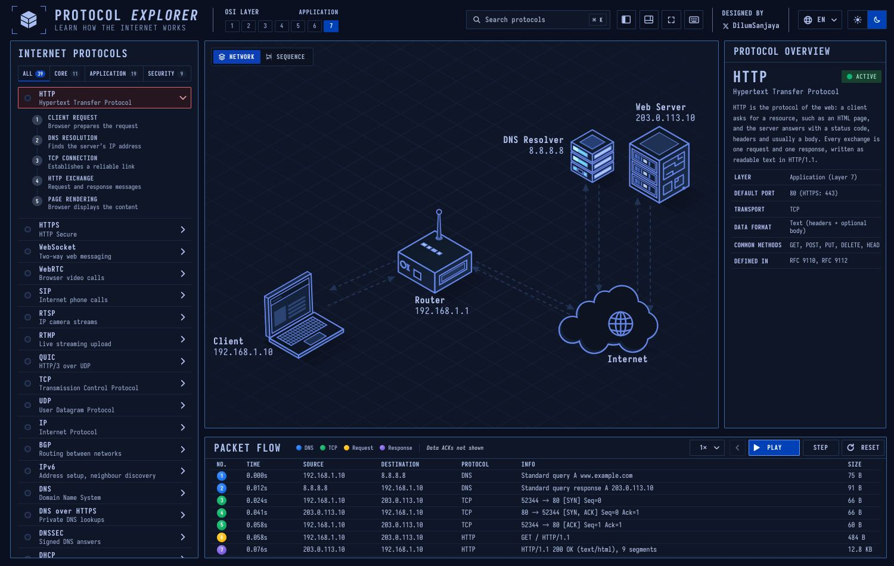
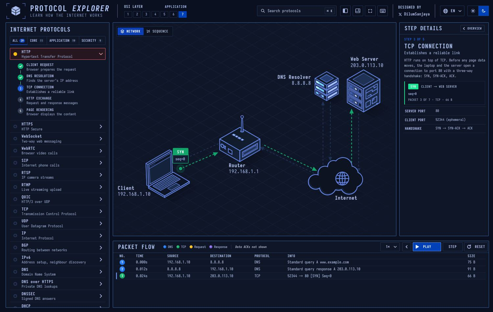
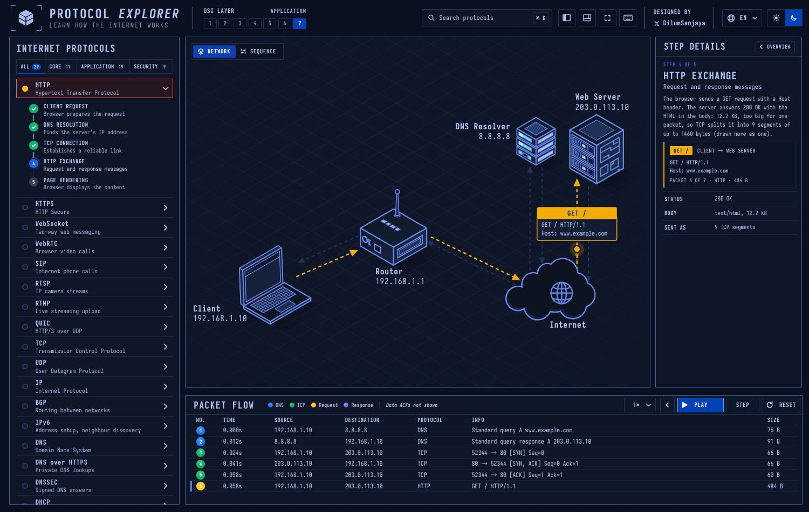
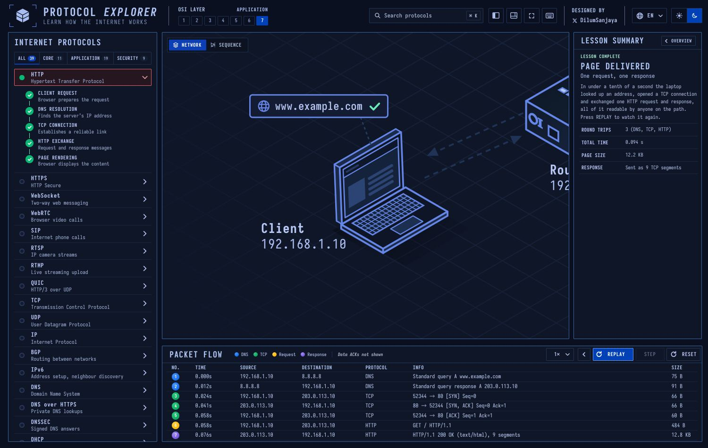

# HTTP – Hypertext Transfer Protocol

<!-- nav -->
[Index](00_Protocols_Index.md) · [02 HTTPS](02-https.md) ➡
<!-- nav -->

*Source: Protocol Explorer – https://protocol-explorer-alpha.vercel.app/ (interactive lesson #1). Screenshots captured from the live lesson; packet decodes are the site's example capture (values marked **E.G.** differ in every real capture).*

## Overview



> PROTOCOL OVERVIEW  
> HTTP  
> ACTIVE  
> Hypertext Transfer Protocol  
> HTTP is the protocol of the web: a client asks for a resource, such as an HTML page, and the server answers with a status code, headers and usually a body. Every exchange is one request and one response, written as readable text in HTTP/1.1.  
> LAYER  
> Application (Layer 7)  
> DEFAULT PORT  
> 80 (HTTPS: 443)  
> TRANSPORT  
> TCP  
> DATA FORMAT  
> Text (headers + optional body)  
> COMMON METHODS  
> GET, POST, PUT, DELETE, HEAD  
> DEFINED IN  
> RFC 9110, RFC 9112  

## In-depth explanation of the example (plain-language version)

### The big picture in one minute
You type `http://www.example.com` into a browser and press Enter. A moment later a web page appears. This lesson shows **everything that travels over the wire** to make that happen: **7 small messages (packets) in about 0.09 seconds.**

Think of it like **ordering food by phone**:
1. You look up the restaurant's phone number (**DNS** – 2 messages).
2. You call and wait for them to pick up, so you both know the line works (**TCP handshake** – 3 messages).
3. You say what you want, and they send it (**HTTP** – 2 messages).

**The key idea:** HTTP is only the *last* step. Before the browser can ask for the page, it needs (a) the server's *address* and (b) a *reliable connection* to it. HTTP is just the polite, plain-text conversation that happens once those are ready.

### Who is who
| Name | Address | Role |
|---|---|---|
| **Client** (your laptop) | `192.168.1.10` | asks for the page |
| **Router** (your home box) | `192.168.1.1` | the door out of your home network |
| **DNS resolver** | `8.8.8.8` | a "phone book" server that turns names into numbers |
| **Web server** | `203.0.113.10` | holds the website and replies |

> **Words you'll see:** a *packet* is one small chunk of data sent over a network. An *IP address* is a computer's number on the network (like a house number). A *port* is a numbered "door" on a computer – web servers listen at port **80** for HTTP.

---

### Step 1 – The browser gets ready
You typed `http://www.example.com/`. The browser splits it into three pieces:
- `http` → "talk in plain, unencrypted web language, on port 80"
- `www.example.com` → the **name** of the website
- `/` → the **page** you want (the front page)

It decides to send a request called **GET** ("please give me this page"). But computers on the internet find each other by **number**, not by name. So before it can send anything, the browser needs the number for `www.example.com`.

*Why does the packet go to the router?* Your laptop only talks directly to devices in your own home network (`192.168.1.x`). Anything outside goes to the **router**, which forwards it onward – like handing your letter to the post office.

---

### Step 2 – Looking up the address (DNS) – packets 1 and 2
**Packet 1 – the question.** The laptop asks the DNS server `8.8.8.8`: *"What is the number for `www.example.com`?"* This is called an **A query** (an "A record" is just "name → IPv4 address").
- It uses **UDP port 53**. UDP is a "just send it" method – perfect for one tiny question and one tiny answer.
- The question carries a random label (`0x3d1a`). The answer must carry the same label, which stops an imposter from slipping in a fake answer.

**Packet 2 – the answer.** `8.8.8.8` replies: *"`www.example.com` is `203.0.113.10`."* It also says *"you can remember this for 1,745 seconds"* (about 29 minutes). That "remember for" time is called the **TTL**, and remembering answers is called **caching**.

⏱ This took only 12 milliseconds because the DNS server already knew the answer.

**Result:** the browser now has the server's number: `203.0.113.10`.

---

### Step 3 – Opening a connection (TCP "three-way handshake") – packets 3, 4, 5
HTTP needs a connection that **doesn't lose or scramble data**. That's what **TCP** provides, but both sides must agree to start first. They do it with three quick messages – like a phone call:

| Packet | Who says it | In plain words |
|---|---|---|
| 3 – **SYN** | laptop → server | "Hello, can we talk?" |
| 4 – **SYN-ACK** | server → laptop | "Yes, I hear you. Can *you* hear me?" |
| 5 – **ACK** | laptop → server | "Yes, I hear you. Let's go." |

A few details inside these packets:
- The laptop uses a **temporary port** (`52344`) as its "return door". The server uses **port 80**. Together with the two IP addresses, that pair identifies this conversation.
- Each side picks a **starting number** for counting the bytes it sends. (The lesson shows "0" to keep it simple; the real numbers start at a random value.) Counting every byte is how TCP notices if something goes missing.
- In the first two packets the sides also announce their limits – for example *"don't send me more than 1,460 bytes at a time"* (this limit is called the **MSS**).

After packet 5 the connection is open in both directions.

---

### Step 4 – The actual HTTP request and reply – packets 6 and 7
Now the real conversation begins. HTTP messages are **plain text** you could read with your eyes.

**Packet 6 – the request (laptop → server).** It looks like this:
```
GET / HTTP/1.1
Host: www.example.com
Connection: keep-alive
User-Agent: Mozilla/5.0 ... Chrome/142 ...
Accept: text/html,...
Accept-Language: en-US
```
Line by line:
- `GET / HTTP/1.1` → "Give me the front page, using HTTP version 1.1."
- `Host: www.example.com` → "I mean *this* website." (One server can host many websites, so you have to say which.)
- `Connection: keep-alive` → "Don't hang up after this – I may ask for more."
- `User-Agent` → "I'm Chrome on Windows."
- `Accept` / `Accept-Language` → "I can read HTML pages, and I prefer English."

A blank line marks the end of the request.

**Packet 7 – the reply (server → laptop).** It starts like this:
```
HTTP/1.1 200 OK
Content-Type: text/html; charset=utf-8
Content-Length: 12500
Connection: keep-alive

<the 12,500 bytes of the web page's HTML>
```
- `200 OK` → "Success – here it is." (You've seen `404 Not Found` – that's another status code.)
- `Content-Type` → "This is an HTML page."
- `Content-Length: 12500` → "The page is 12,500 bytes long," so the browser knows when it has everything.
- Then the page itself.

*Why does the lesson say "9 segments"?* One network packet can carry at most about **1,460 bytes** of your data. The page is 12,500 bytes, so TCP cuts it into **9 pieces** and sends them one after another. The lesson draws them as one big box to keep the picture simple. The laptop puts the pieces back together in order.

---

### Step 5 – The browser draws the page
The browser reads the HTML and paints the page on screen. The page will usually mention other files – images, styles, scripts. Each one needs another `GET` request, but they **reuse the same open connection** (that's what `keep-alive` was for), so there's no new DNS lookup and no new handshake.

**Total time for this whole story: 0.094 seconds.**

---

### The 7 messages at a glance
| # | What | Why it's needed |
|---|---|---|
| 1–2 | DNS question and answer | to learn the server's number |
| 3–5 | TCP handshake | to open a safe, ordered connection |
| 6 | HTTP request (`GET /`) | to ask for the page |
| 7 | HTTP reply (`200 OK` + page) | to receive the page |

### What to remember
- **Three trips back and forth** happen before you see anything: DNS, TCP handshake, HTTP. That is why caching and keeping connections open make websites faster.
- **HTTP is plain text.** Anyone who can see the network (for example on public Wi-Fi) can read the page address, cookies and content. This is the reason **HTTPS** exists – covered in the next note.
- The messages are built like **nested envelopes**: your HTTP text sits inside a TCP packet, which sits inside an IP packet, which sits inside an Ethernet frame. Each layer only adds its own "address label".

## Step-by-step walkthrough (screenshots from the lesson)

### Step 1: CLIENT REQUEST – Browser prepares the request


> STEP 1 OF 5  
> CLIENT REQUEST  
> Browser prepares the request  
> You open http://www.example.com. The browser will send a GET request, but packets travel to IP addresses, not names, so first it needs the server’s address. (Browsers now try https:// first; this is the plain version.)  
> URL  
> http://www.example.com/  
> METHOD  
> GET  
> NEXT HOP  
> Router 192.168.1.1  

### Step 2: DNS RESOLUTION – Finds the server’s IP address


> STEP 2 OF 5  
> DNS RESOLUTION  
> Finds the server’s IP address  
> The laptop asks the DNS server it was given by DHCP, 8.8.8.8, for the address of www.example.com. The query goes over UDP port 53 and the answer is an A record with the IPv4 address. (On a network with IPv6 it would also ask for an AAAA record.)  
> RESOLVER  
> 8.8.8.8 (had it cached)  
> TRANSPORT  
> UDP, port 53  
> ANSWER  
> A 203.0.113.10  

### Step 3: TCP CONNECTION – Establishes a reliable link



> STEP 3 OF 5  
> TCP CONNECTION  
> Establishes a reliable link  
> HTTP runs on top of TCP. Before any page data moves, the laptop and the server open a connection to port 80 with a three-way handshake: SYN, SYN-ACK, ACK.  
> SYN  
> CLIENT → WEB SERVER  
> seq=0  
> PACKET 3 OF 7 · TCP · 66 B  
> SERVER PORT  
> 80  
> CLIENT PORT  
> 52344 (ephemeral)  
> HANDSHAKE  
> SYN → SYN-ACK → ACK  

### Step 4: HTTP EXCHANGE – Request and response messages



> STEP 4 OF 5  
> HTTP EXCHANGE  
> Request and response messages  
> The browser sends a GET request with a Host header. The server answers 200 OK with the HTML in the body: 12.2 KB, too big for one packet, so TCP splits it into 9 segments of up to 1460 bytes (drawn here as one).  
> GET /  
> CLIENT → WEB SERVER  
> GET / HTTP/1.1  
> Host: www.example.com  
> PACKET 6 OF 7 · HTTP · 484 B  
> STATUS  
> 200 OK  
> BODY  
> text/html, 12.2 KB  
> SENT AS  
> 9 TCP segments  

### Step 5: PAGE RENDERING – Browser displays the content


> STEP 5 OF 5  
> PAGE RENDERING  
> Browser displays the content  
> The browser parses the HTML and paints the page. Linked CSS, images and scripts would each start more requests just like this one, reusing the open connection where they can.  
> GET /  
> CLIENT → WEB SERVER  
> GET / HTTP/1.1  
> Host: www.example.com  
> PACKET 6 OF 7 · HTTP · 484 B  
> DOCUMENT  
> text/html, 12.2 KB  
> CONNECTION  
> Kept open for reuse  
> TOTAL TIME  
> 0.094 s  

### Lesson summary



> LESSON SUMMARY  
> LESSON COMPLETE  
> PAGE DELIVERED  
> One request, one response  
> In under a tenth of a second the laptop looked up an address, opened a TCP connection and exchanged one HTTP request and response, all of it readable by anyone on the path. Press REPLAY to watch it again.  
> 200 OK  
> WEB SERVER → CLIENT  
> HTTP/1.1 200 OK  
> 12.2 KB in 9 segments  
> PACKET 7 OF 7 · HTTP · 12.8 KB  
> ROUND TRIPS  
> 3 (DNS, TCP, HTTP)  
> TOTAL TIME  
> 0.094 s  
> PAGE SIZE  
> 12.2 KB  
> RESPONSE  
> Sent as 9 TCP segments  

## Packet flow (whole lesson)

| No. | Time | Source | Destination | Protocol | Info | Size |
|---|---|---|---|---|---|---|
| 1 | 0.000s | 192.168.1.10 | 8.8.8.8 | DNS | Standard query A www.example.com | 75 B |
| 2 | 0.012s | 8.8.8.8 | 192.168.1.10 | DNS | Standard query response A 203.0.113.10 | 91 B |
| 3 | 0.024s | 192.168.1.10 | 203.0.113.10 | TCP | 52344 → 80 [SYN] Seq=0 | 66 B |
| 4 | 0.041s | 203.0.113.10 | 192.168.1.10 | TCP | 80 → 52344 [SYN, ACK] Seq=0 Ack=1 | 66 B |
| 5 | 0.058s | 192.168.1.10 | 203.0.113.10 | TCP | 52344 → 80 [ACK] Seq=1 Ack=1 | 60 B |
| 6 | 0.058s | 192.168.1.10 | 203.0.113.10 | HTTP | GET / HTTP/1.1 | 484 B |
| 7 | 0.076s | 203.0.113.10 | 192.168.1.10 | HTTP | HTTP/1.1 200 OK (text/html), 9 segments | 12.8 KB |

### Sequence diagram


## Packets decoded byte by byte

Each packet below is the lesson's own decode (headers, field values and the plain-English meaning of each field). Screenshots show the first, middle and last packet in the lesson's decoder view with the raw hex bytes.

### Packet 1: DNS – Standard query A www.example.com

*192.168.1.10 → 8.8.8.8 · 75 B · t = 0.000s*


<details><summary>Decoded fields</summary>

```text
1
DNS QUERY
0.000s · 192.168.1.10 → 8.8.8.8 · DNS · 75 B
Seen on the laptop’s home network
Ethernet
14
IPv4
20
UDP
8
DNS
33
Ethernet II · 14 bytes
00:00:5e:00:53:10 → 00:00:5e:00:53:01
Destination
00:00:5e:00:53:01 E.G.

The router: anything beyond the home network goes to it first.

Source
00:00:5e:00:53:10 E.G.

The laptop’s network card.

Type
0x0800 (IPv4)

What the frame carries.

IPv4 · 20 bytes
192.168.1.10 → 8.8.8.8
Version, header length
4, 20 bytes

IPv4, with no options.

DSCP, ECN
0, 0

Priority and congestion marks; 0 means ordinary traffic.

Total length
61 bytes

This header and everything inside it.

Identification
0xd825 E.G.

Lets the receiver reassemble the pieces if the packet gets split.

Flags
none E.G.

Routers may split it if a link is too small.

Time to live
128

Windows starts at 128.

Protocol
17 (UDP)
Header checksum
0x90c8

Covers this header only; every router recomputes it after lowering the TTL.

Source
192.168.1.10
Destination
8.8.8.8
UDP · 8 bytes
59321 → 53
Source port
59321
Destination port
53
Length
41 bytes

UDP header and data. That is all of UDP: no numbering, no acknowledgements.

Checksum
0xbe74

Covers the header, the data and the IP addresses.

DNS
Transaction ID
0x3d1a E.G.

Picked at random; the answer must carry the same one.

Flags
0x0100: query, RD (recursion desired)
Questions
1
Answers
0
Authority records
0
Additional records
0
Question
www.example.com, type A, class IN
BYTES 75 in this frame
0000
00
00
5e
00
53
01
00
00
5e
00
53
10
08
00
45
00
.
.
^
.
S
.
.
.
^
.
S
.
.
.
E
.
0010
00
3d
d8
25
00
00
80
11
90
c8
c0
a8
01
0a
08
08
.
=
.
%
.
.
.
.
.
.
.
.
.
.
.
.
0020
08
08
e7
b9
00
35
00
29
be
74
3d
1a
01
00
00
01
.
.
.
.
.
5
.
)
.
t
=
.
.
.
.
.
0030
00
00
00
00
00
00
03
77
77
77
07
65
78
61
6d
70
.
.
.
.
.
.
.
w
w
w
.
e
x
a
m
p
0040
6c
65
03
63
6f
6d
00
00
01
00
01
l
e
.
c
o
m
.
.
.
.
.
E.G. an example value: it differs in every real capture
·· bytes the lesson can’t show: encrypted, random, or a file’s contents
```

</details>

### Packet 2: DNS – Standard query response A 203.0.113.10

*8.8.8.8 → 192.168.1.10 · 91 B · t = 0.012s*

<details><summary>Decoded fields</summary>

```text
2
DNS REPLY
0.012s · 8.8.8.8 → 192.168.1.10 · DNS · 91 B
Seen on the laptop’s home network
Ethernet
14
IPv4
20
UDP
8
DNS
49
Ethernet II · 14 bytes
00:00:5e:00:53:01 → 00:00:5e:00:53:10
Destination
00:00:5e:00:53:10 E.G.

The laptop.

Source
00:00:5e:00:53:01 E.G.

The router’s side facing the home network.

Type
0x0800 (IPv4)

What the frame carries.

IPv4 · 20 bytes
8.8.8.8 → 192.168.1.10
Version, header length
4, 20 bytes

IPv4, with no options.

DSCP, ECN
0, 0

Priority and congestion marks; 0 means ordinary traffic.

Total length
77 bytes

This header and everything inside it.

Identification
0x8bce E.G.

Lets the receiver reassemble the pieces if the packet gets split.

Flags
none E.G.

Routers may split it if a link is too small.

Time to live
118

Started at 128; 10 routers on the way each took 1.

Protocol
17 (UDP)
Header checksum
0xe70f

Covers this header only; every router recomputes it after lowering the TTL.

Source
8.8.8.8
Destination
192.168.1.10
UDP · 8 bytes
53 → 59321
Source port
53
Destination port
59321
Length
57 bytes

UDP header and data. That is all of UDP: no numbering, no acknowledgements.

Checksum
0x4ed0

Covers the header, the data and the IP addresses.

DNS
Transaction ID
0x3d1a E.G.

Picked at random; the answer must carry the same one.

Flags
0x8180: response, RD (recursion desired), RA (recursion available)
Questions
1
Answers
1
Authority records
0
Additional records
0
Question
www.example.com, type A, class IN
Answer
www.example.com A 203.0.113.10 (TTL 1,745 s) E.G.
BYTES 91 in this frame
0000
00
00
5e
00
53
10
00
00
5e
00
53
01
08
00
45
00
.
.
^
.
S
.
.
.
^
.
S
.
.
.
E
.
0010
00
4d
8b
ce
00
00
76
11
e7
0f
08
08
08
08
c0
a8
.
M
.
.
.
.
v
.
.
.
.
.
.
.
.
.
0020
01
0a
00
35
e7
b9
00
39
4e
d0
3d
1a
81
80
00
01
.
.
.
5
.
.
.
9
N
.
=
.
.
.
.
.
0030
00
01
00
00
00
00
03
77
77
77
07
65
78
61
6d
70
.
.
.
.
.
.
.
w
w
w
.
e
x
a
m
p
0040
6c
65
03
63
6f
6d
00
00
01
00
01
c0
0c
00
01
00
l
e
.
c
o
m
.
.
.
.
.
.
.
.
.
.
0050
01
00
00
06
d1
00
04
cb
00
71
0a
.
.
.
.
.
.
.
.
.
q
.
E.G. an example value: it differs in every real capture
·· bytes the lesson can’t show: encrypted, random, or a file’s contents
```

</details>

### Packet 3: TCP – 52344 → 80 [SYN] Seq=0

*192.168.1.10 → 203.0.113.10 · 66 B · t = 0.024s*

<details><summary>Decoded fields</summary>

```text
3
SYN
0.024s · 192.168.1.10 → 203.0.113.10 · TCP · 66 B
Seen on the laptop’s home network
Ethernet
14
IPv4
20
TCP
32
Ethernet II · 14 bytes
00:00:5e:00:53:10 → 00:00:5e:00:53:01
Destination
00:00:5e:00:53:01 E.G.

The router: anything beyond the home network goes to it first.

Source
00:00:5e:00:53:10 E.G.

The laptop’s network card.

Type
0x0800 (IPv4)

What the frame carries.

IPv4 · 20 bytes
192.168.1.10 → 203.0.113.10
Version, header length
4, 20 bytes

IPv4, with no options.

DSCP, ECN
0, 0

Priority and congestion marks; 0 means ordinary traffic.

Total length
52 bytes

This header and everything inside it.

Identification
0xd826 E.G.

Lets the receiver reassemble the pieces if the packet gets split.

Flags
DF (don’t fragment)

Routers must not split it; if it’s too big they report back instead.

Time to live
128

Windows starts at 128.

Protocol
6 (TCP)
Header checksum
0x24e0

Covers this header only; every router recomputes it after lowering the TTL.

Source
192.168.1.10
Destination
203.0.113.10
TCP · 32 bytes
52344 → 80, SYN
Source port
52344

Picked by the laptop’s system for this connection.

Destination port
80
Sequence number
0 (relative)

This side’s starting number. Shown as 0; the real one is random.

Real sequence number
59972902 E.G.
Acknowledgment
0 (not used yet)

A first SYN has nothing to acknowledge.

Header length
32 bytes

20 bytes, plus 12 of options.

Flags
0x002 (SYN)
Window
64240 E.G.

How much more data this side can take right now.

Checksum
0x88e0

Covers the header, the data and the IP addresses, so damage is caught.

Urgent pointer
0
Options
12 bytes
Maximum segment size
1460 bytes

The most data this side wants in one segment.

No-op
1

Spacing, so the next option lines up.

Window scale
× 256

Window values are multiplied by this, so windows can be larger than 64 KB.

No-op
1

Spacing, so the next option lines up.

No-op
1

Spacing, so the next option lines up.

SACK permitted
yes

This side understands selective acknowledgements.

BYTES 66 in this frame
0000
00
00
5e
00
53
01
00
00
5e
00
53
10
08
00
45
00
.
.
^
.
S
.
.
.
^
.
S
.
.
.
E
.
0010
00
34
d8
26
40
00
80
06
24
e0
c0
a8
01
0a
cb
00
.
4
.
&
@
.
.
.
$
.
.
.
.
.
.
.
0020
71
0a
cc
78
00
50
03
93
1d
26
00
00
00
00
80
02
q
.
.
x
.
P
.
.
.
&
.
.
.
.
.
.
0030
fa
f0
88
e0
00
00
02
04
05
b4
01
03
03
08
01
01
.
.
.
.
.
.
.
.
.
.
.
.
.
.
.
.
0040
04
02
.
.
E.G. an example value: it differs in every real capture
·· bytes the lesson can’t show: encrypted, random, or a file’s contents
```

</details>

### Packet 4: TCP – 80 → 52344 [SYN, ACK] Seq=0 Ack=1

*203.0.113.10 → 192.168.1.10 · 66 B · t = 0.041s*


<details><summary>Decoded fields</summary>

```text
4
SYN-ACK
0.041s · 203.0.113.10 → 192.168.1.10 · TCP · 66 B
Seen on the laptop’s home network
Ethernet
14
IPv4
20
TCP
32
Ethernet II · 14 bytes
00:00:5e:00:53:01 → 00:00:5e:00:53:10
Destination
00:00:5e:00:53:10 E.G.

The laptop.

Source
00:00:5e:00:53:01 E.G.

The router’s side facing the home network.

Type
0x0800 (IPv4)

What the frame carries.

IPv4 · 20 bytes
203.0.113.10 → 192.168.1.10
Version, header length
4, 20 bytes

IPv4, with no options.

DSCP, ECN
0, 0

Priority and congestion marks; 0 means ordinary traffic.

Total length
52 bytes

This header and everything inside it.

Identification
0x0e03 E.G.

Lets the receiver reassemble the pieces if the packet gets split.

Flags
DF (don’t fragment)

Routers must not split it; if it’s too big they report back instead.

Time to live
52

Started at 64; 12 routers on the way each took 1.

Protocol
6 (TCP)
Header checksum
0x3b04

Covers this header only; every router recomputes it after lowering the TTL.

Source
203.0.113.10
Destination
192.168.1.10
TCP · 32 bytes
80 → 52344, SYN, ACK
Source port
80
Destination port
52344
Sequence number
0 (relative)

This side’s starting number. Shown as 0; the real one is random.

Real sequence number
2474976680 E.G.
Acknowledgment
1 (relative)

The next byte this side expects: everything before it has arrived.

Header length
32 bytes

20 bytes, plus 12 of options.

Flags
0x012 (SYN, ACK)
Window
64240 E.G.

How much more data this side can take right now.

Checksum
0xcfa2

Covers the header, the data and the IP addresses, so damage is caught.

Urgent pointer
0
Options
12 bytes
Maximum segment size
1460 bytes

The most data this side wants in one segment.

No-op
1

Spacing, so the next option lines up.

No-op
1

Spacing, so the next option lines up.

SACK permitted
yes

This side understands selective acknowledgements.

No-op
1

Spacing, so the next option lines up.

Window scale
× 128

Window values are multiplied by this, so windows can be larger than 64 KB.

BYTES 66 in this frame
0000
00
00
5e
00
53
10
00
00
5e
00
53
01
08
00
45
00
.
.
^
.
S
.
.
.
^
.
S
.
.
.
E
.
0010
00
34
0e
03
40
00
34
06
3b
04
cb
00
71
0a
c0
a8
.
4
.
.
@
.
4
.
;
.
.
.
q
.
.
.
0020
01
0a
00
50
cc
78
93
85
25
a8
03
93
1d
27
80
12
.
.
.
P
.
x
.
.
%
.
.
.
.
'
.
.
0030
fa
f0
cf
a2
00
00
02
04
05
b4
01
01
04
02
01
03
.
.
.
.
.
.
.
.
.
.
.
.
.
.
.
.
0040
03
07
.
.
E.G. an example value: it differs in every real capture
·· bytes the lesson can’t show: encrypted, random, or a file’s contents
```

</details>

### Packet 5: TCP – 52344 → 80 [ACK] Seq=1 Ack=1

*192.168.1.10 → 203.0.113.10 · 60 B · t = 0.058s*

<details><summary>Decoded fields</summary>

```text
5
ACK
0.058s · 192.168.1.10 → 203.0.113.10 · TCP · 60 B
Seen on the laptop’s home network
Ethernet
14
IPv4
20
TCP
20
Padding
6
Ethernet II · 14 bytes
00:00:5e:00:53:10 → 00:00:5e:00:53:01
Destination
00:00:5e:00:53:01 E.G.

The router: anything beyond the home network goes to it first.

Source
00:00:5e:00:53:10 E.G.

The laptop’s network card.

Type
0x0800 (IPv4)

What the frame carries.

IPv4 · 20 bytes
192.168.1.10 → 203.0.113.10
Version, header length
4, 20 bytes

IPv4, with no options.

DSCP, ECN
0, 0

Priority and congestion marks; 0 means ordinary traffic.

Total length
40 bytes

This header and everything inside it.

Identification
0xd827 E.G.

Lets the receiver reassemble the pieces if the packet gets split.

Flags
DF (don’t fragment)

Routers must not split it; if it’s too big they report back instead.

Time to live
128

Windows starts at 128.

Protocol
6 (TCP)
Header checksum
0x24eb

Covers this header only; every router recomputes it after lowering the TTL.

Source
192.168.1.10
Destination
203.0.113.10
TCP · 20 bytes
52344 → 80, ACK
Source port
52344

Picked by the laptop’s system for this connection.

Destination port
80
Sequence number
1 (relative)

Position of this segment’s first byte, counted from this side’s SYN.

Real sequence number
59972903 E.G.
Acknowledgment
1 (relative)

The next byte this side expects: everything before it has arrived.

Header length
20 bytes
Flags
0x010 (ACK)
Window
1026 (× 256 = 262,656 bytes) E.G.

How much more data this side can take right now.

Checksum
0x0764

Covers the header, the data and the IP addresses, so damage is caught.

Urgent pointer
0
Ethernet padding · 6 bytes
Padding
6 zero bytes

Ethernet frames are at least 60 bytes (64 with the checksum the card adds), so short ones are padded.

BYTES 60 in this frame
0000
00
00
5e
00
53
01
00
00
5e
00
53
10
08
00
45
00
.
.
^
.
S
.
.
.
^
.
S
.
.
.
E
.
0010
00
28
d8
27
40
00
80
06
24
eb
c0
a8
01
0a
cb
00
.
(
.
'
@
.
.
.
$
.
.
.
.
.
.
.
0020
71
0a
cc
78
00
50
03
93
1d
27
93
85
25
a9
50
10
q
.
.
x
.
P
.
.
.
'
.
.
%
.
P
.
0030
04
02
07
64
00
00
00
00
00
00
00
00
.
.
.
d
.
.
.
.
.
.
.
.
E.G. an example value: it differs in every real capture
·· bytes the lesson can’t show: encrypted, random, or a file’s contents
```

</details>

### Packet 6: HTTP – GET / HTTP/1.1

*192.168.1.10 → 203.0.113.10 · 484 B · t = 0.058s*

<details><summary>Decoded fields</summary>

```text
6
GET /
0.058s · 192.168.1.10 → 203.0.113.10 · HTTP · 484 B
Seen on the laptop’s home network
Ethernet
14
IPv4
20
TCP
20
HTTP
430
Ethernet II · 14 bytes
00:00:5e:00:53:10 → 00:00:5e:00:53:01
Destination
00:00:5e:00:53:01 E.G.

The router: anything beyond the home network goes to it first.

Source
00:00:5e:00:53:10 E.G.

The laptop’s network card.

Type
0x0800 (IPv4)

What the frame carries.

IPv4 · 20 bytes
192.168.1.10 → 203.0.113.10
Version, header length
4, 20 bytes

IPv4, with no options.

DSCP, ECN
0, 0

Priority and congestion marks; 0 means ordinary traffic.

Total length
470 bytes

This header and everything inside it.

Identification
0xd828 E.G.

Lets the receiver reassemble the pieces if the packet gets split.

Flags
DF (don’t fragment)

Routers must not split it; if it’s too big they report back instead.

Time to live
128

Windows starts at 128.

Protocol
6 (TCP)
Header checksum
0x233c

Covers this header only; every router recomputes it after lowering the TTL.

Source
192.168.1.10
Destination
203.0.113.10
TCP · 20 bytes
52344 → 80, PSH, ACK
Source port
52344

Picked by the laptop’s system for this connection.

Destination port
80
Sequence number
1 (relative)

Position of this segment’s first byte, counted from this side’s SYN.

Real sequence number
59972903 E.G.
Acknowledgment
1 (relative)

The next byte this side expects: everything before it has arrived.

Header length
20 bytes
Flags
0x018 (PSH, ACK)
Window
1026 (× 256 = 262,656 bytes) E.G.

How much more data this side can take right now.

Checksum
0xd143

Covers the header, the data and the IP addresses, so damage is caught.

Urgent pointer
0
HTTP
Text
GET / HTTP/1.1␍␊
Host: www.example.com␍␊
Connection: keep-alive␍␊
Upgrade-Insecure-Requests: 1␍␊
User-Agent: Mozilla/5.0 (Windows NT 10.0; Win64; x64) AppleWebKit/537.36 (KHTML, like Gecko) Chrome/142.0.0.0 Safari/537.36␍␊
Accept: text/html,application/xhtml+xml,application/xml;q=0.9,image/avif,image/webp,image/apng,*/*;q=0.8,application/signed-exchange;v=b3;q=0.7␍␊
Accept-Encoding: gzip, deflate␍␊
Accept-Language: en-US,en;q=0.9␍␊
␍␊
BYTES 484 in this frame
0000
00
00
5e
00
53
01
00
00
5e
00
53
10
08
00
45
00
.
.
^
.
S
.
.
.
^
.
S
.
.
.
E
.
0010
01
d6
d8
28
40
00
80
06
23
3c
c0
a8
01
0a
cb
00
.
.
.
(
@
.
.
.
#
<
.
.
.
.
.
.
0020
71
0a
cc
78
00
50
03
93
1d
27
93
85
25
a9
50
18
q
.
.
x
.
P
.
.
.
'
.
.
%
.
P
.
0030
04
02
d1
43
00
00
47
45
54
20
2f
20
48
54
54
50
.
.
.
C
.
.
G
E
T
/
H
T
T
P
0040
2f
31
2e
31
0d
0a
48
6f
73
74
3a
20
77
77
77
2e
/
1
.
1
.
.
H
o
s
t
:
w
w
w
.
0050
65
78
61
6d
70
6c
65
2e
63
6f
6d
0d
0a
43
6f
6e
e
x
a
m
p
l
e
.
c
o
m
.
.
C
o
n
0060
6e
65
63
74
69
6f
6e
3a
20
6b
65
65
70
2d
61
6c
n
e
c
t
i
o
n
:
k
e
e
p
-
a
l
0070
69
76
65
0d
0a
55
70
67
72
61
64
65
2d
49
6e
73
i
v
e
.
.
U
p
g
r
a
d
e
-
I
n
s
0080
65
63
75
72
65
2d
52
65
71
75
65
73
74
73
3a
20
e
c
u
r
e
-
R
e
q
u
e
s
t
s
:
0090
31
0d
0a
55
73
65
72
2d
41
67
65
6e
74
3a
20
4d
1
.
.
U
s
e
r
-
A
g
e
n
t
:
M
00a0
6f
7a
69
6c
6c
61
2f
35
2e
30
20
28
57
69
6e
64
o
z
i
l
l
a
/
5
.
0
(
W
i
n
d
00b0
6f
77
73
20
4e
54
20
31
30
2e
30
3b
20
57
69
6e
o
w
s
N
T
1
0
.
0
;
W
i
n
00c0
36
34
3b
20
78
36
34
29
20
41
70
70
6c
65
57
65
6
4
;
x
6
4
)
A
p
p
l
e
W
e
00d0
62
4b
69
74
2f
35
33
37
2e
33
36
20
28
4b
48
54
b
K
i
t
/
5
3
7
.
3
6
(
K
H
T
00e0
4d
4c
2c
20
6c
69
6b
65
20
47
65
63
6b
6f
29
20
M
L
,
l
i
k
e
G
e
c
k
o
)
00f0
43
68
72
6f
6d
65
2f
31
34
32
2e
30
2e
30
2e
30
C
h
r
o
m
e
/
1
4
2
.
0
.
0
.
0
0100
20
53
61
66
61
72
69
2f
35
33
37
2e
33
36
0d
0a
S
a
f
a
r
i
/
5
3
7
.
3
6
.
.
0110
41
63
63
65
70
74
3a
20
74
65
78
74
2f
68
74
6d
A
c
c
e
p
t
:
t
e
x
t
/
h
t
m
0120
6c
2c
61
70
70
6c
69
63
61
74
69
6f
6e
2f
78
68
l
,
a
p
p
l
i
c
a
t
i
o
n
/
x
h
0130
74
6d
6c
2b
78
6d
6c
2c
61
70
70
6c
69
63
61
74
t
m
l
+
x
m
l
,
a
p
p
l
i
c
a
t
0140
69
6f
6e
2f
78
6d
6c
3b
71
3d
30
2e
39
2c
69
6d
i
o
n
/
x
m
l
;
q
=
0
.
9
,
i
m
0150
61
67
65
2f
61
76
69
66
2c
69
6d
61
67
65
2f
77
a
g
e
/
a
v
i
f
,
i
m
a
g
e
/
w
0160
65
62
70
2c
69
6d
61
67
65
2f
61
70
6e
67
2c
2a
e
b
p
,
i
m
a
g
e
/
a
p
n
g
,
*
0170
2f
2a
3b
71
3d
30
2e
38
2c
61
70
70
6c
69
63
61
/
*
;
q
=
0
.
8
,
a
p
p
l
i
c
a
0180
74
69
6f
6e
2f
73
69
67
6e
65
64
2d
65
78
63
68
t
i
o
n
/
s
i
g
n
e
d
-
e
x
c
h
0190
61
6e
67
65
3b
76
3d
62
33
3b
71
3d
30
2e
37
0d
a
n
g
e
;
v
=
b
3
;
q
=
0
.
7
.
01a0
0a
41
63
63
65
70
74
2d
45
6e
63
6f
64
69
6e
67
.
A
c
c
e
p
t
-
E
n
c
o
d
i
n
g
01b0
3a
20
67
7a
69
70
2c
20
64
65
66
6c
61
74
65
0d
:
g
z
i
p
,
d
e
f
l
a
t
e
.
01c0
0a
41
63
63
65
70
74
2d
4c
61
6e
67
75
61
67
65
.
A
c
c
e
p
t
-
L
a
n
g
u
a
g
e
01d0
3a
20
65
6e
2d
55
53
2c
65
6e
3b
71
3d
30
2e
39
:
e
n
-
U
S
,
e
n
;
q
=
0
.
9
01e0
0d
0a
0d
0a
.
.
.
.
E.G. an example value: it differs in every real capture
·· bytes the lesson can’t show: encrypted, random, or a file’s contents
```

</details>

### Packet 7: HTTP – HTTP/1.1 200 OK (text/html), 9 segments

*203.0.113.10 → 192.168.1.10 · 12.8 KB · t = 0.076s*


<details><summary>Decoded fields</summary>

```text
7
200 OK
0.076s · 203.0.113.10 → 192.168.1.10 · HTTP · 12.8 KB
Seen on the laptop’s home network · This row stands for 9 TCP segments carrying a 12,643-byte message; the first segment is shown
Ethernet
14
IPv4
20
TCP
20
HTTP
1460
Ethernet II · 14 bytes
00:00:5e:00:53:01 → 00:00:5e:00:53:10
Destination
00:00:5e:00:53:10 E.G.

The laptop.

Source
00:00:5e:00:53:01 E.G.

The router’s side facing the home network.

Type
0x0800 (IPv4)

What the frame carries.

IPv4 · 20 bytes
203.0.113.10 → 192.168.1.10
Version, header length
4, 20 bytes

IPv4, with no options.

DSCP, ECN
0, 0

Priority and congestion marks; 0 means ordinary traffic.

Total length
1500 bytes

This header and everything inside it.

Identification
0x0e04 E.G.

Lets the receiver reassemble the pieces if the packet gets split.

Flags
DF (don’t fragment)

Routers must not split it; if it’s too big they report back instead.

Time to live
52

Started at 64; 12 routers on the way each took 1.

Protocol
6 (TCP)
Header checksum
0x355b

Covers this header only; every router recomputes it after lowering the TTL.

Source
203.0.113.10
Destination
192.168.1.10
TCP · 20 bytes
80 → 52344, PSH, ACK
Source port
80
Destination port
52344
Sequence number
1 (relative)

Position of this segment’s first byte, counted from this side’s SYN.

Real sequence number
2474976681 E.G.
Acknowledgment
431 (relative)

The next byte this side expects: everything before it has arrived.

Header length
20 bytes
Flags
0x018 (PSH, ACK)
Window
501 (× 128 = 64,128 bytes) E.G.

How much more data this side can take right now.

Checksum
covers bytes not shown here

Covers the header, the data and the IP addresses, so damage is caught.

Urgent pointer
0
HTTP
Text
HTTP/1.1 200 OK␍␊
Date: Sat, 31 Oct 2026 09:41:00 GMT␍␊
Content-Type: text/html; charset=utf-8␍␊
Content-Length: 12500␍␊
Connection: keep-alive␍␊
␍␊
Body
12,500 bytes: the HTML page

The page itself; its contents are not part of the lesson.

BYTES 1514 in this frame
0000
00
00
5e
00
53
10
00
00
5e
00
53
01
08
00
45
00
.
.
^
.
S
.
.
.
^
.
S
.
.
.
E
.
0010
05
dc
0e
04
40
00
34
06
35
5b
cb
00
71
0a
c0
a8
.
.
.
.
@
.
4
.
5
[
.
.
q
.
.
.
0020
01
0a
00
50
cc
78
93
85
25
a9
03
93
1e
d5
50
18
.
.
.
P
.
x
.
.
%
.
.
.
.
.
P
.
0030
01
f5
··
··
00
00
48
54
54
50
2f
31
2e
31
20
32
.
.
·
·
.
.
H
T
T
P
/
1
.
1
2
0040
30
30
20
4f
4b
0d
0a
44
61
74
65
3a
20
53
61
74
0
0
O
K
.
.
D
a
t
e
:
S
a
t
0050
2c
20
33
31
20
4f
63
74
20
32
30
32
36
20
30
39
,
3
1
O
c
t
2
0
2
6
0
9
0060
3a
34
31
3a
30
30
20
47
4d
54
0d
0a
43
6f
6e
74
:
4
1
:
0
0
G
M
T
.
.
C
o
n
t
0070
65
6e
74
2d
54
79
70
65
3a
20
74
65
78
74
2f
68
e
n
t
-
T
y
p
e
:
t
e
x
t
/
h
0080
74
6d
6c
3b
20
63
68
61
72
73
65
74
3d
75
74
66
t
m
l
;
c
h
a
r
s
e
t
=
u
t
f
0090
2d
38
0d
0a
43
6f
6e
74
65
6e
74
2d
4c
65
6e
67
-
8
.
.
C
o
n
t
e
n
t
-
L
e
n
g
00a0
74
68
3a
20
31
32
35
30
30
0d
0a
43
6f
6e
6e
65
t
h
:
1
2
5
0
0
.
.
C
o
n
n
e
00b0
63
74
69
6f
6e
3a
20
6b
65
65
70
2d
61
6c
69
76
c
t
i
o
n
:
k
e
e
p
-
a
l
i
v
00c0
65
0d
0a
0d
0a
··
··
··
··
··
··
··
··
··
··
··
e
.
.
.
.
·
·
·
·
·
·
·
·
·
·
·
00d0
··
··
··
··
··
··
··
··
··
··
··
··
··
··
··
··
·
·
·
·
·
·
·
·
·
·
·
·
·
·
·
·
00e0
··
··
··
··
··
··
··
··
··
··
··
··
··
··
··
··
·
·
·
·
·
·
·
·
·
·
·
·
·
·
·
·
00f0
··
··
··
··
··
··
··
··
··
··
··
··
··
··
··
··
·
·
·
·
·
·
·
·
·
·
·
·
·
·
·
·
0100
··
··
··
··
··
··
··
··
··
··
··
··
··
··
··
··
·
·
·
·
·
·
·
·
·
·
·
·
·
·
·
·
0110
··
··
··
··
··
··
··
··
··
··
··
··
··
··
··
··
·
·
·
·
·
·
·
·
·
·
·
·
·
·
·
·
0120
··
··
··
··
··
··
··
··
··
··
··
··
··
··
··
··
·
·
·
·
·
·
·
·
·
·
·
·
·
·
·
·
0130
··
··
··
··
··
··
··
··
··
··
··
··
··
··
··
··
·
·
·
·
·
·
·
·
·
·
·
·
·
·
·
·
0140
··
··
··
··
··
··
··
··
··
··
··
··
··
··
··
··
·
·
·
·
·
·
·
·
·
·
·
·
·
·
·
·
0150
··
··
··
··
··
··
··
··
··
··
··
··
··
··
··
··
·
·
·
·
·
·
·
·
·
·
·
·
·
·
·
·
0160
··
··
··
··
··
··
··
··
··
··
··
··
··
··
··
··
·
·
·
·
·
·
·
·
·
·
·
·
·
·
·
·
0170
··
··
··
··
··
··
··
··
··
··
··
··
··
··
··
··
·
·
·
·
·
·
·
·
·
·
·
·
·
·
·
·
0180
··
··
··
··
··
··
··
··
··
··
··
··
··
··
··
··
·
·
·
·
·
·
·
·
·
·
·
·
·
·
·
·
0190
··
··
··
··
··
··
··
··
··
··
··
··
··
··
··
··
·
·
·
·
·
·
·
·
·
·
·
·
·
·
·
·
01a0
··
··
··
··
··
··
··
··
··
··
··
··
··
··
··
··
·
·
·
·
·
·
·
·
·
·
·
·
·
·
·
·
01b0
··
··
··
··
··
··
··
··
··
··
··
··
··
··
··
··
·
·
·
·
·
·
·
·
·
·
·
·
·
·
·
·
01c0
··
··
··
··
··
··
··
··
··
··
··
··
··
··
··
··
·
·
·
·
·
·
·
·
·
·
·
·
·
·
·
·
01d0
··
··
··
··
··
··
··
··
··
··
··
··
··
··
··
··
·
·
·
·
·
·
·
·
·
·
·
·
·
·
·
·
01e0
··
··
··
··
··
··
··
··
··
··
··
··
··
··
··
··
·
·
·
·
·
·
·
·
·
·
·
·
·
·
·
·
01f0
··
··
··
··
··
··
··
··
··
··
··
··
··
··
··
··
·
·
·
·
·
·
·
·
·
·
·
·
·
·
·
·
0200
··
··
··
··
··
··
··
··
··
··
··
··
··
··
··
··
·
·
·
·
·
·
·
·
·
·
·
·
·
·
·
·
0210
··
··
··
··
··
··
··
··
··
··
··
··
··
··
··
··
·
·
·
·
·
·
·
·
·
·
·
·
·
·
·
·
0220
··
··
··
··
··
··
··
··
··
··
··
··
··
··
··
··
·
·
·
·
·
·
·
·
·
·
·
·
·
·
·
·
0230
··
··
··
··
··
··
··
··
··
··
··
··
··
··
··
··
·
·
·
·
·
·
·
·
·
·
·
·
·
·
·
·
0240
··
··
··
··
··
··
··
··
··
··
··
··
··
··
··
··
·
·
·
·
·
·
·
·
·
·
·
·
·
·
·
·
0250
··
··
··
··
··
··
··
··
··
··
··
··
··
··
··
··
·
·
·
·
·
·
·
·
·
·
·
·
·
·
·
·
0260
··
··
··
··
··
··
··
··
··
··
··
··
··
··
··
··
·
·
·
·
·
·
·
·
·
·
·
·
·
·
·
·
0270
··
··
··
··
··
··
··
··
··
··
··
··
··
··
··
··
·
·
·
·
·
·
·
·
·
·
·
·
·
·
·
·
0280
··
··
··
··
··
··
··
··
··
··
··
··
··
··
··
··
·
·
·
·
·
·
·
·
·
·
·
·
·
·
·
·
0290
··
··
··
··
··
··
··
··
··
··
··
··
··
··
··
··
·
·
·
·
·
·
·
·
·
·
·
·
·
·
·
·
02a0
··
··
··
··
··
··
··
··
··
··
··
··
··
··
··
··
·
·
·
·
·
·
·
·
·
·
·
·
·
·
·
·
02b0
··
··
··
··
··
··
··
··
··
··
··
··
··
··
··
··
·
·
·
·
·
·
·
·
·
·
·
·
·
·
·
·
02c0
··
··
··
··
··
··
··
··
··
··
··
··
··
··
··
··
·
·
·
·
·
·
·
·
·
·
·
·
·
·
·
·
02d0
··
··
··
··
··
··
··
··
··
··
··
··
··
··
··
··
·
·
·
·
·
·
·
·
·
·
·
·
·
·
·
·
02e0
··
··
··
··
··
··
··
··
··
··
··
··
··
··
··
··
·
·
·
·
·
·
·
·
·
·
·
·
·
·
·
·
02f0
··
··
··
··
··
··
··
··
··
··
··
··
··
··
··
··
·
·
·
·
·
·
·
·
·
·
·
·
·
·
·
·
0300
··
··
··
··
··
··
··
··
··
··
··
··
··
··
··
··
·
·
·
·
·
·
·
·
·
·
·
·
·
·
·
·
0310
··
··
··
··
··
··
··
··
··
··
··
··
··
··
··
··
·
·
·
·
·
·
·
·
·
·
·
·
·
·
·
·
0320
··
··
··
··
··
··
··
··
··
··
··
··
··
··
··
··
·
·
·
·
·
·
·
·
·
·
·
·
·
·
·
·
0330
··
··
··
··
··
··
··
··
··
··
··
··
··
··
··
··
·
·
·
·
·
·
·
·
·
·
·
·
·
·
·
·
0340
··
··
··
··
··
··
··
··
··
··
··
··
··
··
··
··
·
·
·
·
·
·
·
·
·
·
·
·
·
·
·
·
0350
··
··
··
··
··
··
··
··
··
··
··
··
··
··
··
··
·
·
·
·
·
·
·
·
·
·
·
·
·
·
·
·
0360
··
··
··
··
··
··
··
··
··
··
··
··
··
··
··
··
·
·
·
·
·
·
·
·
·
·
·
·
·
·
·
·
0370
··
··
··
··
··
··
··
··
··
··
··
··
··
··
··
··
·
·
·
·
·
·
·
·
·
·
·
·
·
·
·
·
0380
··
··
··
··
··
··
··
··
··
··
··
··
··
··
··
··
·
·
·
·
·
·
·
·
·
·
·
·
·
·
·
·
0390
··
··
··
··
··
··
··
··
··
··
··
··
··
··
··
··
·
·
·
·
·
·
·
·
·
·
·
·
·
·
·
·
03a0
··
··
··
··
··
··
··
··
··
··
··
··
··
··
··
··
·
·
·
·
·
·
·
·
·
·
·
·
·
·
·
·
03b0
··
··
··
··
··
··
··
··
··
··
··
··
··
··
··
··
·
·
·
·
·
·
·
·
·
·
·
·
·
·
·
·
03c0
··
··
··
··
··
··
··
··
··
··
··
··
··
··
··
··
·
·
·
·
·
·
·
·
·
·
·
·
·
·
·
·
03d0
··
··
··
··
··
··
··
··
··
··
··
··
··
··
··
··
·
·
·
·
·
·
·
·
·
·
·
·
·
·
·
·
03e0
··
··
··
··
··
··
··
··
··
··
··
··
··
··
··
··
·
·
·
·
·
·
·
·
·
·
·
·
·
·
·
·
03f0
··
··
··
··
··
··
··
··
··
··
··
··
··
··
··
··
·
·
·
·
·
·
·
·
·
·
·
·
·
·
·
·
0400
··
··
··
··
··
··
··
··
··
··
··
··
··
··
··
··
·
·
·
·
·
·
·
·
·
·
·
·
·
·
·
·
0410
··
··
··
··
··
··
··
··
··
··
··
··
··
··
··
··
·
·
·
·
·
·
·
·
·
·
·
·
·
·
·
·
0420
··
··
··
··
··
··
··
··
··
··
··
··
··
··
··
··
·
·
·
·
·
·
·
·
·
·
·
·
·
·
·
·
0430
··
··
··
··
··
··
··
··
··
··
··
··
··
··
··
··
·
·
·
·
·
·
·
·
·
·
·
·
·
·
·
·
0440
··
··
··
··
··
··
··
··
··
··
··
··
··
··
··
··
·
·
·
·
·
·
·
·
·
·
·
·
·
·
·
·
0450
··
··
··
··
··
··
··
··
··
··
··
··
··
··
··
··
·
·
·
·
·
·
·
·
·
·
·
·
·
·
·
·
0460
··
··
··
··
··
··
··
··
··
··
··
··
··
··
··
··
·
·
·
·
·
·
·
·
·
·
·
·
·
·
·
·
0470
··
··
··
··
··
··
··
··
··
··
··
··
··
··
··
··
·
·
·
·
·
·
·
·
·
·
·
·
·
·
·
·
0480
··
··
··
··
··
··
··
··
··
··
··
··
··
··
··
··
·
·
·
·
·
·
·
·
·
·
·
·
·
·
·
·
0490
··
··
··
··
··
··
··
··
··
··
··
··
··
··
··
··
·
·
·
·
·
·
·
·
·
·
·
·
·
·
·
·
04a0
··
··
··
··
··
··
··
··
··
··
··
··
··
··
··
··
·
·
·
·
·
·
·
·
·
·
·
·
·
·
·
·
04b0
··
··
··
··
··
··
··
··
··
··
··
··
··
··
··
··
·
·
·
·
·
·
·
·
·
·
·
·
·
·
·
·
04c0
··
··
··
··
··
··
··
··
··
··
··
··
··
··
··
··
·
·
·
·
·
·
·
·
·
·
·
·
·
·
·
·
04d0
··
··
··
··
··
··
··
··
··
··
··
··
··
··
··
··
·
·
·
·
·
·
·
·
·
·
·
·
·
·
·
·
04e0
··
··
··
··
··
··
··
··
··
··
··
··
··
··
··
··
·
·
·
·
·
·
·
·
·
·
·
·
·
·
·
·
04f0
··
··
··
··
··
··
··
··
··
··
··
··
··
··
··
··
·
·
·
·
·
·
·
·
·
·
·
·
·
·
·
·
0500
··
··
··
··
··
··
··
··
··
··
··
··
··
··
··
··
·
·
·
·
·
·
·
·
·
·
·
·
·
·
·
·
0510
··
··
··
··
··
··
··
··
··
··
··
··
··
··
··
··
·
·
·
·
·
·
·
·
·
·
·
·
·
·
·
·
0520
··
··
··
··
··
··
··
··
··
··
··
··
··
··
··
··
·
·
·
·
·
·
·
·
·
·
·
·
·
·
·
·
0530
··
··
··
··
··
··
··
··
··
··
··
··
··
··
··
··
·
·
·
·
·
·
·
·
·
·
·
·
·
·
·
·
0540
··
··
··
··
··
··
··
··
··
··
··
··
··
··
··
··
·
·
·
·
·
·
·
·
·
·
·
·
·
·
·
·
0550
··
··
··
··
··
··
··
··
··
··
··
··
··
··
··
··
·
·
·
·
·
·
·
·
·
·
·
·
·
·
·
·
0560
··
··
··
··
··
··
··
··
··
··
··
··
··
··
··
··
·
·
·
·
·
·
·
·
·
·
·
·
·
·
·
·
0570
··
··
··
··
··
··
··
··
··
··
··
··
··
··
··
··
·
·
·
·
·
·
·
·
·
·
·
·
·
·
·
·
0580
··
··
··
··
··
··
··
··
··
··
··
··
··
··
··
··
·
·
·
·
·
·
·
·
·
·
·
·
·
·
·
·
0590
··
··
··
··
··
··
··
··
··
··
··
··
··
··
··
··
·
·
·
·
·
·
·
·
·
·
·
·
·
·
·
·
05a0
··
··
··
··
··
··
··
··
··
··
··
··
··
··
··
··
·
·
·
·
·
·
·
·
·
·
·
·
·
·
·
·
05b0
··
··
··
··
··
··
··
··
··
··
··
··
··
··
··
··
·
·
·
·
·
·
·
·
·
·
·
·
·
·
·
·
05c0
··
··
··
··
··
··
··
··
··
··
··
··
··
··
··
··
·
·
·
·
·
·
·
·
·
·
·
·
·
·
·
·
05d0
··
··
··
··
··
··
··
··
··
··
··
··
··
··
··
··
·
·
·
·
·
·
·
·
·
·
·
·
·
·
·
·
05e0
··
··
··
··
··
··
··
··
··
··
·
·
·
·
·
·
·
·
·
·
E.G. an example value: it differs in every real capture
·· bytes the lesson can’t show: encrypted, random, or a file’s contents
```

</details>

---

<!-- nav -->
[Index](00_Protocols_Index.md) · [02 HTTPS](02-https.md) ➡
<!-- nav -->
