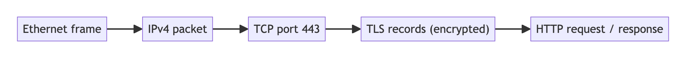
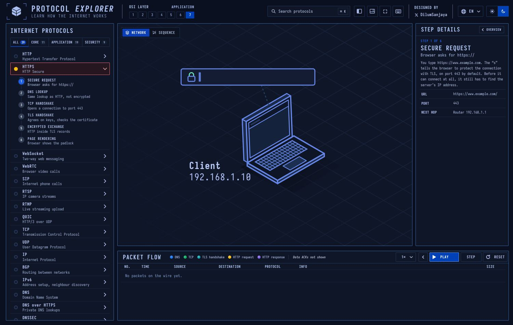
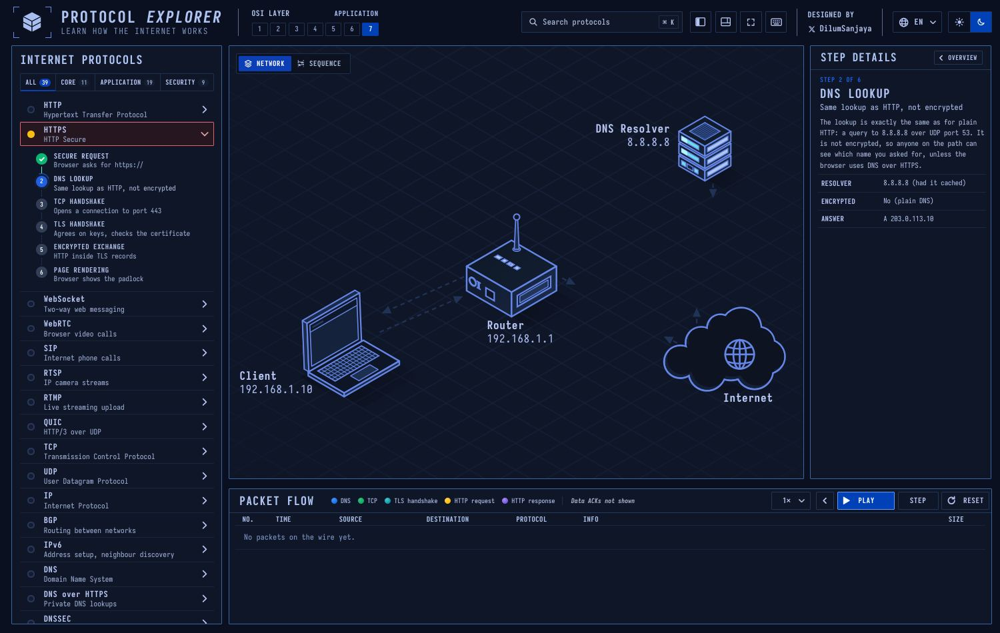
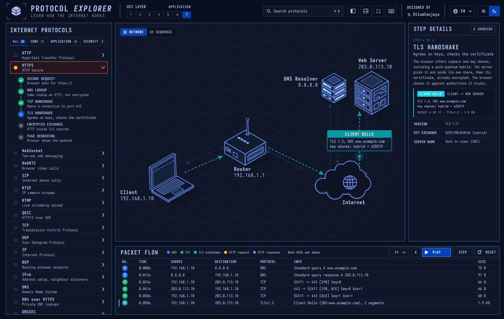
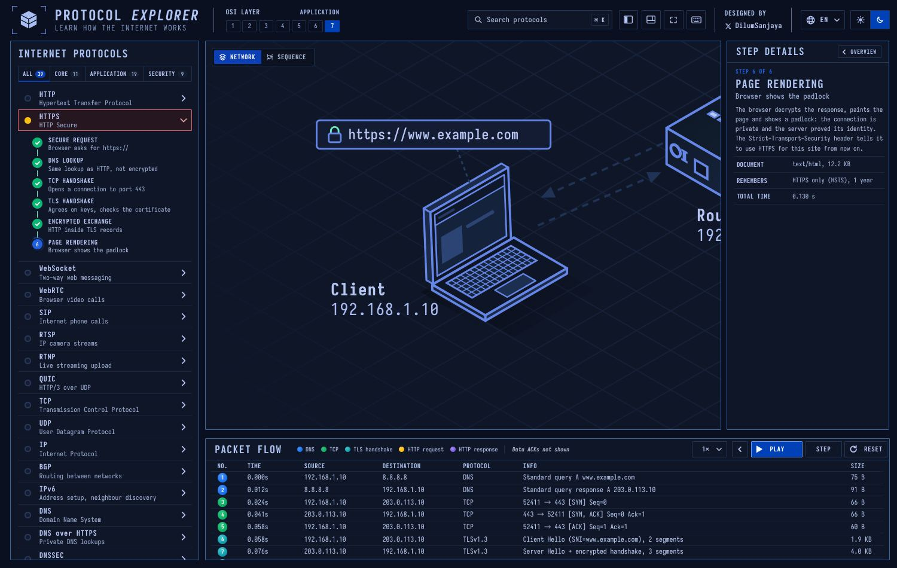
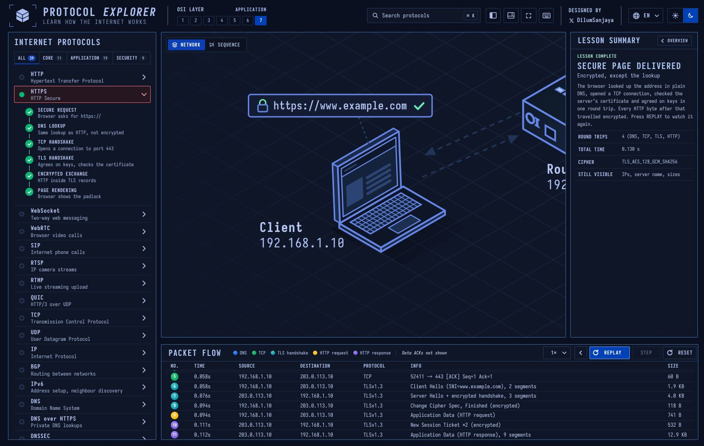
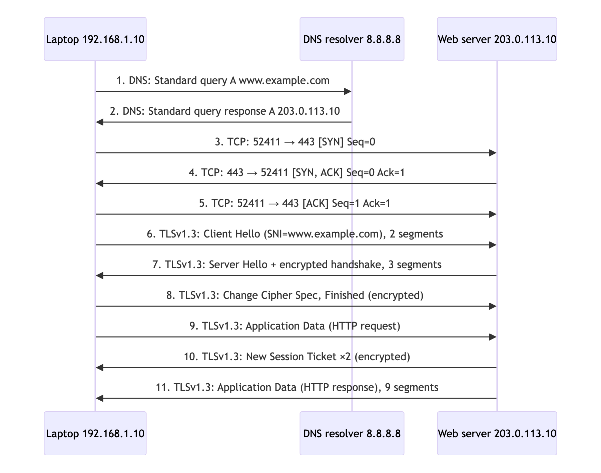
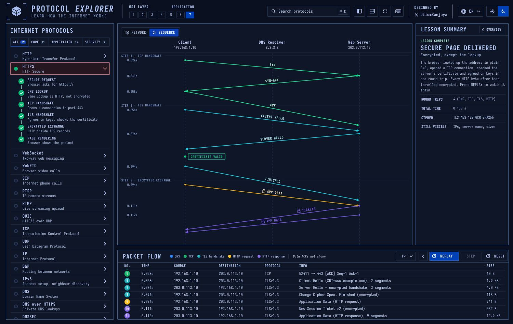
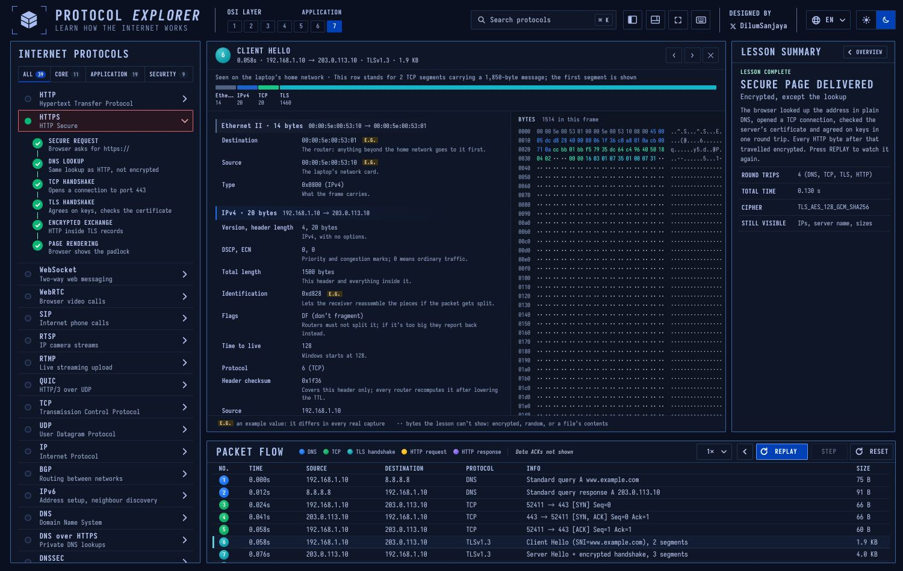
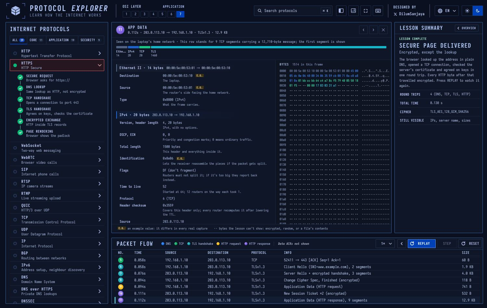

# HTTPS – HTTP Secure

<!-- nav -->
⬅ [01 HTTP](01-http.md) · [Index](00_Protocols_Index.md) · [03 WebSocket](03-websocket.md) ➡
<!-- nav -->

*Source: Protocol Explorer – https://protocol-explorer-alpha.vercel.app/ (interactive lesson #2). Screenshots captured from the live lesson; packet decodes are the site's example capture (values marked **E.G.** differ in every real capture).*

## Overview

### How the layers fit together (outer to inner)

## In-depth explanation of the example (plain-language version)

### The big picture in one minute
The same laptop (`192.168.1.10`) now opens `https://www.example.com/`. The page is the same as in the HTTP lesson. The only difference is one extra stage in the middle, the **TLS handshake**, where the browser and the server **agree on a secret code and the server proves who it is**. After that, everything is scrambled so that nobody on the way can read it. Total: **11 messages in 0.13 seconds.**

**HTTPS = HTTP + TLS.** TLS gives you three promises:
- **Privacy** – nobody can read the data.
- **Tamper-proof** – nobody can change the data without being noticed.
- **Proof of identity** – you really are talking to `www.example.com`, not an imposter.

Think of it as the phone-order story again, but now both of you first agree on a **secret language** before you say what you want, and the restaurant shows an **ID card** to prove it's the real restaurant.

> **Words you'll see:** *encrypted* = scrambled so only the right side can unscramble. *Certificate* = the server's ID card, signed by a trusted authority. *Key* = the secret number used to scramble and unscramble.

---

### Step 1 – The browser notices the "s"
The `s` in `https://` tells the browser: "use TLS, and connect to port **443**" (the HTTPS door). As always, it first needs the server's number.

### Step 2 – Looking up the address (DNS) – packets 1 and 2
Exactly like the HTTP lesson: the laptop asks `8.8.8.8` for `www.example.com` and gets `203.0.113.10`.
**Important:** this question is **not** protected by HTTPS. Someone watching the network can still see *which website* you looked up.

### Step 3 – Opening the connection (TCP handshake) – packets 3, 4, 5
The same three messages as before (SYN, SYN-ACK, ACK), now to port 443. Nothing is scrambled yet. TLS needs a reliable connection underneath, so TCP always comes first.

### Step 4 – The TLS handshake – packets 6, 7, 8
This is the new part. In just **one round trip**, both sides agree on keys and the server proves its identity.

**Packet 6 – "Client Hello" (browser → server).** The browser says what it can do:
- **Versions:** "I can speak TLS 1.3 or 1.2." (Inside the packet, the outer label says "1.0" – a harmless trick so old network boxes don't get confused.)
- **Server name (SNI):** `www.example.com`. It's sent **in plain view** so that a server hosting many websites knows which ID card to show. That's why watchers can still see the site name.
- **Key shares:** the browser guesses which key-agreement method the server will like and **sends its half right away** (a modern hybrid method, X25519 + a "quantum-safe" part, plus plain X25519). Sending the half in the very first message is what makes TLS 1.3 so quick.
- **ALPN:** "I can speak `h2` or `http/1.1` afterwards."

**Packet 7 – "Server Hello" and the rest (server → browser, about 4 KB).**
- The server picks TLS 1.3 and a scrambling method (**AES-128-GCM**), and sends **its half of the key agreement**.
- Now comes the clever part: using the two halves, **both sides calculate the same secret number on their own. The secret itself never travels over the wire.** From it they derive the session keys. **From here on, everything is encrypted.**
- Inside the encrypted part the server sends:
  - its **Certificate** (the ID card),
  - a **Certificate Verify** (a signature that proves it really owns that ID card),
  - a **Finished** message (a checksum of the whole conversation so far).
- The browser then **checks the ID card**: Is it signed by an authority I trust? Does the name match `www.example.com`? Is it still valid? This check is what stops someone from pretending to be the website.

**Packet 8 – "Finished" (browser → server).** The browser sends its own encrypted checksum: "I saw the same conversation and I have the keys." Handshake done at 0.094 s.

### Step 5 – The scrambled conversation – packets 9, 10, 11
- **Packet 9:** the browser sends the very same `GET / HTTP/1.1` request as before, but inside an encrypted envelope. On the wire it looks like random bytes.
- **Packet 10:** the server hands over two **session tickets**. Next visit, the browser can show a ticket and **skip most of the handshake**.
- **Packet 11:** the web page (`200 OK`, about 12 KB) comes back encrypted, split into 9 TCP pieces.

**What a watcher can still see:** the IP addresses, the DNS question, the website *name*, and the sizes and timing of the packets.
**What a watcher cannot see:** the page address after the slash, the headers, cookies and the page itself.

### Step 6 – The padlock
The browser unscrambles the page, draws it and shows the **padlock**: "the line is private and the server proved its identity." The server also sent a header called **HSTS** (`Strict-Transport-Security`) that means: "for the next year, always use HTTPS with me," which blocks later attempts to trick you into plain HTTP.

---

### The 11 messages at a glance
| # | What | Why |
|---|---|---|
| 1–2 | DNS question and answer | find the server's number |
| 3–5 | TCP handshake | open the connection |
| 6–8 | TLS handshake | agree on keys, check identity |
| 9 | Encrypted HTTP request | ask for the page |
| 10 | Session tickets | make the next visit faster |
| 11 | Encrypted HTTP reply | receive the page |

### What to remember
- HTTPS costs only **one extra round trip** over HTTP in this example (older TLS 1.2 needed two).
- The order is **TCP → TLS → HTTP**.
- **Keys are never sent.** Only "halves" are exchanged and each side works out the secret. Even if the server's key leaks years later, old recordings can't be decrypted (this is called *forward secrecy*).
- Certificate = identity, key agreement = privacy, built-in checksum = tamper detection.
- Small leaks remain: DNS and the site name. Newer add-ons (DNS-over-HTTPS and Encrypted Client Hello) close them.

## Under the hood – technical details

- **TLS records.** TLS cuts the byte stream into *records*. Each record starts with a 5-byte header: content type (`22` handshake, `23` application data, `21` alert), version (`0x0303`, a legacy value) and length. After the handshake keys exist, every record is encrypted and ends with a **16-byte authentication tag** (AEAD), so any change is detected.
- **Client Hello contents.** A 32-byte random value, the list of *cipher suites* (for example `TLS_AES_128_GCM_SHA256`), and extensions: `supported_versions` (1.3 and 1.2), `server_name` (SNI), `supported_groups`, `key_share` (the browser's public key for a guessed group), `signature_algorithms` and ALPN (`h2`, `http/1.1`).
- **Why one round trip.** In TLS 1.2 the client had to wait for the server before it could send key material. In 1.3 the client guesses and sends its `key_share` immediately. If the guess is wrong the server answers with a *HelloRetryRequest* and costs one more round trip.
- **Key agreement.** Both sides combine their own private value with the other's public value (an *ephemeral Diffie-Hellman* or KEM exchange) to get the same shared secret. They feed it into **HKDF** (a key-derivation function) together with a hash of the handshake so far, producing separate keys for the handshake and for application data, in each direction.
- **Hybrid post-quantum key share.** `X25519MLKEM768` combines classic elliptic-curve X25519 with ML-KEM, so recorded traffic stays safe even if quantum computers later break the classic part.
- **Server proof.** The `Certificate` message carries the chain (site certificate plus intermediate). `CertificateVerify` is a signature over the whole handshake transcript made with the certificate's private key, which proves the server owns it. `Finished` is an HMAC over the transcript, so any tampering (such as a forced downgrade) fails.
- **What the browser checks.** The chain leads to a trusted root; the name (`www.example.com`) appears in the certificate's *Subject Alternative Name*; today's date is within the validity period; the certificate isn't revoked (OCSP stapling or CRLite); and Certificate Transparency proofs are present.
- **Session tickets.** `NewSessionTicket` holds an encrypted key (a *PSK*). Later the browser can resume with it, skipping the certificate exchange, and can even send *0-RTT* data. 0-RTT data can be replayed by an attacker, so it should only carry safe requests.
- **Forward secrecy.** Because the keys come from ephemeral values that are thrown away, stealing the server's long-term key later cannot decrypt traffic recorded earlier.
- **HSTS.** `Strict-Transport-Security: max-age=31536000` tells the browser to use only HTTPS for this site for a year, blocking downgrade attacks.
- **Still visible.** IP addresses, the DNS query, the SNI name, packet sizes and timing. Encrypted Client Hello (ECH) and DNS over HTTPS reduce this.

## Step-by-step walkthrough

### Step 1: SECURE REQUEST – Browser asks for https://

### Step 2: DNS LOOKUP – Same lookup as HTTP, not encrypted

### Step 3: TCP HANDSHAKE – Opens a connection to port 443

### Step 4: TLS HANDSHAKE – Agrees on keys, checks the certificate

### Step 5: ENCRYPTED EXCHANGE – HTTP inside TLS records

### Step 6: PAGE RENDERING – Browser shows the padlock

### Lesson summary

## Packet flow (whole lesson)

| No. | Time | Source | Destination | Protocol | Info | Size |
|---|---|---|---|---|---|---|
| 1 | 0.000s | 192.168.1.10 | 8.8.8.8 | DNS | Standard query A www.example.com | 75 B |
| 2 | 0.012s | 8.8.8.8 | 192.168.1.10 | DNS | Standard query response A 203.0.113.10 | 91 B |
| 3 | 0.024s | 192.168.1.10 | 203.0.113.10 | TCP | 52411 → 443 [SYN] Seq=0 | 66 B |
| 4 | 0.041s | 203.0.113.10 | 192.168.1.10 | TCP | 443 → 52411 [SYN, ACK] Seq=0 Ack=1 | 66 B |
| 5 | 0.058s | 192.168.1.10 | 203.0.113.10 | TCP | 52411 → 443 [ACK] Seq=1 Ack=1 | 60 B |
| 6 | 0.058s | 192.168.1.10 | 203.0.113.10 | TLSv1.3 | Client Hello (SNI=www.example.com), 2 segments | 1.9 KB |
| 7 | 0.076s | 203.0.113.10 | 192.168.1.10 | TLSv1.3 | Server Hello + encrypted handshake, 3 segments | 4.0 KB |
| 8 | 0.094s | 192.168.1.10 | 203.0.113.10 | TLSv1.3 | Change Cipher Spec, Finished (encrypted) | 118 B |
| 9 | 0.094s | 192.168.1.10 | 203.0.113.10 | TLSv1.3 | Application Data (HTTP request) | 741 B |
| 10 | 0.111s | 203.0.113.10 | 192.168.1.10 | TLSv1.3 | New Session Ticket ×2 (encrypted) | 532 B |
| 11 | 0.112s | 203.0.113.10 | 192.168.1.10 | TLSv1.3 | Application Data (HTTP response), 9 segments | 12.9 KB |

### Sequence diagram

*The lesson's own sequence diagram:*

## Packet decoder screenshots

The lesson's decoder view for the first, middle and last packet: headers, field values and the raw hex bytes.

### Packet 1: DNS – Standard query A www.example.com

*192.168.1.10 → 8.8.8.8 · 75 B · t = 0.000s*

### Packet 6: TLSv1.3 – Client Hello (SNI=www.example.com), 2 segments

*192.168.1.10 → 203.0.113.10 · 1.9 KB · t = 0.058s*

### Packet 11: TLSv1.3 – Application Data (HTTP response), 9 segments

*203.0.113.10 → 192.168.1.10 · 12.9 KB · t = 0.112s*

---

<!-- nav -->
⬅ [01 HTTP](01-http.md) · [Index](00_Protocols_Index.md) · [03 WebSocket](03-websocket.md) ➡
<!-- nav -->
