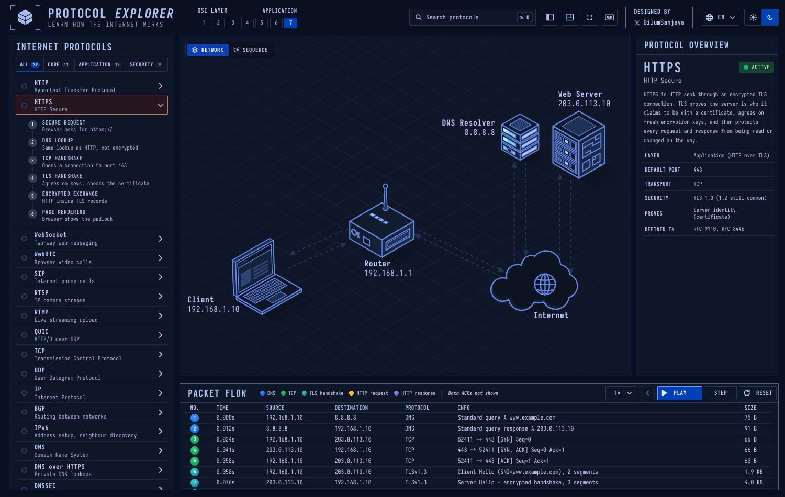
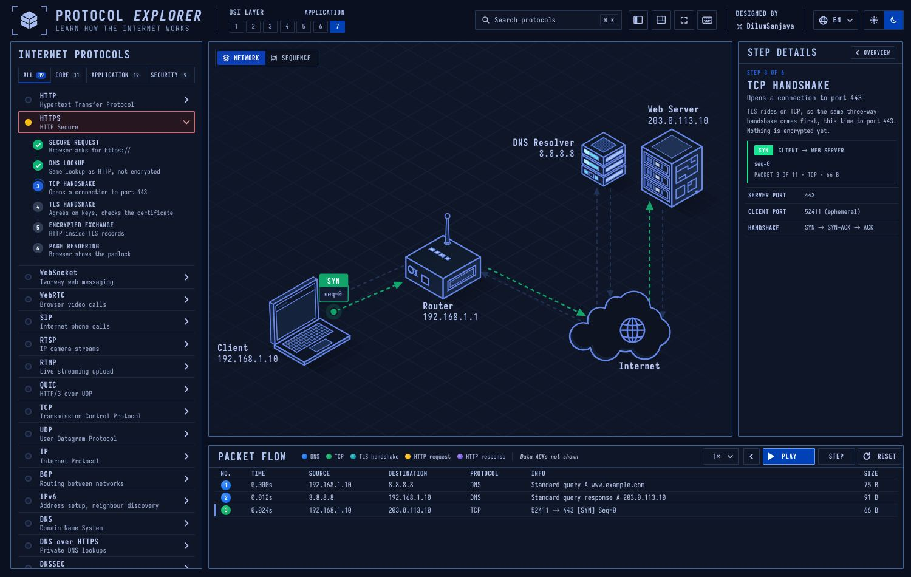
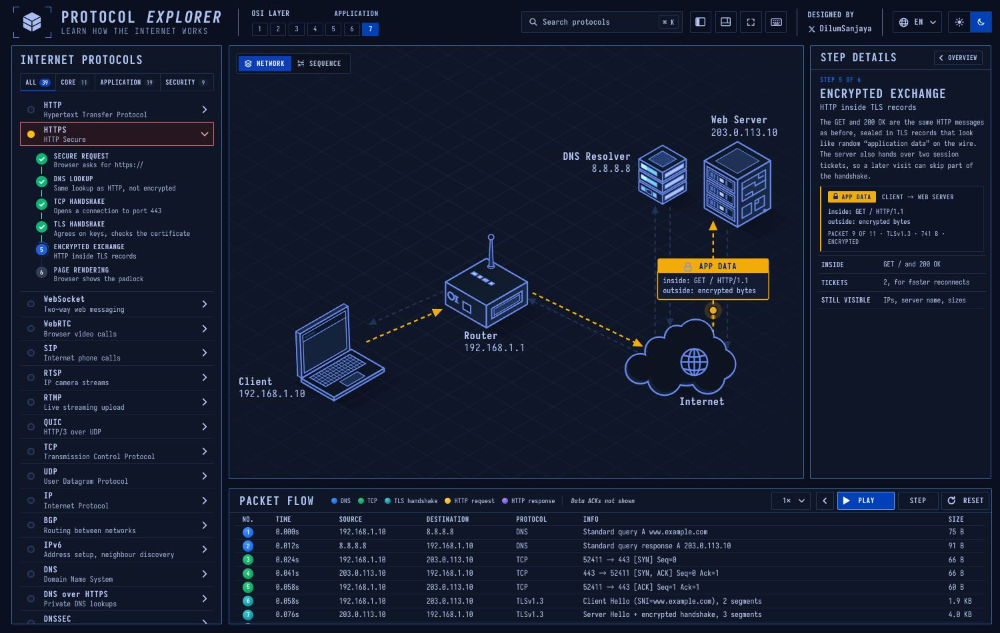
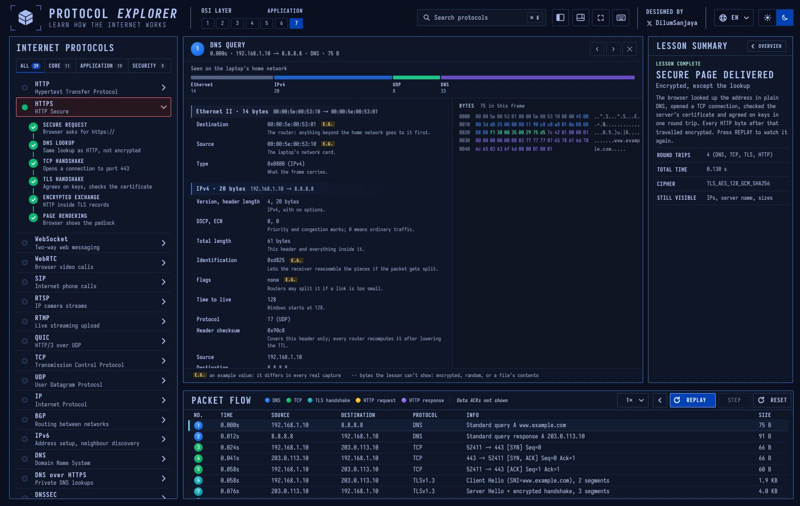

# HTTPS – HTTP Secure

<!-- nav -->
⬅ [01 HTTP](01-http.md) · [Index](00_Protocols_Index.md) · [03 WebSocket](03-websocket.md) ➡
<!-- nav -->

*Source: Protocol Explorer – https://protocol-explorer-alpha.vercel.app/ (interactive lesson #2). Screenshots captured from the live lesson; packet decodes are the site's example capture (values marked **E.G.** differ in every real capture).*

## Overview



> PROTOCOL OVERVIEW  
> HTTPS  
> ACTIVE  
> HTTP Secure  
> HTTPS is HTTP sent through an encrypted TLS connection. TLS proves the server is who it claims to be with a certificate, agrees on fresh encryption keys, and then protects every request and response from being read or changed on the way.  
> LAYER  
> Application (HTTP over TLS)  
> DEFAULT PORT  
> 443  
> TRANSPORT  
> TCP  
> SECURITY  
> TLS 1.3 (1.2 still common)  
> PROVES  
> Server identity (certificate)  
> DEFINED IN  
> RFC 9110, RFC 8446  

## In-depth explanation of the example (plain-language version)

### The big picture in one minute
The same laptop (`192.168.1.10`) now opens `https://www.example.com/`. The page is the same as in the HTTP lesson. The only difference is one extra stage in the middle, the **TLS handshake**, where the browser and the server **agree on a secret code and the server proves who it is**. After that, everything is scrambled so that nobody on the way can read it. Total: **11 messages in 0.13 seconds.**

**HTTPS = HTTP + TLS.** TLS gives you three promises:
- **Privacy** – nobody can read the data.
- **Tamper-proof** – nobody can change the data without being noticed.
- **Proof of identity** – you really are talking to `www.example.com`, not an imposter.

Think of it as the phone-order story again, but now both of you first agree on a **secret language** before you say what you want, and the restaurant shows an **ID card** to prove it's the real restaurant.

> **Words you'll see:** *encrypted* = scrambled so only the right side can unscramble. *Certificate* = the server's ID card, signed by a trusted authority. *Key* = the secret number used to scramble and unscramble.

---

### Step 1 – The browser notices the "s"
The `s` in `https://` tells the browser: "use TLS, and connect to port **443**" (the HTTPS door). As always, it first needs the server's number.

### Step 2 – Looking up the address (DNS) – packets 1 and 2
Exactly like the HTTP lesson: the laptop asks `8.8.8.8` for `www.example.com` and gets `203.0.113.10`.
**Important:** this question is **not** protected by HTTPS. Someone watching the network can still see *which website* you looked up.

### Step 3 – Opening the connection (TCP handshake) – packets 3, 4, 5
The same three messages as before (SYN, SYN-ACK, ACK), now to port 443. Nothing is scrambled yet. TLS needs a reliable connection underneath, so TCP always comes first.

### Step 4 – The TLS handshake – packets 6, 7, 8
This is the new part. In just **one round trip**, both sides agree on keys and the server proves its identity.

**Packet 6 – "Client Hello" (browser → server).** The browser says what it can do:
- **Versions:** "I can speak TLS 1.3 or 1.2." (Inside the packet, the outer label says "1.0" – a harmless trick so old network boxes don't get confused.)
- **Server name (SNI):** `www.example.com`. It's sent **in plain view** so that a server hosting many websites knows which ID card to show. That's why watchers can still see the site name.
- **Key shares:** the browser guesses which key-agreement method the server will like and **sends its half right away** (a modern hybrid method, X25519 + a "quantum-safe" part, plus plain X25519). Sending the half in the very first message is what makes TLS 1.3 so quick.
- **ALPN:** "I can speak `h2` or `http/1.1` afterwards."

**Packet 7 – "Server Hello" and the rest (server → browser, about 4 KB).**
- The server picks TLS 1.3 and a scrambling method (**AES-128-GCM**), and sends **its half of the key agreement**.
- Now comes the clever part: using the two halves, **both sides calculate the same secret number on their own. The secret itself never travels over the wire.** From it they derive the session keys. **From here on, everything is encrypted.**
- Inside the encrypted part the server sends:
  - its **Certificate** (the ID card),
  - a **Certificate Verify** (a signature that proves it really owns that ID card),
  - a **Finished** message (a checksum of the whole conversation so far).
- The browser then **checks the ID card**: Is it signed by an authority I trust? Does the name match `www.example.com`? Is it still valid? This check is what stops someone from pretending to be the website.

**Packet 8 – "Finished" (browser → server).** The browser sends its own encrypted checksum: "I saw the same conversation and I have the keys." Handshake done at 0.094 s.

### Step 5 – The scrambled conversation – packets 9, 10, 11
- **Packet 9:** the browser sends the very same `GET / HTTP/1.1` request as before, but inside an encrypted envelope. On the wire it looks like random bytes.
- **Packet 10:** the server hands over two **session tickets**. Next visit, the browser can show a ticket and **skip most of the handshake**.
- **Packet 11:** the web page (`200 OK`, about 12 KB) comes back encrypted, split into 9 TCP pieces.

**What a watcher can still see:** the IP addresses, the DNS question, the website *name*, and the sizes and timing of the packets.
**What a watcher cannot see:** the page address after the slash, the headers, cookies and the page itself.

### Step 6 – The padlock
The browser unscrambles the page, draws it and shows the **padlock**: "the line is private and the server proved its identity." The server also sent a header called **HSTS** (`Strict-Transport-Security`) that means: "for the next year, always use HTTPS with me," which blocks later attempts to trick you into plain HTTP.

---

### The 11 messages at a glance
| # | What | Why |
|---|---|---|
| 1–2 | DNS question and answer | find the server's number |
| 3–5 | TCP handshake | open the connection |
| 6–8 | TLS handshake | agree on keys, check identity |
| 9 | Encrypted HTTP request | ask for the page |
| 10 | Session tickets | make the next visit faster |
| 11 | Encrypted HTTP reply | receive the page |

### What to remember
- HTTPS costs only **one extra round trip** over HTTP in this example (older TLS 1.2 needed two).
- The order is **TCP → TLS → HTTP**.
- **Keys are never sent.** Only "halves" are exchanged and each side works out the secret. Even if the server's key leaks years later, old recordings can't be decrypted (this is called *forward secrecy*).
- Certificate = identity, key agreement = privacy, built-in checksum = tamper detection.
- Small leaks remain: DNS and the site name. Newer add-ons (DNS-over-HTTPS and Encrypted Client Hello) close them.

## Step-by-step walkthrough (screenshots from the lesson)

### Step 1: SECURE REQUEST – Browser asks for https://


> STEP 1 OF 6  
> SECURE REQUEST  
> Browser asks for https://  
> You type https://www.example.com. The “s” tells the browser to protect the connection with TLS, on port 443 by default. Before it can connect at all, it still has to find the server’s IP address.  
> URL  
> https://www.example.com/  
> PORT  
> 443  
> NEXT HOP  
> Router 192.168.1.1  

### Step 2: DNS LOOKUP – Same lookup as HTTP, not encrypted


> STEP 2 OF 6  
> DNS LOOKUP  
> Same lookup as HTTP, not encrypted  
> The lookup is exactly the same as for plain HTTP: a query to 8.8.8.8 over UDP port 53. It is not encrypted, so anyone on the path can see which name you asked for, unless the browser uses DNS over HTTPS.  
> RESOLVER  
> 8.8.8.8 (had it cached)  
> ENCRYPTED  
> No (plain DNS)  
> ANSWER  
> A 203.0.113.10  

### Step 3: TCP HANDSHAKE – Opens a connection to port 443



> STEP 3 OF 6  
> TCP HANDSHAKE  
> Opens a connection to port 443  
> TLS rides on TCP, so the same three-way handshake comes first, this time to port 443. Nothing is encrypted yet.  
> SYN  
> CLIENT → WEB SERVER  
> seq=0  
> PACKET 3 OF 11 · TCP · 66 B  
> SERVER PORT  
> 443  
> CLIENT PORT  
> 52411 (ephemeral)  
> HANDSHAKE  
> SYN → SYN-ACK → ACK  

### Step 4: TLS HANDSHAKE – Agrees on keys, checks the certificate


> STEP 4 OF 6  
> TLS HANDSHAKE  
> Agrees on keys, checks the certificate  
> The browser offers ciphers and key shares, including a post-quantum hybrid. The server picks it and sends its own share, then its certificate, already encrypted. The browser checks it against authorities it trusts.  
> CLIENT HELLO  
> CLIENT → WEB SERVER  
> TLS 1.3, SNI www.example.com  
> key shares: hybrid + x25519  
> PACKET 6 OF 11 · TLSv1.3 · 1.9 KB  
> VERSION  
> TLS 1.3  
> KEY EXCHANGE  
> X25519MLKEM768 (hybrid)  
> SERVER NAME  
> Sent in clear (SNI)  

### Step 5: ENCRYPTED EXCHANGE – HTTP inside TLS records



> STEP 5 OF 6  
> ENCRYPTED EXCHANGE  
> HTTP inside TLS records  
> The GET and 200 OK are the same HTTP messages as before, sealed in TLS records that look like random “application data” on the wire. The server also hands over two session tickets, so a later visit can skip part of the handshake.  
> APP DATA  
> CLIENT → WEB SERVER  
> inside: GET / HTTP/1.1  
> outside: encrypted bytes  
> PACKET 9 OF 11 · TLSv1.3 · 741 B · ENCRYPTED  
> INSIDE  
> GET / and 200 OK  
> TICKETS  
> 2, for faster reconnects  
> STILL VISIBLE  
> IPs, server name, sizes  

### Step 6: PAGE RENDERING – Browser shows the padlock


> STEP 6 OF 6  
> PAGE RENDERING  
> Browser shows the padlock  
> The browser decrypts the response, paints the page and shows a padlock: the connection is private and the server proved its identity. The Strict-Transport-Security header tells it to use HTTPS for this site from now on.  
> APP DATA  
> CLIENT → WEB SERVER  
> inside: GET / HTTP/1.1  
> outside: encrypted bytes  
> PACKET 9 OF 11 · TLSv1.3 · 741 B · ENCRYPTED  
> DOCUMENT  
> text/html, 12.2 KB  
> REMEMBERS  
> HTTPS only (HSTS), 1 year  
> TOTAL TIME  
> 0.130 s  

### Lesson summary


> LESSON SUMMARY  
> LESSON COMPLETE  
> SECURE PAGE DELIVERED  
> Encrypted, except the lookup  
> The browser looked up the address in plain DNS, opened a TCP connection, checked the server’s certificate and agreed on keys in one round trip. Every HTTP byte after that travelled encrypted. Press REPLAY to watch it again.  
> APP DATA  
> WEB SERVER → CLIENT  
> inside: HTTP/1.1 200 OK  
> outside: 12.9 KB, 9 segments  
> PACKET 11 OF 11 · TLSv1.3 · 12.9 KB · ENCRYPTED  
> ROUND TRIPS  
> 4 (DNS, TCP, TLS, HTTP)  
> TOTAL TIME  
> 0.130 s  
> CIPHER  
> TLS_AES_128_GCM_SHA256  
> STILL VISIBLE  
> IPs, server name, sizes  

## Packet flow (whole lesson)

| No. | Time | Source | Destination | Protocol | Info | Size |
|---|---|---|---|---|---|---|
| 1 | 0.000s | 192.168.1.10 | 8.8.8.8 | DNS | Standard query A www.example.com | 75 B |
| 2 | 0.012s | 8.8.8.8 | 192.168.1.10 | DNS | Standard query response A 203.0.113.10 | 91 B |
| 3 | 0.024s | 192.168.1.10 | 203.0.113.10 | TCP | 52411 → 443 [SYN] Seq=0 | 66 B |
| 4 | 0.041s | 203.0.113.10 | 192.168.1.10 | TCP | 443 → 52411 [SYN, ACK] Seq=0 Ack=1 | 66 B |
| 5 | 0.058s | 192.168.1.10 | 203.0.113.10 | TCP | 52411 → 443 [ACK] Seq=1 Ack=1 | 60 B |
| 6 | 0.058s | 192.168.1.10 | 203.0.113.10 | TLSv1.3 | Client Hello (SNI=www.example.com), 2 segments | 1.9 KB |
| 7 | 0.076s | 203.0.113.10 | 192.168.1.10 | TLSv1.3 | Server Hello + encrypted handshake, 3 segments | 4.0 KB |
| 8 | 0.094s | 192.168.1.10 | 203.0.113.10 | TLSv1.3 | Change Cipher Spec, Finished (encrypted) | 118 B |
| 9 | 0.094s | 192.168.1.10 | 203.0.113.10 | TLSv1.3 | Application Data (HTTP request) | 741 B |
| 10 | 0.111s | 203.0.113.10 | 192.168.1.10 | TLSv1.3 | New Session Ticket ×2 (encrypted) | 532 B |
| 11 | 0.112s | 203.0.113.10 | 192.168.1.10 | TLSv1.3 | Application Data (HTTP response), 9 segments | 12.9 KB |

### Sequence diagram


## Packets decoded byte by byte

Each packet below is the lesson's own decode (headers, field values and the plain-English meaning of each field). Screenshots show the first, middle and last packet in the lesson's decoder view with the raw hex bytes.

### Packet 1: DNS – Standard query A www.example.com

*192.168.1.10 → 8.8.8.8 · 75 B · t = 0.000s*



<details><summary>Decoded fields</summary>

```text
1
DNS QUERY
0.000s · 192.168.1.10 → 8.8.8.8 · DNS · 75 B
Seen on the laptop’s home network
Ethernet
14
IPv4
20
UDP
8
DNS
33
Ethernet II · 14 bytes
00:00:5e:00:53:10 → 00:00:5e:00:53:01
Destination
00:00:5e:00:53:01 E.G.

The router: anything beyond the home network goes to it first.

Source
00:00:5e:00:53:10 E.G.

The laptop’s network card.

Type
0x0800 (IPv4)

What the frame carries.

IPv4 · 20 bytes
192.168.1.10 → 8.8.8.8
Version, header length
4, 20 bytes

IPv4, with no options.

DSCP, ECN
0, 0

Priority and congestion marks; 0 means ordinary traffic.

Total length
61 bytes

This header and everything inside it.

Identification
0xd825 E.G.

Lets the receiver reassemble the pieces if the packet gets split.

Flags
none E.G.

Routers may split it if a link is too small.

Time to live
128

Windows starts at 128.

Protocol
17 (UDP)
Header checksum
0x90c8

Covers this header only; every router recomputes it after lowering the TTL.

Source
192.168.1.10
Destination
8.8.8.8
UDP · 8 bytes
61744 → 53
Source port
61744
Destination port
53
Length
41 bytes

UDP header and data. That is all of UDP: no numbering, no acknowledgements.

Checksum
0x75d5

Covers the header, the data and the IP addresses.

DNS
Transaction ID
0x7c42 E.G.

Picked at random; the answer must carry the same one.

Flags
0x0100: query, RD (recursion desired)
Questions
1
Answers
0
Authority records
0
Additional records
0
Question
www.example.com, type A, class IN
BYTES 75 in this frame
0000
00
00
5e
00
53
01
00
00
5e
00
53
10
08
00
45
00
.
.
^
.
S
.
.
.
^
.
S
.
.
.
E
.
0010
00
3d
d8
25
00
00
80
11
90
c8
c0
a8
01
0a
08
08
.
=
.
%
.
.
.
.
.
.
.
.
.
.
.
.
0020
08
08
f1
30
00
35
00
29
75
d5
7c
42
01
00
00
01
.
.
.
0
.
5
.
)
u
.
|
B
.
.
.
.
0030
00
00
00
00
00
00
03
77
77
77
07
65
78
61
6d
70
.
.
.
.
.
.
.
w
w
w
.
e
x
a
m
p
0040
6c
65
03
63
6f
6d
00
00
01
00
01
l
e
.
c
o
m
.
.
.
.
.
E.G. an example value: it differs in every real capture
·· bytes the lesson can’t show: encrypted, random, or a file’s contents
```

</details>

### Packet 2: DNS – Standard query response A 203.0.113.10

*8.8.8.8 → 192.168.1.10 · 91 B · t = 0.012s*

<details><summary>Decoded fields</summary>

```text
2
DNS REPLY
0.012s · 8.8.8.8 → 192.168.1.10 · DNS · 91 B
Seen on the laptop’s home network
Ethernet
14
IPv4
20
UDP
8
DNS
49
Ethernet II · 14 bytes
00:00:5e:00:53:01 → 00:00:5e:00:53:10
Destination
00:00:5e:00:53:10 E.G.

The laptop.

Source
00:00:5e:00:53:01 E.G.

The router’s side facing the home network.

Type
0x0800 (IPv4)

What the frame carries.

IPv4 · 20 bytes
8.8.8.8 → 192.168.1.10
Version, header length
4, 20 bytes

IPv4, with no options.

DSCP, ECN
0, 0

Priority and congestion marks; 0 means ordinary traffic.

Total length
77 bytes

This header and everything inside it.

Identification
0x8bce E.G.

Lets the receiver reassemble the pieces if the packet gets split.

Flags
none E.G.

Routers may split it if a link is too small.

Time to live
118

Started at 128; 10 routers on the way each took 1.

Protocol
17 (UDP)
Header checksum
0xe70f

Covers this header only; every router recomputes it after lowering the TTL.

Source
8.8.8.8
Destination
192.168.1.10
UDP · 8 bytes
53 → 61744
Source port
53
Destination port
61744
Length
57 bytes

UDP header and data. That is all of UDP: no numbering, no acknowledgements.

Checksum
0x1d31

Covers the header, the data and the IP addresses.

DNS
Transaction ID
0x7c42 E.G.

Picked at random; the answer must carry the same one.

Flags
0x8180: response, RD (recursion desired), RA (recursion available)
Questions
1
Answers
1
Authority records
0
Additional records
0
Question
www.example.com, type A, class IN
Answer
www.example.com A 203.0.113.10 (TTL 1,722 s) E.G.
BYTES 91 in this frame
0000
00
00
5e
00
53
10
00
00
5e
00
53
01
08
00
45
00
.
.
^
.
S
.
.
.
^
.
S
.
.
.
E
.
0010
00
4d
8b
ce
00
00
76
11
e7
0f
08
08
08
08
c0
a8
.
M
.
.
.
.
v
.
.
.
.
.
.
.
.
.
0020
01
0a
00
35
f1
30
00
39
1d
31
7c
42
81
80
00
01
.
.
.
5
.
0
.
9
.
1
|
B
.
.
.
.
0030
00
01
00
00
00
00
03
77
77
77
07
65
78
61
6d
70
.
.
.
.
.
.
.
w
w
w
.
e
x
a
m
p
0040
6c
65
03
63
6f
6d
00
00
01
00
01
c0
0c
00
01
00
l
e
.
c
o
m
.
.
.
.
.
.
.
.
.
.
0050
01
00
00
06
ba
00
04
cb
00
71
0a
.
.
.
.
.
.
.
.
.
q
.
E.G. an example value: it differs in every real capture
·· bytes the lesson can’t show: encrypted, random, or a file’s contents
```

</details>

### Packet 3: TCP – 52411 → 443 [SYN] Seq=0

*192.168.1.10 → 203.0.113.10 · 66 B · t = 0.024s*

<details><summary>Decoded fields</summary>

```text
3
SYN
0.024s · 192.168.1.10 → 203.0.113.10 · TCP · 66 B
Seen on the laptop’s home network
Ethernet
14
IPv4
20
TCP
32
Ethernet II · 14 bytes
00:00:5e:00:53:10 → 00:00:5e:00:53:01
Destination
00:00:5e:00:53:01 E.G.

The router: anything beyond the home network goes to it first.

Source
00:00:5e:00:53:10 E.G.

The laptop’s network card.

Type
0x0800 (IPv4)

What the frame carries.

IPv4 · 20 bytes
192.168.1.10 → 203.0.113.10
Version, header length
4, 20 bytes

IPv4, with no options.

DSCP, ECN
0, 0

Priority and congestion marks; 0 means ordinary traffic.

Total length
52 bytes

This header and everything inside it.

Identification
0xd826 E.G.

Lets the receiver reassemble the pieces if the packet gets split.

Flags
DF (don’t fragment)

Routers must not split it; if it’s too big they report back instead.

Time to live
128

Windows starts at 128.

Protocol
6 (TCP)
Header checksum
0x24e0

Covers this header only; every router recomputes it after lowering the TTL.

Source
192.168.1.10
Destination
203.0.113.10
TCP · 32 bytes
52411 → 443, SYN
Source port
52411

Picked by the laptop’s system for this connection.

Destination port
443
Sequence number
0 (relative)

This side’s starting number. Shown as 0; the real one is random.

Real sequence number
4118361563 E.G.
Acknowledgment
0 (not used yet)

A first SYN has nothing to acknowledge.

Header length
32 bytes

20 bytes, plus 12 of options.

Flags
0x002 (SYN)
Window
64240 E.G.

How much more data this side can take right now.

Checksum
0x7c96

Covers the header, the data and the IP addresses, so damage is caught.

Urgent pointer
0
Options
12 bytes
Maximum segment size
1460 bytes

The most data this side wants in one segment.

No-op
1

Spacing, so the next option lines up.

Window scale
× 256

Window values are multiplied by this, so windows can be larger than 64 KB.

No-op
1

Spacing, so the next option lines up.

No-op
1

Spacing, so the next option lines up.

SACK permitted
yes

This side understands selective acknowledgements.

BYTES 66 in this frame
0000
00
00
5e
00
53
01
00
00
5e
00
53
10
08
00
45
00
.
.
^
.
S
.
.
.
^
.
S
.
.
.
E
.
0010
00
34
d8
26
40
00
80
06
24
e0
c0
a8
01
0a
cb
00
.
4
.
&
@
.
.
.
$
.
.
.
.
.
.
.
0020
71
0a
cc
bb
01
bb
f5
79
35
db
00
00
00
00
80
02
q
.
.
.
.
.
.
y
5
.
.
.
.
.
.
.
0030
fa
f0
7c
96
00
00
02
04
05
b4
01
03
03
08
01
01
.
.
|
.
.
.
.
.
.
.
.
.
.
.
.
.
0040
04
02
.
.
E.G. an example value: it differs in every real capture
·· bytes the lesson can’t show: encrypted, random, or a file’s contents
```

</details>

### Packet 4: TCP – 443 → 52411 [SYN, ACK] Seq=0 Ack=1

*203.0.113.10 → 192.168.1.10 · 66 B · t = 0.041s*

<details><summary>Decoded fields</summary>

```text
4
SYN-ACK
0.041s · 203.0.113.10 → 192.168.1.10 · TCP · 66 B
Seen on the laptop’s home network
Ethernet
14
IPv4
20
TCP
32
Ethernet II · 14 bytes
00:00:5e:00:53:01 → 00:00:5e:00:53:10
Destination
00:00:5e:00:53:10 E.G.

The laptop.

Source
00:00:5e:00:53:01 E.G.

The router’s side facing the home network.

Type
0x0800 (IPv4)

What the frame carries.

IPv4 · 20 bytes
203.0.113.10 → 192.168.1.10
Version, header length
4, 20 bytes

IPv4, with no options.

DSCP, ECN
0, 0

Priority and congestion marks; 0 means ordinary traffic.

Total length
52 bytes

This header and everything inside it.

Identification
0x0e03 E.G.

Lets the receiver reassemble the pieces if the packet gets split.

Flags
DF (don’t fragment)

Routers must not split it; if it’s too big they report back instead.

Time to live
52

Started at 64; 12 routers on the way each took 1.

Protocol
6 (TCP)
Header checksum
0x3b04

Covers this header only; every router recomputes it after lowering the TTL.

Source
203.0.113.10
Destination
192.168.1.10
TCP · 32 bytes
443 → 52411, SYN, ACK
Source port
443
Destination port
52411
Sequence number
0 (relative)

This side’s starting number. Shown as 0; the real one is random.

Real sequence number
1690605119 E.G.
Acknowledgment
1 (relative)

The next byte this side expects: everything before it has arrived.

Header length
32 bytes

20 bytes, plus 12 of options.

Flags
0x012 (SYN, ACK)
Window
64240 E.G.

How much more data this side can take right now.

Checksum
0x8182

Covers the header, the data and the IP addresses, so damage is caught.

Urgent pointer
0
Options
12 bytes
Maximum segment size
1460 bytes

The most data this side wants in one segment.

No-op
1

Spacing, so the next option lines up.

No-op
1

Spacing, so the next option lines up.

SACK permitted
yes

This side understands selective acknowledgements.

No-op
1

Spacing, so the next option lines up.

Window scale
× 128

Window values are multiplied by this, so windows can be larger than 64 KB.

BYTES 66 in this frame
0000
00
00
5e
00
53
10
00
00
5e
00
53
01
08
00
45
00
.
.
^
.
S
.
.
.
^
.
S
.
.
.
E
.
0010
00
34
0e
03
40
00
34
06
3b
04
cb
00
71
0a
c0
a8
.
4
.
.
@
.
4
.
;
.
.
.
q
.
.
.
0020
01
0a
01
bb
cc
bb
64
c4
96
3f
f5
79
35
dc
80
12
.
.
.
.
.
.
d
.
.
?
.
y
5
.
.
.
0030
fa
f0
81
82
00
00
02
04
05
b4
01
01
04
02
01
03
.
.
.
.
.
.
.
.
.
.
.
.
.
.
.
.
0040
03
07
.
.
E.G. an example value: it differs in every real capture
·· bytes the lesson can’t show: encrypted, random, or a file’s contents
```

</details>

### Packet 5: TCP – 52411 → 443 [ACK] Seq=1 Ack=1

*192.168.1.10 → 203.0.113.10 · 60 B · t = 0.058s*

<details><summary>Decoded fields</summary>

```text
5
ACK
0.058s · 192.168.1.10 → 203.0.113.10 · TCP · 60 B
Seen on the laptop’s home network
Ethernet
14
IPv4
20
TCP
20
Padding
6
Ethernet II · 14 bytes
00:00:5e:00:53:10 → 00:00:5e:00:53:01
Destination
00:00:5e:00:53:01 E.G.

The router: anything beyond the home network goes to it first.

Source
00:00:5e:00:53:10 E.G.

The laptop’s network card.

Type
0x0800 (IPv4)

What the frame carries.

IPv4 · 20 bytes
192.168.1.10 → 203.0.113.10
Version, header length
4, 20 bytes

IPv4, with no options.

DSCP, ECN
0, 0

Priority and congestion marks; 0 means ordinary traffic.

Total length
40 bytes

This header and everything inside it.

Identification
0xd827 E.G.

Lets the receiver reassemble the pieces if the packet gets split.

Flags
DF (don’t fragment)

Routers must not split it; if it’s too big they report back instead.

Time to live
128

Windows starts at 128.

Protocol
6 (TCP)
Header checksum
0x24eb

Covers this header only; every router recomputes it after lowering the TTL.

Source
192.168.1.10
Destination
203.0.113.10
TCP · 20 bytes
52411 → 443, ACK
Source port
52411

Picked by the laptop’s system for this connection.

Destination port
443
Sequence number
1 (relative)

Position of this segment’s first byte, counted from this side’s SYN.

Real sequence number
4118361564 E.G.
Acknowledgment
1 (relative)

The next byte this side expects: everything before it has arrived.

Header length
20 bytes
Flags
0x010 (ACK)
Window
1026 (× 256 = 262,656 bytes) E.G.

How much more data this side can take right now.

Checksum
0xb943

Covers the header, the data and the IP addresses, so damage is caught.

Urgent pointer
0
Ethernet padding · 6 bytes
Padding
6 zero bytes

Ethernet frames are at least 60 bytes (64 with the checksum the card adds), so short ones are padded.

BYTES 60 in this frame
0000
00
00
5e
00
53
01
00
00
5e
00
53
10
08
00
45
00
.
.
^
.
S
.
.
.
^
.
S
.
.
.
E
.
0010
00
28
d8
27
40
00
80
06
24
eb
c0
a8
01
0a
cb
00
.
(
.
'
@
.
.
.
$
.
.
.
.
.
.
.
0020
71
0a
cc
bb
01
bb
f5
79
35
dc
64
c4
96
40
50
10
q
.
.
.
.
.
.
y
5
.
d
.
.
@
P
.
0030
04
02
b9
43
00
00
00
00
00
00
00
00
.
.
.
C
.
.
.
.
.
.
.
.
E.G. an example value: it differs in every real capture
·· bytes the lesson can’t show: encrypted, random, or a file’s contents
```

</details>

### Packet 6: TLSv1.3 – Client Hello (SNI=www.example.com), 2 segments

*192.168.1.10 → 203.0.113.10 · 1.9 KB · t = 0.058s*


<details><summary>Decoded fields</summary>

```text
6
CLIENT HELLO
0.058s · 192.168.1.10 → 203.0.113.10 · TLSv1.3 · 1.9 KB
Seen on the laptop’s home network · This row stands for 2 TCP segments carrying a 1,850-byte message; the first segment is shown
Ethernet
14
IPv4
20
TCP
20
TLS
1460
Ethernet II · 14 bytes
00:00:5e:00:53:10 → 00:00:5e:00:53:01
Destination
00:00:5e:00:53:01 E.G.

The router: anything beyond the home network goes to it first.

Source
00:00:5e:00:53:10 E.G.

The laptop’s network card.

Type
0x0800 (IPv4)

What the frame carries.

IPv4 · 20 bytes
192.168.1.10 → 203.0.113.10
Version, header length
4, 20 bytes

IPv4, with no options.

DSCP, ECN
0, 0

Priority and congestion marks; 0 means ordinary traffic.

Total length
1500 bytes

This header and everything inside it.

Identification
0xd828 E.G.

Lets the receiver reassemble the pieces if the packet gets split.

Flags
DF (don’t fragment)

Routers must not split it; if it’s too big they report back instead.

Time to live
128

Windows starts at 128.

Protocol
6 (TCP)
Header checksum
0x1f36

Covers this header only; every router recomputes it after lowering the TTL.

Source
192.168.1.10
Destination
203.0.113.10
TCP · 20 bytes
52411 → 443, PSH, ACK
Source port
52411

Picked by the laptop’s system for this connection.

Destination port
443
Sequence number
1 (relative)

Position of this segment’s first byte, counted from this side’s SYN.

Real sequence number
4118361564 E.G.
Acknowledgment
1 (relative)

The next byte this side expects: everything before it has arrived.

Header length
20 bytes
Flags
0x018 (PSH, ACK)
Window
1026 (× 256 = 262,656 bytes) E.G.

How much more data this side can take right now.

Checksum
covers bytes not shown here

Covers the header, the data and the IP addresses, so damage is caught.

Urgent pointer
0
TLS 1.3 · 1 record
Record
Handshake, 1,845 bytes
Content type
22 (Handshake)
Version
0x0301 (TLS 1.0)

A Client Hello’s record says TLS 1.0 so old middleboxes let it through; the real versions are offered inside.

Length
1,845
Handshake type
1 (Client Hello)
Length
1,841
Contents
1,841 bytes

Everything the browser supports. Browsers vary a few details from one connection to the next.

Server name (SNI)
www.example.com
Versions offered
TLS 1.3, TLS 1.2
Key shares
X25519MLKEM768 (1,216 bytes), X25519
App protocols (ALPN)
h2, http/1.1
BYTES 1514 in this frame
0000
00
00
5e
00
53
01
00
00
5e
00
53
10
08
00
45
00
.
.
^
.
S
.
.
.
^
.
S
.
.
.
E
.
0010
05
dc
d8
28
40
00
80
06
1f
36
c0
a8
01
0a
cb
00
.
.
.
(
@
.
.
.
.
6
.
.
.
.
.
.
0020
71
0a
cc
bb
01
bb
f5
79
35
dc
64
c4
96
40
50
18
q
.
.
.
.
.
.
y
5
.
d
.
.
@
P
.
0030
04
02
··
··
00
00
16
03
01
07
35
01
00
07
31
··
.
.
·
·
.
.
.
.
.
.
5
.
.
.
1
·
0040
··
··
··
··
··
··
··
··
··
··
··
··
··
··
··
··
·
·
·
·
·
·
·
·
·
·
·
·
·
·
·
·
0050
··
··
··
··
··
··
··
··
··
··
··
··
··
··
··
··
·
·
·
·
·
·
·
·
·
·
·
·
·
·
·
·
0060
··
··
··
··
··
··
··
··
··
··
··
··
··
··
··
··
·
·
·
·
·
·
·
·
·
·
·
·
·
·
·
·
0070
··
··
··
··
··
··
··
··
··
··
··
··
··
··
··
··
·
·
·
·
·
·
·
·
·
·
·
·
·
·
·
·
0080
··
··
··
··
··
··
··
··
··
··
··
··
··
··
··
··
·
·
·
·
·
·
·
·
·
·
·
·
·
·
·
·
0090
··
··
··
··
··
··
··
··
··
··
··
··
··
··
··
··
·
·
·
·
·
·
·
·
·
·
·
·
·
·
·
·
00a0
··
··
··
··
··
··
··
··
··
··
··
··
··
··
··
··
·
·
·
·
·
·
·
·
·
·
·
·
·
·
·
·
00b0
··
··
··
··
··
··
··
··
··
··
··
··
··
··
··
··
·
·
·
·
·
·
·
·
·
·
·
·
·
·
·
·
00c0
··
··
··
··
··
··
··
··
··
··
··
··
··
··
··
··
·
·
·
·
·
·
·
·
·
·
·
·
·
·
·
·
00d0
··
··
··
··
··
··
··
··
··
··
··
··
··
··
··
··
·
·
·
·
·
·
·
·
·
·
·
·
·
·
·
·
00e0
··
··
··
··
··
··
··
··
··
··
··
··
··
··
··
··
·
·
·
·
·
·
·
·
·
·
·
·
·
·
·
·
00f0
··
··
··
··
··
··
··
··
··
··
··
··
··
··
··
··
·
·
·
·
·
·
·
·
·
·
·
·
·
·
·
·
0100
··
··
··
··
··
··
··
··
··
··
··
··
··
··
··
··
·
·
·
·
·
·
·
·
·
·
·
·
·
·
·
·
0110
··
··
··
··
··
··
··
··
··
··
··
··
··
··
··
··
·
·
·
·
·
·
·
·
·
·
·
·
·
·
·
·
0120
··
··
··
··
··
··
··
··
··
··
··
··
··
··
··
··
·
·
·
·
·
·
·
·
·
·
·
·
·
·
·
·
0130
··
··
··
··
··
··
··
··
··
··
··
··
··
··
··
··
·
·
·
·
·
·
·
·
·
·
·
·
·
·
·
·
0140
··
··
··
··
··
··
··
··
··
··
··
··
··
··
··
··
·
·
·
·
·
·
·
·
·
·
·
·
·
·
·
·
0150
··
··
··
··
··
··
··
··
··
··
··
··
··
··
··
··
·
·
·
·
·
·
·
·
·
·
·
·
·
·
·
·
0160
··
··
··
··
··
··
··
··
··
··
··
··
··
··
··
··
·
·
·
·
·
·
·
·
·
·
·
·
·
·
·
·
0170
··
··
··
··
··
··
··
··
··
··
··
··
··
··
··
··
·
·
·
·
·
·
·
·
·
·
·
·
·
·
·
·
0180
··
··
··
··
··
··
··
··
··
··
··
··
··
··
··
··
·
·
·
·
·
·
·
·
·
·
·
·
·
·
·
·
0190
··
··
··
··
··
··
··
··
··
··
··
··
··
··
··
··
·
·
·
·
·
·
·
·
·
·
·
·
·
·
·
·
01a0
··
··
··
··
··
··
··
··
··
··
··
··
··
··
··
··
·
·
·
·
·
·
·
·
·
·
·
·
·
·
·
·
01b0
··
··
··
··
··
··
··
··
··
··
··
··
··
··
··
··
·
·
·
·
·
·
·
·
·
·
·
·
·
·
·
·
01c0
··
··
··
··
··
··
··
··
··
··
··
··
··
··
··
··
·
·
·
·
·
·
·
·
·
·
·
·
·
·
·
·
01d0
··
··
··
··
··
··
··
··
··
··
··
··
··
··
··
··
·
·
·
·
·
·
·
·
·
·
·
·
·
·
·
·
01e0
··
··
··
··
··
··
··
··
··
··
··
··
··
··
··
··
·
·
·
·
·
·
·
·
·
·
·
·
·
·
·
·
01f0
··
··
··
··
··
··
··
··
··
··
··
··
··
··
··
··
·
·
·
·
·
·
·
·
·
·
·
·
·
·
·
·
0200
··
··
··
··
··
··
··
··
··
··
··
··
··
··
··
··
·
·
·
·
·
·
·
·
·
·
·
·
·
·
·
·
0210
··
··
··
··
··
··
··
··
··
··
··
··
··
··
··
··
·
·
·
·
·
·
·
·
·
·
·
·
·
·
·
·
0220
··
··
··
··
··
··
··
··
··
··
··
··
··
··
··
··
·
·
·
·
·
·
·
·
·
·
·
·
·
·
·
·
0230
··
··
··
··
··
··
··
··
··
··
··
··
··
··
··
··
·
·
·
·
·
·
·
·
·
·
·
·
·
·
·
·
0240
··
··
··
··
··
··
··
··
··
··
··
··
··
··
··
··
·
·
·
·
·
·
·
·
·
·
·
·
·
·
·
·
0250
··
··
··
··
··
··
··
··
··
··
··
··
··
··
··
··
·
·
·
·
·
·
·
·
·
·
·
·
·
·
·
·
0260
··
··
··
··
··
··
··
··
··
··
··
··
··
··
··
··
·
·
·
·
·
·
·
·
·
·
·
·
·
·
·
·
0270
··
··
··
··
··
··
··
··
··
··
··
··
··
··
··
··
·
·
·
·
·
·
·
·
·
·
·
·
·
·
·
·
0280
··
··
··
··
··
··
··
··
··
··
··
··
··
··
··
··
·
·
·
·
·
·
·
·
·
·
·
·
·
·
·
·
0290
··
··
··
··
··
··
··
··
··
··
··
··
··
··
··
··
·
·
·
·
·
·
·
·
·
·
·
·
·
·
·
·
02a0
··
··
··
··
··
··
··
··
··
··
··
··
··
··
··
··
·
·
·
·
·
·
·
·
·
·
·
·
·
·
·
·
02b0
··
··
··
··
··
··
··
··
··
··
··
··
··
··
··
··
·
·
·
·
·
·
·
·
·
·
·
·
·
·
·
·
02c0
··
··
··
··
··
··
··
··
··
··
··
··
··
··
··
··
·
·
·
·
·
·
·
·
·
·
·
·
·
·
·
·
02d0
··
··
··
··
··
··
··
··
··
··
··
··
··
··
··
··
·
·
·
·
·
·
·
·
·
·
·
·
·
·
·
·
02e0
··
··
··
··
··
··
··
··
··
··
··
··
··
··
··
··
·
·
·
·
·
·
·
·
·
·
·
·
·
·
·
·
02f0
··
··
··
··
··
··
··
··
··
··
··
··
··
··
··
··
·
·
·
·
·
·
·
·
·
·
·
·
·
·
·
·
0300
··
··
··
··
··
··
··
··
··
··
··
··
··
··
··
··
·
·
·
·
·
·
·
·
·
·
·
·
·
·
·
·
0310
··
··
··
··
··
··
··
··
··
··
··
··
··
··
··
··
·
·
·
·
·
·
·
·
·
·
·
·
·
·
·
·
0320
··
··
··
··
··
··
··
··
··
··
··
··
··
··
··
··
·
·
·
·
·
·
·
·
·
·
·
·
·
·
·
·
0330
··
··
··
··
··
··
··
··
··
··
··
··
··
··
··
··
·
·
·
·
·
·
·
·
·
·
·
·
·
·
·
·
0340
··
··
··
··
··
··
··
··
··
··
··
··
··
··
··
··
·
·
·
·
·
·
·
·
·
·
·
·
·
·
·
·
0350
··
··
··
··
··
··
··
··
··
··
··
··
··
··
··
··
·
·
·
·
·
·
·
·
·
·
·
·
·
·
·
·
0360
··
··
··
··
··
··
··
··
··
··
··
··
··
··
··
··
·
·
·
·
·
·
·
·
·
·
·
·
·
·
·
·
0370
··
··
··
··
··
··
··
··
··
··
··
··
··
··
··
··
·
·
·
·
·
·
·
·
·
·
·
·
·
·
·
·
0380
··
··
··
··
··
··
··
··
··
··
··
··
··
··
··
··
·
·
·
·
·
·
·
·
·
·
·
·
·
·
·
·
0390
··
··
··
··
··
··
··
··
··
··
··
··
··
··
··
··
·
·
·
·
·
·
·
·
·
·
·
·
·
·
·
·
03a0
··
··
··
··
··
··
··
··
··
··
··
··
··
··
··
··
·
·
·
·
·
·
·
·
·
·
·
·
·
·
·
·
03b0
··
··
··
··
··
··
··
··
··
··
··
··
··
··
··
··
·
·
·
·
·
·
·
·
·
·
·
·
·
·
·
·
03c0
··
··
··
··
··
··
··
··
··
··
··
··
··
··
··
··
·
·
·
·
·
·
·
·
·
·
·
·
·
·
·
·
03d0
··
··
··
··
··
··
··
··
··
··
··
··
··
··
··
··
·
·
·
·
·
·
·
·
·
·
·
·
·
·
·
·
03e0
··
··
··
··
··
··
··
··
··
··
··
··
··
··
··
··
·
·
·
·
·
·
·
·
·
·
·
·
·
·
·
·
03f0
··
··
··
··
··
··
··
··
··
··
··
··
··
··
··
··
·
·
·
·
·
·
·
·
·
·
·
·
·
·
·
·
0400
··
··
··
··
··
··
··
··
··
··
··
··
··
··
··
··
·
·
·
·
·
·
·
·
·
·
·
·
·
·
·
·
0410
··
··
··
··
··
··
··
··
··
··
··
··
··
··
··
··
·
·
·
·
·
·
·
·
·
·
·
·
·
·
·
·
0420
··
··
··
··
··
··
··
··
··
··
··
··
··
··
··
··
·
·
·
·
·
·
·
·
·
·
·
·
·
·
·
·
0430
··
··
··
··
··
··
··
··
··
··
··
··
··
··
··
··
·
·
·
·
·
·
·
·
·
·
·
·
·
·
·
·
0440
··
··
··
··
··
··
··
··
··
··
··
··
··
··
··
··
·
·
·
·
·
·
·
·
·
·
·
·
·
·
·
·
0450
··
··
··
··
··
··
··
··
··
··
··
··
··
··
··
··
·
·
·
·
·
·
·
·
·
·
·
·
·
·
·
·
0460
··
··
··
··
··
··
··
··
··
··
··
··
··
··
··
··
·
·
·
·
·
·
·
·
·
·
·
·
·
·
·
·
0470
··
··
··
··
··
··
··
··
··
··
··
··
··
··
··
··
·
·
·
·
·
·
·
·
·
·
·
·
·
·
·
·
0480
··
··
··
··
··
··
··
··
··
··
··
··
··
··
··
··
·
·
·
·
·
·
·
·
·
·
·
·
·
·
·
·
0490
··
··
··
··
··
··
··
··
··
··
··
··
··
··
··
··
·
·
·
·
·
·
·
·
·
·
·
·
·
·
·
·
04a0
··
··
··
··
··
··
··
··
··
··
··
··
··
··
··
··
·
·
·
·
·
·
·
·
·
·
·
·
·
·
·
·
04b0
··
··
··
··
··
··
··
··
··
··
··
··
··
··
··
··
·
·
·
·
·
·
·
·
·
·
·
·
·
·
·
·
04c0
··
··
··
··
··
··
··
··
··
··
··
··
··
··
··
··
·
·
·
·
·
·
·
·
·
·
·
·
·
·
·
·
04d0
··
··
··
··
··
··
··
··
··
··
··
··
··
··
··
··
·
·
·
·
·
·
·
·
·
·
·
·
·
·
·
·
04e0
··
··
··
··
··
··
··
··
··
··
··
··
··
··
··
··
·
·
·
·
·
·
·
·
·
·
·
·
·
·
·
·
04f0
··
··
··
··
··
··
··
··
··
··
··
··
··
··
··
··
·
·
·
·
·
·
·
·
·
·
·
·
·
·
·
·
0500
··
··
··
··
··
··
··
··
··
··
··
··
··
··
··
··
·
·
·
·
·
·
·
·
·
·
·
·
·
·
·
·
0510
··
··
··
··
··
··
··
··
··
··
··
··
··
··
··
··
·
·
·
·
·
·
·
·
·
·
·
·
·
·
·
·
0520
··
··
··
··
··
··
··
··
··
··
··
··
··
··
··
··
·
·
·
·
·
·
·
·
·
·
·
·
·
·
·
·
0530
··
··
··
··
··
··
··
··
··
··
··
··
··
··
··
··
·
·
·
·
·
·
·
·
·
·
·
·
·
·
·
·
0540
··
··
··
··
··
··
··
··
··
··
··
··
··
··
··
··
·
·
·
·
·
·
·
·
·
·
·
·
·
·
·
·
0550
··
··
··
··
··
··
··
··
··
··
··
··
··
··
··
··
·
·
·
·
·
·
·
·
·
·
·
·
·
·
·
·
0560
··
··
··
··
··
··
··
··
··
··
··
··
··
··
··
··
·
·
·
·
·
·
·
·
·
·
·
·
·
·
·
·
0570
··
··
··
··
··
··
··
··
··
··
··
··
··
··
··
··
·
·
·
·
·
·
·
·
·
·
·
·
·
·
·
·
0580
··
··
··
··
··
··
··
··
··
··
··
··
··
··
··
··
·
·
·
·
·
·
·
·
·
·
·
·
·
·
·
·
0590
··
··
··
··
··
··
··
··
··
··
··
··
··
··
··
··
·
·
·
·
·
·
·
·
·
·
·
·
·
·
·
·
05a0
··
··
··
··
··
··
··
··
··
··
··
··
··
··
··
··
·
·
·
·
·
·
·
·
·
·
·
·
·
·
·
·
05b0
··
··
··
··
··
··
··
··
··
··
··
··
··
··
··
··
·
·
·
·
·
·
·
·
·
·
·
·
·
·
·
·
05c0
··
··
··
··
··
··
··
··
··
··
··
··
··
··
··
··
·
·
·
·
·
·
·
·
·
·
·
·
·
·
·
·
05d0
··
··
··
··
··
··
··
··
··
··
··
··
··
··
··
··
·
·
·
·
·
·
·
·
·
·
·
·
·
·
·
·
05e0
··
··
··
··
··
··
··
··
··
··
·
·
·
·
·
·
·
·
·
·
E.G. an example value: it differs in every real capture
·· bytes the lesson can’t show: encrypted, random, or a file’s contents
```

</details>

### Packet 7: TLSv1.3 – Server Hello + encrypted handshake, 3 segments

*203.0.113.10 → 192.168.1.10 · 4.0 KB · t = 0.076s*

<details><summary>Decoded fields</summary>

```text
7
SERVER HELLO
0.076s · 203.0.113.10 → 192.168.1.10 · TLSv1.3 · 4.0 KB
Seen on the laptop’s home network · This row stands for 3 TCP segments carrying a 3,950-byte message; the first segment is shown
Ethernet
14
IPv4
20
TCP
20
TLS
1460
Ethernet II · 14 bytes
00:00:5e:00:53:01 → 00:00:5e:00:53:10
Destination
00:00:5e:00:53:10 E.G.

The laptop.

Source
00:00:5e:00:53:01 E.G.

The router’s side facing the home network.

Type
0x0800 (IPv4)

What the frame carries.

IPv4 · 20 bytes
203.0.113.10 → 192.168.1.10
Version, header length
4, 20 bytes

IPv4, with no options.

DSCP, ECN
0, 0

Priority and congestion marks; 0 means ordinary traffic.

Total length
1500 bytes

This header and everything inside it.

Identification
0x0e04 E.G.

Lets the receiver reassemble the pieces if the packet gets split.

Flags
DF (don’t fragment)

Routers must not split it; if it’s too big they report back instead.

Time to live
52

Started at 64; 12 routers on the way each took 1.

Protocol
6 (TCP)
Header checksum
0x355b

Covers this header only; every router recomputes it after lowering the TTL.

Source
203.0.113.10
Destination
192.168.1.10
TCP · 20 bytes
443 → 52411, PSH, ACK
Source port
443
Destination port
52411
Sequence number
1 (relative)

Position of this segment’s first byte, counted from this side’s SYN.

Real sequence number
1690605120 E.G.
Acknowledgment
1851 (relative)

The next byte this side expects: everything before it has arrived.

Header length
20 bytes
Flags
0x018 (PSH, ACK)
Window
501 (× 128 = 64,128 bytes) E.G.

How much more data this side can take right now.

Checksum
covers bytes not shown here

Covers the header, the data and the IP addresses, so damage is caught.

Urgent pointer
0
TLS 1.3 · 3 records
Record
Handshake, 1,210 bytes
Content type
22 (Handshake)
Version
0x0303 (TLS 1.2)

TLS 1.3 records say 1.2 on the outside, for compatibility.

Length
1,210
Handshake type
2 (Server Hello)
Length
1,206
Contents
1,206 bytes

The server’s choices and its half of the hybrid key exchange.

Version
TLS 1.3
Cipher suite
TLS_AES_128_GCM_SHA256
Key share
X25519MLKEM768 (1,120 bytes)
Record
Change Cipher Spec, 1 byte
Content type
20 (Change Cipher Spec)
Version
0x0303 (TLS 1.2)

TLS 1.3 records say 1.2 on the outside, for compatibility.

Length
1
Change cipher spec
1

Has no job in TLS 1.3; sent so middleboxes see a familiar handshake.

Record
Application Data, 2,724 bytes
Content type
23 (Application Data)

Every encrypted record says Application Data on the outside; the real type is inside.

Version
0x0303 (TLS 1.2)

TLS 1.3 records say 1.2 on the outside, for compatibility.

Length
2,724
Encrypted data
2,724 bytes

Ciphertext, ending in a 16-byte tag that shows any change. Only the two ends can read it.

Inside
Encrypted Extensions (ALPN: http/1.1), Certificate (the chain), Certificate Verify (the signature), Finished
BYTES 1514 in this frame
0000
00
00
5e
00
53
10
00
00
5e
00
53
01
08
00
45
00
.
.
^
.
S
.
.
.
^
.
S
.
.
.
E
.
0010
05
dc
0e
04
40
00
34
06
35
5b
cb
00
71
0a
c0
a8
.
.
.
.
@
.
4
.
5
[
.
.
q
.
.
.
0020
01
0a
01
bb
cc
bb
64
c4
96
40
f5
79
3d
16
50
18
.
.
.
.
.
.
d
.
.
@
.
y
=
.
P
.
0030
01
f5
··
··
00
00
16
03
03
04
ba
02
00
04
b6
··
.
.
·
·
.
.
.
.
.
.
.
.
.
.
.
·
0040
··
··
··
··
··
··
··
··
··
··
··
··
··
··
··
··
·
·
·
·
·
·
·
·
·
·
·
·
·
·
·
·
0050
··
··
··
··
··
··
··
··
··
··
··
··
··
··
··
··
·
·
·
·
·
·
·
·
·
·
·
·
·
·
·
·
0060
··
··
··
··
··
··
··
··
··
··
··
··
··
··
··
··
·
·
·
·
·
·
·
·
·
·
·
·
·
·
·
·
0070
··
··
··
··
··
··
··
··
··
··
··
··
··
··
··
··
·
·
·
·
·
·
·
·
·
·
·
·
·
·
·
·
0080
··
··
··
··
··
··
··
··
··
··
··
··
··
··
··
··
·
·
·
·
·
·
·
·
·
·
·
·
·
·
·
·
0090
··
··
··
··
··
··
··
··
··
··
··
··
··
··
··
··
·
·
·
·
·
·
·
·
·
·
·
·
·
·
·
·
00a0
··
··
··
··
··
··
··
··
··
··
··
··
··
··
··
··
·
·
·
·
·
·
·
·
·
·
·
·
·
·
·
·
00b0
··
··
··
··
··
··
··
··
··
··
··
··
··
··
··
··
·
·
·
·
·
·
·
·
·
·
·
·
·
·
·
·
00c0
··
··
··
··
··
··
··
··
··
··
··
··
··
··
··
··
·
·
·
·
·
·
·
·
·
·
·
·
·
·
·
·
00d0
··
··
··
··
··
··
··
··
··
··
··
··
··
··
··
··
·
·
·
·
·
·
·
·
·
·
·
·
·
·
·
·
00e0
··
··
··
··
··
··
··
··
··
··
··
··
··
··
··
··
·
·
·
·
·
·
·
·
·
·
·
·
·
·
·
·
00f0
··
··
··
··
··
··
··
··
··
··
··
··
··
··
··
··
·
·
·
·
·
·
·
·
·
·
·
·
·
·
·
·
0100
··
··
··
··
··
··
··
··
··
··
··
··
··
··
··
··
·
·
·
·
·
·
·
·
·
·
·
·
·
·
·
·
0110
··
··
··
··
··
··
··
··
··
··
··
··
··
··
··
··
·
·
·
·
·
·
·
·
·
·
·
·
·
·
·
·
0120
··
··
··
··
··
··
··
··
··
··
··
··
··
··
··
··
·
·
·
·
·
·
·
·
·
·
·
·
·
·
·
·
0130
··
··
··
··
··
··
··
··
··
··
··
··
··
··
··
··
·
·
·
·
·
·
·
·
·
·
·
·
·
·
·
·
0140
··
··
··
··
··
··
··
··
··
··
··
··
··
··
··
··
·
·
·
·
·
·
·
·
·
·
·
·
·
·
·
·
0150
··
··
··
··
··
··
··
··
··
··
··
··
··
··
··
··
·
·
·
·
·
·
·
·
·
·
·
·
·
·
·
·
0160
··
··
··
··
··
··
··
··
··
··
··
··
··
··
··
··
·
·
·
·
·
·
·
·
·
·
·
·
·
·
·
·
0170
··
··
··
··
··
··
··
··
··
··
··
··
··
··
··
··
·
·
·
·
·
·
·
·
·
·
·
·
·
·
·
·
0180
··
··
··
··
··
··
··
··
··
··
··
··
··
··
··
··
·
·
·
·
·
·
·
·
·
·
·
·
·
·
·
·
0190
··
··
··
··
··
··
··
··
··
··
··
··
··
··
··
··
·
·
·
·
·
·
·
·
·
·
·
·
·
·
·
·
01a0
··
··
··
··
··
··
··
··
··
··
··
··
··
··
··
··
·
·
·
·
·
·
·
·
·
·
·
·
·
·
·
·
01b0
··
··
··
··
··
··
··
··
··
··
··
··
··
··
··
··
·
·
·
·
·
·
·
·
·
·
·
·
·
·
·
·
01c0
··
··
··
··
··
··
··
··
··
··
··
··
··
··
··
··
·
·
·
·
·
·
·
·
·
·
·
·
·
·
·
·
01d0
··
··
··
··
··
··
··
··
··
··
··
··
··
··
··
··
·
·
·
·
·
·
·
·
·
·
·
·
·
·
·
·
01e0
··
··
··
··
··
··
··
··
··
··
··
··
··
··
··
··
·
·
·
·
·
·
·
·
·
·
·
·
·
·
·
·
01f0
··
··
··
··
··
··
··
··
··
··
··
··
··
··
··
··
·
·
·
·
·
·
·
·
·
·
·
·
·
·
·
·
0200
··
··
··
··
··
··
··
··
··
··
··
··
··
··
··
··
·
·
·
·
·
·
·
·
·
·
·
·
·
·
·
·
0210
··
··
··
··
··
··
··
··
··
··
··
··
··
··
··
··
·
·
·
·
·
·
·
·
·
·
·
·
·
·
·
·
0220
··
··
··
··
··
··
··
··
··
··
··
··
··
··
··
··
·
·
·
·
·
·
·
·
·
·
·
·
·
·
·
·
0230
··
··
··
··
··
··
··
··
··
··
··
··
··
··
··
··
·
·
·
·
·
·
·
·
·
·
·
·
·
·
·
·
0240
··
··
··
··
··
··
··
··
··
··
··
··
··
··
··
··
·
·
·
·
·
·
·
·
·
·
·
·
·
·
·
·
0250
··
··
··
··
··
··
··
··
··
··
··
··
··
··
··
··
·
·
·
·
·
·
·
·
·
·
·
·
·
·
·
·
0260
··
··
··
··
··
··
··
··
··
··
··
··
··
··
··
··
·
·
·
·
·
·
·
·
·
·
·
·
·
·
·
·
0270
··
··
··
··
··
··
··
··
··
··
··
··
··
··
··
··
·
·
·
·
·
·
·
·
·
·
·
·
·
·
·
·
0280
··
··
··
··
··
··
··
··
··
··
··
··
··
··
··
··
·
·
·
·
·
·
·
·
·
·
·
·
·
·
·
·
0290
··
··
··
··
··
··
··
··
··
··
··
··
··
··
··
··
·
·
·
·
·
·
·
·
·
·
·
·
·
·
·
·
02a0
··
··
··
··
··
··
··
··
··
··
··
··
··
··
··
··
·
·
·
·
·
·
·
·
·
·
·
·
·
·
·
·
02b0
··
··
··
··
··
··
··
··
··
··
··
··
··
··
··
··
·
·
·
·
·
·
·
·
·
·
·
·
·
·
·
·
02c0
··
··
··
··
··
··
··
··
··
··
··
··
··
··
··
··
·
·
·
·
·
·
·
·
·
·
·
·
·
·
·
·
02d0
··
··
··
··
··
··
··
··
··
··
··
··
··
··
··
··
·
·
·
·
·
·
·
·
·
·
·
·
·
·
·
·
02e0
··
··
··
··
··
··
··
··
··
··
··
··
··
··
··
··
·
·
·
·
·
·
·
·
·
·
·
·
·
·
·
·
02f0
··
··
··
··
··
··
··
··
··
··
··
··
··
··
··
··
·
·
·
·
·
·
·
·
·
·
·
·
·
·
·
·
0300
··
··
··
··
··
··
··
··
··
··
··
··
··
··
··
··
·
·
·
·
·
·
·
·
·
·
·
·
·
·
·
·
0310
··
··
··
··
··
··
··
··
··
··
··
··
··
··
··
··
·
·
·
·
·
·
·
·
·
·
·
·
·
·
·
·
0320
··
··
··
··
··
··
··
··
··
··
··
··
··
··
··
··
·
·
·
·
·
·
·
·
·
·
·
·
·
·
·
·
0330
··
··
··
··
··
··
··
··
··
··
··
··
··
··
··
··
·
·
·
·
·
·
·
·
·
·
·
·
·
·
·
·
0340
··
··
··
··
··
··
··
··
··
··
··
··
··
··
··
··
·
·
·
·
·
·
·
·
·
·
·
·
·
·
·
·
0350
··
··
··
··
··
··
··
··
··
··
··
··
··
··
··
··
·
·
·
·
·
·
·
·
·
·
·
·
·
·
·
·
0360
··
··
··
··
··
··
··
··
··
··
··
··
··
··
··
··
·
·
·
·
·
·
·
·
·
·
·
·
·
·
·
·
0370
··
··
··
··
··
··
··
··
··
··
··
··
··
··
··
··
·
·
·
·
·
·
·
·
·
·
·
·
·
·
·
·
0380
··
··
··
··
··
··
··
··
··
··
··
··
··
··
··
··
·
·
·
·
·
·
·
·
·
·
·
·
·
·
·
·
0390
··
··
··
··
··
··
··
··
··
··
··
··
··
··
··
··
·
·
·
·
·
·
·
·
·
·
·
·
·
·
·
·
03a0
··
··
··
··
··
··
··
··
··
··
··
··
··
··
··
··
·
·
·
·
·
·
·
·
·
·
·
·
·
·
·
·
03b0
··
··
··
··
··
··
··
··
··
··
··
··
··
··
··
··
·
·
·
·
·
·
·
·
·
·
·
·
·
·
·
·
03c0
··
··
··
··
··
··
··
··
··
··
··
··
··
··
··
··
·
·
·
·
·
·
·
·
·
·
·
·
·
·
·
·
03d0
··
··
··
··
··
··
··
··
··
··
··
··
··
··
··
··
·
·
·
·
·
·
·
·
·
·
·
·
·
·
·
·
03e0
··
··
··
··
··
··
··
··
··
··
··
··
··
··
··
··
·
·
·
·
·
·
·
·
·
·
·
·
·
·
·
·
03f0
··
··
··
··
··
··
··
··
··
··
··
··
··
··
··
··
·
·
·
·
·
·
·
·
·
·
·
·
·
·
·
·
0400
··
··
··
··
··
··
··
··
··
··
··
··
··
··
··
··
·
·
·
·
·
·
·
·
·
·
·
·
·
·
·
·
0410
··
··
··
··
··
··
··
··
··
··
··
··
··
··
··
··
·
·
·
·
·
·
·
·
·
·
·
·
·
·
·
·
0420
··
··
··
··
··
··
··
··
··
··
··
··
··
··
··
··
·
·
·
·
·
·
·
·
·
·
·
·
·
·
·
·
0430
··
··
··
··
··
··
··
··
··
··
··
··
··
··
··
··
·
·
·
·
·
·
·
·
·
·
·
·
·
·
·
·
0440
··
··
··
··
··
··
··
··
··
··
··
··
··
··
··
··
·
·
·
·
·
·
·
·
·
·
·
·
·
·
·
·
0450
··
··
··
··
··
··
··
··
··
··
··
··
··
··
··
··
·
·
·
·
·
·
·
·
·
·
·
·
·
·
·
·
0460
··
··
··
··
··
··
··
··
··
··
··
··
··
··
··
··
·
·
·
·
·
·
·
·
·
·
·
·
·
·
·
·
0470
··
··
··
··
··
··
··
··
··
··
··
··
··
··
··
··
·
·
·
·
·
·
·
·
·
·
·
·
·
·
·
·
0480
··
··
··
··
··
··
··
··
··
··
··
··
··
··
··
··
·
·
·
·
·
·
·
·
·
·
·
·
·
·
·
·
0490
··
··
··
··
··
··
··
··
··
··
··
··
··
··
··
··
·
·
·
·
·
·
·
·
·
·
·
·
·
·
·
·
04a0
··
··
··
··
··
··
··
··
··
··
··
··
··
··
··
··
·
·
·
·
·
·
·
·
·
·
·
·
·
·
·
·
04b0
··
··
··
··
··
··
··
··
··
··
··
··
··
··
··
··
·
·
·
·
·
·
·
·
·
·
·
·
·
·
·
·
04c0
··
··
··
··
··
··
··
··
··
··
··
··
··
··
··
··
·
·
·
·
·
·
·
·
·
·
·
·
·
·
·
·
04d0
··
··
··
··
··
··
··
··
··
··
··
··
··
··
··
··
·
·
·
·
·
·
·
·
·
·
·
·
·
·
·
·
04e0
··
··
··
··
··
··
··
··
··
··
··
··
··
··
··
··
·
·
·
·
·
·
·
·
·
·
·
·
·
·
·
·
04f0
··
··
··
··
··
14
03
03
00
01
01
17
03
03
0a
a4
·
·
·
·
·
.
.
.
.
.
.
.
.
.
.
.
0500
··
··
··
··
··
··
··
··
··
··
··
··
··
··
··
··
·
·
·
·
·
·
·
·
·
·
·
·
·
·
·
·
0510
··
··
··
··
··
··
··
··
··
··
··
··
··
··
··
··
·
·
·
·
·
·
·
·
·
·
·
·
·
·
·
·
0520
··
··
··
··
··
··
··
··
··
··
··
··
··
··
··
··
·
·
·
·
·
·
·
·
·
·
·
·
·
·
·
·
0530
··
··
··
··
··
··
··
··
··
··
··
··
··
··
··
··
·
·
·
·
·
·
·
·
·
·
·
·
·
·
·
·
0540
··
··
··
··
··
··
··
··
··
··
··
··
··
··
··
··
·
·
·
·
·
·
·
·
·
·
·
·
·
·
·
·
0550
··
··
··
··
··
··
··
··
··
··
··
··
··
··
··
··
·
·
·
·
·
·
·
·
·
·
·
·
·
·
·
·
0560
··
··
··
··
··
··
··
··
··
··
··
··
··
··
··
··
·
·
·
·
·
·
·
·
·
·
·
·
·
·
·
·
0570
··
··
··
··
··
··
··
··
··
··
··
··
··
··
··
··
·
·
·
·
·
·
·
·
·
·
·
·
·
·
·
·
0580
··
··
··
··
··
··
··
··
··
··
··
··
··
··
··
··
·
·
·
·
·
·
·
·
·
·
·
·
·
·
·
·
0590
··
··
··
··
··
··
··
··
··
··
··
··
··
··
··
··
·
·
·
·
·
·
·
·
·
·
·
·
·
·
·
·
05a0
··
··
··
··
··
··
··
··
··
··
··
··
··
··
··
··
·
·
·
·
·
·
·
·
·
·
·
·
·
·
·
·
05b0
··
··
··
··
··
··
··
··
··
··
··
··
··
··
··
··
·
·
·
·
·
·
·
·
·
·
·
·
·
·
·
·
05c0
··
··
··
··
··
··
··
··
··
··
··
··
··
··
··
··
·
·
·
·
·
·
·
·
·
·
·
·
·
·
·
·
05d0
··
··
··
··
··
··
··
··
··
··
··
··
··
··
··
··
·
·
·
·
·
·
·
·
·
·
·
·
·
·
·
·
05e0
··
··
··
··
··
··
··
··
··
··
·
·
·
·
·
·
·
·
·
·
E.G. an example value: it differs in every real capture
·· bytes the lesson can’t show: encrypted, random, or a file’s contents
```

</details>

### Packet 8: TLSv1.3 – Change Cipher Spec, Finished (encrypted)

*192.168.1.10 → 203.0.113.10 · 118 B · t = 0.094s*

<details><summary>Decoded fields</summary>

```text
8
FINISHED
0.094s · 192.168.1.10 → 203.0.113.10 · TLSv1.3 · 118 B
Seen on the laptop’s home network
Ethernet
14
IPv4
20
TCP
20
TLS
64
Ethernet II · 14 bytes
00:00:5e:00:53:10 → 00:00:5e:00:53:01
Destination
00:00:5e:00:53:01 E.G.

The router: anything beyond the home network goes to it first.

Source
00:00:5e:00:53:10 E.G.

The laptop’s network card.

Type
0x0800 (IPv4)

What the frame carries.

IPv4 · 20 bytes
192.168.1.10 → 203.0.113.10
Version, header length
4, 20 bytes

IPv4, with no options.

DSCP, ECN
0, 0

Priority and congestion marks; 0 means ordinary traffic.

Total length
104 bytes

This header and everything inside it.

Identification
0xd829 E.G.

Lets the receiver reassemble the pieces if the packet gets split.

Flags
DF (don’t fragment)

Routers must not split it; if it’s too big they report back instead.

Time to live
128

Windows starts at 128.

Protocol
6 (TCP)
Header checksum
0x24a9

Covers this header only; every router recomputes it after lowering the TTL.

Source
192.168.1.10
Destination
203.0.113.10
TCP · 20 bytes
52411 → 443, PSH, ACK
Source port
52411

Picked by the laptop’s system for this connection.

Destination port
443
Sequence number
1851 (relative)

Position of this segment’s first byte, counted from this side’s SYN.

Real sequence number
4118363414 E.G.
Acknowledgment
3951 (relative)

The next byte this side expects: everything before it has arrived.

Header length
20 bytes
Flags
0x018 (PSH, ACK)
Window
1026 (× 256 = 262,656 bytes) E.G.

How much more data this side can take right now.

Checksum
covers bytes not shown here

Covers the header, the data and the IP addresses, so damage is caught.

Urgent pointer
0
TLS 1.3 · 2 records
Record
Change Cipher Spec, 1 byte
Content type
20 (Change Cipher Spec)
Version
0x0303 (TLS 1.2)

TLS 1.3 records say 1.2 on the outside, for compatibility.

Length
1
Change cipher spec
1

Has no job in TLS 1.3; sent so middleboxes see a familiar handshake.

Record
Application Data, 53 bytes
Content type
23 (Application Data)

Every encrypted record says Application Data on the outside; the real type is inside.

Version
0x0303 (TLS 1.2)

TLS 1.3 records say 1.2 on the outside, for compatibility.

Length
53
Encrypted data
53 bytes

Ciphertext, ending in a 16-byte tag that shows any change. Only the two ends can read it.

Inside
Finished: a check value over the whole handshake
BYTES 118 in this frame
0000
00
00
5e
00
53
01
00
00
5e
00
53
10
08
00
45
00
.
.
^
.
S
.
.
.
^
.
S
.
.
.
E
.
0010
00
68
d8
29
40
00
80
06
24
a9
c0
a8
01
0a
cb
00
.
h
.
)
@
.
.
.
$
.
.
.
.
.
.
.
0020
71
0a
cc
bb
01
bb
f5
79
3d
16
64
c4
a5
ae
50
18
q
.
.
.
.
.
.
y
=
.
d
.
.
.
P
.
0030
04
02
··
··
00
00
14
03
03
00
01
01
17
03
03
00
.
.
·
·
.
.
.
.
.
.
.
.
.
.
.
.
0040
35
··
··
··
··
··
··
··
··
··
··
··
··
··
··
··
5
·
·
·
·
·
·
·
·
·
·
·
·
·
·
·
0050
··
··
··
··
··
··
··
··
··
··
··
··
··
··
··
··
·
·
·
·
·
·
·
·
·
·
·
·
·
·
·
·
0060
··
··
··
··
··
··
··
··
··
··
··
··
··
··
··
··
·
·
·
·
·
·
·
·
·
·
·
·
·
·
·
·
0070
··
··
··
··
··
··
·
·
·
·
·
·
E.G. an example value: it differs in every real capture
·· bytes the lesson can’t show: encrypted, random, or a file’s contents
```

</details>

### Packet 9: TLSv1.3 – Application Data (HTTP request)

*192.168.1.10 → 203.0.113.10 · 741 B · t = 0.094s*

<details><summary>Decoded fields</summary>

```text
9
APP DATA
0.094s · 192.168.1.10 → 203.0.113.10 · TLSv1.3 · 741 B
Seen on the laptop’s home network
Ethernet
14
IPv4
20
TCP
20
TLS
687
Ethernet II · 14 bytes
00:00:5e:00:53:10 → 00:00:5e:00:53:01
Destination
00:00:5e:00:53:01 E.G.

The router: anything beyond the home network goes to it first.

Source
00:00:5e:00:53:10 E.G.

The laptop’s network card.

Type
0x0800 (IPv4)

What the frame carries.

IPv4 · 20 bytes
192.168.1.10 → 203.0.113.10
Version, header length
4, 20 bytes

IPv4, with no options.

DSCP, ECN
0, 0

Priority and congestion marks; 0 means ordinary traffic.

Total length
727 bytes

This header and everything inside it.

Identification
0xd82a E.G.

Lets the receiver reassemble the pieces if the packet gets split.

Flags
DF (don’t fragment)

Routers must not split it; if it’s too big they report back instead.

Time to live
128

Windows starts at 128.

Protocol
6 (TCP)
Header checksum
0x2239

Covers this header only; every router recomputes it after lowering the TTL.

Source
192.168.1.10
Destination
203.0.113.10
TCP · 20 bytes
52411 → 443, PSH, ACK
Source port
52411

Picked by the laptop’s system for this connection.

Destination port
443
Sequence number
1915 (relative)

Position of this segment’s first byte, counted from this side’s SYN.

Real sequence number
4118363478 E.G.
Acknowledgment
3951 (relative)

The next byte this side expects: everything before it has arrived.

Header length
20 bytes
Flags
0x018 (PSH, ACK)
Window
1026 (× 256 = 262,656 bytes) E.G.

How much more data this side can take right now.

Checksum
covers bytes not shown here

Covers the header, the data and the IP addresses, so damage is caught.

Urgent pointer
0
TLS 1.3 · 1 record
Record
Application Data, 682 bytes
Content type
23 (Application Data)

Every encrypted record says Application Data on the outside; the real type is inside.

Version
0x0303 (TLS 1.2)

TLS 1.3 records say 1.2 on the outside, for compatibility.

Length
682
Encrypted data
682 bytes

Ciphertext, ending in a 16-byte tag that shows any change. Only the two ends can read it.

Inside
The HTTP request
GET / HTTP/1.1␍␊
Host: www.example.com␍␊
Connection: keep-alive␍␊
sec-ch-ua: \"Chromium\";v=\"142\", \"Google Chrome\";v=\"142\", \"Not_A Brand\";v=\"99\"␍␊
sec-ch-ua-mobile: ?0␍␊
sec-ch-ua-platform: \"Windows\"␍␊
Upgrade-Insecure-Requests: 1␍␊
User-Agent: Mozilla/5.0 (Windows NT 10.0; Win64; x64) AppleWebKit/537.36 (KHTML, like Gecko) Chrome/142.0.0.0 Safari/537.36␍␊
Accept: text/html,application/xhtml+xml,application/xml;q=0.9,image/avif,image/webp,image/apng,*/*;q=0.8,application/signed-exchange;v=b3;q=0.7␍␊
Sec-Fetch-Site: none␍␊
Sec-Fetch-Mode: navigate␍␊
Sec-Fetch-User: ?1␍␊
Sec-Fetch-Dest: document␍␊
Accept-Encoding: gzip, deflate, br, zstd␍␊
Accept-Language: en-US,en;q=0.9␍␊
␍␊
BYTES 741 in this frame
0000
00
00
5e
00
53
01
00
00
5e
00
53
10
08
00
45
00
.
.
^
.
S
.
.
.
^
.
S
.
.
.
E
.
0010
02
d7
d8
2a
40
00
80
06
22
39
c0
a8
01
0a
cb
00
.
.
.
*
@
.
.
.
"
9
.
.
.
.
.
.
0020
71
0a
cc
bb
01
bb
f5
79
3d
56
64
c4
a5
ae
50
18
q
.
.
.
.
.
.
y
=
V
d
.
.
.
P
.
0030
04
02
··
··
00
00
17
03
03
02
aa
··
··
··
··
··
.
.
·
·
.
.
.
.
.
.
.
·
·
·
·
·
0040
··
··
··
··
··
··
··
··
··
··
··
··
··
··
··
··
·
·
·
·
·
·
·
·
·
·
·
·
·
·
·
·
0050
··
··
··
··
··
··
··
··
··
··
··
··
··
··
··
··
·
·
·
·
·
·
·
·
·
·
·
·
·
·
·
·
0060
··
··
··
··
··
··
··
··
··
··
··
··
··
··
··
··
·
·
·
·
·
·
·
·
·
·
·
·
·
·
·
·
0070
··
··
··
··
··
··
··
··
··
··
··
··
··
··
··
··
·
·
·
·
·
·
·
·
·
·
·
·
·
·
·
·
0080
··
··
··
··
··
··
··
··
··
··
··
··
··
··
··
··
·
·
·
·
·
·
·
·
·
·
·
·
·
·
·
·
0090
··
··
··
··
··
··
··
··
··
··
··
··
··
··
··
··
·
·
·
·
·
·
·
·
·
·
·
·
·
·
·
·
00a0
··
··
··
··
··
··
··
··
··
··
··
··
··
··
··
··
·
·
·
·
·
·
·
·
·
·
·
·
·
·
·
·
00b0
··
··
··
··
··
··
··
··
··
··
··
··
··
··
··
··
·
·
·
·
·
·
·
·
·
·
·
·
·
·
·
·
00c0
··
··
··
··
··
··
··
··
··
··
··
··
··
··
··
··
·
·
·
·
·
·
·
·
·
·
·
·
·
·
·
·
00d0
··
··
··
··
··
··
··
··
··
··
··
··
··
··
··
··
·
·
·
·
·
·
·
·
·
·
·
·
·
·
·
·
00e0
··
··
··
··
··
··
··
··
··
··
··
··
··
··
··
··
·
·
·
·
·
·
·
·
·
·
·
·
·
·
·
·
00f0
··
··
··
··
··
··
··
··
··
··
··
··
··
··
··
··
·
·
·
·
·
·
·
·
·
·
·
·
·
·
·
·
0100
··
··
··
··
··
··
··
··
··
··
··
··
··
··
··
··
·
·
·
·
·
·
·
·
·
·
·
·
·
·
·
·
0110
··
··
··
··
··
··
··
··
··
··
··
··
··
··
··
··
·
·
·
·
·
·
·
·
·
·
·
·
·
·
·
·
0120
··
··
··
··
··
··
··
··
··
··
··
··
··
··
··
··
·
·
·
·
·
·
·
·
·
·
·
·
·
·
·
·
0130
··
··
··
··
··
··
··
··
··
··
··
··
··
··
··
··
·
·
·
·
·
·
·
·
·
·
·
·
·
·
·
·
0140
··
··
··
··
··
··
··
··
··
··
··
··
··
··
··
··
·
·
·
·
·
·
·
·
·
·
·
·
·
·
·
·
0150
··
··
··
··
··
··
··
··
··
··
··
··
··
··
··
··
·
·
·
·
·
·
·
·
·
·
·
·
·
·
·
·
0160
··
··
··
··
··
··
··
··
··
··
··
··
··
··
··
··
·
·
·
·
·
·
·
·
·
·
·
·
·
·
·
·
0170
··
··
··
··
··
··
··
··
··
··
··
··
··
··
··
··
·
·
·
·
·
·
·
·
·
·
·
·
·
·
·
·
0180
··
··
··
··
··
··
··
··
··
··
··
··
··
··
··
··
·
·
·
·
·
·
·
·
·
·
·
·
·
·
·
·
0190
··
··
··
··
··
··
··
··
··
··
··
··
··
··
··
··
·
·
·
·
·
·
·
·
·
·
·
·
·
·
·
·
01a0
··
··
··
··
··
··
··
··
··
··
··
··
··
··
··
··
·
·
·
·
·
·
·
·
·
·
·
·
·
·
·
·
01b0
··
··
··
··
··
··
··
··
··
··
··
··
··
··
··
··
·
·
·
·
·
·
·
·
·
·
·
·
·
·
·
·
01c0
··
··
··
··
··
··
··
··
··
··
··
··
··
··
··
··
·
·
·
·
·
·
·
·
·
·
·
·
·
·
·
·
01d0
··
··
··
··
··
··
··
··
··
··
··
··
··
··
··
··
·
·
·
·
·
·
·
·
·
·
·
·
·
·
·
·
01e0
··
··
··
··
··
··
··
··
··
··
··
··
··
··
··
··
·
·
·
·
·
·
·
·
·
·
·
·
·
·
·
·
01f0
··
··
··
··
··
··
··
··
··
··
··
··
··
··
··
··
·
·
·
·
·
·
·
·
·
·
·
·
·
·
·
·
0200
··
··
··
··
··
··
··
··
··
··
··
··
··
··
··
··
·
·
·
·
·
·
·
·
·
·
·
·
·
·
·
·
0210
··
··
··
··
··
··
··
··
··
··
··
··
··
··
··
··
·
·
·
·
·
·
·
·
·
·
·
·
·
·
·
·
0220
··
··
··
··
··
··
··
··
··
··
··
··
··
··
··
··
·
·
·
·
·
·
·
·
·
·
·
·
·
·
·
·
0230
··
··
··
··
··
··
··
··
··
··
··
··
··
··
··
··
·
·
·
·
·
·
·
·
·
·
·
·
·
·
·
·
0240
··
··
··
··
··
··
··
··
··
··
··
··
··
··
··
··
·
·
·
·
·
·
·
·
·
·
·
·
·
·
·
·
0250
··
··
··
··
··
··
··
··
··
··
··
··
··
··
··
··
·
·
·
·
·
·
·
·
·
·
·
·
·
·
·
·
0260
··
··
··
··
··
··
··
··
··
··
··
··
··
··
··
··
·
·
·
·
·
·
·
·
·
·
·
·
·
·
·
·
0270
··
··
··
··
··
··
··
··
··
··
··
··
··
··
··
··
·
·
·
·
·
·
·
·
·
·
·
·
·
·
·
·
0280
··
··
··
··
··
··
··
··
··
··
··
··
··
··
··
··
·
·
·
·
·
·
·
·
·
·
·
·
·
·
·
·
0290
··
··
··
··
··
··
··
··
··
··
··
··
··
··
··
··
·
·
·
·
·
·
·
·
·
·
·
·
·
·
·
·
02a0
··
··
··
··
··
··
··
··
··
··
··
··
··
··
··
··
·
·
·
·
·
·
·
·
·
·
·
·
·
·
·
·
02b0
··
··
··
··
··
··
··
··
··
··
··
··
··
··
··
··
·
·
·
·
·
·
·
·
·
·
·
·
·
·
·
·
02c0
··
··
··
··
··
··
··
··
··
··
··
··
··
··
··
··
·
·
·
·
·
·
·
·
·
·
·
·
·
·
·
·
02d0
··
··
··
··
··
··
··
··
··
··
··
··
··
··
··
··
·
·
·
·
·
·
·
·
·
·
·
·
·
·
·
·
02e0
··
··
··
··
··
·
·
·
·
·
E.G. an example value: it differs in every real capture
·· bytes the lesson can’t show: encrypted, random, or a file’s contents
```

</details>

### Packet 10: TLSv1.3 – New Session Ticket ×2 (encrypted)

*203.0.113.10 → 192.168.1.10 · 532 B · t = 0.111s*

<details><summary>Decoded fields</summary>

```text
10
TICKETS
0.111s · 203.0.113.10 → 192.168.1.10 · TLSv1.3 · 532 B
Seen on the laptop’s home network
Ethernet
14
IPv4
20
TCP
20
TLS
478
Ethernet II · 14 bytes
00:00:5e:00:53:01 → 00:00:5e:00:53:10
Destination
00:00:5e:00:53:10 E.G.

The laptop.

Source
00:00:5e:00:53:01 E.G.

The router’s side facing the home network.

Type
0x0800 (IPv4)

What the frame carries.

IPv4 · 20 bytes
203.0.113.10 → 192.168.1.10
Version, header length
4, 20 bytes

IPv4, with no options.

DSCP, ECN
0, 0

Priority and congestion marks; 0 means ordinary traffic.

Total length
518 bytes

This header and everything inside it.

Identification
0x0e05 E.G.

Lets the receiver reassemble the pieces if the packet gets split.

Flags
DF (don’t fragment)

Routers must not split it; if it’s too big they report back instead.

Time to live
52

Started at 64; 12 routers on the way each took 1.

Protocol
6 (TCP)
Header checksum
0x3930

Covers this header only; every router recomputes it after lowering the TTL.

Source
203.0.113.10
Destination
192.168.1.10
TCP · 20 bytes
443 → 52411, PSH, ACK
Source port
443
Destination port
52411
Sequence number
3951 (relative)

Position of this segment’s first byte, counted from this side’s SYN.

Real sequence number
1690609070 E.G.
Acknowledgment
2602 (relative)

The next byte this side expects: everything before it has arrived.

Header length
20 bytes
Flags
0x018 (PSH, ACK)
Window
501 (× 128 = 64,128 bytes) E.G.

How much more data this side can take right now.

Checksum
covers bytes not shown here

Covers the header, the data and the IP addresses, so damage is caught.

Urgent pointer
0
TLS 1.3 · 2 records
Record
Application Data, 234 bytes
Content type
23 (Application Data)

Every encrypted record says Application Data on the outside; the real type is inside.

Version
0x0303 (TLS 1.2)

TLS 1.3 records say 1.2 on the outside, for compatibility.

Length
234
Encrypted data
234 bytes

Ciphertext, ending in a 16-byte tag that shows any change. Only the two ends can read it.

Inside
New Session Ticket: lets a later visit resume
Record
Application Data, 234 bytes
Content type
23 (Application Data)

Every encrypted record says Application Data on the outside; the real type is inside.

Version
0x0303 (TLS 1.2)

TLS 1.3 records say 1.2 on the outside, for compatibility.

Length
234
Encrypted data
234 bytes

Ciphertext, ending in a 16-byte tag that shows any change. Only the two ends can read it.

Inside
New Session Ticket: lets a later visit resume
BYTES 532 in this frame
0000
00
00
5e
00
53
10
00
00
5e
00
53
01
08
00
45
00
.
.
^
.
S
.
.
.
^
.
S
.
.
.
E
.
0010
02
06
0e
05
40
00
34
06
39
30
cb
00
71
0a
c0
a8
.
.
.
.
@
.
4
.
9
0
.
.
q
.
.
.
0020
01
0a
01
bb
cc
bb
64
c4
a5
ae
f5
79
40
05
50
18
.
.
.
.
.
.
d
.
.
.
.
y
@
.
P
.
0030
01
f5
··
··
00
00
17
03
03
00
ea
··
··
··
··
··
.
.
·
·
.
.
.
.
.
.
.
·
·
·
·
·
0040
··
··
··
··
··
··
··
··
··
··
··
··
··
··
··
··
·
·
·
·
·
·
·
·
·
·
·
·
·
·
·
·
0050
··
··
··
··
··
··
··
··
··
··
··
··
··
··
··
··
·
·
·
·
·
·
·
·
·
·
·
·
·
·
·
·
0060
··
··
··
··
··
··
··
··
··
··
··
··
··
··
··
··
·
·
·
·
·
·
·
·
·
·
·
·
·
·
·
·
0070
··
··
··
··
··
··
··
··
··
··
··
··
··
··
··
··
·
·
·
·
·
·
·
·
·
·
·
·
·
·
·
·
0080
··
··
··
··
··
··
··
··
··
··
··
··
··
··
··
··
·
·
·
·
·
·
·
·
·
·
·
·
·
·
·
·
0090
··
··
··
··
··
··
··
··
··
··
··
··
··
··
··
··
·
·
·
·
·
·
·
·
·
·
·
·
·
·
·
·
00a0
··
··
··
··
··
··
··
··
··
··
··
··
··
··
··
··
·
·
·
·
·
·
·
·
·
·
·
·
·
·
·
·
00b0
··
··
··
··
··
··
··
··
··
··
··
··
··
··
··
··
·
·
·
·
·
·
·
·
·
·
·
·
·
·
·
·
00c0
··
··
··
··
··
··
··
··
··
··
··
··
··
··
··
··
·
·
·
·
·
·
·
·
·
·
·
·
·
·
·
·
00d0
··
··
··
··
··
··
··
··
··
··
··
··
··
··
··
··
·
·
·
·
·
·
·
·
·
·
·
·
·
·
·
·
00e0
··
··
··
··
··
··
··
··
··
··
··
··
··
··
··
··
·
·
·
·
·
·
·
·
·
·
·
·
·
·
·
·
00f0
··
··
··
··
··
··
··
··
··
··
··
··
··
··
··
··
·
·
·
·
·
·
·
·
·
·
·
·
·
·
·
·
0100
··
··
··
··
··
··
··
··
··
··
··
··
··
··
··
··
·
·
·
·
·
·
·
·
·
·
·
·
·
·
·
·
0110
··
··
··
··
··
··
··
··
··
··
··
··
··
··
··
··
·
·
·
·
·
·
·
·
·
·
·
·
·
·
·
·
0120
··
··
··
··
··
17
03
03
00
ea
··
··
··
··
··
··
·
·
·
·
·
.
.
.
.
.
·
·
·
·
·
·
0130
··
··
··
··
··
··
··
··
··
··
··
··
··
··
··
··
·
·
·
·
·
·
·
·
·
·
·
·
·
·
·
·
0140
··
··
··
··
··
··
··
··
··
··
··
··
··
··
··
··
·
·
·
·
·
·
·
·
·
·
·
·
·
·
·
·
0150
··
··
··
··
··
··
··
··
··
··
··
··
··
··
··
··
·
·
·
·
·
·
·
·
·
·
·
·
·
·
·
·
0160
··
··
··
··
··
··
··
··
··
··
··
··
··
··
··
··
·
·
·
·
·
·
·
·
·
·
·
·
·
·
·
·
0170
··
··
··
··
··
··
··
··
··
··
··
··
··
··
··
··
·
·
·
·
·
·
·
·
·
·
·
·
·
·
·
·
0180
··
··
··
··
··
··
··
··
··
··
··
··
··
··
··
··
·
·
·
·
·
·
·
·
·
·
·
·
·
·
·
·
0190
··
··
··
··
··
··
··
··
··
··
··
··
··
··
··
··
·
·
·
·
·
·
·
·
·
·
·
·
·
·
·
·
01a0
··
··
··
··
··
··
··
··
··
··
··
··
··
··
··
··
·
·
·
·
·
·
·
·
·
·
·
·
·
·
·
·
01b0
··
··
··
··
··
··
··
··
··
··
··
··
··
··
··
··
·
·
·
·
·
·
·
·
·
·
·
·
·
·
·
·
01c0
··
··
··
··
··
··
··
··
··
··
··
··
··
··
··
··
·
·
·
·
·
·
·
·
·
·
·
·
·
·
·
·
01d0
··
··
··
··
··
··
··
··
··
··
··
··
··
··
··
··
·
·
·
·
·
·
·
·
·
·
·
·
·
·
·
·
01e0
··
··
··
··
··
··
··
··
··
··
··
··
··
··
··
··
·
·
·
·
·
·
·
·
·
·
·
·
·
·
·
·
01f0
··
··
··
··
··
··
··
··
··
··
··
··
··
··
··
··
·
·
·
·
·
·
·
·
·
·
·
·
·
·
·
·
0200
··
··
··
··
··
··
··
··
··
··
··
··
··
··
··
··
·
·
·
·
·
·
·
·
·
·
·
·
·
·
·
·
0210
··
··
··
··
·
·
·
·
E.G. an example value: it differs in every real capture
·· bytes the lesson can’t show: encrypted, random, or a file’s contents
```

</details>

### Packet 11: TLSv1.3 – Application Data (HTTP response), 9 segments

*203.0.113.10 → 192.168.1.10 · 12.9 KB · t = 0.112s*


<details><summary>Decoded fields</summary>

```text
11
APP DATA
0.112s · 203.0.113.10 → 192.168.1.10 · TLSv1.3 · 12.9 KB
Seen on the laptop’s home network · This row stands for 9 TCP segments carrying a 12,710-byte message; the first segment is shown
Ethernet
14
IPv4
20
TCP
20
TLS
1460
Ethernet II · 14 bytes
00:00:5e:00:53:01 → 00:00:5e:00:53:10
Destination
00:00:5e:00:53:10 E.G.

The laptop.

Source
00:00:5e:00:53:01 E.G.

The router’s side facing the home network.

Type
0x0800 (IPv4)

What the frame carries.

IPv4 · 20 bytes
203.0.113.10 → 192.168.1.10
Version, header length
4, 20 bytes

IPv4, with no options.

DSCP, ECN
0, 0

Priority and congestion marks; 0 means ordinary traffic.

Total length
1500 bytes

This header and everything inside it.

Identification
0x0e06 E.G.

Lets the receiver reassemble the pieces if the packet gets split.

Flags
DF (don’t fragment)

Routers must not split it; if it’s too big they report back instead.

Time to live
52

Started at 64; 12 routers on the way each took 1.

Protocol
6 (TCP)
Header checksum
0x3559

Covers this header only; every router recomputes it after lowering the TTL.

Source
203.0.113.10
Destination
192.168.1.10
TCP · 20 bytes
443 → 52411, PSH, ACK
Source port
443
Destination port
52411
Sequence number
4429 (relative)

Position of this segment’s first byte, counted from this side’s SYN.

Real sequence number
1690609548 E.G.
Acknowledgment
2602 (relative)

The next byte this side expects: everything before it has arrived.

Header length
20 bytes
Flags
0x018 (PSH, ACK)
Window
501 (× 128 = 64,128 bytes) E.G.

How much more data this side can take right now.

Checksum
covers bytes not shown here

Covers the header, the data and the IP addresses, so damage is caught.

Urgent pointer
0
TLS 1.3 · 1 record
Record
Application Data, 12,705 bytes
Content type
23 (Application Data)

Every encrypted record says Application Data on the outside; the real type is inside.

Version
0x0303 (TLS 1.2)

TLS 1.3 records say 1.2 on the outside, for compatibility.

Length
12,705
Encrypted data
12,705 bytes

Ciphertext, ending in a 16-byte tag that shows any change. Only the two ends can read it.

Inside
The HTTP response, then the 12,500-byte page
HTTP/1.1 200 OK␍␊
Date: Sat, 31 Oct 2026 09:41:00 GMT␍␊
Content-Type: text/html; charset=utf-8␍␊
Content-Length: 12500␍␊
Connection: keep-alive␍␊
Strict-Transport-Security: max-age=31536000␍␊
␍␊
BYTES 1514 in this frame
0000
00
00
5e
00
53
10
00
00
5e
00
53
01
08
00
45
00
.
.
^
.
S
.
.
.
^
.
S
.
.
.
E
.
0010
05
dc
0e
06
40
00
34
06
35
59
cb
00
71
0a
c0
a8
.
.
.
.
@
.
4
.
5
Y
.
.
q
.
.
.
0020
01
0a
01
bb
cc
bb
64
c4
a7
8c
f5
79
40
05
50
18
.
.
.
.
.
.
d
.
.
.
.
y
@
.
P
.
0030
01
f5
··
··
00
00
17
03
03
31
a1
··
··
··
··
··
.
.
·
·
.
.
.
.
.
1
.
·
·
·
·
·
0040
··
··
··
··
··
··
··
··
··
··
··
··
··
··
··
··
·
·
·
·
·
·
·
·
·
·
·
·
·
·
·
·
0050
··
··
··
··
··
··
··
··
··
··
··
··
··
··
··
··
·
·
·
·
·
·
·
·
·
·
·
·
·
·
·
·
0060
··
··
··
··
··
··
··
··
··
··
··
··
··
··
··
··
·
·
·
·
·
·
·
·
·
·
·
·
·
·
·
·
0070
··
··
··
··
··
··
··
··
··
··
··
··
··
··
··
··
·
·
·
·
·
·
·
·
·
·
·
·
·
·
·
·
0080
··
··
··
··
··
··
··
··
··
··
··
··
··
··
··
··
·
·
·
·
·
·
·
·
·
·
·
·
·
·
·
·
0090
··
··
··
··
··
··
··
··
··
··
··
··
··
··
··
··
·
·
·
·
·
·
·
·
·
·
·
·
·
·
·
·
00a0
··
··
··
··
··
··
··
··
··
··
··
··
··
··
··
··
·
·
·
·
·
·
·
·
·
·
·
·
·
·
·
·
00b0
··
··
··
··
··
··
··
··
··
··
··
··
··
··
··
··
·
·
·
·
·
·
·
·
·
·
·
·
·
·
·
·
00c0
··
··
··
··
··
··
··
··
··
··
··
··
··
··
··
··
·
·
·
·
·
·
·
·
·
·
·
·
·
·
·
·
00d0
··
··
··
··
··
··
··
··
··
··
··
··
··
··
··
··
·
·
·
·
·
·
·
·
·
·
·
·
·
·
·
·
00e0
··
··
··
··
··
··
··
··
··
··
··
··
··
··
··
··
·
·
·
·
·
·
·
·
·
·
·
·
·
·
·
·
00f0
··
··
··
··
··
··
··
··
··
··
··
··
··
··
··
··
·
·
·
·
·
·
·
·
·
·
·
·
·
·
·
·
0100
··
··
··
··
··
··
··
··
··
··
··
··
··
··
··
··
·
·
·
·
·
·
·
·
·
·
·
·
·
·
·
·
0110
··
··
··
··
··
··
··
··
··
··
··
··
··
··
··
··
·
·
·
·
·
·
·
·
·
·
·
·
·
·
·
·
0120
··
··
··
··
··
··
··
··
··
··
··
··
··
··
··
··
·
·
·
·
·
·
·
·
·
·
·
·
·
·
·
·
0130
··
··
··
··
··
··
··
··
··
··
··
··
··
··
··
··
·
·
·
·
·
·
·
·
·
·
·
·
·
·
·
·
0140
··
··
··
··
··
··
··
··
··
··
··
··
··
··
··
··
·
·
·
·
·
·
·
·
·
·
·
·
·
·
·
·
0150
··
··
··
··
··
··
··
··
··
··
··
··
··
··
··
··
·
·
·
·
·
·
·
·
·
·
·
·
·
·
·
·
0160
··
··
··
··
··
··
··
··
··
··
··
··
··
··
··
··
·
·
·
·
·
·
·
·
·
·
·
·
·
·
·
·
0170
··
··
··
··
··
··
··
··
··
··
··
··
··
··
··
··
·
·
·
·
·
·
·
·
·
·
·
·
·
·
·
·
0180
··
··
··
··
··
··
··
··
··
··
··
··
··
··
··
··
·
·
·
·
·
·
·
·
·
·
·
·
·
·
·
·
0190
··
··
··
··
··
··
··
··
··
··
··
··
··
··
··
··
·
·
·
·
·
·
·
·
·
·
·
·
·
·
·
·
01a0
··
··
··
··
··
··
··
··
··
··
··
··
··
··
··
··
·
·
·
·
·
·
·
·
·
·
·
·
·
·
·
·
01b0
··
··
··
··
··
··
··
··
··
··
··
··
··
··
··
··
·
·
·
·
·
·
·
·
·
·
·
·
·
·
·
·
01c0
··
··
··
··
··
··
··
··
··
··
··
··
··
··
··
··
·
·
·
·
·
·
·
·
·
·
·
·
·
·
·
·
01d0
··
··
··
··
··
··
··
··
··
··
··
··
··
··
··
··
·
·
·
·
·
·
·
·
·
·
·
·
·
·
·
·
01e0
··
··
··
··
··
··
··
··
··
··
··
··
··
··
··
··
·
·
·
·
·
·
·
·
·
·
·
·
·
·
·
·
01f0
··
··
··
··
··
··
··
··
··
··
··
··
··
··
··
··
·
·
·
·
·
·
·
·
·
·
·
·
·
·
·
·
0200
··
··
··
··
··
··
··
··
··
··
··
··
··
··
··
··
·
·
·
·
·
·
·
·
·
·
·
·
·
·
·
·
0210
··
··
··
··
··
··
··
··
··
··
··
··
··
··
··
··
·
·
·
·
·
·
·
·
·
·
·
·
·
·
·
·
0220
··
··
··
··
··
··
··
··
··
··
··
··
··
··
··
··
·
·
·
·
·
·
·
·
·
·
·
·
·
·
·
·
0230
··
··
··
··
··
··
··
··
··
··
··
··
··
··
··
··
·
·
·
·
·
·
·
·
·
·
·
·
·
·
·
·
0240
··
··
··
··
··
··
··
··
··
··
··
··
··
··
··
··
·
·
·
·
·
·
·
·
·
·
·
·
·
·
·
·
0250
··
··
··
··
··
··
··
··
··
··
··
··
··
··
··
··
·
·
·
·
·
·
·
·
·
·
·
·
·
·
·
·
0260
··
··
··
··
··
··
··
··
··
··
··
··
··
··
··
··
·
·
·
·
·
·
·
·
·
·
·
·
·
·
·
·
0270
··
··
··
··
··
··
··
··
··
··
··
··
··
··
··
··
·
·
·
·
·
·
·
·
·
·
·
·
·
·
·
·
0280
··
··
··
··
··
··
··
··
··
··
··
··
··
··
··
··
·
·
·
·
·
·
·
·
·
·
·
·
·
·
·
·
0290
··
··
··
··
··
··
··
··
··
··
··
··
··
··
··
··
·
·
·
·
·
·
·
·
·
·
·
·
·
·
·
·
02a0
··
··
··
··
··
··
··
··
··
··
··
··
··
··
··
··
·
·
·
·
·
·
·
·
·
·
·
·
·
·
·
·
02b0
··
··
··
··
··
··
··
··
··
··
··
··
··
··
··
··
·
·
·
·
·
·
·
·
·
·
·
·
·
·
·
·
02c0
··
··
··
··
··
··
··
··
··
··
··
··
··
··
··
··
·
·
·
·
·
·
·
·
·
·
·
·
·
·
·
·
02d0
··
··
··
··
··
··
··
··
··
··
··
··
··
··
··
··
·
·
·
·
·
·
·
·
·
·
·
·
·
·
·
·
02e0
··
··
··
··
··
··
··
··
··
··
··
··
··
··
··
··
·
·
·
·
·
·
·
·
·
·
·
·
·
·
·
·
02f0
··
··
··
··
··
··
··
··
··
··
··
··
··
··
··
··
·
·
·
·
·
·
·
·
·
·
·
·
·
·
·
·
0300
··
··
··
··
··
··
··
··
··
··
··
··
··
··
··
··
·
·
·
·
·
·
·
·
·
·
·
·
·
·
·
·
0310
··
··
··
··
··
··
··
··
··
··
··
··
··
··
··
··
·
·
·
·
·
·
·
·
·
·
·
·
·
·
·
·
0320
··
··
··
··
··
··
··
··
··
··
··
··
··
··
··
··
·
·
·
·
·
·
·
·
·
·
·
·
·
·
·
·
0330
··
··
··
··
··
··
··
··
··
··
··
··
··
··
··
··
·
·
·
·
·
·
·
·
·
·
·
·
·
·
·
·
0340
··
··
··
··
··
··
··
··
··
··
··
··
··
··
··
··
·
·
·
·
·
·
·
·
·
·
·
·
·
·
·
·
0350
··
··
··
··
··
··
··
··
··
··
··
··
··
··
··
··
·
·
·
·
·
·
·
·
·
·
·
·
·
·
·
·
0360
··
··
··
··
··
··
··
··
··
··
··
··
··
··
··
··
·
·
·
·
·
·
·
·
·
·
·
·
·
·
·
·
0370
··
··
··
··
··
··
··
··
··
··
··
··
··
··
··
··
·
·
·
·
·
·
·
·
·
·
·
·
·
·
·
·
0380
··
··
··
··
··
··
··
··
··
··
··
··
··
··
··
··
·
·
·
·
·
·
·
·
·
·
·
·
·
·
·
·
0390
··
··
··
··
··
··
··
··
··
··
··
··
··
··
··
··
·
·
·
·
·
·
·
·
·
·
·
·
·
·
·
·
03a0
··
··
··
··
··
··
··
··
··
··
··
··
··
··
··
··
·
·
·
·
·
·
·
·
·
·
·
·
·
·
·
·
03b0
··
··
··
··
··
··
··
··
··
··
··
··
··
··
··
··
·
·
·
·
·
·
·
·
·
·
·
·
·
·
·
·
03c0
··
··
··
··
··
··
··
··
··
··
··
··
··
··
··
··
·
·
·
·
·
·
·
·
·
·
·
·
·
·
·
·
03d0
··
··
··
··
··
··
··
··
··
··
··
··
··
··
··
··
·
·
·
·
·
·
·
·
·
·
·
·
·
·
·
·
03e0
··
··
··
··
··
··
··
··
··
··
··
··
··
··
··
··
·
·
·
·
·
·
·
·
·
·
·
·
·
·
·
·
03f0
··
··
··
··
··
··
··
··
··
··
··
··
··
··
··
··
·
·
·
·
·
·
·
·
·
·
·
·
·
·
·
·
0400
··
··
··
··
··
··
··
··
··
··
··
··
··
··
··
··
·
·
·
·
·
·
·
·
·
·
·
·
·
·
·
·
0410
··
··
··
··
··
··
··
··
··
··
··
··
··
··
··
··
·
·
·
·
·
·
·
·
·
·
·
·
·
·
·
·
0420
··
··
··
··
··
··
··
··
··
··
··
··
··
··
··
··
·
·
·
·
·
·
·
·
·
·
·
·
·
·
·
·
0430
··
··
··
··
··
··
··
··
··
··
··
··
··
··
··
··
·
·
·
·
·
·
·
·
·
·
·
·
·
·
·
·
0440
··
··
··
··
··
··
··
··
··
··
··
··
··
··
··
··
·
·
·
·
·
·
·
·
·
·
·
·
·
·
·
·
0450
··
··
··
··
··
··
··
··
··
··
··
··
··
··
··
··
·
·
·
·
·
·
·
·
·
·
·
·
·
·
·
·
0460
··
··
··
··
··
··
··
··
··
··
··
··
··
··
··
··
·
·
·
·
·
·
·
·
·
·
·
·
·
·
·
·
0470
··
··
··
··
··
··
··
··
··
··
··
··
··
··
··
··
·
·
·
·
·
·
·
·
·
·
·
·
·
·
·
·
0480
··
··
··
··
··
··
··
··
··
··
··
··
··
··
··
··
·
·
·
·
·
·
·
·
·
·
·
·
·
·
·
·
0490
··
··
··
··
··
··
··
··
··
··
··
··
··
··
··
··
·
·
·
·
·
·
·
·
·
·
·
·
·
·
·
·
04a0
··
··
··
··
··
··
··
··
··
··
··
··
··
··
··
··
·
·
·
·
·
·
·
·
·
·
·
·
·
·
·
·
04b0
··
··
··
··
··
··
··
··
··
··
··
··
··
··
··
··
·
·
·
·
·
·
·
·
·
·
·
·
·
·
·
·
04c0
··
··
··
··
··
··
··
··
··
··
··
··
··
··
··
··
·
·
·
·
·
·
·
·
·
·
·
·
·
·
·
·
04d0
··
··
··
··
··
··
··
··
··
··
··
··
··
··
··
··
·
·
·
·
·
·
·
·
·
·
·
·
·
·
·
·
04e0
··
··
··
··
··
··
··
··
··
··
··
··
··
··
··
··
·
·
·
·
·
·
·
·
·
·
·
·
·
·
·
·
04f0
··
··
··
··
··
··
··
··
··
··
··
··
··
··
··
··
·
·
·
·
·
·
·
·
·
·
·
·
·
·
·
·
0500
··
··
··
··
··
··
··
··
··
··
··
··
··
··
··
··
·
·
·
·
·
·
·
·
·
·
·
·
·
·
·
·
0510
··
··
··
··
··
··
··
··
··
··
··
··
··
··
··
··
·
·
·
·
·
·
·
·
·
·
·
·
·
·
·
·
0520
··
··
··
··
··
··
··
··
··
··
··
··
··
··
··
··
·
·
·
·
·
·
·
·
·
·
·
·
·
·
·
·
0530
··
··
··
··
··
··
··
··
··
··
··
··
··
··
··
··
·
·
·
·
·
·
·
·
·
·
·
·
·
·
·
·
0540
··
··
··
··
··
··
··
··
··
··
··
··
··
··
··
··
·
·
·
·
·
·
·
·
·
·
·
·
·
·
·
·
0550
··
··
··
··
··
··
··
··
··
··
··
··
··
··
··
··
·
·
·
·
·
·
·
·
·
·
·
·
·
·
·
·
0560
··
··
··
··
··
··
··
··
··
··
··
··
··
··
··
··
·
·
·
·
·
·
·
·
·
·
·
·
·
·
·
·
0570
··
··
··
··
··
··
··
··
··
··
··
··
··
··
··
··
·
·
·
·
·
·
·
·
·
·
·
·
·
·
·
·
0580
··
··
··
··
··
··
··
··
··
··
··
··
··
··
··
··
·
·
·
·
·
·
·
·
·
·
·
·
·
·
·
·
0590
··
··
··
··
··
··
··
··
··
··
··
··
··
··
··
··
·
·
·
·
·
·
·
·
·
·
·
·
·
·
·
·
05a0
··
··
··
··
··
··
··
··
··
··
··
··
··
··
··
··
·
·
·
·
·
·
·
·
·
·
·
·
·
·
·
·
05b0
··
··
··
··
··
··
··
··
··
··
··
··
··
··
··
··
·
·
·
·
·
·
·
·
·
·
·
·
·
·
·
·
05c0
··
··
··
··
··
··
··
··
··
··
··
··
··
··
··
··
·
·
·
·
·
·
·
·
·
·
·
·
·
·
·
·
05d0
··
··
··
··
··
··
··
··
··
··
··
··
··
··
··
··
·
·
·
·
·
·
·
·
·
·
·
·
·
·
·
·
05e0
··
··
··
··
··
··
··
··
··
··
·
·
·
·
·
·
·
·
·
·
E.G. an example value: it differs in every real capture
·· bytes the lesson can’t show: encrypted, random, or a file’s contents
```

</details>

---

<!-- nav -->
⬅ [01 HTTP](01-http.md) · [Index](00_Protocols_Index.md) · [03 WebSocket](03-websocket.md) ➡
<!-- nav -->
