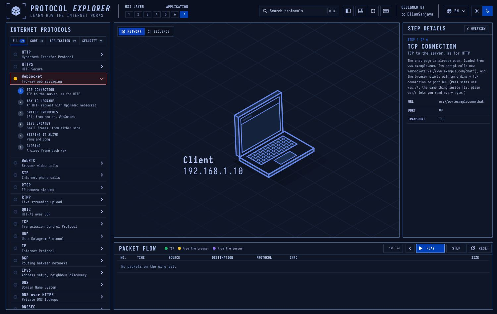
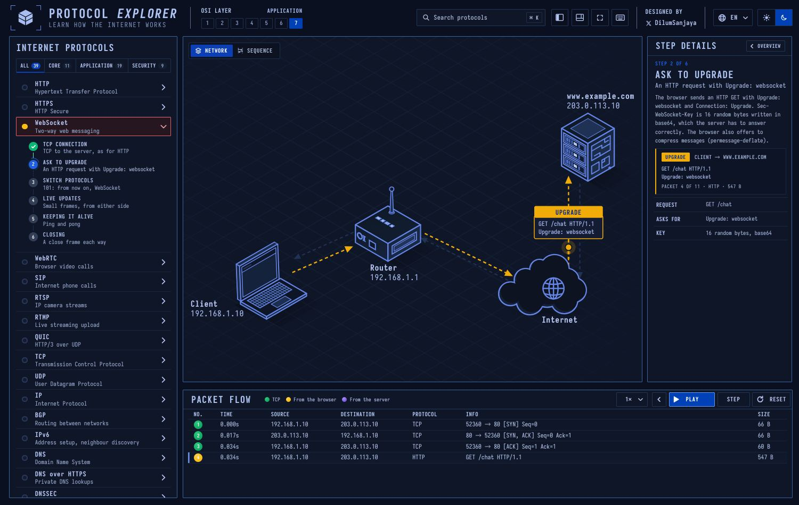
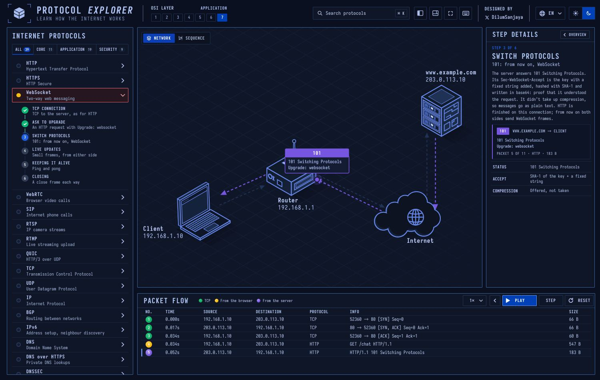
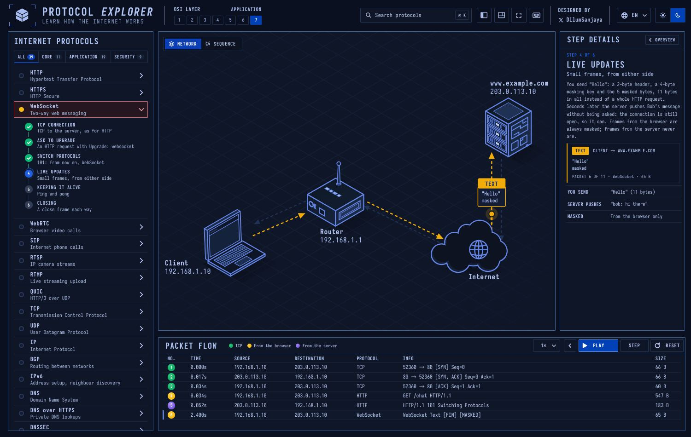
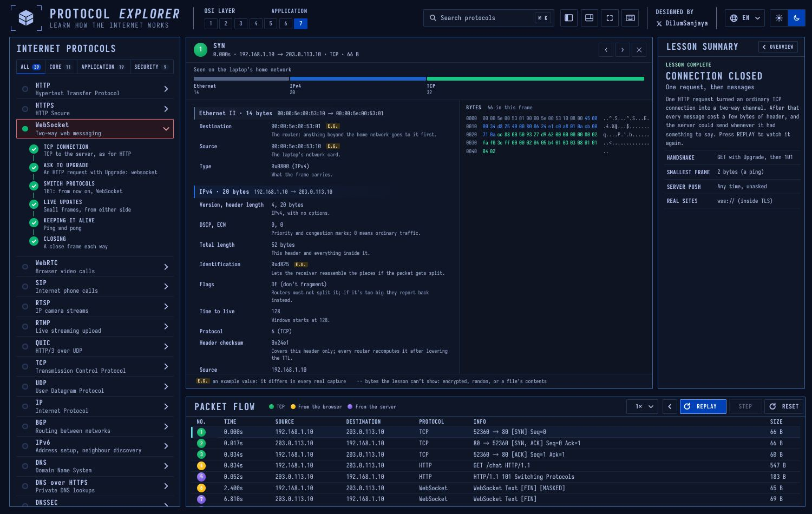
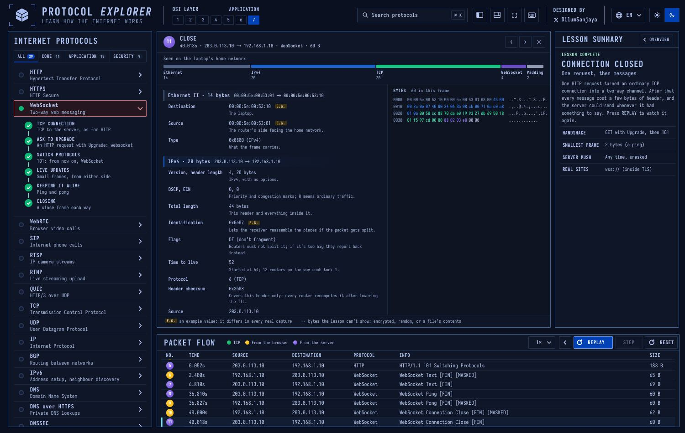

# WebSocket – Two-way web messaging

<!-- nav -->
⬅ [02 HTTPS](02-https.md) · [Index](00_Protocols_Index.md) · [04 WebRTC](04-webrtc.md) ➡
<!-- nav -->

*Source: Protocol Explorer – https://protocol-explorer-alpha.vercel.app/ (interactive lesson #3). Screenshots captured from the live lesson; packet decodes are the site's example capture (values marked **E.G.** differ in every real capture).*

## Overview


> PROTOCOL OVERVIEW  
> WebSocket  
> ACTIVE  
> The WebSocket Protocol  
> A WebSocket keeps one connection open between a web page and a server, so either side can send a message at any moment: chat, live scores, games, shared documents. It starts as an ordinary HTTP request asking to upgrade; after that, messages travel in small frames with a header of just a few bytes.  
> LAYER  
> Application (Layer 7)  
> PORTS  
> 80 (ws://), 443 (wss://)  
> STARTS AS  
> An HTTP request (Upgrade)  
> THEN  
> Frames both ways, any time  
> FRAME HEADER  
> 2–14 bytes  
> DEFINED IN  
> RFC 6455  

## In-depth explanation of the example (plain-language version)

### The big picture in one minute
A chat web page wants to show new messages **the instant** they arrive, like "bob: hi there". Normal HTTP can't do this well, because with HTTP **the server can only speak when the browser asks**. WebSocket fixes that: the browser opens **one connection and keeps it open**, and then **either side can send a message at any time.**

Think of the difference between **sending letters** (HTTP: you write, they reply) and **a phone call** (WebSocket: the line stays open, both can talk whenever).

This lesson follows one chat for 40 seconds and **11 messages**: open a connection, ask to "upgrade" it into a WebSocket, send a few tiny messages, and close.

> **Words you'll see:** a *frame* is one small WebSocket message with a short header. *Handshake* = the opening greeting. `ws://` is WebSocket over plain port 80, while `wss://` is WebSocket inside TLS on 443 (like HTTPS), which is what real sites use.

---

### Step 1 – Open a normal connection (TCP) – packets 1, 2, 3
The browser makes an ordinary TCP connection (SYN, SYN-ACK, ACK) to the server's port 80. WebSocket doesn't invent a new road; it reuses TCP.

### Step 2 – "Can we switch to WebSocket?" – packet 4
The first message is a normal HTTP request. That's on purpose: it lets WebSocket pass through the web servers, proxies and firewalls that already understand HTTP. The special lines are:
- `Upgrade: websocket` and `Connection: Upgrade` → "Let's switch this connection to another language."
- `Sec-WebSocket-Version: 13` → the version of WebSocket.
- `Sec-WebSocket-Key: dGhlIHNhbXBsZSBub25jZQ==` → a random value, **not a password**. It's a small quiz the server must answer correctly to prove it truly understands WebSocket.
- `Origin: http://www.example.com` → "this request comes from that web page," so the server can refuse pages it doesn't trust.
- `Sec-WebSocket-Extensions: permessage-deflate` → "I can compress messages if you can."

### Step 3 – "Okay, switching!" – packet 5
The server replies `101 Switching Protocols` and answers the quiz in `Sec-WebSocket-Accept`. It computes the answer by mixing the browser's key with a fixed, well-known text and hashing it. The browser repeats the calculation and only trusts the connection if the answers match. The server did not agree to compression, so messages stay uncompressed.
**After this reply, HTTP is over on this connection.** Everything that follows is WebSocket frames.

### Step 4 – Live messages – packets 6 and 7
- **Packet 6 – you send "Hello".** The frame is only 11 bytes:
  - byte 1: "this is a complete text message" (FIN = 1, type = text)
  - byte 2: "the data is masked, and it is 5 bytes long"
  - 4 bytes: a random **masking key**
  - 5 bytes: the word `Hello`, scrambled with that key
- **Why mask?** Browsers must always mask their frames; servers never do. Masking is **not encryption** (the key travels with the message). Its job is to stop a malicious page from sending bytes that look like an HTTP request and tricking a shared proxy cache.
- **Packet 7 – the server pushes "bob: hi there"** 4.4 seconds later, unmasked. Nobody asked for it. This "server push" is exactly what plain HTTP can't do.

### Step 5 – Keeping the line alive – packets 8 and 9
After 30 quiet seconds the server sends a **Ping** and the browser automatically answers **Pong**. Your page's code never even sees them. Reason: routers and firewalls like to drop connections that look idle, and the ping/pong also reveals if the other side has died.

### Step 6 – Hanging up – packets 10 and 11
The page calls `socket.close()`. The browser sends a **Close** frame with code `1000` ("normal closure"), the server answers with its own Close frame, and then the TCP connection ends. (Closing the tab sends `1001`, "going away".)

---

### The 11 messages at a glance
| # | What | Why |
|---|---|---|
| 1–3 | TCP handshake | open the connection |
| 4 | HTTP request with `Upgrade: websocket` | ask to switch |
| 5 | `101 Switching Protocols` | agree to switch |
| 6 | Client text frame "Hello" | you send a message |
| 7 | Server text frame "bob: hi there" | server pushes a message |
| 8–9 | Ping / Pong | keep the line alive |
| 10–11 | Close / Close | end politely |

### What to remember
- **One HTTP handshake, then thin frames.** A frame header is only 2–14 bytes, far smaller than an HTTP request.
- Frame types: **text, binary, close, ping, pong.**
- **Browser → server frames are masked; server → browser frames are not.**
- Always use **`wss://`** in real apps. `ws://` can be read by anyone on the network, just like HTTP.
- It replaced older tricks like *polling* ("any news?" every second) and *long polling* (see the chat-app design in the HLD notes).

## Step-by-step walkthrough (screenshots from the lesson)

### Step 1: TCP CONNECTION – TCP to the server, as for HTTP



> STEP 1 OF 6  
> TCP CONNECTION  
> TCP to the server, as for HTTP  
> The chat page is already open, loaded from www.example.com. Its script calls new WebSocket("ws://www.example.com/chat"), and the browser starts with an ordinary TCP connection to port 80. (Real sites use wss://, the same thing inside TLS; plain ws:// lets you read every byte.)  
> URL  
> ws://www.example.com/chat  
> PORT  
> 80  
> TRANSPORT  
> TCP  

### Step 2: ASK TO UPGRADE – An HTTP request with Upgrade: websocket



> STEP 2 OF 6  
> ASK TO UPGRADE  
> An HTTP request with Upgrade: websocket  
> The browser sends an HTTP GET with Upgrade: websocket and Connection: Upgrade. Sec-WebSocket-Key is 16 random bytes written in base64, which the server has to answer correctly. The browser also offers to compress messages (permessage-deflate).  
> UPGRADE  
> CLIENT → WWW.EXAMPLE.COM  
> GET /chat HTTP/1.1  
> Upgrade: websocket  
> PACKET 4 OF 11 · HTTP · 547 B  
> REQUEST  
> GET /chat  
> ASKS FOR  
> Upgrade: websocket  
> KEY  
> 16 random bytes, base64  

### Step 3: SWITCH PROTOCOLS – 101: from now on, WebSocket



> STEP 3 OF 6  
> SWITCH PROTOCOLS  
> 101: from now on, WebSocket  
> The server answers 101 Switching Protocols. Its Sec-WebSocket-Accept is the key with a fixed string added, hashed with SHA-1 and written in base64: proof that it understood the request. It didn’t take up compression, so messages go as plain text. HTTP is finished on this connection; from now on both sides send WebSocket frames.  
> 101  
> WWW.EXAMPLE.COM → CLIENT  
> 101 Switching Protocols  
> Upgrade: websocket  
> PACKET 5 OF 11 · HTTP · 183 B  
> STATUS  
> 101 Switching Protocols  
> ACCEPT  
> SHA-1 of the key + a fixed string  
> COMPRESSION  
> Offered, not taken  

### Step 4: LIVE UPDATES – Small frames, from either side



> STEP 4 OF 6  
> LIVE UPDATES  
> Small frames, from either side  
> You send "Hello": a 2-byte header, a 4-byte masking key and the 5 masked bytes, 11 bytes in all instead of a whole HTTP request. Seconds later the server pushes Bob’s message without being asked: the connection is still open, so it can. Frames from the browser are always masked; frames from the server never are.  
> TEXT  
> CLIENT → WWW.EXAMPLE.COM  
> "Hello"  
> masked  
> PACKET 6 OF 11 · WebSocket · 65 B  
> YOU SEND  
> "Hello" (11 bytes)  
> SERVER PUSHES  
> "bob: hi there"  
> MASKED  
> From the browser only  

### Step 5: KEEPING IT ALIVE – Ping and pong


> STEP 5 OF 6  
> KEEPING IT ALIVE  
> Ping and pong  
> After half a minute with nothing to say, the server sends a ping, so routers and firewalls on the way don’t forget the quiet connection. The browser answers with a pong on its own; the page’s script never sees either.  
> PING  
> WWW.EXAMPLE.COM → CLIENT  
> PACKET 8 OF 11 · WebSocket · 60 B  
> PING  
> Opcode 9, from either side  
> PONG  
> Opcode 10, by itself  
> HOW OFTEN  
> Up to the server (30 s)  

### Step 6: CLOSING – A close frame each way


> STEP 6 OF 6  
> CLOSING  
> A close frame each way  
> When you leave the chat, the page’s script closes the WebSocket with status 1000 (normal closure): the browser sends a close frame and the server answers with its own. Then the server closes the TCP connection. (Simply closing the tab would send 1001, going away.)  
> CLOSE  
> CLIENT → WWW.EXAMPLE.COM  
> 1000 normal closure  
> PACKET 10 OF 11 · WebSocket · 62 B  
> OPCODE  
> 8 (close)  
> STATUS  
> 1000 (normal closure)  
> THEN  
> TCP closes  

### Lesson summary


> LESSON SUMMARY  
> LESSON COMPLETE  
> CONNECTION CLOSED  
> One request, then messages  
> One HTTP request turned an ordinary TCP connection into a two-way channel. After that every message cost a few bytes of header, and the server could send whenever it had something to say. Press REPLAY to watch it again.  
> CLOSE  
> WWW.EXAMPLE.COM → CLIENT  
> 1000 normal closure  
> PACKET 11 OF 11 · WebSocket · 60 B  
> HANDSHAKE  
> GET with Upgrade, then 101  
> SMALLEST FRAME  
> 2 bytes (a ping)  
> SERVER PUSH  
> Any time, unasked  
> REAL SITES  
> wss:// (inside TLS)  

## Packet flow (whole lesson)

| No. | Time | Source | Destination | Protocol | Info | Size |
|---|---|---|---|---|---|---|
| 1 | 0.000s | 192.168.1.10 | 203.0.113.10 | TCP | 52360 → 80 [SYN] Seq=0 | 66 B |
| 2 | 0.017s | 203.0.113.10 | 192.168.1.10 | TCP | 80 → 52360 [SYN, ACK] Seq=0 Ack=1 | 66 B |
| 3 | 0.034s | 192.168.1.10 | 203.0.113.10 | TCP | 52360 → 80 [ACK] Seq=1 Ack=1 | 60 B |
| 4 | 0.034s | 192.168.1.10 | 203.0.113.10 | HTTP | GET /chat HTTP/1.1 | 547 B |
| 5 | 0.052s | 203.0.113.10 | 192.168.1.10 | HTTP | HTTP/1.1 101 Switching Protocols | 183 B |
| 6 | 2.400s | 192.168.1.10 | 203.0.113.10 | WebSocket | WebSocket Text [FIN] [MASKED] | 65 B |
| 7 | 6.810s | 203.0.113.10 | 192.168.1.10 | WebSocket | WebSocket Text [FIN] | 69 B |
| 8 | 36.810s | 203.0.113.10 | 192.168.1.10 | WebSocket | WebSocket Ping [FIN] | 60 B |
| 9 | 36.827s | 192.168.1.10 | 203.0.113.10 | WebSocket | WebSocket Pong [FIN] [MASKED] | 60 B |
| 10 | 40.000s | 192.168.1.10 | 203.0.113.10 | WebSocket | WebSocket Connection Close [FIN] [MASKED] | 62 B |
| 11 | 40.018s | 203.0.113.10 | 192.168.1.10 | WebSocket | WebSocket Connection Close [FIN] | 60 B |

### Sequence diagram


## Packets decoded byte by byte

Each packet below is the lesson's own decode (headers, field values and the plain-English meaning of each field). Screenshots show the first, middle and last packet in the lesson's decoder view with the raw hex bytes.

### Packet 1: TCP – 52360 → 80 [SYN] Seq=0

*192.168.1.10 → 203.0.113.10 · 66 B · t = 0.000s*



<details><summary>Decoded fields</summary>

```text
1
SYN
0.000s · 192.168.1.10 → 203.0.113.10 · TCP · 66 B
Seen on the laptop’s home network
Ethernet
14
IPv4
20
TCP
32
Ethernet II · 14 bytes
00:00:5e:00:53:10 → 00:00:5e:00:53:01
Destination
00:00:5e:00:53:01 E.G.

The router: anything beyond the home network goes to it first.

Source
00:00:5e:00:53:10 E.G.

The laptop’s network card.

Type
0x0800 (IPv4)

What the frame carries.

IPv4 · 20 bytes
192.168.1.10 → 203.0.113.10
Version, header length
4, 20 bytes

IPv4, with no options.

DSCP, ECN
0, 0

Priority and congestion marks; 0 means ordinary traffic.

Total length
52 bytes

This header and everything inside it.

Identification
0xd825 E.G.

Lets the receiver reassemble the pieces if the packet gets split.

Flags
DF (don’t fragment)

Routers must not split it; if it’s too big they report back instead.

Time to live
128

Windows starts at 128.

Protocol
6 (TCP)
Header checksum
0x24e1

Covers this header only; every router recomputes it after lowering the TTL.

Source
192.168.1.10
Destination
203.0.113.10
TCP · 32 bytes
52360 → 80, SYN
Source port
52360

Picked by the laptop’s system for this connection.

Destination port
80
Sequence number
0 (relative)

This side’s starting number. Shown as 0; the real one is random.

Real sequence number
2468862306 E.G.
Acknowledgment
0 (not used yet)

A first SYN has nothing to acknowledge.

Header length
32 bytes

20 bytes, plus 12 of options.

Flags
0x002 (SYN)
Window
64240 E.G.

How much more data this side can take right now.

Checksum
0x3cff

Covers the header, the data and the IP addresses, so damage is caught.

Urgent pointer
0
Options
12 bytes
Maximum segment size
1460 bytes

The most data this side wants in one segment.

No-op
1

Spacing, so the next option lines up.

Window scale
× 256

Window values are multiplied by this, so windows can be larger than 64 KB.

No-op
1

Spacing, so the next option lines up.

No-op
1

Spacing, so the next option lines up.

SACK permitted
yes

This side understands selective acknowledgements.

BYTES 66 in this frame
0000
00
00
5e
00
53
01
00
00
5e
00
53
10
08
00
45
00
.
.
^
.
S
.
.
.
^
.
S
.
.
.
E
.
0010
00
34
d8
25
40
00
80
06
24
e1
c0
a8
01
0a
cb
00
.
4
.
%
@
.
.
.
$
.
.
.
.
.
.
.
0020
71
0a
cc
88
00
50
93
27
d9
62
00
00
00
00
80
02
q
.
.
.
.
P
.
'
.
b
.
.
.
.
.
.
0030
fa
f0
3c
ff
00
00
02
04
05
b4
01
03
03
08
01
01
.
.
<
.
.
.
.
.
.
.
.
.
.
.
.
.
0040
04
02
.
.
E.G. an example value: it differs in every real capture
·· bytes the lesson can’t show: encrypted, random, or a file’s contents
```

</details>

### Packet 2: TCP – 80 → 52360 [SYN, ACK] Seq=0 Ack=1

*203.0.113.10 → 192.168.1.10 · 66 B · t = 0.017s*

<details><summary>Decoded fields</summary>

```text
2
SYN-ACK
0.017s · 203.0.113.10 → 192.168.1.10 · TCP · 66 B
Seen on the laptop’s home network
Ethernet
14
IPv4
20
TCP
32
Ethernet II · 14 bytes
00:00:5e:00:53:01 → 00:00:5e:00:53:10
Destination
00:00:5e:00:53:10 E.G.

The laptop.

Source
00:00:5e:00:53:01 E.G.

The router’s side facing the home network.

Type
0x0800 (IPv4)

What the frame carries.

IPv4 · 20 bytes
203.0.113.10 → 192.168.1.10
Version, header length
4, 20 bytes

IPv4, with no options.

DSCP, ECN
0, 0

Priority and congestion marks; 0 means ordinary traffic.

Total length
52 bytes

This header and everything inside it.

Identification
0x0e03 E.G.

Lets the receiver reassemble the pieces if the packet gets split.

Flags
DF (don’t fragment)

Routers must not split it; if it’s too big they report back instead.

Time to live
52

Started at 64; 12 routers on the way each took 1.

Protocol
6 (TCP)
Header checksum
0x3b04

Covers this header only; every router recomputes it after lowering the TTL.

Source
203.0.113.10
Destination
192.168.1.10
TCP · 32 bytes
80 → 52360, SYN, ACK
Source port
80
Destination port
52360
Sequence number
0 (relative)

This side’s starting number. Shown as 0; the real one is random.

Real sequence number
1893392262 E.G.
Acknowledgment
1 (relative)

The next byte this side expects: everything before it has arrived.

Header length
32 bytes

20 bytes, plus 12 of options.

Flags
0x012 (SYN, ACK)
Window
64240 E.G.

How much more data this side can take right now.

Checksum
0xec8d

Covers the header, the data and the IP addresses, so damage is caught.

Urgent pointer
0
Options
12 bytes
Maximum segment size
1460 bytes

The most data this side wants in one segment.

No-op
1

Spacing, so the next option lines up.

No-op
1

Spacing, so the next option lines up.

SACK permitted
yes

This side understands selective acknowledgements.

No-op
1

Spacing, so the next option lines up.

Window scale
× 128

Window values are multiplied by this, so windows can be larger than 64 KB.

BYTES 66 in this frame
0000
00
00
5e
00
53
10
00
00
5e
00
53
01
08
00
45
00
.
.
^
.
S
.
.
.
^
.
S
.
.
.
E
.
0010
00
34
0e
03
40
00
34
06
3b
04
cb
00
71
0a
c0
a8
.
4
.
.
@
.
4
.
;
.
.
.
q
.
.
.
0020
01
0a
00
50
cc
88
70
da
df
86
93
27
d9
63
80
12
.
.
.
P
.
.
p
.
.
.
.
'
.
c
.
.
0030
fa
f0
ec
8d
00
00
02
04
05
b4
01
01
04
02
01
03
.
.
.
.
.
.
.
.
.
.
.
.
.
.
.
.
0040
03
07
.
.
E.G. an example value: it differs in every real capture
·· bytes the lesson can’t show: encrypted, random, or a file’s contents
```

</details>

### Packet 3: TCP – 52360 → 80 [ACK] Seq=1 Ack=1

*192.168.1.10 → 203.0.113.10 · 60 B · t = 0.034s*

<details><summary>Decoded fields</summary>

```text
3
ACK
0.034s · 192.168.1.10 → 203.0.113.10 · TCP · 60 B
Seen on the laptop’s home network
Ethernet
14
IPv4
20
TCP
20
Padding
6
Ethernet II · 14 bytes
00:00:5e:00:53:10 → 00:00:5e:00:53:01
Destination
00:00:5e:00:53:01 E.G.

The router: anything beyond the home network goes to it first.

Source
00:00:5e:00:53:10 E.G.

The laptop’s network card.

Type
0x0800 (IPv4)

What the frame carries.

IPv4 · 20 bytes
192.168.1.10 → 203.0.113.10
Version, header length
4, 20 bytes

IPv4, with no options.

DSCP, ECN
0, 0

Priority and congestion marks; 0 means ordinary traffic.

Total length
40 bytes

This header and everything inside it.

Identification
0xd826 E.G.

Lets the receiver reassemble the pieces if the packet gets split.

Flags
DF (don’t fragment)

Routers must not split it; if it’s too big they report back instead.

Time to live
128

Windows starts at 128.

Protocol
6 (TCP)
Header checksum
0x24ec

Covers this header only; every router recomputes it after lowering the TTL.

Source
192.168.1.10
Destination
203.0.113.10
TCP · 20 bytes
52360 → 80, ACK
Source port
52360

Picked by the laptop’s system for this connection.

Destination port
80
Sequence number
1 (relative)

Position of this segment’s first byte, counted from this side’s SYN.

Real sequence number
2468862307 E.G.
Acknowledgment
1 (relative)

The next byte this side expects: everything before it has arrived.

Header length
20 bytes
Flags
0x010 (ACK)
Window
1026 (× 256 = 262,656 bytes) E.G.

How much more data this side can take right now.

Checksum
0x244f

Covers the header, the data and the IP addresses, so damage is caught.

Urgent pointer
0
Ethernet padding · 6 bytes
Padding
6 zero bytes

Ethernet frames are at least 60 bytes (64 with the checksum the card adds), so short ones are padded.

BYTES 60 in this frame
0000
00
00
5e
00
53
01
00
00
5e
00
53
10
08
00
45
00
.
.
^
.
S
.
.
.
^
.
S
.
.
.
E
.
0010
00
28
d8
26
40
00
80
06
24
ec
c0
a8
01
0a
cb
00
.
(
.
&
@
.
.
.
$
.
.
.
.
.
.
.
0020
71
0a
cc
88
00
50
93
27
d9
63
70
da
df
87
50
10
q
.
.
.
.
P
.
'
.
c
p
.
.
.
P
.
0030
04
02
24
4f
00
00
00
00
00
00
00
00
.
.
$
O
.
.
.
.
.
.
.
.
E.G. an example value: it differs in every real capture
·· bytes the lesson can’t show: encrypted, random, or a file’s contents
```

</details>

### Packet 4: HTTP – GET /chat HTTP/1.1

*192.168.1.10 → 203.0.113.10 · 547 B · t = 0.034s*

<details><summary>Decoded fields</summary>

```text
4
UPGRADE
0.034s · 192.168.1.10 → 203.0.113.10 · HTTP · 547 B
Seen on the laptop’s home network
Ethernet
14
IPv4
20
TCP
20
HTTP
493
Ethernet II · 14 bytes
00:00:5e:00:53:10 → 00:00:5e:00:53:01
Destination
00:00:5e:00:53:01 E.G.

The router: anything beyond the home network goes to it first.

Source
00:00:5e:00:53:10 E.G.

The laptop’s network card.

Type
0x0800 (IPv4)

What the frame carries.

IPv4 · 20 bytes
192.168.1.10 → 203.0.113.10
Version, header length
4, 20 bytes

IPv4, with no options.

DSCP, ECN
0, 0

Priority and congestion marks; 0 means ordinary traffic.

Total length
533 bytes

This header and everything inside it.

Identification
0xd827 E.G.

Lets the receiver reassemble the pieces if the packet gets split.

Flags
DF (don’t fragment)

Routers must not split it; if it’s too big they report back instead.

Time to live
128

Windows starts at 128.

Protocol
6 (TCP)
Header checksum
0x22fe

Covers this header only; every router recomputes it after lowering the TTL.

Source
192.168.1.10
Destination
203.0.113.10
TCP · 20 bytes
52360 → 80, PSH, ACK
Source port
52360

Picked by the laptop’s system for this connection.

Destination port
80
Sequence number
1 (relative)

Position of this segment’s first byte, counted from this side’s SYN.

Real sequence number
2468862307 E.G.
Acknowledgment
1 (relative)

The next byte this side expects: everything before it has arrived.

Header length
20 bytes
Flags
0x018 (PSH, ACK)
Window
1026 (× 256 = 262,656 bytes) E.G.

How much more data this side can take right now.

Checksum
0xa515

Covers the header, the data and the IP addresses, so damage is caught.

Urgent pointer
0
HTTP
Text
GET /chat HTTP/1.1␍␊
Host: www.example.com␍␊
Connection: Upgrade␍␊
Pragma: no-cache␍␊
Cache-Control: no-cache␍␊
User-Agent: Mozilla/5.0 (Windows NT 10.0; Win64; x64) AppleWebKit/537.36 (KHTML, like Gecko) Chrome/142.0.0.0 Safari/537.36␍␊
Upgrade: websocket␍␊
Origin: http://www.example.com␍␊
Sec-WebSocket-Version: 13␍␊
Accept-Encoding: gzip, deflate␍␊
Accept-Language: en-US,en;q=0.9␍␊
Sec-WebSocket-Key: dGhlIHNhbXBsZSBub25jZQ==␍␊
Sec-WebSocket-Extensions: permessage-deflate; client_max_window_bits␍␊
␍␊
BYTES 547 in this frame
0000
00
00
5e
00
53
01
00
00
5e
00
53
10
08
00
45
00
.
.
^
.
S
.
.
.
^
.
S
.
.
.
E
.
0010
02
15
d8
27
40
00
80
06
22
fe
c0
a8
01
0a
cb
00
.
.
.
'
@
.
.
.
"
.
.
.
.
.
.
.
0020
71
0a
cc
88
00
50
93
27
d9
63
70
da
df
87
50
18
q
.
.
.
.
P
.
'
.
c
p
.
.
.
P
.
0030
04
02
a5
15
00
00
47
45
54
20
2f
63
68
61
74
20
.
.
.
.
.
.
G
E
T
/
c
h
a
t
0040
48
54
54
50
2f
31
2e
31
0d
0a
48
6f
73
74
3a
20
H
T
T
P
/
1
.
1
.
.
H
o
s
t
:
0050
77
77
77
2e
65
78
61
6d
70
6c
65
2e
63
6f
6d
0d
w
w
w
.
e
x
a
m
p
l
e
.
c
o
m
.
0060
0a
43
6f
6e
6e
65
63
74
69
6f
6e
3a
20
55
70
67
.
C
o
n
n
e
c
t
i
o
n
:
U
p
g
0070
72
61
64
65
0d
0a
50
72
61
67
6d
61
3a
20
6e
6f
r
a
d
e
.
.
P
r
a
g
m
a
:
n
o
0080
2d
63
61
63
68
65
0d
0a
43
61
63
68
65
2d
43
6f
-
c
a
c
h
e
.
.
C
a
c
h
e
-
C
o
0090
6e
74
72
6f
6c
3a
20
6e
6f
2d
63
61
63
68
65
0d
n
t
r
o
l
:
n
o
-
c
a
c
h
e
.
00a0
0a
55
73
65
72
2d
41
67
65
6e
74
3a
20
4d
6f
7a
.
U
s
e
r
-
A
g
e
n
t
:
M
o
z
00b0
69
6c
6c
61
2f
35
2e
30
20
28
57
69
6e
64
6f
77
i
l
l
a
/
5
.
0
(
W
i
n
d
o
w
00c0
73
20
4e
54
20
31
30
2e
30
3b
20
57
69
6e
36
34
s
N
T
1
0
.
0
;
W
i
n
6
4
00d0
3b
20
78
36
34
29
20
41
70
70
6c
65
57
65
62
4b
;
x
6
4
)
A
p
p
l
e
W
e
b
K
00e0
69
74
2f
35
33
37
2e
33
36
20
28
4b
48
54
4d
4c
i
t
/
5
3
7
.
3
6
(
K
H
T
M
L
00f0
2c
20
6c
69
6b
65
20
47
65
63
6b
6f
29
20
43
68
,
l
i
k
e
G
e
c
k
o
)
C
h
0100
72
6f
6d
65
2f
31
34
32
2e
30
2e
30
2e
30
20
53
r
o
m
e
/
1
4
2
.
0
.
0
.
0
S
0110
61
66
61
72
69
2f
35
33
37
2e
33
36
0d
0a
55
70
a
f
a
r
i
/
5
3
7
.
3
6
.
.
U
p
0120
67
72
61
64
65
3a
20
77
65
62
73
6f
63
6b
65
74
g
r
a
d
e
:
w
e
b
s
o
c
k
e
t
0130
0d
0a
4f
72
69
67
69
6e
3a
20
68
74
74
70
3a
2f
.
.
O
r
i
g
i
n
:
h
t
t
p
:
/
0140
2f
77
77
77
2e
65
78
61
6d
70
6c
65
2e
63
6f
6d
/
w
w
w
.
e
x
a
m
p
l
e
.
c
o
m
0150
0d
0a
53
65
63
2d
57
65
62
53
6f
63
6b
65
74
2d
.
.
S
e
c
-
W
e
b
S
o
c
k
e
t
-
0160
56
65
72
73
69
6f
6e
3a
20
31
33
0d
0a
41
63
63
V
e
r
s
i
o
n
:
1
3
.
.
A
c
c
0170
65
70
74
2d
45
6e
63
6f
64
69
6e
67
3a
20
67
7a
e
p
t
-
E
n
c
o
d
i
n
g
:
g
z
0180
69
70
2c
20
64
65
66
6c
61
74
65
0d
0a
41
63
63
i
p
,
d
e
f
l
a
t
e
.
.
A
c
c
0190
65
70
74
2d
4c
61
6e
67
75
61
67
65
3a
20
65
6e
e
p
t
-
L
a
n
g
u
a
g
e
:
e
n
01a0
2d
55
53
2c
65
6e
3b
71
3d
30
2e
39
0d
0a
53
65
-
U
S
,
e
n
;
q
=
0
.
9
.
.
S
e
01b0
63
2d
57
65
62
53
6f
63
6b
65
74
2d
4b
65
79
3a
c
-
W
e
b
S
o
c
k
e
t
-
K
e
y
:
01c0
20
64
47
68
6c
49
48
4e
68
62
58
42
73
5a
53
42
d
G
h
l
I
H
N
h
b
X
B
s
Z
S
B
01d0
75
62
32
35
6a
5a
51
3d
3d
0d
0a
53
65
63
2d
57
u
b
2
5
j
Z
Q
=
=
.
.
S
e
c
-
W
01e0
65
62
53
6f
63
6b
65
74
2d
45
78
74
65
6e
73
69
e
b
S
o
c
k
e
t
-
E
x
t
e
n
s
i
01f0
6f
6e
73
3a
20
70
65
72
6d
65
73
73
61
67
65
2d
o
n
s
:
p
e
r
m
e
s
s
a
g
e
-
0200
64
65
66
6c
61
74
65
3b
20
63
6c
69
65
6e
74
5f
d
e
f
l
a
t
e
;
c
l
i
e
n
t
_
0210
6d
61
78
5f
77
69
6e
64
6f
77
5f
62
69
74
73
0d
m
a
x
_
w
i
n
d
o
w
_
b
i
t
s
.
0220
0a
0d
0a
.
.
.
E.G. an example value: it differs in every real capture
·· bytes the lesson can’t show: encrypted, random, or a file’s contents
```

</details>

### Packet 5: HTTP – HTTP/1.1 101 Switching Protocols

*203.0.113.10 → 192.168.1.10 · 183 B · t = 0.052s*

<details><summary>Decoded fields</summary>

```text
5
101
0.052s · 203.0.113.10 → 192.168.1.10 · HTTP · 183 B
Seen on the laptop’s home network
Ethernet
14
IPv4
20
TCP
20
HTTP
129
Ethernet II · 14 bytes
00:00:5e:00:53:01 → 00:00:5e:00:53:10
Destination
00:00:5e:00:53:10 E.G.

The laptop.

Source
00:00:5e:00:53:01 E.G.

The router’s side facing the home network.

Type
0x0800 (IPv4)

What the frame carries.

IPv4 · 20 bytes
203.0.113.10 → 192.168.1.10
Version, header length
4, 20 bytes

IPv4, with no options.

DSCP, ECN
0, 0

Priority and congestion marks; 0 means ordinary traffic.

Total length
169 bytes

This header and everything inside it.

Identification
0x0e04 E.G.

Lets the receiver reassemble the pieces if the packet gets split.

Flags
DF (don’t fragment)

Routers must not split it; if it’s too big they report back instead.

Time to live
52

Started at 64; 12 routers on the way each took 1.

Protocol
6 (TCP)
Header checksum
0x3a8e

Covers this header only; every router recomputes it after lowering the TTL.

Source
203.0.113.10
Destination
192.168.1.10
TCP · 20 bytes
80 → 52360, PSH, ACK
Source port
80
Destination port
52360
Sequence number
1 (relative)

Position of this segment’s first byte, counted from this side’s SYN.

Real sequence number
1893392263 E.G.
Acknowledgment
494 (relative)

The next byte this side expects: everything before it has arrived.

Header length
20 bytes
Flags
0x018 (PSH, ACK)
Window
501 (× 128 = 64,128 bytes) E.G.

How much more data this side can take right now.

Checksum
0xa3e2

Covers the header, the data and the IP addresses, so damage is caught.

Urgent pointer
0
HTTP
Text
HTTP/1.1 101 Switching Protocols␍␊
Upgrade: websocket␍␊
Connection: Upgrade␍␊
Sec-WebSocket-Accept: s3pPLMBiTxaQ9kYGzzhZRbK+xOo=␍␊
␍␊
BYTES 183 in this frame
0000
00
00
5e
00
53
10
00
00
5e
00
53
01
08
00
45
00
.
.
^
.
S
.
.
.
^
.
S
.
.
.
E
.
0010
00
a9
0e
04
40
00
34
06
3a
8e
cb
00
71
0a
c0
a8
.
.
.
.
@
.
4
.
:
.
.
.
q
.
.
.
0020
01
0a
00
50
cc
88
70
da
df
87
93
27
db
50
50
18
.
.
.
P
.
.
p
.
.
.
.
'
.
P
P
.
0030
01
f5
a3
e2
00
00
48
54
54
50
2f
31
2e
31
20
31
.
.
.
.
.
.
H
T
T
P
/
1
.
1
1
0040
30
31
20
53
77
69
74
63
68
69
6e
67
20
50
72
6f
0
1
S
w
i
t
c
h
i
n
g
P
r
o
0050
74
6f
63
6f
6c
73
0d
0a
55
70
67
72
61
64
65
3a
t
o
c
o
l
s
.
.
U
p
g
r
a
d
e
:
0060
20
77
65
62
73
6f
63
6b
65
74
0d
0a
43
6f
6e
6e
w
e
b
s
o
c
k
e
t
.
.
C
o
n
n
0070
65
63
74
69
6f
6e
3a
20
55
70
67
72
61
64
65
0d
e
c
t
i
o
n
:
U
p
g
r
a
d
e
.
0080
0a
53
65
63
2d
57
65
62
53
6f
63
6b
65
74
2d
41
.
S
e
c
-
W
e
b
S
o
c
k
e
t
-
A
0090
63
63
65
70
74
3a
20
73
33
70
50
4c
4d
42
69
54
c
c
e
p
t
:
s
3
p
P
L
M
B
i
T
00a0
78
61
51
39
6b
59
47
7a
7a
68
5a
52
62
4b
2b
78
x
a
Q
9
k
Y
G
z
z
h
Z
R
b
K
+
x
00b0
4f
6f
3d
0d
0a
0d
0a
O
o
=
.
.
.
.
E.G. an example value: it differs in every real capture
·· bytes the lesson can’t show: encrypted, random, or a file’s contents
```

</details>

### Packet 6: WebSocket – WebSocket Text [FIN] [MASKED]

*192.168.1.10 → 203.0.113.10 · 65 B · t = 2.400s*


<details><summary>Decoded fields</summary>

```text
6
TEXT
2.400s · 192.168.1.10 → 203.0.113.10 · WebSocket · 65 B
Seen on the laptop’s home network
Ethernet
14
IPv4
20
TCP
20
WebSocket
11
Ethernet II · 14 bytes
00:00:5e:00:53:10 → 00:00:5e:00:53:01
Destination
00:00:5e:00:53:01 E.G.

The router: anything beyond the home network goes to it first.

Source
00:00:5e:00:53:10 E.G.

The laptop’s network card.

Type
0x0800 (IPv4)

What the frame carries.

IPv4 · 20 bytes
192.168.1.10 → 203.0.113.10
Version, header length
4, 20 bytes

IPv4, with no options.

DSCP, ECN
0, 0

Priority and congestion marks; 0 means ordinary traffic.

Total length
51 bytes

This header and everything inside it.

Identification
0xd828 E.G.

Lets the receiver reassemble the pieces if the packet gets split.

Flags
DF (don’t fragment)

Routers must not split it; if it’s too big they report back instead.

Time to live
128

Windows starts at 128.

Protocol
6 (TCP)
Header checksum
0x24df

Covers this header only; every router recomputes it after lowering the TTL.

Source
192.168.1.10
Destination
203.0.113.10
TCP · 20 bytes
52360 → 80, PSH, ACK
Source port
52360

Picked by the laptop’s system for this connection.

Destination port
80
Sequence number
494 (relative)

Position of this segment’s first byte, counted from this side’s SYN.

Real sequence number
2468862800 E.G.
Acknowledgment
130 (relative)

The next byte this side expects: everything before it has arrived.

Header length
20 bytes
Flags
0x018 (PSH, ACK)
Window
1026 (× 256 = 262,656 bytes) E.G.

How much more data this side can take right now.

Checksum
0x2220

Covers the header, the data and the IP addresses, so damage is caught.

Urgent pointer
0
WebSocket · text
FIN, opcode
1, 1 (text)

FIN 1: this frame is a whole message. The opcode says what it carries.

Mask, length
masked, 5 bytes

Everything a browser sends is masked.

Masking key
37 fa 21 3d E.G.

Chosen at random for every frame.

Payload
"Hello" (5 bytes)

Each byte XORed with the masking key in turn; the server XORs it back.

BYTES 65 in this frame
0000
00
00
5e
00
53
01
00
00
5e
00
53
10
08
00
45
00
.
.
^
.
S
.
.
.
^
.
S
.
.
.
E
.
0010
00
33
d8
28
40
00
80
06
24
df
c0
a8
01
0a
cb
00
.
3
.
(
@
.
.
.
$
.
.
.
.
.
.
.
0020
71
0a
cc
88
00
50
93
27
db
50
70
da
e0
08
50
18
q
.
.
.
.
P
.
'
.
P
p
.
.
.
P
.
0030
04
02
22
20
00
00
81
85
37
fa
21
3d
7f
9f
4d
51
.
.
"
.
.
.
.
7
.
!
=
.
.
M
Q
0040
58
X
E.G. an example value: it differs in every real capture
·· bytes the lesson can’t show: encrypted, random, or a file’s contents
```

</details>

### Packet 7: WebSocket – WebSocket Text [FIN]

*203.0.113.10 → 192.168.1.10 · 69 B · t = 6.810s*

<details><summary>Decoded fields</summary>

```text
7
TEXT
6.810s · 203.0.113.10 → 192.168.1.10 · WebSocket · 69 B
Seen on the laptop’s home network
Ethernet
14
IPv4
20
TCP
20
WebSocket
15
Ethernet II · 14 bytes
00:00:5e:00:53:01 → 00:00:5e:00:53:10
Destination
00:00:5e:00:53:10 E.G.

The laptop.

Source
00:00:5e:00:53:01 E.G.

The router’s side facing the home network.

Type
0x0800 (IPv4)

What the frame carries.

IPv4 · 20 bytes
203.0.113.10 → 192.168.1.10
Version, header length
4, 20 bytes

IPv4, with no options.

DSCP, ECN
0, 0

Priority and congestion marks; 0 means ordinary traffic.

Total length
55 bytes

This header and everything inside it.

Identification
0x0e05 E.G.

Lets the receiver reassemble the pieces if the packet gets split.

Flags
DF (don’t fragment)

Routers must not split it; if it’s too big they report back instead.

Time to live
52

Started at 64; 12 routers on the way each took 1.

Protocol
6 (TCP)
Header checksum
0x3aff

Covers this header only; every router recomputes it after lowering the TTL.

Source
203.0.113.10
Destination
192.168.1.10
TCP · 20 bytes
80 → 52360, PSH, ACK
Source port
80
Destination port
52360
Sequence number
130 (relative)

Position of this segment’s first byte, counted from this side’s SYN.

Real sequence number
1893392392 E.G.
Acknowledgment
505 (relative)

The next byte this side expects: everything before it has arrived.

Header length
20 bytes
Flags
0x018 (PSH, ACK)
Window
501 (× 128 = 64,128 bytes) E.G.

How much more data this side can take right now.

Checksum
0x15b1

Covers the header, the data and the IP addresses, so damage is caught.

Urgent pointer
0
WebSocket · text
FIN, opcode
1, 1 (text)

FIN 1: this frame is a whole message. The opcode says what it carries.

Mask, length
not masked, 13 bytes

A server never masks what it sends.

Payload
"bob: hi there" (13 bytes)
BYTES 69 in this frame
0000
00
00
5e
00
53
10
00
00
5e
00
53
01
08
00
45
00
.
.
^
.
S
.
.
.
^
.
S
.
.
.
E
.
0010
00
37
0e
05
40
00
34
06
3a
ff
cb
00
71
0a
c0
a8
.
7
.
.
@
.
4
.
:
.
.
.
q
.
.
.
0020
01
0a
00
50
cc
88
70
da
e0
08
93
27
db
5b
50
18
.
.
.
P
.
.
p
.
.
.
.
'
.
[
P
.
0030
01
f5
15
b1
00
00
81
0d
62
6f
62
3a
20
68
69
20
.
.
.
.
.
.
.
.
b
o
b
:
h
i
0040
74
68
65
72
65
t
h
e
r
e
E.G. an example value: it differs in every real capture
·· bytes the lesson can’t show: encrypted, random, or a file’s contents
```

</details>

### Packet 8: WebSocket – WebSocket Ping [FIN]

*203.0.113.10 → 192.168.1.10 · 60 B · t = 36.810s*

<details><summary>Decoded fields</summary>

```text
8
PING
36.810s · 203.0.113.10 → 192.168.1.10 · WebSocket · 60 B
Seen on the laptop’s home network
Ethernet
14
IPv4
20
TCP
20
WebSocket
2
Padding
4
Ethernet II · 14 bytes
00:00:5e:00:53:01 → 00:00:5e:00:53:10
Destination
00:00:5e:00:53:10 E.G.

The laptop.

Source
00:00:5e:00:53:01 E.G.

The router’s side facing the home network.

Type
0x0800 (IPv4)

What the frame carries.

IPv4 · 20 bytes
203.0.113.10 → 192.168.1.10
Version, header length
4, 20 bytes

IPv4, with no options.

DSCP, ECN
0, 0

Priority and congestion marks; 0 means ordinary traffic.

Total length
42 bytes

This header and everything inside it.

Identification
0x0e06 E.G.

Lets the receiver reassemble the pieces if the packet gets split.

Flags
DF (don’t fragment)

Routers must not split it; if it’s too big they report back instead.

Time to live
52

Started at 64; 12 routers on the way each took 1.

Protocol
6 (TCP)
Header checksum
0x3b0b

Covers this header only; every router recomputes it after lowering the TTL.

Source
203.0.113.10
Destination
192.168.1.10
TCP · 20 bytes
80 → 52360, PSH, ACK
Source port
80
Destination port
52360
Sequence number
145 (relative)

Position of this segment’s first byte, counted from this side’s SYN.

Real sequence number
1893392407 E.G.
Acknowledgment
505 (relative)

The next byte this side expects: everything before it has arrived.

Header length
20 bytes
Flags
0x018 (PSH, ACK)
Window
501 (× 128 = 64,128 bytes) E.G.

How much more data this side can take right now.

Checksum
0x9ac9

Covers the header, the data and the IP addresses, so damage is caught.

Urgent pointer
0
WebSocket · ping
FIN, opcode
1, 9 (ping)

FIN 1: this frame is a whole message. The opcode says what it carries.

Mask, length
not masked, 0 bytes

A server never masks what it sends.

Ethernet padding · 4 bytes
Padding
4 zero bytes

Ethernet frames are at least 60 bytes (64 with the checksum the card adds), so short ones are padded.

BYTES 60 in this frame
0000
00
00
5e
00
53
10
00
00
5e
00
53
01
08
00
45
00
.
.
^
.
S
.
.
.
^
.
S
.
.
.
E
.
0010
00
2a
0e
06
40
00
34
06
3b
0b
cb
00
71
0a
c0
a8
.
*
.
.
@
.
4
.
;
.
.
.
q
.
.
.
0020
01
0a
00
50
cc
88
70
da
e0
17
93
27
db
5b
50
18
.
.
.
P
.
.
p
.
.
.
.
'
.
[
P
.
0030
01
f5
9a
c9
00
00
89
00
00
00
00
00
.
.
.
.
.
.
.
.
.
.
.
.
E.G. an example value: it differs in every real capture
·· bytes the lesson can’t show: encrypted, random, or a file’s contents
```

</details>

### Packet 9: WebSocket – WebSocket Pong [FIN] [MASKED]

*192.168.1.10 → 203.0.113.10 · 60 B · t = 36.827s*

<details><summary>Decoded fields</summary>

```text
9
PONG
36.827s · 192.168.1.10 → 203.0.113.10 · WebSocket · 60 B
Seen on the laptop’s home network
Ethernet
14
IPv4
20
TCP
20
WebSocket
6
Ethernet II · 14 bytes
00:00:5e:00:53:10 → 00:00:5e:00:53:01
Destination
00:00:5e:00:53:01 E.G.

The router: anything beyond the home network goes to it first.

Source
00:00:5e:00:53:10 E.G.

The laptop’s network card.

Type
0x0800 (IPv4)

What the frame carries.

IPv4 · 20 bytes
192.168.1.10 → 203.0.113.10
Version, header length
4, 20 bytes

IPv4, with no options.

DSCP, ECN
0, 0

Priority and congestion marks; 0 means ordinary traffic.

Total length
46 bytes

This header and everything inside it.

Identification
0xd829 E.G.

Lets the receiver reassemble the pieces if the packet gets split.

Flags
DF (don’t fragment)

Routers must not split it; if it’s too big they report back instead.

Time to live
128

Windows starts at 128.

Protocol
6 (TCP)
Header checksum
0x24e3

Covers this header only; every router recomputes it after lowering the TTL.

Source
192.168.1.10
Destination
203.0.113.10
TCP · 20 bytes
52360 → 80, PSH, ACK
Source port
52360

Picked by the laptop’s system for this connection.

Destination port
80
Sequence number
505 (relative)

Position of this segment’s first byte, counted from this side’s SYN.

Real sequence number
2468862811 E.G.
Acknowledgment
147 (relative)

The next byte this side expects: everything before it has arrived.

Header length
20 bytes
Flags
0x018 (PSH, ACK)
Window
1026 (× 256 = 262,656 bytes) E.G.

How much more data this side can take right now.

Checksum
0xaaa5

Covers the header, the data and the IP addresses, so damage is caught.

Urgent pointer
0
WebSocket · pong
FIN, opcode
1, 10 (pong)

FIN 1: this frame is a whole message. The opcode says what it carries.

Mask, length
masked, 0 bytes

Everything a browser sends is masked.

Masking key
5c 1e 90 72 E.G.

Chosen at random for every frame.

BYTES 60 in this frame
0000
00
00
5e
00
53
01
00
00
5e
00
53
10
08
00
45
00
.
.
^
.
S
.
.
.
^
.
S
.
.
.
E
.
0010
00
2e
d8
29
40
00
80
06
24
e3
c0
a8
01
0a
cb
00
.
.
.
)
@
.
.
.
$
.
.
.
.
.
.
.
0020
71
0a
cc
88
00
50
93
27
db
5b
70
da
e0
19
50
18
q
.
.
.
.
P
.
'
.
[
p
.
.
.
P
.
0030
04
02
aa
a5
00
00
8a
80
5c
1e
90
72
.
.
.
.
.
.
.
.
\
.
.
r
E.G. an example value: it differs in every real capture
·· bytes the lesson can’t show: encrypted, random, or a file’s contents
```

</details>

### Packet 10: WebSocket – WebSocket Connection Close [FIN] [MASKED]

*192.168.1.10 → 203.0.113.10 · 62 B · t = 40.000s*

<details><summary>Decoded fields</summary>

```text
10
CLOSE
40.000s · 192.168.1.10 → 203.0.113.10 · WebSocket · 62 B
Seen on the laptop’s home network
Ethernet
14
IPv4
20
TCP
20
WebSocket
8
Ethernet II · 14 bytes
00:00:5e:00:53:10 → 00:00:5e:00:53:01
Destination
00:00:5e:00:53:01 E.G.

The router: anything beyond the home network goes to it first.

Source
00:00:5e:00:53:10 E.G.

The laptop’s network card.

Type
0x0800 (IPv4)

What the frame carries.

IPv4 · 20 bytes
192.168.1.10 → 203.0.113.10
Version, header length
4, 20 bytes

IPv4, with no options.

DSCP, ECN
0, 0

Priority and congestion marks; 0 means ordinary traffic.

Total length
48 bytes

This header and everything inside it.

Identification
0xd82a E.G.

Lets the receiver reassemble the pieces if the packet gets split.

Flags
DF (don’t fragment)

Routers must not split it; if it’s too big they report back instead.

Time to live
128

Windows starts at 128.

Protocol
6 (TCP)
Header checksum
0x24e0

Covers this header only; every router recomputes it after lowering the TTL.

Source
192.168.1.10
Destination
203.0.113.10
TCP · 20 bytes
52360 → 80, PSH, ACK
Source port
52360

Picked by the laptop’s system for this connection.

Destination port
80
Sequence number
511 (relative)

Position of this segment’s first byte, counted from this side’s SYN.

Real sequence number
2468862817 E.G.
Acknowledgment
147 (relative)

The next byte this side expects: everything before it has arrived.

Header length
20 bytes
Flags
0x018 (PSH, ACK)
Window
1026 (× 256 = 262,656 bytes) E.G.

How much more data this side can take right now.

Checksum
0x4d64

Covers the header, the data and the IP addresses, so damage is caught.

Urgent pointer
0
WebSocket · close
FIN, opcode
1, 8 (close)

FIN 1: this frame is a whole message. The opcode says what it carries.

Mask, length
masked, 2 bytes

Everything a browser sends is masked.

Masking key
a3 4b 07 d9 E.G.

Chosen at random for every frame.

Status code
1000 (normal closure)

Each byte XORed with the masking key in turn; the server XORs it back.

BYTES 62 in this frame
0000
00
00
5e
00
53
01
00
00
5e
00
53
10
08
00
45
00
.
.
^
.
S
.
.
.
^
.
S
.
.
.
E
.
0010
00
30
d8
2a
40
00
80
06
24
e0
c0
a8
01
0a
cb
00
.
0
.
*
@
.
.
.
$
.
.
.
.
.
.
.
0020
71
0a
cc
88
00
50
93
27
db
61
70
da
e0
19
50
18
q
.
.
.
.
P
.
'
.
a
p
.
.
.
P
.
0030
04
02
4d
64
00
00
88
82
a3
4b
07
d9
a0
a3
.
.
M
d
.
.
.
.
.
K
.
.
.
.
E.G. an example value: it differs in every real capture
·· bytes the lesson can’t show: encrypted, random, or a file’s contents
```

</details>

### Packet 11: WebSocket – WebSocket Connection Close [FIN]

*203.0.113.10 → 192.168.1.10 · 60 B · t = 40.018s*



<details><summary>Decoded fields</summary>

```text
11
CLOSE
40.018s · 203.0.113.10 → 192.168.1.10 · WebSocket · 60 B
Seen on the laptop’s home network
Ethernet
14
IPv4
20
TCP
20
WebSocket
4
Padding
2
Ethernet II · 14 bytes
00:00:5e:00:53:01 → 00:00:5e:00:53:10
Destination
00:00:5e:00:53:10 E.G.

The laptop.

Source
00:00:5e:00:53:01 E.G.

The router’s side facing the home network.

Type
0x0800 (IPv4)

What the frame carries.

IPv4 · 20 bytes
203.0.113.10 → 192.168.1.10
Version, header length
4, 20 bytes

IPv4, with no options.

DSCP, ECN
0, 0

Priority and congestion marks; 0 means ordinary traffic.

Total length
44 bytes

This header and everything inside it.

Identification
0x0e07 E.G.

Lets the receiver reassemble the pieces if the packet gets split.

Flags
DF (don’t fragment)

Routers must not split it; if it’s too big they report back instead.

Time to live
52

Started at 64; 12 routers on the way each took 1.

Protocol
6 (TCP)
Header checksum
0x3b08

Covers this header only; every router recomputes it after lowering the TTL.

Source
203.0.113.10
Destination
192.168.1.10
TCP · 20 bytes
80 → 52360, PSH, ACK
Source port
80
Destination port
52360
Sequence number
147 (relative)

Position of this segment’s first byte, counted from this side’s SYN.

Real sequence number
1893392409 E.G.
Acknowledgment
519 (relative)

The next byte this side expects: everything before it has arrived.

Header length
20 bytes
Flags
0x018 (PSH, ACK)
Window
501 (× 128 = 64,128 bytes) E.G.

How much more data this side can take right now.

Checksum
0x97cd

Covers the header, the data and the IP addresses, so damage is caught.

Urgent pointer
0
WebSocket · close
FIN, opcode
1, 8 (close)

FIN 1: this frame is a whole message. The opcode says what it carries.

Mask, length
not masked, 2 bytes

A server never masks what it sends.

Status code
1000 (normal closure)
Ethernet padding · 2 bytes
Padding
2 zero bytes

Ethernet frames are at least 60 bytes (64 with the checksum the card adds), so short ones are padded.

BYTES 60 in this frame
0000
00
00
5e
00
53
10
00
00
5e
00
53
01
08
00
45
00
.
.
^
.
S
.
.
.
^
.
S
.
.
.
E
.
0010
00
2c
0e
07
40
00
34
06
3b
08
cb
00
71
0a
c0
a8
.
,
.
.
@
.
4
.
;
.
.
.
q
.
.
.
0020
01
0a
00
50
cc
88
70
da
e0
19
93
27
db
69
50
18
.
.
.
P
.
.
p
.
.
.
.
'
.
i
P
.
0030
01
f5
97
cd
00
00
88
02
03
e8
00
00
.
.
.
.
.
.
.
.
.
.
.
.
E.G. an example value: it differs in every real capture
·· bytes the lesson can’t show: encrypted, random, or a file’s contents
```

</details>

---

<!-- nav -->
⬅ [02 HTTPS](02-https.md) · [Index](00_Protocols_Index.md) · [04 WebRTC](04-webrtc.md) ➡
<!-- nav -->
