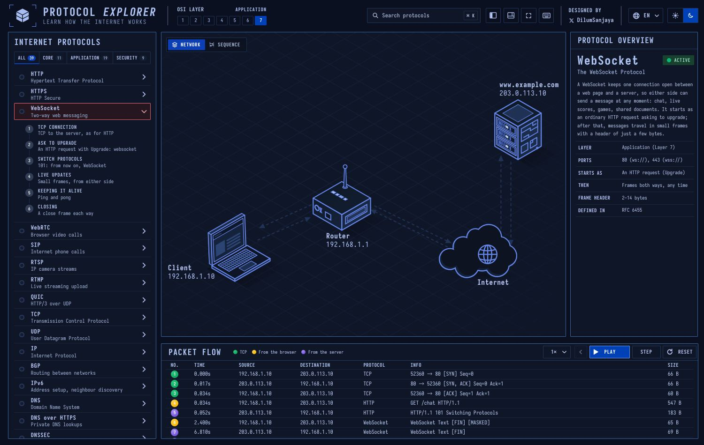
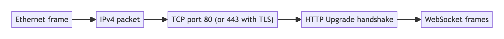
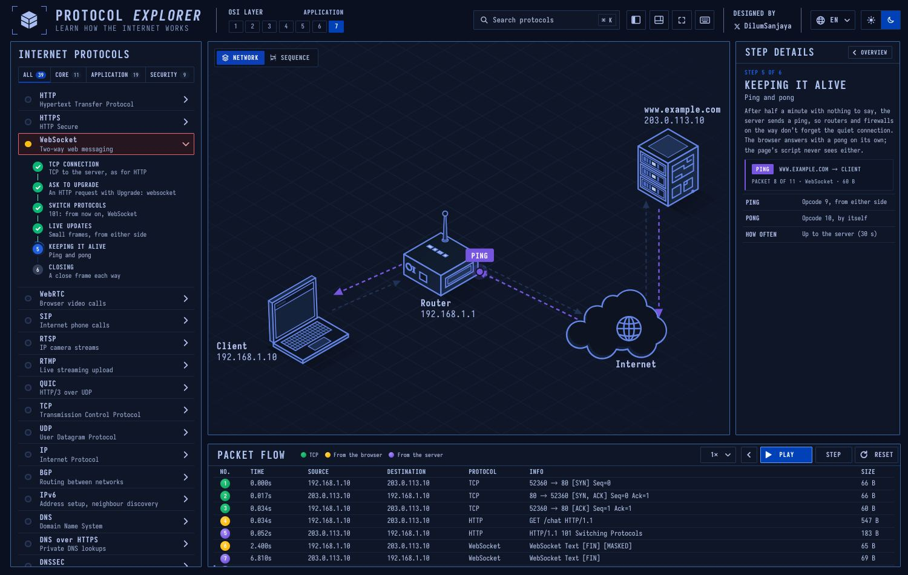
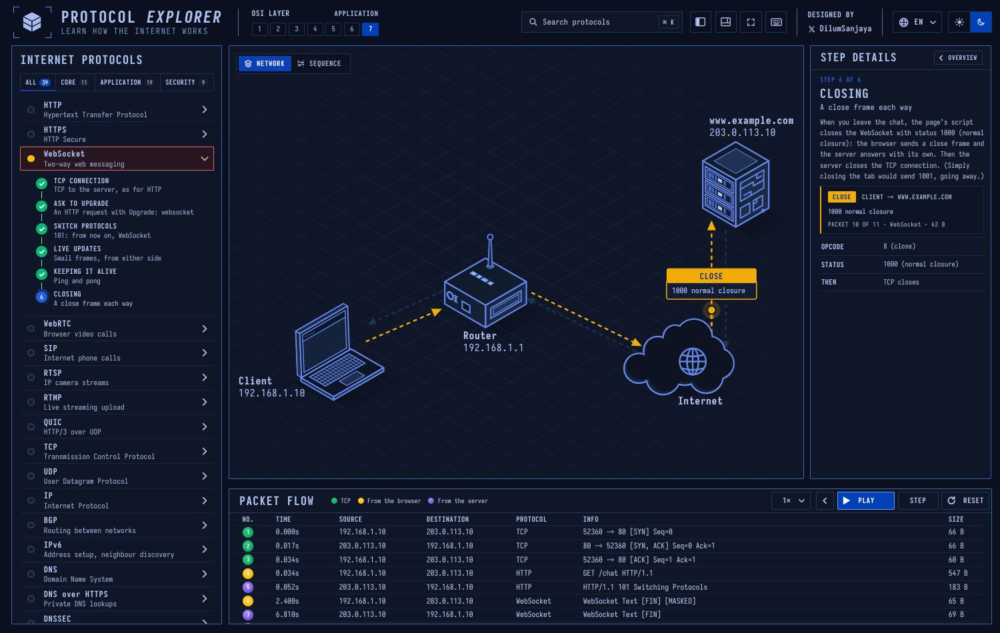
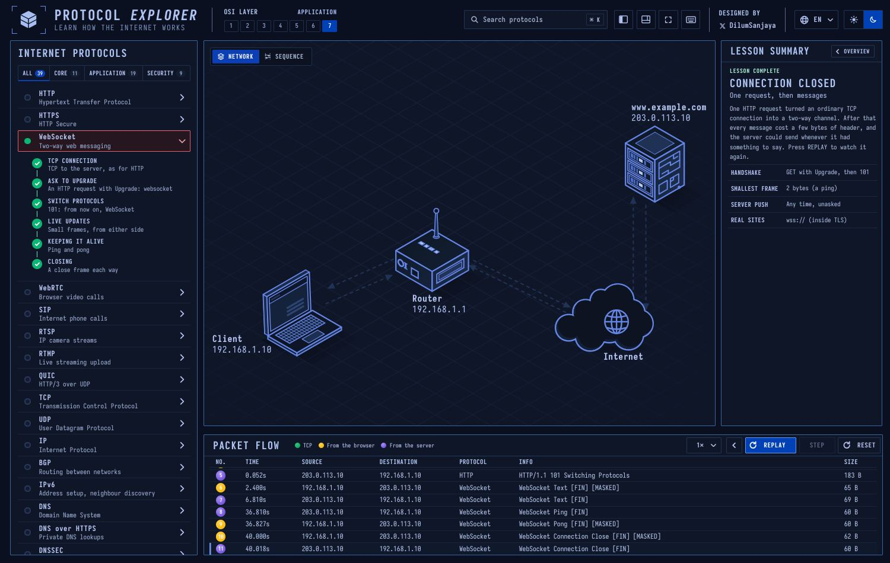
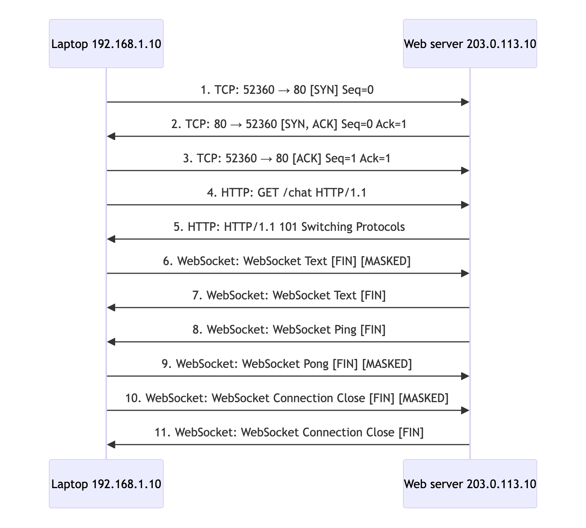
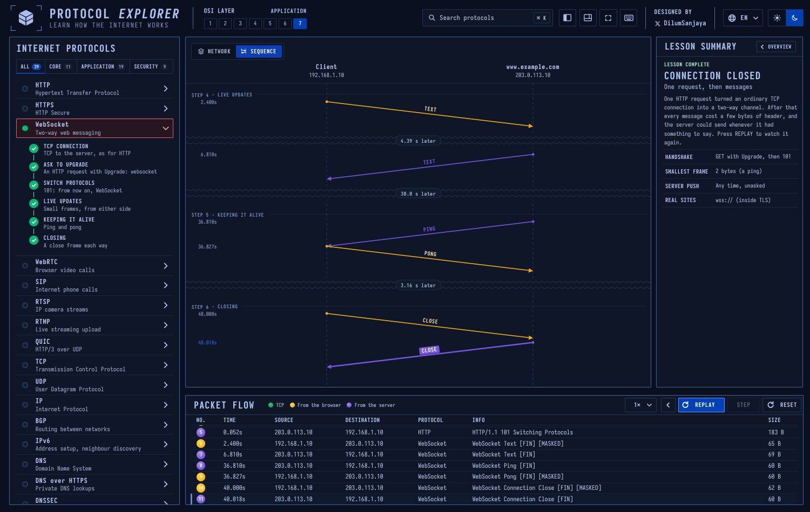
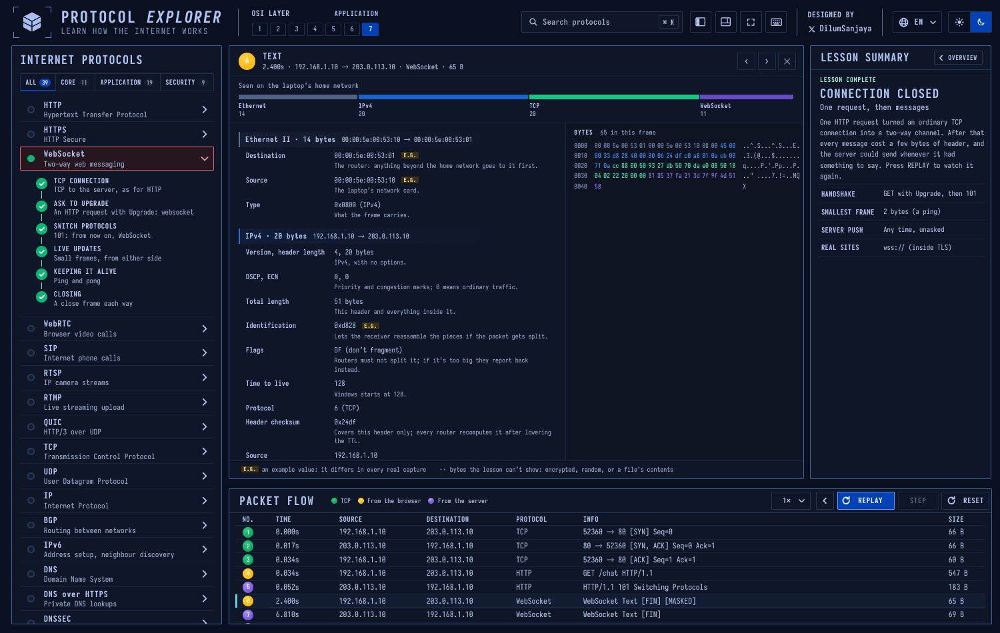

# WebSocket – Two-way web messaging

<!-- nav -->
⬅ [02 HTTPS](02-https.md) · [Index](00_Protocols_Index.md) · [04 WebRTC](04-webrtc.md) ➡
<!-- nav -->

*Source: Protocol Explorer – https://protocol-explorer-alpha.vercel.app/ (interactive lesson #3). Screenshots captured from the live lesson; packet decodes are the site's example capture (values marked **E.G.** differ in every real capture).*

## Overview

### How the layers fit together (outer to inner)

## In-depth explanation of the example (plain-language version)

### The big picture in one minute
A chat web page wants to show new messages **the instant** they arrive, like "bob: hi there". Normal HTTP can't do this well, because with HTTP **the server can only speak when the browser asks**. WebSocket fixes that: the browser opens **one connection and keeps it open**, and then **either side can send a message at any time.**

Think of the difference between **sending letters** (HTTP: you write, they reply) and **a phone call** (WebSocket: the line stays open, both can talk whenever).

This lesson follows one chat for 40 seconds and **11 messages**: open a connection, ask to "upgrade" it into a WebSocket, send a few tiny messages, and close.

> **Words you'll see:** a *frame* is one small WebSocket message with a short header. *Handshake* = the opening greeting. `ws://` is WebSocket over plain port 80, while `wss://` is WebSocket inside TLS on 443 (like HTTPS), which is what real sites use.

---

### Step 1 – Open a normal connection (TCP) – packets 1, 2, 3
The browser makes an ordinary TCP connection (SYN, SYN-ACK, ACK) to the server's port 80. WebSocket doesn't invent a new road; it reuses TCP.

### Step 2 – "Can we switch to WebSocket?" – packet 4
The first message is a normal HTTP request. That's on purpose: it lets WebSocket pass through the web servers, proxies and firewalls that already understand HTTP. The special lines are:
- `Upgrade: websocket` and `Connection: Upgrade` → "Let's switch this connection to another language."
- `Sec-WebSocket-Version: 13` → the version of WebSocket.
- `Sec-WebSocket-Key: dGhlIHNhbXBsZSBub25jZQ==` → a random value, **not a password**. It's a small quiz the server must answer correctly to prove it truly understands WebSocket.
- `Origin: http://www.example.com` → "this request comes from that web page," so the server can refuse pages it doesn't trust.
- `Sec-WebSocket-Extensions: permessage-deflate` → "I can compress messages if you can."

### Step 3 – "Okay, switching!" – packet 5
The server replies `101 Switching Protocols` and answers the quiz in `Sec-WebSocket-Accept`. It computes the answer by mixing the browser's key with a fixed, well-known text and hashing it. The browser repeats the calculation and only trusts the connection if the answers match. The server did not agree to compression, so messages stay uncompressed.
**After this reply, HTTP is over on this connection.** Everything that follows is WebSocket frames.

### Step 4 – Live messages – packets 6 and 7
- **Packet 6 – you send "Hello".** The frame is only 11 bytes:
  - byte 1: "this is a complete text message" (FIN = 1, type = text)
  - byte 2: "the data is masked, and it is 5 bytes long"
  - 4 bytes: a random **masking key**
  - 5 bytes: the word `Hello`, scrambled with that key
- **Why mask?** Browsers must always mask their frames; servers never do. Masking is **not encryption** (the key travels with the message). Its job is to stop a malicious page from sending bytes that look like an HTTP request and tricking a shared proxy cache.
- **Packet 7 – the server pushes "bob: hi there"** 4.4 seconds later, unmasked. Nobody asked for it. This "server push" is exactly what plain HTTP can't do.

### Step 5 – Keeping the line alive – packets 8 and 9
After 30 quiet seconds the server sends a **Ping** and the browser automatically answers **Pong**. Your page's code never even sees them. Reason: routers and firewalls like to drop connections that look idle, and the ping/pong also reveals if the other side has died.

### Step 6 – Hanging up – packets 10 and 11
The page calls `socket.close()`. The browser sends a **Close** frame with code `1000` ("normal closure"), the server answers with its own Close frame, and then the TCP connection ends. (Closing the tab sends `1001`, "going away".)

---

### The 11 messages at a glance
| # | What | Why |
|---|---|---|
| 1–3 | TCP handshake | open the connection |
| 4 | HTTP request with `Upgrade: websocket` | ask to switch |
| 5 | `101 Switching Protocols` | agree to switch |
| 6 | Client text frame "Hello" | you send a message |
| 7 | Server text frame "bob: hi there" | server pushes a message |
| 8–9 | Ping / Pong | keep the line alive |
| 10–11 | Close / Close | end politely |

### What to remember
- **One HTTP handshake, then thin frames.** A frame header is only 2–14 bytes, far smaller than an HTTP request.
- Frame types: **text, binary, close, ping, pong.**
- **Browser → server frames are masked; server → browser frames are not.**
- Always use **`wss://`** in real apps. `ws://` can be read by anyone on the network, just like HTTP.
- It replaced older tricks like *polling* ("any news?" every second) and *long polling* (see the chat-app design in the HLD notes).

## Under the hood – technical details

- **Handshake maths.** The server's `Sec-WebSocket-Accept` is `base64( SHA-1( client key + "258EAFA5-E914-47DA-95CA-914BE5AA7611" ) )`. The GUID is a fixed constant in the standard. Only a server that really understands WebSocket would compute it, which stops ordinary HTTP servers or caches from accidentally "accepting".
- **Frame header.** Byte 1 holds `FIN` (is this the last fragment?), three reserved bits and a 4-bit *opcode*. Byte 2 holds the `MASK` bit and a 7-bit payload length. Then come optional extended-length bytes and, for client frames, a 4-byte masking key.
- **Opcodes.** `0` continuation, `1` text (UTF-8), `2` binary, `8` close, `9` ping, `10` pong.
- **Payload length encoding.** 0-125 fits in the 7-bit field; `126` means the next 2 bytes hold the length (up to 65,535); `127` means the next 8 bytes hold it. That is why a frame header is only 2 to 14 bytes long.
- **Masking.** Every client-to-server payload byte is XOR-ed with `key[i mod 4]`. Applying the same operation again restores the data. It's not encryption (the key is sent in the frame). It prevents a malicious script from making the browser send bytes that look like an HTTP request, which could poison a shared proxy cache.
- **Fragmentation.** A large message can be split into several frames: the first has the real opcode and `FIN = 0`, later ones use opcode `0`, and the last has `FIN = 1`. Control frames (ping, pong, close) may be inserted in between.
- **Heartbeat.** A `ping` must be answered with a `pong` carrying the same data. This keeps NAT and firewall entries alive and detects dead peers.
- **Closing.** A close frame carries a 2-byte status code (`1000` normal, `1001` going away, `1002` protocol error, `1009` message too big) and an optional reason. Each side sends one and then TCP closes.
- **Compression.** `permessage-deflate` compresses each message with the DEFLATE algorithm if both sides agree. In this example the server declined.
- **Same-origin and security.** Browsers send an `Origin` header, but WebSocket is not restricted by the same-origin policy, so the server must check it (to avoid *cross-site WebSocket hijacking*). Use `wss://` (TLS) in production.
- **Scaling note.** WebSocket servers keep one open TCP connection per user, so load balancers need sticky routing or a shared message layer (for example Redis pub/sub) to deliver a message to the right server. See the chat-app design in the HLD notes.

## Step-by-step walkthrough

### Step 1: TCP CONNECTION – TCP to the server, as for HTTP

### Step 2: ASK TO UPGRADE – An HTTP request with Upgrade: websocket

### Step 3: SWITCH PROTOCOLS – 101: from now on, WebSocket

### Step 4: LIVE UPDATES – Small frames, from either side

### Step 5: KEEPING IT ALIVE – Ping and pong

### Step 6: CLOSING – A close frame each way

### Lesson summary

## Packet flow (whole lesson)

| No. | Time | Source | Destination | Protocol | Info | Size |
|---|---|---|---|---|---|---|
| 1 | 0.000s | 192.168.1.10 | 203.0.113.10 | TCP | 52360 → 80 [SYN] Seq=0 | 66 B |
| 2 | 0.017s | 203.0.113.10 | 192.168.1.10 | TCP | 80 → 52360 [SYN, ACK] Seq=0 Ack=1 | 66 B |
| 3 | 0.034s | 192.168.1.10 | 203.0.113.10 | TCP | 52360 → 80 [ACK] Seq=1 Ack=1 | 60 B |
| 4 | 0.034s | 192.168.1.10 | 203.0.113.10 | HTTP | GET /chat HTTP/1.1 | 547 B |
| 5 | 0.052s | 203.0.113.10 | 192.168.1.10 | HTTP | HTTP/1.1 101 Switching Protocols | 183 B |
| 6 | 2.400s | 192.168.1.10 | 203.0.113.10 | WebSocket | WebSocket Text [FIN] [MASKED] | 65 B |
| 7 | 6.810s | 203.0.113.10 | 192.168.1.10 | WebSocket | WebSocket Text [FIN] | 69 B |
| 8 | 36.810s | 203.0.113.10 | 192.168.1.10 | WebSocket | WebSocket Ping [FIN] | 60 B |
| 9 | 36.827s | 192.168.1.10 | 203.0.113.10 | WebSocket | WebSocket Pong [FIN] [MASKED] | 60 B |
| 10 | 40.000s | 192.168.1.10 | 203.0.113.10 | WebSocket | WebSocket Connection Close [FIN] [MASKED] | 62 B |
| 11 | 40.018s | 203.0.113.10 | 192.168.1.10 | WebSocket | WebSocket Connection Close [FIN] | 60 B |

### Sequence diagram

*The lesson's own sequence diagram:*

## Packet decoder screenshots

The lesson's decoder view for the first, middle and last packet: headers, field values and the raw hex bytes.

### Packet 1: TCP – 52360 → 80 [SYN] Seq=0

*192.168.1.10 → 203.0.113.10 · 66 B · t = 0.000s*

### Packet 6: WebSocket – WebSocket Text [FIN] [MASKED]

*192.168.1.10 → 203.0.113.10 · 65 B · t = 2.400s*

### Packet 11: WebSocket – WebSocket Connection Close [FIN]

*203.0.113.10 → 192.168.1.10 · 60 B · t = 40.018s*

---

<!-- nav -->
⬅ [02 HTTPS](02-https.md) · [Index](00_Protocols_Index.md) · [04 WebRTC](04-webrtc.md) ➡
<!-- nav -->
