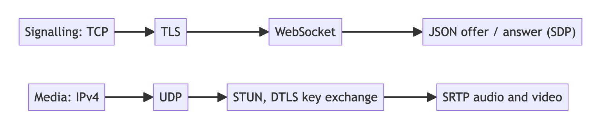
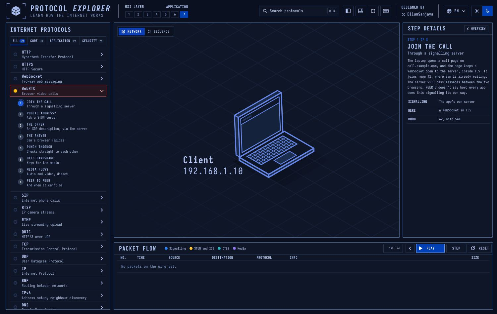
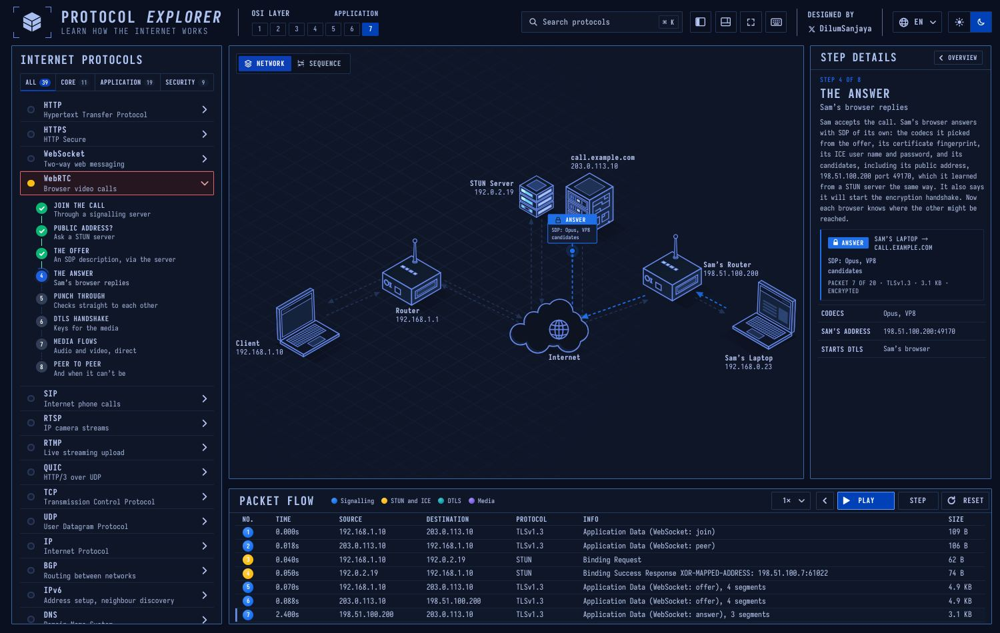
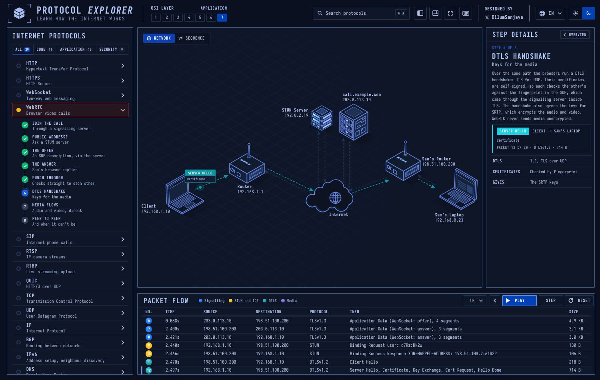
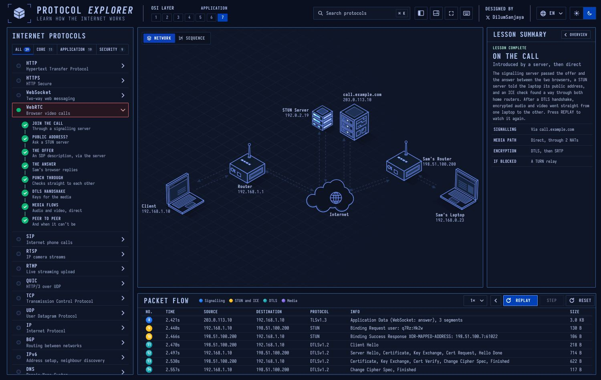
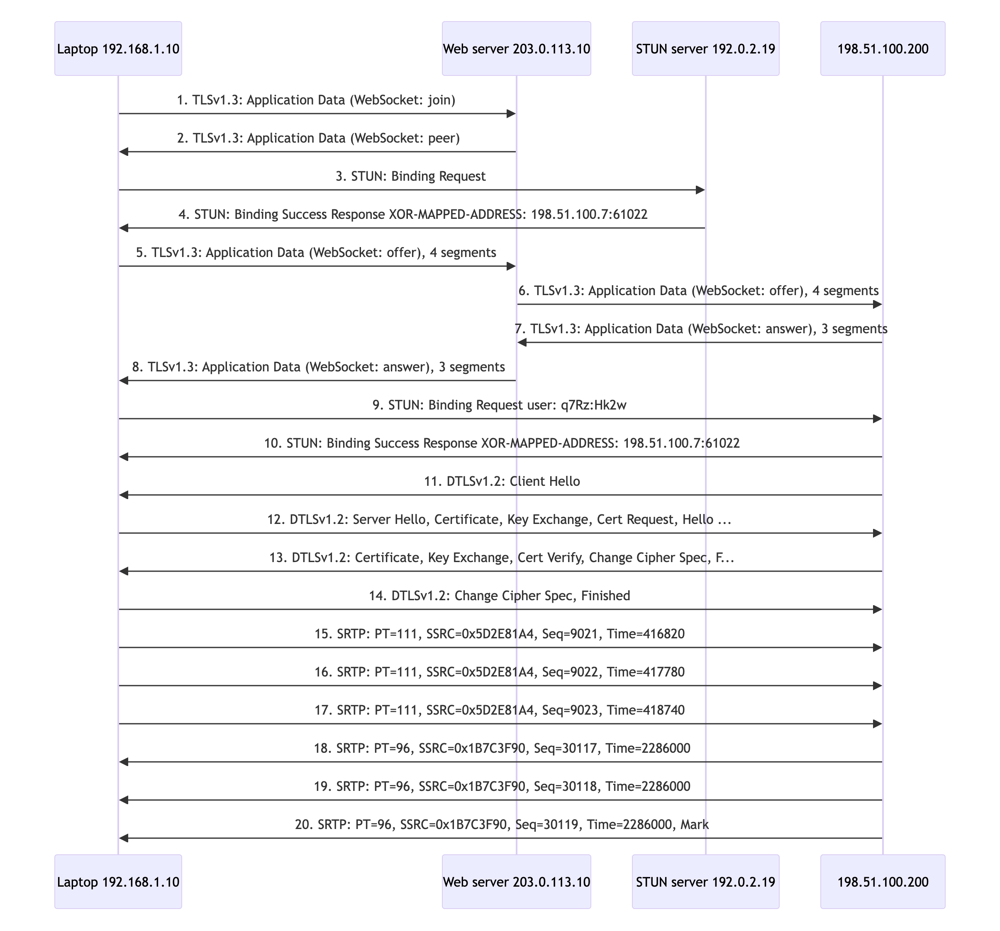
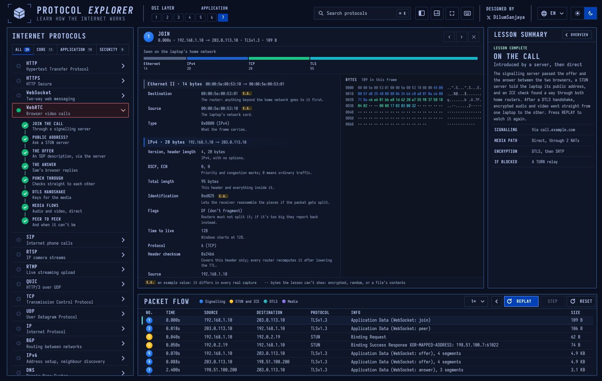
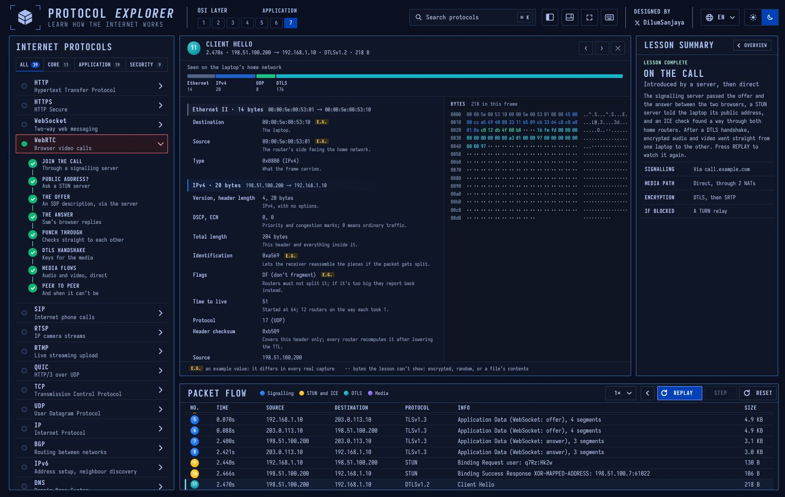
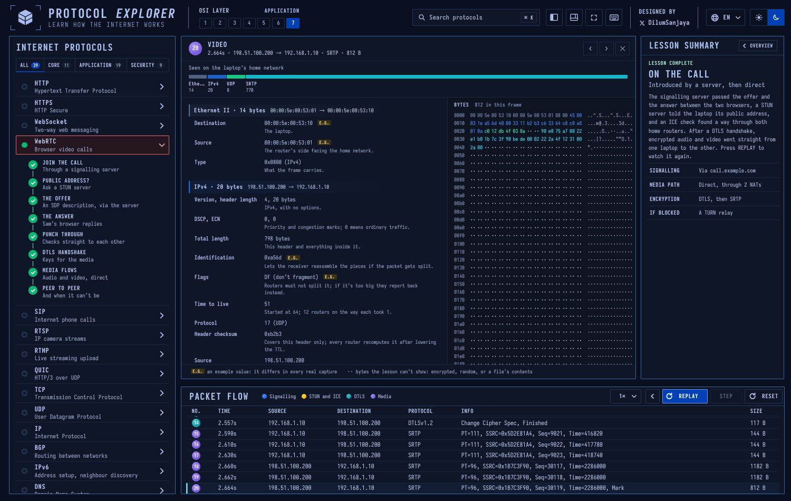

# WebRTC – Browser video calls

<!-- nav -->
⬅ [03 WebSocket](03-websocket.md) · [Index](00_Protocols_Index.md) · [05 SIP](05-sip.md) ➡
<!-- nav -->

*Source: Protocol Explorer – https://protocol-explorer-alpha.vercel.app/ (interactive lesson #4). Screenshots captured from the live lesson; packet decodes are the site's example capture (values marked **E.G.** differ in every real capture).*

## Overview

### How the layers fit together (outer to inner)

## In-depth explanation of the example (plain-language version)

### The big picture in one minute
You and your friend **Sam** start a video call in the browser. Your laptop (`192.168.1.10`) sits behind your home router (public address `198.51.100.7`). Sam is at `198.51.100.200`. The lesson shows **20 messages over about 2.7 seconds**: a quick introduction through a server, finding each other's real addresses, and then audio and video flowing **directly between your two laptops**.

**The key idea:** WebRTC sends the call **directly from person to person** (cheaper, faster, more private). The problem: both laptops are hidden behind home routers, so they can't simply dial each other. So a server is used **only to introduce you**. Once you've met, the server is no longer involved and never sees your video.

Think of two people who each live in a gated building. A mutual friend gives each the other's contact details (introduction), each person steps outside and "waves" at the same moment (the gate opens), and then they talk directly.

> **Words you'll see:** *NAT* = what your home router does: it hides your private address behind one public address. *Signalling* = the "introduction" messages. *Codec* = the method of compressing audio or video. *Encrypted* = scrambled so only the two of you can understand.

---

### Step 1 – Join the call through a "signalling" server – packets 1, 2
The call page keeps a secure connection (WebSocket inside TLS) open to `call.example.com`. You send "join room 42", and the server answers "Sam is already here." WebRTC deliberately leaves this part to each app; any channel can carry the introduction. It is used only to set up the call.

### Step 2 – "What's my public address?" (STUN) – packets 3, 4
Your laptop only knows its **private** address, which is useless from outside. So it asks a **STUN server**: "what address do you see me coming from?" The STUN reply says `198.51.100.7:61022`, which is your router's public address and the "door" (port) it opened for you. That's one address where Sam might reach you.

### Step 3 – The offer – packets 5, 6
Your browser writes an **offer** (in a format called SDP) that lists:
- what media it wants (**Opus audio, VP8 or H.264 video**),
- the **fingerprint** of its security certificate (used later to check nobody is faking),
- a temporary username and password for the next steps,
- the **candidate addresses** where it can be reached (your private address is hidden behind a random `.local` name for privacy).
The server passes this offer to Sam.

### Step 4 – The answer – packets 7, 8
Sam's browser replies with an **answer**: which codecs it chose (Opus and VP8), its own fingerprint and credentials, and its addresses (including `198.51.100.200:49170`, found the same way with STUN). Now each side knows what the other can do and where to try.

### Step 5 – "Punching a hole" through the routers (ICE) – packets 9, 10
Both browsers send small STUN test messages **straight to each other**.
- **Why this works:** when your laptop sends something out, your router remembers it and allows replies from that address back in. If both sides do this at about the same time, each router thinks "this is a reply to something we sent," and lets the packet through. The path is open.
- Packet 10 confirms it: the direct route works. Your side marks that route as the chosen one.
- No **TURN relay** was needed. TURN is the backup plan: a server that forwards the (still encrypted) call if a direct path is impossible.

### Step 6 – Agreeing on secret keys (DTLS) – packets 11 to 14
Over that direct path, the two browsers run a security handshake (**DTLS**, which is TLS adapted for UDP). They exchange certificates and agree on keys.
- The certificates are self-made, so how do they know they aren't being tricked? Each side **compares the certificate with the fingerprint from the offer/answer**, which arrived through the secure signalling channel. If they don't match, someone is in the middle and the call is cancelled.
- From this handshake they get the keys used to scramble the media. **WebRTC never sends audio or video unencrypted.**

### Step 7 – The call itself – packets 15 to 20
- **Audio (15–17):** every **20 milliseconds** one small packet (144 bytes) is sent. Each carries a counter (`9021, 9022, 9023`) so loss or reordering is obvious, and a timestamp that grows by **960** each time (20 ms on the audio clock) so the receiver plays at the right speed. The audio type is **Opus** (code 111, as agreed).
- **Video (18–20):** from Sam, three packets that all share **the same timestamp**, because they are three pieces of **one video frame** (one picture was too big for one packet). The last piece carries a "marker" flag meaning "end of this frame".
- Both browsers keep measuring delay and loss and adjust the video quality. A **data channel** on the same path can carry chat messages or files.
- Everything uses **UDP** because a late audio packet is useless; waiting to re-send it (as TCP would) just adds delay.

---

### Who did what
| Helper | Job |
|---|---|
| Signalling server | carried the offer and answer (the introduction) |
| STUN server | told you your public address |
| ICE tests | found a working path through both routers |
| DTLS | agreed on secret keys |
| SRTP | carried the encrypted audio and video |
| TURN (not needed here) | relay if no direct path exists |

### What to remember
- Acronyms: **SDP** (the description), **ICE** (find a path), **STUN** (learn your public address), **TURN** (relay backup), **DTLS** (key agreement), **SRTP** (encrypted media), **SCTP** (data channels).
- Media uses **UDP** because speed matters more than perfection.
- Privacy is built in: mandatory encryption, hidden local addresses, and certificate fingerprints checked through the signalling channel.

## Under the hood – technical details

- **Roles of each protocol.** Signalling (any channel, here WebSocket + TLS) exchanges the offer and answer. **ICE** finds a working network path. **STUN** tells a device its public address. **TURN** relays media when no direct path works. **DTLS** agrees on keys over UDP. **SRTP** carries the encrypted audio and video. **SCTP** over DTLS carries data channels.
- **STUN message.** A 20-byte header: message type (`0x0001` Binding Request, `0x0101` Success), length, the fixed *magic cookie* `0x2112A442` and a random 96-bit transaction ID. The answer includes `XOR-MAPPED-ADDRESS`, the sender's public IP and port XOR-ed with the cookie, so that badly behaved NATs which rewrite anything that looks like an IP address don't corrupt it.
- **Candidates.** Each side lists *host* candidates (local addresses, hidden behind random `.local` mDNS names for privacy), *server-reflexive* candidates (the public address learned via STUN) and *relay* candidates (TURN). ICE tries pairs in priority order.
- **Connectivity checks.** Checks are STUN requests signed with `MESSAGE-INTEGRITY` (an HMAC keyed with the ICE password) and carry `USERNAME` (`remote-ufrag:local-ufrag`). The side that controls the session later adds `USE-CANDIDATE` to pick the winning pair.
- **Why hole punching works.** An outbound packet creates a NAT mapping that admits replies from that remote address. When both peers send at about the same time, each NAT treats the other's packet as a reply. It fails with *symmetric NAT* (a different mapping per destination), which is when TURN is used.
- **SDP.** The offer lists media sections (`m=audio`, `m=video`), codecs and payload types (Opus 111, VP8 96), `a=fingerprint` (hash of the DTLS certificate), `a=ice-ufrag` / `a=ice-pwd`, and `a=candidate` lines.
- **DTLS.** It is TLS made safe for UDP: records carry an *epoch* and sequence number, handshake messages carry a message sequence and fragment offset so they can be reordered, fragmented and retransmitted. The certificates are self-signed; trust comes from comparing the certificate hash with the `fingerprint` that arrived over the (TLS-protected) signalling channel.
- **RTP header.** 12 bytes: version 2, payload type, 16-bit *sequence number* (+1 per packet), 32-bit *timestamp* (audio: +960 per 20 ms at 48 kHz; video: +3000 per frame at 90 kHz and 30 fps), and the 32-bit *SSRC* that identifies the stream. The *marker bit* on the last packet of a video frame says "frame complete".
- **Adaptation.** RTCP reports (loss, jitter, round-trip time) let each side lower or raise the video bitrate. Modern senders use congestion control based on delay (Google Congestion Control or transport-wide feedback).
- **Why UDP.** A retransmitted media packet arrives too late to play. Losses are hidden with forward error correction, retransmission requests (NACK) for key frames, and concealment.

## Step-by-step walkthrough

### Step 1: JOIN THE CALL – Through a signalling server

### Step 2: PUBLIC ADDRESS? – Ask a STUN server

### Step 3: THE OFFER – An SDP description, via the server

### Step 4: THE ANSWER – Sam’s browser replies

### Step 5: PUNCH THROUGH – Checks straight to each other

### Step 6: DTLS HANDSHAKE – Keys for the media

### Step 7: MEDIA FLOWS – Audio and video, direct

### Step 8: PEER TO PEER – And when it can’t be

### Lesson summary

## Packet flow (whole lesson)

| No. | Time | Source | Destination | Protocol | Info | Size |
|---|---|---|---|---|---|---|
| 1 | 0.000s | 192.168.1.10 | 203.0.113.10 | TLSv1.3 | Application Data (WebSocket: join) | 109 B |
| 2 | 0.018s | 203.0.113.10 | 192.168.1.10 | TLSv1.3 | Application Data (WebSocket: peer) | 106 B |
| 3 | 0.040s | 192.168.1.10 | 192.0.2.19 | STUN | Binding Request | 62 B |
| 4 | 0.050s | 192.0.2.19 | 192.168.1.10 | STUN | Binding Success Response XOR-MAPPED-ADDRESS: 198.51.100.7:61022 | 74 B |
| 5 | 0.070s | 192.168.1.10 | 203.0.113.10 | TLSv1.3 | Application Data (WebSocket: offer), 4 segments | 4.9 KB |
| 6 | 0.088s | 203.0.113.10 | 198.51.100.200 | TLSv1.3 | Application Data (WebSocket: offer), 4 segments | 4.9 KB |
| 7 | 2.400s | 198.51.100.200 | 203.0.113.10 | TLSv1.3 | Application Data (WebSocket: answer), 3 segments | 3.1 KB |
| 8 | 2.421s | 203.0.113.10 | 192.168.1.10 | TLSv1.3 | Application Data (WebSocket: answer), 3 segments | 3.0 KB |
| 9 | 2.440s | 192.168.1.10 | 198.51.100.200 | STUN | Binding Request user: q7Rz:Hk2w | 130 B |
| 10 | 2.466s | 198.51.100.200 | 192.168.1.10 | STUN | Binding Success Response XOR-MAPPED-ADDRESS: 198.51.100.7:61022 | 106 B |
| 11 | 2.470s | 198.51.100.200 | 192.168.1.10 | DTLSv1.2 | Client Hello | 218 B |
| 12 | 2.497s | 192.168.1.10 | 198.51.100.200 | DTLSv1.2 | Server Hello, Certificate, Key Exchange, Cert Request, Hello Done | 714 B |
| 13 | 2.530s | 198.51.100.200 | 192.168.1.10 | DTLSv1.2 | Certificate, Key Exchange, Cert Verify, Change Cipher Spec, Finished | 622 B |
| 14 | 2.557s | 192.168.1.10 | 198.51.100.200 | DTLSv1.2 | Change Cipher Spec, Finished | 117 B |
| 15 | 2.590s | 192.168.1.10 | 198.51.100.200 | SRTP | PT=111, SSRC=0x5D2E81A4, Seq=9021, Time=416820 | 144 B |
| 16 | 2.610s | 192.168.1.10 | 198.51.100.200 | SRTP | PT=111, SSRC=0x5D2E81A4, Seq=9022, Time=417780 | 144 B |
| 17 | 2.630s | 192.168.1.10 | 198.51.100.200 | SRTP | PT=111, SSRC=0x5D2E81A4, Seq=9023, Time=418740 | 144 B |
| 18 | 2.660s | 198.51.100.200 | 192.168.1.10 | SRTP | PT=96, SSRC=0x1B7C3F90, Seq=30117, Time=2286000 | 1182 B |
| 19 | 2.662s | 198.51.100.200 | 192.168.1.10 | SRTP | PT=96, SSRC=0x1B7C3F90, Seq=30118, Time=2286000 | 1182 B |
| 20 | 2.664s | 198.51.100.200 | 192.168.1.10 | SRTP | PT=96, SSRC=0x1B7C3F90, Seq=30119, Time=2286000, Mark | 812 B |

### Sequence diagram

*The lesson's own sequence diagram:*

## Packet decoder screenshots

The lesson's decoder view for the first, middle and last packet: headers, field values and the raw hex bytes.

### Packet 1: TLSv1.3 – Application Data (WebSocket: join)

*192.168.1.10 → 203.0.113.10 · 109 B · t = 0.000s*

### Packet 11: DTLSv1.2 – Client Hello

*198.51.100.200 → 192.168.1.10 · 218 B · t = 2.470s*

### Packet 20: SRTP – PT=96, SSRC=0x1B7C3F90, Seq=30119, Time=2286000, Mark

*198.51.100.200 → 192.168.1.10 · 812 B · t = 2.664s*

---

<!-- nav -->
⬅ [03 WebSocket](03-websocket.md) · [Index](00_Protocols_Index.md) · [05 SIP](05-sip.md) ➡
<!-- nav -->
