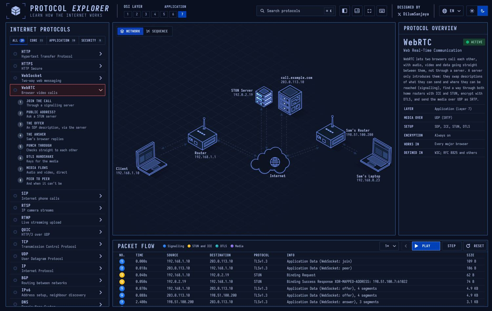
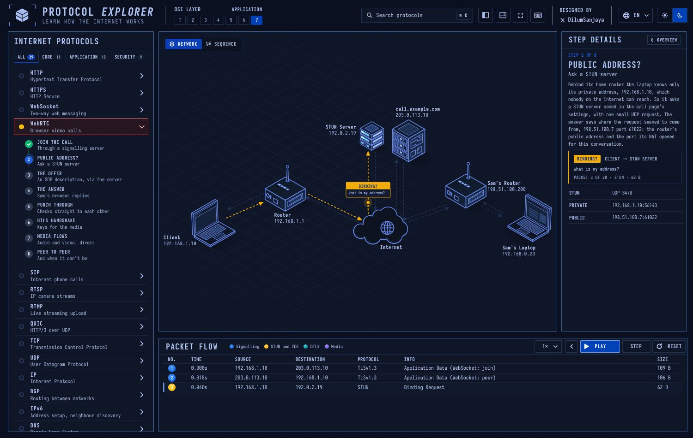
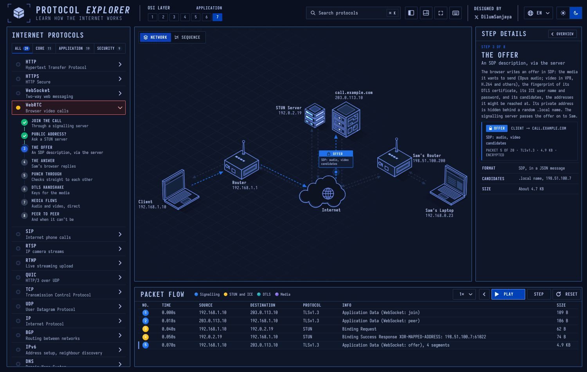
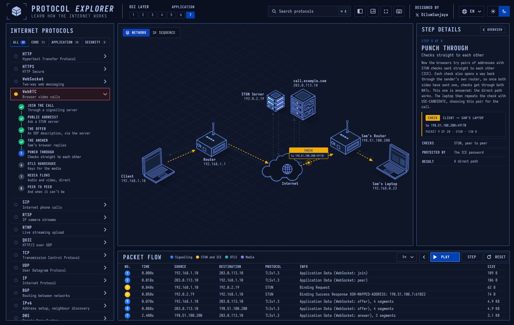
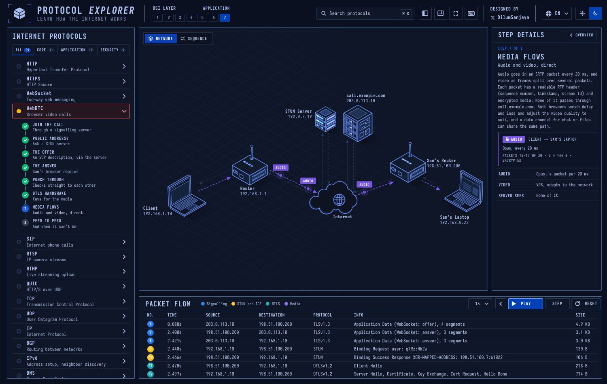
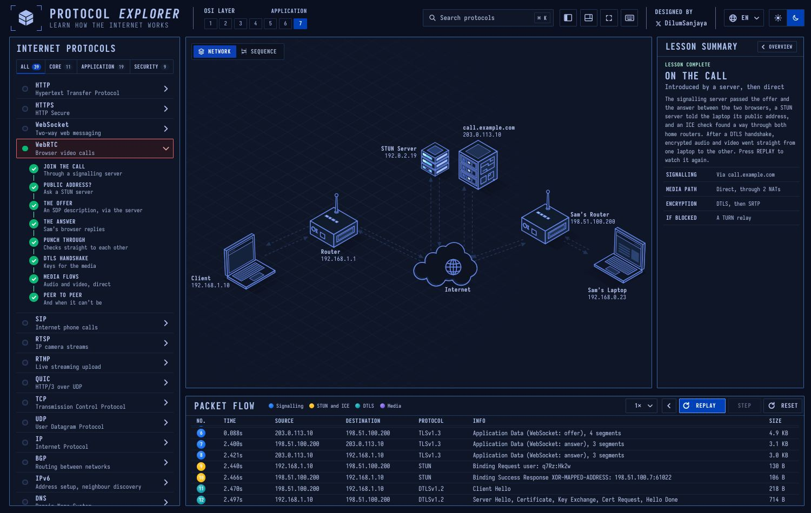
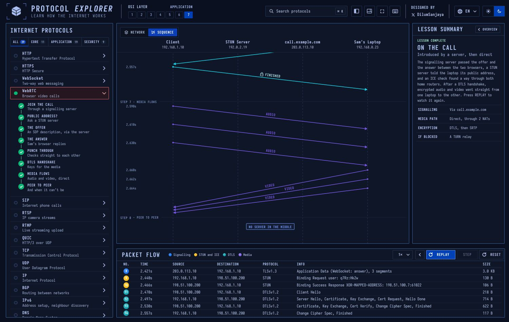

# WebRTC – Browser video calls

<!-- nav -->
⬅ [03 WebSocket](03-websocket.md) · [Index](00_Protocols_Index.md) · [05 SIP](05-sip.md) ➡
<!-- nav -->

*Source: Protocol Explorer – https://protocol-explorer-alpha.vercel.app/ (interactive lesson #4). Screenshots captured from the live lesson; packet decodes are the site's example capture (values marked **E.G.** differ in every real capture).*

## Overview



> PROTOCOL OVERVIEW  
> WebRTC  
> ACTIVE  
> Web Real-Time Communication  
> WebRTC lets two browsers call each other, with audio, video and data going straight between them, not through a server. A server only introduces them: they swap descriptions of what they can send and where they can be reached (signalling), find a way through both home routers with ICE and STUN, encrypt with DTLS, and send the media over UDP as SRTP.  
> LAYER  
> Application (Layer 7)  
> MEDIA OVER  
> UDP (SRTP)  
> SETUP  
> SDP, ICE, STUN, DTLS  
> ENCRYPTION  
> Always on  
> WORKS IN  
> Every major browser  
> DEFINED IN  
> W3C; RFC 8825 and others  

## In-depth explanation of the example (plain-language version)

### The big picture in one minute
You and your friend **Sam** start a video call in the browser. Your laptop (`192.168.1.10`) sits behind your home router (public address `198.51.100.7`). Sam is at `198.51.100.200`. The lesson shows **20 messages over about 2.7 seconds**: a quick introduction through a server, finding each other's real addresses, and then audio and video flowing **directly between your two laptops**.

**The key idea:** WebRTC sends the call **directly from person to person** (cheaper, faster, more private). The problem: both laptops are hidden behind home routers, so they can't simply dial each other. So a server is used **only to introduce you**. Once you've met, the server is no longer involved and never sees your video.

Think of two people who each live in a gated building. A mutual friend gives each the other's contact details (introduction), each person steps outside and "waves" at the same moment (the gate opens), and then they talk directly.

> **Words you'll see:** *NAT* = what your home router does: it hides your private address behind one public address. *Signalling* = the "introduction" messages. *Codec* = the method of compressing audio or video. *Encrypted* = scrambled so only the two of you can understand.

---

### Step 1 – Join the call through a "signalling" server – packets 1, 2
The call page keeps a secure connection (WebSocket inside TLS) open to `call.example.com`. You send "join room 42", and the server answers "Sam is already here." WebRTC deliberately leaves this part to each app; any channel can carry the introduction. It is used only to set up the call.

### Step 2 – "What's my public address?" (STUN) – packets 3, 4
Your laptop only knows its **private** address, which is useless from outside. So it asks a **STUN server**: "what address do you see me coming from?" The STUN reply says `198.51.100.7:61022`, which is your router's public address and the "door" (port) it opened for you. That's one address where Sam might reach you.

### Step 3 – The offer – packets 5, 6
Your browser writes an **offer** (in a format called SDP) that lists:
- what media it wants (**Opus audio, VP8 or H.264 video**),
- the **fingerprint** of its security certificate (used later to check nobody is faking),
- a temporary username and password for the next steps,
- the **candidate addresses** where it can be reached (your private address is hidden behind a random `.local` name for privacy).
The server passes this offer to Sam.

### Step 4 – The answer – packets 7, 8
Sam's browser replies with an **answer**: which codecs it chose (Opus and VP8), its own fingerprint and credentials, and its addresses (including `198.51.100.200:49170`, found the same way with STUN). Now each side knows what the other can do and where to try.

### Step 5 – "Punching a hole" through the routers (ICE) – packets 9, 10
Both browsers send small STUN test messages **straight to each other**.
- **Why this works:** when your laptop sends something out, your router remembers it and allows replies from that address back in. If both sides do this at about the same time, each router thinks "this is a reply to something we sent," and lets the packet through. The path is open.
- Packet 10 confirms it: the direct route works. Your side marks that route as the chosen one.
- No **TURN relay** was needed. TURN is the backup plan: a server that forwards the (still encrypted) call if a direct path is impossible.

### Step 6 – Agreeing on secret keys (DTLS) – packets 11 to 14
Over that direct path, the two browsers run a security handshake (**DTLS**, which is TLS adapted for UDP). They exchange certificates and agree on keys.
- The certificates are self-made, so how do they know they aren't being tricked? Each side **compares the certificate with the fingerprint from the offer/answer**, which arrived through the secure signalling channel. If they don't match, someone is in the middle and the call is cancelled.
- From this handshake they get the keys used to scramble the media. **WebRTC never sends audio or video unencrypted.**

### Step 7 – The call itself – packets 15 to 20
- **Audio (15–17):** every **20 milliseconds** one small packet (144 bytes) is sent. Each carries a counter (`9021, 9022, 9023`) so loss or reordering is obvious, and a timestamp that grows by **960** each time (20 ms on the audio clock) so the receiver plays at the right speed. The audio type is **Opus** (code 111, as agreed).
- **Video (18–20):** from Sam, three packets that all share **the same timestamp**, because they are three pieces of **one video frame** (one picture was too big for one packet). The last piece carries a "marker" flag meaning "end of this frame".
- Both browsers keep measuring delay and loss and adjust the video quality. A **data channel** on the same path can carry chat messages or files.
- Everything uses **UDP** because a late audio packet is useless; waiting to re-send it (as TCP would) just adds delay.

---

### Who did what
| Helper | Job |
|---|---|
| Signalling server | carried the offer and answer (the introduction) |
| STUN server | told you your public address |
| ICE tests | found a working path through both routers |
| DTLS | agreed on secret keys |
| SRTP | carried the encrypted audio and video |
| TURN (not needed here) | relay if no direct path exists |

### What to remember
- Acronyms: **SDP** (the description), **ICE** (find a path), **STUN** (learn your public address), **TURN** (relay backup), **DTLS** (key agreement), **SRTP** (encrypted media), **SCTP** (data channels).
- Media uses **UDP** because speed matters more than perfection.
- Privacy is built in: mandatory encryption, hidden local addresses, and certificate fingerprints checked through the signalling channel.

## Step-by-step walkthrough (screenshots from the lesson)

### Step 1: JOIN THE CALL – Through a signalling server


> STEP 1 OF 8  
> JOIN THE CALL  
> Through a signalling server  
> The laptop opens a call page on call.example.com, and the page keeps a WebSocket open to the server, inside TLS. It joins room 42, where Sam is already waiting. The server will pass messages between the two browsers. WebRTC doesn’t say how: every app does this signalling its own way.  
> SIGNALLING  
> The app’s own server  
> HERE  
> A WebSocket in TLS  
> ROOM  
> 42, with Sam  

### Step 2: PUBLIC ADDRESS? – Ask a STUN server



> STEP 2 OF 8  
> PUBLIC ADDRESS?  
> Ask a STUN server  
> Behind its home router the laptop knows only its private address, 192.168.1.10, which nobody on the internet can reach. So it asks a STUN server named in the call page’s settings, with one small UDP request. The answer says where the request seemed to come from, 198.51.100.7 port 61022: the router’s public address and the port its NAT opened for this conversation.  
> BINDING?  
> CLIENT → STUN SERVER  
> what is my address?  
> PACKET 3 OF 20 · STUN · 62 B  
> STUN  
> UDP 3478  
> PRIVATE  
> 192.168.1.10:56143  
> PUBLIC  
> 198.51.100.7:61022  

### Step 3: THE OFFER – An SDP description, via the server



> STEP 3 OF 8  
> THE OFFER  
> An SDP description, via the server  
> The browser writes an offer in SDP: the media it wants to send (Opus audio; video in VP8, H.264 and others), the fingerprint of its DTLS certificate, its ICE user name and password, and its candidates, the addresses it might be reached at. Its private address is hidden behind a random .local name. The signalling server passes the offer on to Sam.  
> OFFER  
> CLIENT → CALL.EXAMPLE.COM  
> SDP: audio, video  
> candidates  
> PACKET 5 OF 20 · TLSv1.3 · 4.9 KB · ENCRYPTED  
> FORMAT  
> SDP, in a JSON message  
> CANDIDATES  
> .local name, 198.51.100.7  
> SIZE  
> About 4.7 KB  

### Step 4: THE ANSWER – Sam’s browser replies


> STEP 4 OF 8  
> THE ANSWER  
> Sam’s browser replies  
> Sam accepts the call. Sam’s browser answers with SDP of its own: the codecs it picked from the offer, its certificate fingerprint, its ICE user name and password, and its candidates, including its public address, 198.51.100.200 port 49170, which it learned from a STUN server the same way. It also says it will start the encryption handshake. Now each browser knows where the other might be reached.  
> ANSWER  
> SAM’S LAPTOP → CALL.EXAMPLE.COM  
> SDP: Opus, VP8  
> candidates  
> PACKET 7 OF 20 · TLSv1.3 · 3.1 KB · ENCRYPTED  
> CODECS  
> Opus, VP8  
> SAM’S ADDRESS  
> 198.51.100.200:49170  
> STARTS DTLS  
> Sam’s browser  

### Step 5: PUNCH THROUGH – Checks straight to each other



> STEP 5 OF 8  
> PUNCH THROUGH  
> Checks straight to each other  
> Now the browsers try pairs of addresses with STUN checks sent straight to each other (ICE). Each check also opens a way back through the sender’s own router, so once both sides have sent one, checks get through both NATs. This one is answered: the direct path works. The laptop then repeats the check with USE-CANDIDATE, choosing this pair for the call.  
> CHECK  
> CLIENT → SAM’S LAPTOP  
> to 198.51.100.200:49170  
> PACKET 9 OF 20 · STUN · 130 B  
> CHECKS  
> STUN, peer to peer  
> PROTECTED BY  
> The ICE password  
> RESULT  
> A direct path  

### Step 6: DTLS HANDSHAKE – Keys for the media


> STEP 6 OF 8  
> DTLS HANDSHAKE  
> Keys for the media  
> Over the same path the browsers run a DTLS handshake: TLS for UDP. Their certificates are self-signed, so each checks the other’s against the fingerprint in the SDP, which came through the signalling server inside TLS. The handshake also agrees the keys for SRTP, which encrypts the audio and video. WebRTC never sends media unencrypted.  
> SERVER HELLO  
> CLIENT → SAM’S LAPTOP  
> certificate  
> PACKET 12 OF 20 · DTLSv1.2 · 714 B  
> DTLS  
> 1.2, TLS over UDP  
> CERTIFICATES  
> Checked by fingerprint  
> GIVES  
> The SRTP keys  

### Step 7: MEDIA FLOWS – Audio and video, direct



> STEP 7 OF 8  
> MEDIA FLOWS  
> Audio and video, direct  
> Audio goes in an SRTP packet every 20 ms, and video as frames split over several packets. Each packet has a readable RTP header (sequence number, timestamp, stream ID) and encrypted media. None of it passes through call.example.com. Both browsers watch delay and loss and adjust the video quality to suit, and a data channel for chat or files can share the same path.  
> AUDIO  
> CLIENT → SAM’S LAPTOP  
> Opus, every 20 ms  
> PACKETS 15–17 OF 20 · 3 × 144 B · ENCRYPTED  
> AUDIO  
> Opus, a packet per 20 ms  
> VIDEO  
> VP8, adapts to the network  
> SERVER SEES  
> None of it  

### Step 8: PEER TO PEER – And when it can’t be



> LESSON SUMMARY  
> LESSON COMPLETE  
> ON THE CALL  
> Introduced by a server, then direct  
> The signalling server passed the offer and the answer between the two browsers, a STUN server told the laptop its public address, and an ICE check found a way through both home routers. After a DTLS handshake, encrypted audio and video went straight from one laptop to the other. Press REPLAY to watch it again.  
> AUDIO  
> CLIENT → SAM’S LAPTOP  
> Opus, every 20 ms  
> PACKETS 15–17 OF 20 · 3 × 144 B · ENCRYPTED  
> SIGNALLING  
> Via call.example.com  
> MEDIA PATH  
> Direct, through 2 NATs  
> ENCRYPTION  
> DTLS, then SRTP  
> IF BLOCKED  
> A TURN relay  

### Lesson summary


> LESSON SUMMARY  
> LESSON COMPLETE  
> ON THE CALL  
> Introduced by a server, then direct  
> The signalling server passed the offer and the answer between the two browsers, a STUN server told the laptop its public address, and an ICE check found a way through both home routers. After a DTLS handshake, encrypted audio and video went straight from one laptop to the other. Press REPLAY to watch it again.  
> VIDEO  
> SAM’S LAPTOP → CLIENT  
> VP8, a frame in 3 packets  
> PACKETS 18–20 OF 20 · 1182 + 1182 + 812 B · ENCRYPTED  
> SIGNALLING  
> Via call.example.com  
> MEDIA PATH  
> Direct, through 2 NATs  
> ENCRYPTION  
> DTLS, then SRTP  
> IF BLOCKED  
> A TURN relay  

## Packet flow (whole lesson)

| No. | Time | Source | Destination | Protocol | Info | Size |
|---|---|---|---|---|---|---|
| 1 | 0.000s | 192.168.1.10 | 203.0.113.10 | TLSv1.3 | Application Data (WebSocket: join) | 109 B |
| 2 | 0.018s | 203.0.113.10 | 192.168.1.10 | TLSv1.3 | Application Data (WebSocket: peer) | 106 B |
| 3 | 0.040s | 192.168.1.10 | 192.0.2.19 | STUN | Binding Request | 62 B |
| 4 | 0.050s | 192.0.2.19 | 192.168.1.10 | STUN | Binding Success Response XOR-MAPPED-ADDRESS: 198.51.100.7:61022 | 74 B |
| 5 | 0.070s | 192.168.1.10 | 203.0.113.10 | TLSv1.3 | Application Data (WebSocket: offer), 4 segments | 4.9 KB |
| 6 | 0.088s | 203.0.113.10 | 198.51.100.200 | TLSv1.3 | Application Data (WebSocket: offer), 4 segments | 4.9 KB |
| 7 | 2.400s | 198.51.100.200 | 203.0.113.10 | TLSv1.3 | Application Data (WebSocket: answer), 3 segments | 3.1 KB |
| 8 | 2.421s | 203.0.113.10 | 192.168.1.10 | TLSv1.3 | Application Data (WebSocket: answer), 3 segments | 3.0 KB |
| 9 | 2.440s | 192.168.1.10 | 198.51.100.200 | STUN | Binding Request user: q7Rz:Hk2w | 130 B |
| 10 | 2.466s | 198.51.100.200 | 192.168.1.10 | STUN | Binding Success Response XOR-MAPPED-ADDRESS: 198.51.100.7:61022 | 106 B |
| 11 | 2.470s | 198.51.100.200 | 192.168.1.10 | DTLSv1.2 | Client Hello | 218 B |
| 12 | 2.497s | 192.168.1.10 | 198.51.100.200 | DTLSv1.2 | Server Hello, Certificate, Key Exchange, Cert Request, Hello Done | 714 B |
| 13 | 2.530s | 198.51.100.200 | 192.168.1.10 | DTLSv1.2 | Certificate, Key Exchange, Cert Verify, Change Cipher Spec, Finished | 622 B |
| 14 | 2.557s | 192.168.1.10 | 198.51.100.200 | DTLSv1.2 | Change Cipher Spec, Finished | 117 B |
| 15 | 2.590s | 192.168.1.10 | 198.51.100.200 | SRTP | PT=111, SSRC=0x5D2E81A4, Seq=9021, Time=416820 | 144 B |
| 16 | 2.610s | 192.168.1.10 | 198.51.100.200 | SRTP | PT=111, SSRC=0x5D2E81A4, Seq=9022, Time=417780 | 144 B |
| 17 | 2.630s | 192.168.1.10 | 198.51.100.200 | SRTP | PT=111, SSRC=0x5D2E81A4, Seq=9023, Time=418740 | 144 B |
| 18 | 2.660s | 198.51.100.200 | 192.168.1.10 | SRTP | PT=96, SSRC=0x1B7C3F90, Seq=30117, Time=2286000 | 1182 B |
| 19 | 2.662s | 198.51.100.200 | 192.168.1.10 | SRTP | PT=96, SSRC=0x1B7C3F90, Seq=30118, Time=2286000 | 1182 B |
| 20 | 2.664s | 198.51.100.200 | 192.168.1.10 | SRTP | PT=96, SSRC=0x1B7C3F90, Seq=30119, Time=2286000, Mark | 812 B |

### Sequence diagram



## Packets decoded byte by byte

Each packet below is the lesson's own decode (headers, field values and the plain-English meaning of each field). Screenshots show the first, middle and last packet in the lesson's decoder view with the raw hex bytes.

### Packet 1: TLSv1.3 – Application Data (WebSocket: join)

*192.168.1.10 → 203.0.113.10 · 109 B · t = 0.000s*


<details><summary>Decoded fields</summary>

```text
1
JOIN
0.000s · 192.168.1.10 → 203.0.113.10 · TLSv1.3 · 109 B
Seen on the laptop’s home network
Ethernet
14
IPv4
20
TCP
20
TLS
55
Ethernet II · 14 bytes
00:00:5e:00:53:10 → 00:00:5e:00:53:01
Destination
00:00:5e:00:53:01 E.G.

The router: anything beyond the home network goes to it first.

Source
00:00:5e:00:53:10 E.G.

The laptop’s network card.

Type
0x0800 (IPv4)

What the frame carries.

IPv4 · 20 bytes
192.168.1.10 → 203.0.113.10
Version, header length
4, 20 bytes

IPv4, with no options.

DSCP, ECN
0, 0

Priority and congestion marks; 0 means ordinary traffic.

Total length
95 bytes

This header and everything inside it.

Identification
0xd825 E.G.

Lets the receiver reassemble the pieces if the packet gets split.

Flags
DF (don’t fragment)

Routers must not split it; if it’s too big they report back instead.

Time to live
128

Windows starts at 128.

Protocol
6 (TCP)
Header checksum
0x24b6

Covers this header only; every router recomputes it after lowering the TTL.

Source
192.168.1.10
Destination
203.0.113.10
TCP · 20 bytes
50918 → 443, PSH, ACK
Source port
50918

Picked by the laptop’s system for this connection.

Destination port
443
Sequence number
2817 (relative)

Position of this segment’s first byte, counted from this side’s SYN.

Real sequence number
3894239776 E.G.
Acknowledgment
5934 (relative)

The next byte this side expects: everything before it has arrived.

Header length
20 bytes
Flags
0x018 (PSH, ACK)
Window
1026 (× 256 = 262,656 bytes) E.G.

How much more data this side can take right now.

Checksum
covers bytes not shown here

Covers the header, the data and the IP addresses, so damage is caught.

Urgent pointer
0
TLS 1.3 · 1 record
Record
Application Data, 50 bytes
Content type
23 (Application Data)

Every encrypted record says Application Data on the outside; the real type is inside.

Version
0x0303 (TLS 1.2)

TLS 1.3 records say 1.2 on the outside, for compatibility.

Length
50
Encrypted data
50 bytes

Ciphertext, ending in a 16-byte tag that shows any change. Only the two ends can read it.

Inside
A WebSocket text message
{\"type\":\"join\",\"room\":\"42\"}␍␊
BYTES 109 in this frame
0000
00
00
5e
00
53
01
00
00
5e
00
53
10
08
00
45
00
.
.
^
.
S
.
.
.
^
.
S
.
.
.
E
.
0010
00
5f
d8
25
40
00
80
06
24
b6
c0
a8
01
0a
cb
00
.
_
.
%
@
.
.
.
$
.
.
.
.
.
.
.
0020
71
0a
c6
e6
01
bb
e8
1d
62
20
a7
55
98
37
50
18
q
.
.
.
.
.
.
.
b
.
U
.
7
P
.
0030
04
02
··
··
00
00
17
03
03
00
32
··
··
··
··
··
.
.
·
·
.
.
.
.
.
.
2
·
·
·
·
·
0040
··
··
··
··
··
··
··
··
··
··
··
··
··
··
··
··
·
·
·
·
·
·
·
·
·
·
·
·
·
·
·
·
0050
··
··
··
··
··
··
··
··
··
··
··
··
··
··
··
··
·
·
·
·
·
·
·
·
·
·
·
·
·
·
·
·
0060
··
··
··
··
··
··
··
··
··
··
··
··
··
·
·
·
·
·
·
·
·
·
·
·
·
·
E.G. an example value: it differs in every real capture
·· bytes the lesson can’t show: encrypted, random, or a file’s contents
```

</details>

### Packet 2: TLSv1.3 – Application Data (WebSocket: peer)

*203.0.113.10 → 192.168.1.10 · 106 B · t = 0.018s*

<details><summary>Decoded fields</summary>

```text
2
SAM IS HERE
0.018s · 203.0.113.10 → 192.168.1.10 · TLSv1.3 · 106 B
Seen on the laptop’s home network
Ethernet
14
IPv4
20
TCP
20
TLS
52
Ethernet II · 14 bytes
00:00:5e:00:53:01 → 00:00:5e:00:53:10
Destination
00:00:5e:00:53:10 E.G.

The laptop.

Source
00:00:5e:00:53:01 E.G.

The router’s side facing the home network.

Type
0x0800 (IPv4)

What the frame carries.

IPv4 · 20 bytes
203.0.113.10 → 192.168.1.10
Version, header length
4, 20 bytes

IPv4, with no options.

DSCP, ECN
0, 0

Priority and congestion marks; 0 means ordinary traffic.

Total length
92 bytes

This header and everything inside it.

Identification
0x0e03 E.G.

Lets the receiver reassemble the pieces if the packet gets split.

Flags
DF (don’t fragment)

Routers must not split it; if it’s too big they report back instead.

Time to live
52

Started at 64; 12 routers on the way each took 1.

Protocol
6 (TCP)
Header checksum
0x3adc

Covers this header only; every router recomputes it after lowering the TTL.

Source
203.0.113.10
Destination
192.168.1.10
TCP · 20 bytes
443 → 50918, PSH, ACK
Source port
443
Destination port
50918
Sequence number
5934 (relative)

Position of this segment’s first byte, counted from this side’s SYN.

Real sequence number
2807404599 E.G.
Acknowledgment
2872 (relative)

The next byte this side expects: everything before it has arrived.

Header length
20 bytes
Flags
0x018 (PSH, ACK)
Window
501 (× 128 = 64,128 bytes) E.G.

How much more data this side can take right now.

Checksum
covers bytes not shown here

Covers the header, the data and the IP addresses, so damage is caught.

Urgent pointer
0
TLS 1.3 · 1 record
Record
Application Data, 47 bytes
Content type
23 (Application Data)

Every encrypted record says Application Data on the outside; the real type is inside.

Version
0x0303 (TLS 1.2)

TLS 1.3 records say 1.2 on the outside, for compatibility.

Length
47
Encrypted data
47 bytes

Ciphertext, ending in a 16-byte tag that shows any change. Only the two ends can read it.

Inside
A WebSocket text message
{\"type\":\"peer\",\"name\":\"Sam\"}␍␊
BYTES 106 in this frame
0000
00
00
5e
00
53
10
00
00
5e
00
53
01
08
00
45
00
.
.
^
.
S
.
.
.
^
.
S
.
.
.
E
.
0010
00
5c
0e
03
40
00
34
06
3a
dc
cb
00
71
0a
c0
a8
.
\
.
.
@
.
4
.
:
.
.
.
q
.
.
.
0020
01
0a
01
bb
c6
e6
a7
55
98
37
e8
1d
62
57
50
18
.
.
.
.
.
.
.
U
.
7
.
.
b
W
P
.
0030
01
f5
··
··
00
00
17
03
03
00
2f
··
··
··
··
··
.
.
·
·
.
.
.
.
.
.
/
·
·
·
·
·
0040
··
··
··
··
··
··
··
··
··
··
··
··
··
··
··
··
·
·
·
·
·
·
·
·
·
·
·
·
·
·
·
·
0050
··
··
··
··
··
··
··
··
··
··
··
··
··
··
··
··
·
·
·
·
·
·
·
·
·
·
·
·
·
·
·
·
0060
··
··
··
··
··
··
··
··
··
··
·
·
·
·
·
·
·
·
·
·
E.G. an example value: it differs in every real capture
·· bytes the lesson can’t show: encrypted, random, or a file’s contents
```

</details>

### Packet 3: STUN – Binding Request

*192.168.1.10 → 192.0.2.19 · 62 B · t = 0.040s*

<details><summary>Decoded fields</summary>

```text
3
BINDING?
0.040s · 192.168.1.10 → 192.0.2.19 · STUN · 62 B
Seen on the laptop’s home network
Ethernet
14
IPv4
20
UDP
8
STUN
20
Ethernet II · 14 bytes
00:00:5e:00:53:10 → 00:00:5e:00:53:01
Destination
00:00:5e:00:53:01 E.G.

The router: anything beyond the home network goes to it first.

Source
00:00:5e:00:53:10 E.G.

The laptop’s network card.

Type
0x0800 (IPv4)

What the frame carries.

IPv4 · 20 bytes
192.168.1.10 → 192.0.2.19
Version, header length
4, 20 bytes

IPv4, with no options.

DSCP, ECN
0, 0

Priority and congestion marks; 0 means ordinary traffic.

Total length
48 bytes

This header and everything inside it.

Identification
0xd826 E.G.

Lets the receiver reassemble the pieces if the packet gets split.

Flags
none E.G.

Routers may split it if a link is too small.

Time to live
128

Windows starts at 128.

Protocol
17 (UDP)
Header checksum
0xded0

Covers this header only; every router recomputes it after lowering the TTL.

Source
192.168.1.10
Destination
192.0.2.19
UDP · 8 bytes
56143 → 3478
Source port
56143
Destination port
3478
Length
28 bytes

UDP header and data. That is all of UDP: no numbering, no acknowledgements.

Checksum
0x1d07

Covers the header, the data and the IP addresses.

STUN · Binding Request
Message type
0x0001 (Binding Request)
Length
0 bytes

The attributes; the 20-byte header isn’t counted.

Magic cookie
0x2112a442

Always this value: tells STUN apart from the other traffic on the same port.

Transaction ID
4e 21 9c 07 … E.G.

Random; the response carries the same ID.

BYTES 62 in this frame
0000
00
00
5e
00
53
01
00
00
5e
00
53
10
08
00
45
00
.
.
^
.
S
.
.
.
^
.
S
.
.
.
E
.
0010
00
30
d8
26
00
00
80
11
de
d0
c0
a8
01
0a
c0
00
.
0
.
&
.
.
.
.
.
.
.
.
.
.
.
.
0020
02
13
db
4f
0d
96
00
1c
1d
07
00
01
00
00
21
12
.
.
.
O
.
.
.
.
.
.
.
.
.
.
!
.
0030
a4
42
4e
21
9c
07
b3
5a
11
e8
62
0d
9f
34
.
B
N
!
.
.
.
Z
.
.
b
.
.
4
E.G. an example value: it differs in every real capture
·· bytes the lesson can’t show: encrypted, random, or a file’s contents
```

</details>

### Packet 4: STUN – Binding Success Response XOR-MAPPED-ADDRESS: 198.51.100.7:61022

*192.0.2.19 → 192.168.1.10 · 74 B · t = 0.050s*

<details><summary>Decoded fields</summary>

```text
4
YOUR ADDRESS
0.050s · 192.0.2.19 → 192.168.1.10 · STUN · 74 B
Seen on the laptop’s home network
Ethernet
14
IPv4
20
UDP
8
STUN
32
Ethernet II · 14 bytes
00:00:5e:00:53:01 → 00:00:5e:00:53:10
Destination
00:00:5e:00:53:10 E.G.

The laptop.

Source
00:00:5e:00:53:01 E.G.

The router’s side facing the home network.

Type
0x0800 (IPv4)

What the frame carries.

IPv4 · 20 bytes
192.0.2.19 → 192.168.1.10
Version, header length
4, 20 bytes

IPv4, with no options.

DSCP, ECN
0, 0

Priority and congestion marks; 0 means ordinary traffic.

Total length
60 bytes

This header and everything inside it.

Identification
0x3a1a E.G.

Lets the receiver reassemble the pieces if the packet gets split.

Flags
DF (don’t fragment) E.G.

Routers must not split it; if it’s too big they report back instead.

Time to live
52

Started at 64; 12 routers on the way each took 1.

Protocol
17 (UDP)
Header checksum
0x88d1

Covers this header only; every router recomputes it after lowering the TTL.

Source
192.0.2.19
Destination
192.168.1.10
UDP · 8 bytes
3478 → 56143
Source port
3478
Destination port
56143
Length
40 bytes

UDP header and data. That is all of UDP: no numbering, no acknowledgements.

Checksum
0xa505

Covers the header, the data and the IP addresses.

STUN · Binding Success Response
Message type
0x0101 (Binding Success Response)
Length
12 bytes

The attributes; the 20-byte header isn’t counted.

Magic cookie
0x2112a442

Always this value: tells STUN apart from the other traffic on the same port.

Transaction ID
4e 21 9c 07 … E.G.

Random; the response carries the same ID.

Attributes
12 bytes
XOR-MAPPED-ADDRESS
198.51.100.7:61022

Where the request came from, as the server saw it: the home router’s public address, and the port its NAT picked for this conversation.

BYTES 74 in this frame
0000
00
00
5e
00
53
10
00
00
5e
00
53
01
08
00
45
00
.
.
^
.
S
.
.
.
^
.
S
.
.
.
E
.
0010
00
3c
3a
1a
40
00
34
11
88
d1
c0
00
02
13
c0
a8
.
<
:
.
@
.
4
.
.
.
.
.
.
.
.
.
0020
01
0a
0d
96
db
4f
00
28
a5
05
01
01
00
0c
21
12
.
.
.
.
.
O
.
(
.
.
.
.
.
.
!
.
0030
a4
42
4e
21
9c
07
b3
5a
11
e8
62
0d
9f
34
00
20
.
B
N
!
.
.
.
Z
.
.
b
.
.
4
.
0040
00
08
00
01
cf
4c
e7
21
c0
45
.
.
.
.
.
L
.
!
.
E
E.G. an example value: it differs in every real capture
·· bytes the lesson can’t show: encrypted, random, or a file’s contents
```

</details>

### Packet 5: TLSv1.3 – Application Data (WebSocket: offer), 4 segments

*192.168.1.10 → 203.0.113.10 · 4.9 KB · t = 0.070s*

<details><summary>Decoded fields</summary>

```text
5
OFFER
0.070s · 192.168.1.10 → 203.0.113.10 · TLSv1.3 · 4.9 KB
Seen on the laptop’s home network · This row stands for 4 TCP segments carrying a 4,768-byte message; the first segment is shown
Ethernet
14
IPv4
20
TCP
20
TLS
1460
Ethernet II · 14 bytes
00:00:5e:00:53:10 → 00:00:5e:00:53:01
Destination
00:00:5e:00:53:01 E.G.

The router: anything beyond the home network goes to it first.

Source
00:00:5e:00:53:10 E.G.

The laptop’s network card.

Type
0x0800 (IPv4)

What the frame carries.

IPv4 · 20 bytes
192.168.1.10 → 203.0.113.10
Version, header length
4, 20 bytes

IPv4, with no options.

DSCP, ECN
0, 0

Priority and congestion marks; 0 means ordinary traffic.

Total length
1500 bytes

This header and everything inside it.

Identification
0xd827 E.G.

Lets the receiver reassemble the pieces if the packet gets split.

Flags
DF (don’t fragment)

Routers must not split it; if it’s too big they report back instead.

Time to live
128

Windows starts at 128.

Protocol
6 (TCP)
Header checksum
0x1f37

Covers this header only; every router recomputes it after lowering the TTL.

Source
192.168.1.10
Destination
203.0.113.10
TCP · 20 bytes
50918 → 443, PSH, ACK
Source port
50918

Picked by the laptop’s system for this connection.

Destination port
443
Sequence number
2872 (relative)

Position of this segment’s first byte, counted from this side’s SYN.

Real sequence number
3894239831 E.G.
Acknowledgment
5986 (relative)

The next byte this side expects: everything before it has arrived.

Header length
20 bytes
Flags
0x018 (PSH, ACK)
Window
1026 (× 256 = 262,656 bytes) E.G.

How much more data this side can take right now.

Checksum
covers bytes not shown here

Covers the header, the data and the IP addresses, so damage is caught.

Urgent pointer
0
TLS 1.3 · 1 record
Record
Application Data, 4,763 bytes
Content type
23 (Application Data)

Every encrypted record says Application Data on the outside; the real type is inside.

Version
0x0303 (TLS 1.2)

TLS 1.3 records say 1.2 on the outside, for compatibility.

Length
4,763
Encrypted data
4,763 bytes

Ciphertext, ending in a 16-byte tag that shows any change. Only the two ends can read it.

Inside
A WebSocket text message
{\"type\":\"offer\",\"sdp\":\"v=0 …\"}␍␊
m=audio: Opus; m=video: VP8, H.264, AV1 …␍␊
a=fingerprint:sha-256 4F:2A:… (its DTLS certificate)␍␊
a=ice-ufrag:Hk2w a=ice-pwd:…␍␊
a=candidate: host 2b9c…e1.local, srflx 198.51.100.7 61022␍␊
BYTES 1514 in this frame
0000
00
00
5e
00
53
01
00
00
5e
00
53
10
08
00
45
00
.
.
^
.
S
.
.
.
^
.
S
.
.
.
E
.
0010
05
dc
d8
27
40
00
80
06
1f
37
c0
a8
01
0a
cb
00
.
.
.
'
@
.
.
.
.
7
.
.
.
.
.
.
0020
71
0a
c6
e6
01
bb
e8
1d
62
57
a7
55
98
6b
50
18
q
.
.
.
.
.
.
.
b
W
.
U
.
k
P
.
0030
04
02
··
··
00
00
17
03
03
12
9b
··
··
··
··
··
.
.
·
·
.
.
.
.
.
.
.
·
·
·
·
·
0040
··
··
··
··
··
··
··
··
··
··
··
··
··
··
··
··
·
·
·
·
·
·
·
·
·
·
·
·
·
·
·
·
0050
··
··
··
··
··
··
··
··
··
··
··
··
··
··
··
··
·
·
·
·
·
·
·
·
·
·
·
·
·
·
·
·
0060
··
··
··
··
··
··
··
··
··
··
··
··
··
··
··
··
·
·
·
·
·
·
·
·
·
·
·
·
·
·
·
·
0070
··
··
··
··
··
··
··
··
··
··
··
··
··
··
··
··
·
·
·
·
·
·
·
·
·
·
·
·
·
·
·
·
0080
··
··
··
··
··
··
··
··
··
··
··
··
··
··
··
··
·
·
·
·
·
·
·
·
·
·
·
·
·
·
·
·
0090
··
··
··
··
··
··
··
··
··
··
··
··
··
··
··
··
·
·
·
·
·
·
·
·
·
·
·
·
·
·
·
·
00a0
··
··
··
··
··
··
··
··
··
··
··
··
··
··
··
··
·
·
·
·
·
·
·
·
·
·
·
·
·
·
·
·
00b0
··
··
··
··
··
··
··
··
··
··
··
··
··
··
··
··
·
·
·
·
·
·
·
·
·
·
·
·
·
·
·
·
00c0
··
··
··
··
··
··
··
··
··
··
··
··
··
··
··
··
·
·
·
·
·
·
·
·
·
·
·
·
·
·
·
·
00d0
··
··
··
··
··
··
··
··
··
··
··
··
··
··
··
··
·
·
·
·
·
·
·
·
·
·
·
·
·
·
·
·
00e0
··
··
··
··
··
··
··
··
··
··
··
··
··
··
··
··
·
·
·
·
·
·
·
·
·
·
·
·
·
·
·
·
00f0
··
··
··
··
··
··
··
··
··
··
··
··
··
··
··
··
·
·
·
·
·
·
·
·
·
·
·
·
·
·
·
·
0100
··
··
··
··
··
··
··
··
··
··
··
··
··
··
··
··
·
·
·
·
·
·
·
·
·
·
·
·
·
·
·
·
0110
··
··
··
··
··
··
··
··
··
··
··
··
··
··
··
··
·
·
·
·
·
·
·
·
·
·
·
·
·
·
·
·
0120
··
··
··
··
··
··
··
··
··
··
··
··
··
··
··
··
·
·
·
·
·
·
·
·
·
·
·
·
·
·
·
·
0130
··
··
··
··
··
··
··
··
··
··
··
··
··
··
··
··
·
·
·
·
·
·
·
·
·
·
·
·
·
·
·
·
0140
··
··
··
··
··
··
··
··
··
··
··
··
··
··
··
··
·
·
·
·
·
·
·
·
·
·
·
·
·
·
·
·
0150
··
··
··
··
··
··
··
··
··
··
··
··
··
··
··
··
·
·
·
·
·
·
·
·
·
·
·
·
·
·
·
·
0160
··
··
··
··
··
··
··
··
··
··
··
··
··
··
··
··
·
·
·
·
·
·
·
·
·
·
·
·
·
·
·
·
0170
··
··
··
··
··
··
··
··
··
··
··
··
··
··
··
··
·
·
·
·
·
·
·
·
·
·
·
·
·
·
·
·
0180
··
··
··
··
··
··
··
··
··
··
··
··
··
··
··
··
·
·
·
·
·
·
·
·
·
·
·
·
·
·
·
·
0190
··
··
··
··
··
··
··
··
··
··
··
··
··
··
··
··
·
·
·
·
·
·
·
·
·
·
·
·
·
·
·
·
01a0
··
··
··
··
··
··
··
··
··
··
··
··
··
··
··
··
·
·
·
·
·
·
·
·
·
·
·
·
·
·
·
·
01b0
··
··
··
··
··
··
··
··
··
··
··
··
··
··
··
··
·
·
·
·
·
·
·
·
·
·
·
·
·
·
·
·
01c0
··
··
··
··
··
··
··
··
··
··
··
··
··
··
··
··
·
·
·
·
·
·
·
·
·
·
·
·
·
·
·
·
01d0
··
··
··
··
··
··
··
··
··
··
··
··
··
··
··
··
·
·
·
·
·
·
·
·
·
·
·
·
·
·
·
·
01e0
··
··
··
··
··
··
··
··
··
··
··
··
··
··
··
··
·
·
·
·
·
·
·
·
·
·
·
·
·
·
·
·
01f0
··
··
··
··
··
··
··
··
··
··
··
··
··
··
··
··
·
·
·
·
·
·
·
·
·
·
·
·
·
·
·
·
0200
··
··
··
··
··
··
··
··
··
··
··
··
··
··
··
··
·
·
·
·
·
·
·
·
·
·
·
·
·
·
·
·
0210
··
··
··
··
··
··
··
··
··
··
··
··
··
··
··
··
·
·
·
·
·
·
·
·
·
·
·
·
·
·
·
·
0220
··
··
··
··
··
··
··
··
··
··
··
··
··
··
··
··
·
·
·
·
·
·
·
·
·
·
·
·
·
·
·
·
0230
··
··
··
··
··
··
··
··
··
··
··
··
··
··
··
··
·
·
·
·
·
·
·
·
·
·
·
·
·
·
·
·
0240
··
··
··
··
··
··
··
··
··
··
··
··
··
··
··
··
·
·
·
·
·
·
·
·
·
·
·
·
·
·
·
·
0250
··
··
··
··
··
··
··
··
··
··
··
··
··
··
··
··
·
·
·
·
·
·
·
·
·
·
·
·
·
·
·
·
0260
··
··
··
··
··
··
··
··
··
··
··
··
··
··
··
··
·
·
·
·
·
·
·
·
·
·
·
·
·
·
·
·
0270
··
··
··
··
··
··
··
··
··
··
··
··
··
··
··
··
·
·
·
·
·
·
·
·
·
·
·
·
·
·
·
·
0280
··
··
··
··
··
··
··
··
··
··
··
··
··
··
··
··
·
·
·
·
·
·
·
·
·
·
·
·
·
·
·
·
0290
··
··
··
··
··
··
··
··
··
··
··
··
··
··
··
··
·
·
·
·
·
·
·
·
·
·
·
·
·
·
·
·
02a0
··
··
··
··
··
··
··
··
··
··
··
··
··
··
··
··
·
·
·
·
·
·
·
·
·
·
·
·
·
·
·
·
02b0
··
··
··
··
··
··
··
··
··
··
··
··
··
··
··
··
·
·
·
·
·
·
·
·
·
·
·
·
·
·
·
·
02c0
··
··
··
··
··
··
··
··
··
··
··
··
··
··
··
··
·
·
·
·
·
·
·
·
·
·
·
·
·
·
·
·
02d0
··
··
··
··
··
··
··
··
··
··
··
··
··
··
··
··
·
·
·
·
·
·
·
·
·
·
·
·
·
·
·
·
02e0
··
··
··
··
··
··
··
··
··
··
··
··
··
··
··
··
·
·
·
·
·
·
·
·
·
·
·
·
·
·
·
·
02f0
··
··
··
··
··
··
··
··
··
··
··
··
··
··
··
··
·
·
·
·
·
·
·
·
·
·
·
·
·
·
·
·
0300
··
··
··
··
··
··
··
··
··
··
··
··
··
··
··
··
·
·
·
·
·
·
·
·
·
·
·
·
·
·
·
·
0310
··
··
··
··
··
··
··
··
··
··
··
··
··
··
··
··
·
·
·
·
·
·
·
·
·
·
·
·
·
·
·
·
0320
··
··
··
··
··
··
··
··
··
··
··
··
··
··
··
··
·
·
·
·
·
·
·
·
·
·
·
·
·
·
·
·
0330
··
··
··
··
··
··
··
··
··
··
··
··
··
··
··
··
·
·
·
·
·
·
·
·
·
·
·
·
·
·
·
·
0340
··
··
··
··
··
··
··
··
··
··
··
··
··
··
··
··
·
·
·
·
·
·
·
·
·
·
·
·
·
·
·
·
0350
··
··
··
··
··
··
··
··
··
··
··
··
··
··
··
··
·
·
·
·
·
·
·
·
·
·
·
·
·
·
·
·
0360
··
··
··
··
··
··
··
··
··
··
··
··
··
··
··
··
·
·
·
·
·
·
·
·
·
·
·
·
·
·
·
·
0370
··
··
··
··
··
··
··
··
··
··
··
··
··
··
··
··
·
·
·
·
·
·
·
·
·
·
·
·
·
·
·
·
0380
··
··
··
··
··
··
··
··
··
··
··
··
··
··
··
··
·
·
·
·
·
·
·
·
·
·
·
·
·
·
·
·
0390
··
··
··
··
··
··
··
··
··
··
··
··
··
··
··
··
·
·
·
·
·
·
·
·
·
·
·
·
·
·
·
·
03a0
··
··
··
··
··
··
··
··
··
··
··
··
··
··
··
··
·
·
·
·
·
·
·
·
·
·
·
·
·
·
·
·
03b0
··
··
··
··
··
··
··
··
··
··
··
··
··
··
··
··
·
·
·
·
·
·
·
·
·
·
·
·
·
·
·
·
03c0
··
··
··
··
··
··
··
··
··
··
··
··
··
··
··
··
·
·
·
·
·
·
·
·
·
·
·
·
·
·
·
·
03d0
··
··
··
··
··
··
··
··
··
··
··
··
··
··
··
··
·
·
·
·
·
·
·
·
·
·
·
·
·
·
·
·
03e0
··
··
··
··
··
··
··
··
··
··
··
··
··
··
··
··
·
·
·
·
·
·
·
·
·
·
·
·
·
·
·
·
03f0
··
··
··
··
··
··
··
··
··
··
··
··
··
··
··
··
·
·
·
·
·
·
·
·
·
·
·
·
·
·
·
·
0400
··
··
··
··
··
··
··
··
··
··
··
··
··
··
··
··
·
·
·
·
·
·
·
·
·
·
·
·
·
·
·
·
0410
··
··
··
··
··
··
··
··
··
··
··
··
··
··
··
··
·
·
·
·
·
·
·
·
·
·
·
·
·
·
·
·
0420
··
··
··
··
··
··
··
··
··
··
··
··
··
··
··
··
·
·
·
·
·
·
·
·
·
·
·
·
·
·
·
·
0430
··
··
··
··
··
··
··
··
··
··
··
··
··
··
··
··
·
·
·
·
·
·
·
·
·
·
·
·
·
·
·
·
0440
··
··
··
··
··
··
··
··
··
··
··
··
··
··
··
··
·
·
·
·
·
·
·
·
·
·
·
·
·
·
·
·
0450
··
··
··
··
··
··
··
··
··
··
··
··
··
··
··
··
·
·
·
·
·
·
·
·
·
·
·
·
·
·
·
·
0460
··
··
··
··
··
··
··
··
··
··
··
··
··
··
··
··
·
·
·
·
·
·
·
·
·
·
·
·
·
·
·
·
0470
··
··
··
··
··
··
··
··
··
··
··
··
··
··
··
··
·
·
·
·
·
·
·
·
·
·
·
·
·
·
·
·
0480
··
··
··
··
··
··
··
··
··
··
··
··
··
··
··
··
·
·
·
·
·
·
·
·
·
·
·
·
·
·
·
·
0490
··
··
··
··
··
··
··
··
··
··
··
··
··
··
··
··
·
·
·
·
·
·
·
·
·
·
·
·
·
·
·
·
04a0
··
··
··
··
··
··
··
··
··
··
··
··
··
··
··
··
·
·
·
·
·
·
·
·
·
·
·
·
·
·
·
·
04b0
··
··
··
··
··
··
··
··
··
··
··
··
··
··
··
··
·
·
·
·
·
·
·
·
·
·
·
·
·
·
·
·
04c0
··
··
··
··
··
··
··
··
··
··
··
··
··
··
··
··
·
·
·
·
·
·
·
·
·
·
·
·
·
·
·
·
04d0
··
··
··
··
··
··
··
··
··
··
··
··
··
··
··
··
·
·
·
·
·
·
·
·
·
·
·
·
·
·
·
·
04e0
··
··
··
··
··
··
··
··
··
··
··
··
··
··
··
··
·
·
·
·
·
·
·
·
·
·
·
·
·
·
·
·
04f0
··
··
··
··
··
··
··
··
··
··
··
··
··
··
··
··
·
·
·
·
·
·
·
·
·
·
·
·
·
·
·
·
0500
··
··
··
··
··
··
··
··
··
··
··
··
··
··
··
··
·
·
·
·
·
·
·
·
·
·
·
·
·
·
·
·
0510
··
··
··
··
··
··
··
··
··
··
··
··
··
··
··
··
·
·
·
·
·
·
·
·
·
·
·
·
·
·
·
·
0520
··
··
··
··
··
··
··
··
··
··
··
··
··
··
··
··
·
·
·
·
·
·
·
·
·
·
·
·
·
·
·
·
0530
··
··
··
··
··
··
··
··
··
··
··
··
··
··
··
··
·
·
·
·
·
·
·
·
·
·
·
·
·
·
·
·
0540
··
··
··
··
··
··
··
··
··
··
··
··
··
··
··
··
·
·
·
·
·
·
·
·
·
·
·
·
·
·
·
·
0550
··
··
··
··
··
··
··
··
··
··
··
··
··
··
··
··
·
·
·
·
·
·
·
·
·
·
·
·
·
·
·
·
0560
··
··
··
··
··
··
··
··
··
··
··
··
··
··
··
··
·
·
·
·
·
·
·
·
·
·
·
·
·
·
·
·
0570
··
··
··
··
··
··
··
··
··
··
··
··
··
··
··
··
·
·
·
·
·
·
·
·
·
·
·
·
·
·
·
·
0580
··
··
··
··
··
··
··
··
··
··
··
··
··
··
··
··
·
·
·
·
·
·
·
·
·
·
·
·
·
·
·
·
0590
··
··
··
··
··
··
··
··
··
··
··
··
··
··
··
··
·
·
·
·
·
·
·
·
·
·
·
·
·
·
·
·
05a0
··
··
··
··
··
··
··
··
··
··
··
··
··
··
··
··
·
·
·
·
·
·
·
·
·
·
·
·
·
·
·
·
05b0
··
··
··
··
··
··
··
··
··
··
··
··
··
··
··
··
·
·
·
·
·
·
·
·
·
·
·
·
·
·
·
·
05c0
··
··
··
··
··
··
··
··
··
··
··
··
··
··
··
··
·
·
·
·
·
·
·
·
·
·
·
·
·
·
·
·
05d0
··
··
··
··
··
··
··
··
··
··
··
··
··
··
··
··
·
·
·
·
·
·
·
·
·
·
·
·
·
·
·
·
05e0
··
··
··
··
··
··
··
··
··
··
·
·
·
·
·
·
·
·
·
·
E.G. an example value: it differs in every real capture
·· bytes the lesson can’t show: encrypted, random, or a file’s contents
```

</details>

### Packet 6: TLSv1.3 – Application Data (WebSocket: offer), 4 segments

*203.0.113.10 → 198.51.100.200 · 4.9 KB · t = 0.088s*

<details><summary>Decoded fields</summary>

```text
6
OFFER
0.088s · 203.0.113.10 → 198.51.100.200 · TLSv1.3 · 4.9 KB
Seen as it leaves 203.0.113.10 · This row stands for 4 TCP segments carrying a 4,780-byte message; the first segment is shown
Ethernet
14
IPv4
20
TCP
32
TLS
1448
Ethernet II · 14 bytes
00:00:5e:00:53:40 → 00:00:5e:00:53:80
Destination
00:00:5e:00:53:80 E.G.

The sender’s next router; each hop puts the packet in a new frame.

Source
00:00:5e:00:53:40 E.G.

The sender’s network card.

Type
0x0800 (IPv4)

What the frame carries.

IPv4 · 20 bytes
203.0.113.10 → 198.51.100.200
Version, header length
4, 20 bytes

IPv4, with no options.

DSCP, ECN
0, 0

Priority and congestion marks; 0 means ordinary traffic.

Total length
1500 bytes

This header and everything inside it.

Identification
0x0e04 E.G.

Lets the receiver reassemble the pieces if the packet gets split.

Flags
DF (don’t fragment)

Routers must not split it; if it’s too big they report back instead.

Time to live
64

As sent: this system starts at 64.

Protocol
6 (TCP)
Header checksum
0xc011

Covers this header only; every router recomputes it after lowering the TTL.

Source
203.0.113.10
Destination
198.51.100.200
TCP · 32 bytes
443 → 50731, PSH, ACK
Source port
443
Destination port
50731
Sequence number
4410 (relative)

Position of this segment’s first byte, counted from this side’s SYN.

Real sequence number
1042723402 E.G.
Acknowledgment
1934 (relative)

The next byte this side expects: everything before it has arrived.

Header length
32 bytes

20 bytes, plus 12 of options.

Flags
0x018 (PSH, ACK)
Window
501 (× 128 = 64,128 bytes) E.G.

How much more data this side can take right now.

Checksum
covers bytes not shown here

Covers the header, the data and the IP addresses, so damage is caught.

Urgent pointer
0
Options
12 bytes
No-op
1

Spacing, so the next option lines up.

No-op
1

Spacing, so the next option lines up.

Timestamps
value 1388138064, echo 3652347231 E.G.

Used to measure round trips; both sides offered them.

TLS 1.3 · 1 record
Record
Application Data, 4,775 bytes
Content type
23 (Application Data)

Every encrypted record says Application Data on the outside; the real type is inside.

Version
0x0303 (TLS 1.2)

TLS 1.3 records say 1.2 on the outside, for compatibility.

Length
4,775
Encrypted data
4,775 bytes

Ciphertext, ending in a 16-byte tag that shows any change. Only the two ends can read it.

Inside
A WebSocket text message
{\"type\":\"offer\",\"sdp\":\"v=0 …\"}␍␊
m=audio: Opus; m=video: VP8, H.264, AV1 …␍␊
a=fingerprint:sha-256 4F:2A:… (its DTLS certificate)␍␊
a=ice-ufrag:Hk2w a=ice-pwd:…␍␊
a=candidate: host 2b9c…e1.local, srflx 198.51.100.7 61022␍␊
BYTES 1514 in this frame
0000
00
00
5e
00
53
80
00
00
5e
00
53
40
08
00
45
00
.
.
^
.
S
.
.
.
^
.
S
@
.
.
E
.
0010
05
dc
0e
04
40
00
40
06
c0
11
cb
00
71
0a
c6
33
.
.
.
.
@
.
@
.
.
.
.
.
q
.
.
3
0020
64
c8
01
bb
c6
2b
3e
26
b2
4a
18
d7
0d
c5
80
18
d
.
.
.
.
+
>
&
.
J
.
.
.
.
.
.
0030
01
f5
··
··
00
00
01
01
08
0a
52
bd
4e
50
d9
b2
.
.
·
·
.
.
.
.
.
.
R
.
N
P
.
.
0040
65
5f
17
03
03
12
a7
··
··
··
··
··
··
··
··
··
e
_
.
.
.
.
.
·
·
·
·
·
·
·
·
·
0050
··
··
··
··
··
··
··
··
··
··
··
··
··
··
··
··
·
·
·
·
·
·
·
·
·
·
·
·
·
·
·
·
0060
··
··
··
··
··
··
··
··
··
··
··
··
··
··
··
··
·
·
·
·
·
·
·
·
·
·
·
·
·
·
·
·
0070
··
··
··
··
··
··
··
··
··
··
··
··
··
··
··
··
·
·
·
·
·
·
·
·
·
·
·
·
·
·
·
·
0080
··
··
··
··
··
··
··
··
··
··
··
··
··
··
··
··
·
·
·
·
·
·
·
·
·
·
·
·
·
·
·
·
0090
··
··
··
··
··
··
··
··
··
··
··
··
··
··
··
··
·
·
·
·
·
·
·
·
·
·
·
·
·
·
·
·
00a0
··
··
··
··
··
··
··
··
··
··
··
··
··
··
··
··
·
·
·
·
·
·
·
·
·
·
·
·
·
·
·
·
00b0
··
··
··
··
··
··
··
··
··
··
··
··
··
··
··
··
·
·
·
·
·
·
·
·
·
·
·
·
·
·
·
·
00c0
··
··
··
··
··
··
··
··
··
··
··
··
··
··
··
··
·
·
·
·
·
·
·
·
·
·
·
·
·
·
·
·
00d0
··
··
··
··
··
··
··
··
··
··
··
··
··
··
··
··
·
·
·
·
·
·
·
·
·
·
·
·
·
·
·
·
00e0
··
··
··
··
··
··
··
··
··
··
··
··
··
··
··
··
·
·
·
·
·
·
·
·
·
·
·
·
·
·
·
·
00f0
··
··
··
··
··
··
··
··
··
··
··
··
··
··
··
··
·
·
·
·
·
·
·
·
·
·
·
·
·
·
·
·
0100
··
··
··
··
··
··
··
··
··
··
··
··
··
··
··
··
·
·
·
·
·
·
·
·
·
·
·
·
·
·
·
·
0110
··
··
··
··
··
··
··
··
··
··
··
··
··
··
··
··
·
·
·
·
·
·
·
·
·
·
·
·
·
·
·
·
0120
··
··
··
··
··
··
··
··
··
··
··
··
··
··
··
··
·
·
·
·
·
·
·
·
·
·
·
·
·
·
·
·
0130
··
··
··
··
··
··
··
··
··
··
··
··
··
··
··
··
·
·
·
·
·
·
·
·
·
·
·
·
·
·
·
·
0140
··
··
··
··
··
··
··
··
··
··
··
··
··
··
··
··
·
·
·
·
·
·
·
·
·
·
·
·
·
·
·
·
0150
··
··
··
··
··
··
··
··
··
··
··
··
··
··
··
··
·
·
·
·
·
·
·
·
·
·
·
·
·
·
·
·
0160
··
··
··
··
··
··
··
··
··
··
··
··
··
··
··
··
·
·
·
·
·
·
·
·
·
·
·
·
·
·
·
·
0170
··
··
··
··
··
··
··
··
··
··
··
··
··
··
··
··
·
·
·
·
·
·
·
·
·
·
·
·
·
·
·
·
0180
··
··
··
··
··
··
··
··
··
··
··
··
··
··
··
··
·
·
·
·
·
·
·
·
·
·
·
·
·
·
·
·
0190
··
··
··
··
··
··
··
··
··
··
··
··
··
··
··
··
·
·
·
·
·
·
·
·
·
·
·
·
·
·
·
·
01a0
··
··
··
··
··
··
··
··
··
··
··
··
··
··
··
··
·
·
·
·
·
·
·
·
·
·
·
·
·
·
·
·
01b0
··
··
··
··
··
··
··
··
··
··
··
··
··
··
··
··
·
·
·
·
·
·
·
·
·
·
·
·
·
·
·
·
01c0
··
··
··
··
··
··
··
··
··
··
··
··
··
··
··
··
·
·
·
·
·
·
·
·
·
·
·
·
·
·
·
·
01d0
··
··
··
··
··
··
··
··
··
··
··
··
··
··
··
··
·
·
·
·
·
·
·
·
·
·
·
·
·
·
·
·
01e0
··
··
··
··
··
··
··
··
··
··
··
··
··
··
··
··
·
·
·
·
·
·
·
·
·
·
·
·
·
·
·
·
01f0
··
··
··
··
··
··
··
··
··
··
··
··
··
··
··
··
·
·
·
·
·
·
·
·
·
·
·
·
·
·
·
·
0200
··
··
··
··
··
··
··
··
··
··
··
··
··
··
··
··
·
·
·
·
·
·
·
·
·
·
·
·
·
·
·
·
0210
··
··
··
··
··
··
··
··
··
··
··
··
··
··
··
··
·
·
·
·
·
·
·
·
·
·
·
·
·
·
·
·
0220
··
··
··
··
··
··
··
··
··
··
··
··
··
··
··
··
·
·
·
·
·
·
·
·
·
·
·
·
·
·
·
·
0230
··
··
··
··
··
··
··
··
··
··
··
··
··
··
··
··
·
·
·
·
·
·
·
·
·
·
·
·
·
·
·
·
0240
··
··
··
··
··
··
··
··
··
··
··
··
··
··
··
··
·
·
·
·
·
·
·
·
·
·
·
·
·
·
·
·
0250
··
··
··
··
··
··
··
··
··
··
··
··
··
··
··
··
·
·
·
·
·
·
·
·
·
·
·
·
·
·
·
·
0260
··
··
··
··
··
··
··
··
··
··
··
··
··
··
··
··
·
·
·
·
·
·
·
·
·
·
·
·
·
·
·
·
0270
··
··
··
··
··
··
··
··
··
··
··
··
··
··
··
··
·
·
·
·
·
·
·
·
·
·
·
·
·
·
·
·
0280
··
··
··
··
··
··
··
··
··
··
··
··
··
··
··
··
·
·
·
·
·
·
·
·
·
·
·
·
·
·
·
·
0290
··
··
··
··
··
··
··
··
··
··
··
··
··
··
··
··
·
·
·
·
·
·
·
·
·
·
·
·
·
·
·
·
02a0
··
··
··
··
··
··
··
··
··
··
··
··
··
··
··
··
·
·
·
·
·
·
·
·
·
·
·
·
·
·
·
·
02b0
··
··
··
··
··
··
··
··
··
··
··
··
··
··
··
··
·
·
·
·
·
·
·
·
·
·
·
·
·
·
·
·
02c0
··
··
··
··
··
··
··
··
··
··
··
··
··
··
··
··
·
·
·
·
·
·
·
·
·
·
·
·
·
·
·
·
02d0
··
··
··
··
··
··
··
··
··
··
··
··
··
··
··
··
·
·
·
·
·
·
·
·
·
·
·
·
·
·
·
·
02e0
··
··
··
··
··
··
··
··
··
··
··
··
··
··
··
··
·
·
·
·
·
·
·
·
·
·
·
·
·
·
·
·
02f0
··
··
··
··
··
··
··
··
··
··
··
··
··
··
··
··
·
·
·
·
·
·
·
·
·
·
·
·
·
·
·
·
0300
··
··
··
··
··
··
··
··
··
··
··
··
··
··
··
··
·
·
·
·
·
·
·
·
·
·
·
·
·
·
·
·
0310
··
··
··
··
··
··
··
··
··
··
··
··
··
··
··
··
·
·
·
·
·
·
·
·
·
·
·
·
·
·
·
·
0320
··
··
··
··
··
··
··
··
··
··
··
··
··
··
··
··
·
·
·
·
·
·
·
·
·
·
·
·
·
·
·
·
0330
··
··
··
··
··
··
··
··
··
··
··
··
··
··
··
··
·
·
·
·
·
·
·
·
·
·
·
·
·
·
·
·
0340
··
··
··
··
··
··
··
··
··
··
··
··
··
··
··
··
·
·
·
·
·
·
·
·
·
·
·
·
·
·
·
·
0350
··
··
··
··
··
··
··
··
··
··
··
··
··
··
··
··
·
·
·
·
·
·
·
·
·
·
·
·
·
·
·
·
0360
··
··
··
··
··
··
··
··
··
··
··
··
··
··
··
··
·
·
·
·
·
·
·
·
·
·
·
·
·
·
·
·
0370
··
··
··
··
··
··
··
··
··
··
··
··
··
··
··
··
·
·
·
·
·
·
·
·
·
·
·
·
·
·
·
·
0380
··
··
··
··
··
··
··
··
··
··
··
··
··
··
··
··
·
·
·
·
·
·
·
·
·
·
·
·
·
·
·
·
0390
··
··
··
··
··
··
··
··
··
··
··
··
··
··
··
··
·
·
·
·
·
·
·
·
·
·
·
·
·
·
·
·
03a0
··
··
··
··
··
··
··
··
··
··
··
··
··
··
··
··
·
·
·
·
·
·
·
·
·
·
·
·
·
·
·
·
03b0
··
··
··
··
··
··
··
··
··
··
··
··
··
··
··
··
·
·
·
·
·
·
·
·
·
·
·
·
·
·
·
·
03c0
··
··
··
··
··
··
··
··
··
··
··
··
··
··
··
··
·
·
·
·
·
·
·
·
·
·
·
·
·
·
·
·
03d0
··
··
··
··
··
··
··
··
··
··
··
··
··
··
··
··
·
·
·
·
·
·
·
·
·
·
·
·
·
·
·
·
03e0
··
··
··
··
··
··
··
··
··
··
··
··
··
··
··
··
·
·
·
·
·
·
·
·
·
·
·
·
·
·
·
·
03f0
··
··
··
··
··
··
··
··
··
··
··
··
··
··
··
··
·
·
·
·
·
·
·
·
·
·
·
·
·
·
·
·
0400
··
··
··
··
··
··
··
··
··
··
··
··
··
··
··
··
·
·
·
·
·
·
·
·
·
·
·
·
·
·
·
·
0410
··
··
··
··
··
··
··
··
··
··
··
··
··
··
··
··
·
·
·
·
·
·
·
·
·
·
·
·
·
·
·
·
0420
··
··
··
··
··
··
··
··
··
··
··
··
··
··
··
··
·
·
·
·
·
·
·
·
·
·
·
·
·
·
·
·
0430
··
··
··
··
··
··
··
··
··
··
··
··
··
··
··
··
·
·
·
·
·
·
·
·
·
·
·
·
·
·
·
·
0440
··
··
··
··
··
··
··
··
··
··
··
··
··
··
··
··
·
·
·
·
·
·
·
·
·
·
·
·
·
·
·
·
0450
··
··
··
··
··
··
··
··
··
··
··
··
··
··
··
··
·
·
·
·
·
·
·
·
·
·
·
·
·
·
·
·
0460
··
··
··
··
··
··
··
··
··
··
··
··
··
··
··
··
·
·
·
·
·
·
·
·
·
·
·
·
·
·
·
·
0470
··
··
··
··
··
··
··
··
··
··
··
··
··
··
··
··
·
·
·
·
·
·
·
·
·
·
·
·
·
·
·
·
0480
··
··
··
··
··
··
··
··
··
··
··
··
··
··
··
··
·
·
·
·
·
·
·
·
·
·
·
·
·
·
·
·
0490
··
··
··
··
··
··
··
··
··
··
··
··
··
··
··
··
·
·
·
·
·
·
·
·
·
·
·
·
·
·
·
·
04a0
··
··
··
··
··
··
··
··
··
··
··
··
··
··
··
··
·
·
·
·
·
·
·
·
·
·
·
·
·
·
·
·
04b0
··
··
··
··
··
··
··
··
··
··
··
··
··
··
··
··
·
·
·
·
·
·
·
·
·
·
·
·
·
·
·
·
04c0
··
··
··
··
··
··
··
··
··
··
··
··
··
··
··
··
·
·
·
·
·
·
·
·
·
·
·
·
·
·
·
·
04d0
··
··
··
··
··
··
··
··
··
··
··
··
··
··
··
··
·
·
·
·
·
·
·
·
·
·
·
·
·
·
·
·
04e0
··
··
··
··
··
··
··
··
··
··
··
··
··
··
··
··
·
·
·
·
·
·
·
·
·
·
·
·
·
·
·
·
04f0
··
··
··
··
··
··
··
··
··
··
··
··
··
··
··
··
·
·
·
·
·
·
·
·
·
·
·
·
·
·
·
·
0500
··
··
··
··
··
··
··
··
··
··
··
··
··
··
··
··
·
·
·
·
·
·
·
·
·
·
·
·
·
·
·
·
0510
··
··
··
··
··
··
··
··
··
··
··
··
··
··
··
··
·
·
·
·
·
·
·
·
·
·
·
·
·
·
·
·
0520
··
··
··
··
··
··
··
··
··
··
··
··
··
··
··
··
·
·
·
·
·
·
·
·
·
·
·
·
·
·
·
·
0530
··
··
··
··
··
··
··
··
··
··
··
··
··
··
··
··
·
·
·
·
·
·
·
·
·
·
·
·
·
·
·
·
0540
··
··
··
··
··
··
··
··
··
··
··
··
··
··
··
··
·
·
·
·
·
·
·
·
·
·
·
·
·
·
·
·
0550
··
··
··
··
··
··
··
··
··
··
··
··
··
··
··
··
·
·
·
·
·
·
·
·
·
·
·
·
·
·
·
·
0560
··
··
··
··
··
··
··
··
··
··
··
··
··
··
··
··
·
·
·
·
·
·
·
·
·
·
·
·
·
·
·
·
0570
··
··
··
··
··
··
··
··
··
··
··
··
··
··
··
··
·
·
·
·
·
·
·
·
·
·
·
·
·
·
·
·
0580
··
··
··
··
··
··
··
··
··
··
··
··
··
··
··
··
·
·
·
·
·
·
·
·
·
·
·
·
·
·
·
·
0590
··
··
··
··
··
··
··
··
··
··
··
··
··
··
··
··
·
·
·
·
·
·
·
·
·
·
·
·
·
·
·
·
05a0
··
··
··
··
··
··
··
··
··
··
··
··
··
··
··
··
·
·
·
·
·
·
·
·
·
·
·
·
·
·
·
·
05b0
··
··
··
··
··
··
··
··
··
··
··
··
··
··
··
··
·
·
·
·
·
·
·
·
·
·
·
·
·
·
·
·
05c0
··
··
··
··
··
··
··
··
··
··
··
··
··
··
··
··
·
·
·
·
·
·
·
·
·
·
·
·
·
·
·
·
05d0
··
··
··
··
··
··
··
··
··
··
··
··
··
··
··
··
·
·
·
·
·
·
·
·
·
·
·
·
·
·
·
·
05e0
··
··
··
··
··
··
··
··
··
··
·
·
·
·
·
·
·
·
·
·
E.G. an example value: it differs in every real capture
·· bytes the lesson can’t show: encrypted, random, or a file’s contents
```

</details>

### Packet 7: TLSv1.3 – Application Data (WebSocket: answer), 3 segments

*198.51.100.200 → 203.0.113.10 · 3.1 KB · t = 2.400s*

<details><summary>Decoded fields</summary>

```text
7
ANSWER
2.400s · 198.51.100.200 → 203.0.113.10 · TLSv1.3 · 3.1 KB
Seen as it leaves their router’s internet side · This row stands for 3 TCP segments carrying a 2,930-byte message; the first segment is shown
Ethernet
14
IPv4
20
TCP
32
TLS
1448
Ethernet II · 14 bytes
00:00:5e:00:53:41 → 00:00:5e:00:53:81
Destination
00:00:5e:00:53:81 E.G.

Their internet provider’s router, the next hop.

Source
00:00:5e:00:53:41 E.G.

Their router’s internet-facing port.

Type
0x0800 (IPv4)

What the frame carries.

IPv4 · 20 bytes
198.51.100.200 → 203.0.113.10
Version, header length
4, 20 bytes

IPv4, with no options.

DSCP, ECN
0, 0

Priority and congestion marks; 0 means ordinary traffic.

Total length
1500 bytes

This header and everything inside it.

Identification
0xa567 E.G.

Lets the receiver reassemble the pieces if the packet gets split.

Flags
DF (don’t fragment)

Routers must not split it; if it’s too big they report back instead.

Time to live
63

As sent: this system starts at 64.

Protocol
6 (TCP)
Header checksum
0x29ae

Covers this header only; every router recomputes it after lowering the TTL.

Source
198.51.100.200
Destination
203.0.113.10
TCP · 32 bytes
50731 → 443, PSH, ACK
Source port
50731
Destination port
443
Sequence number
1934 (relative)

Position of this segment’s first byte, counted from this side’s SYN.

Real sequence number
416746949 E.G.
Acknowledgment
9190 (relative)

The next byte this side expects: everything before it has arrived.

Header length
32 bytes

20 bytes, plus 12 of options.

Flags
0x018 (PSH, ACK)
Window
501 (× 128 = 64,128 bytes) E.G.

How much more data this side can take right now.

Checksum
covers bytes not shown here

Covers the header, the data and the IP addresses, so damage is caught.

Urgent pointer
0
Options
12 bytes
No-op
1

Spacing, so the next option lines up.

No-op
1

Spacing, so the next option lines up.

Timestamps
value 3652349631, echo 1388138064 E.G.

Used to measure round trips; both sides offered them.

TLS 1.3 · 1 record
Record
Application Data, 2,925 bytes
Content type
23 (Application Data)

Every encrypted record says Application Data on the outside; the real type is inside.

Version
0x0303 (TLS 1.2)

TLS 1.3 records say 1.2 on the outside, for compatibility.

Length
2,925
Encrypted data
2,925 bytes

Ciphertext, ending in a 16-byte tag that shows any change. Only the two ends can read it.

Inside
A WebSocket text message
{\"type\":\"answer\",\"sdp\":\"v=0 …\"}␍␊
Chosen: Opus, VP8␍␊
a=setup:active (Sam’s browser starts DTLS)␍␊
a=fingerprint:sha-256 9C:71:… a=ice-ufrag:q7Rz␍␊
a=candidate: srflx 198.51.100.200 49170, and others␍␊
BYTES 1514 in this frame
0000
00
00
5e
00
53
81
00
00
5e
00
53
41
08
00
45
00
.
.
^
.
S
.
.
.
^
.
S
A
.
.
E
.
0010
05
dc
a5
67
40
00
3f
06
29
ae
c6
33
64
c8
cb
00
.
.
.
g
@
.
?
.
)
.
.
3
d
.
.
.
0020
71
0a
c6
2b
01
bb
18
d7
0d
c5
3e
26
c4
f6
80
18
q
.
.
+
.
.
.
.
.
.
>
&
.
.
.
.
0030
01
f5
··
··
00
00
01
01
08
0a
d9
b2
6e
bf
52
bd
.
.
·
·
.
.
.
.
.
.
.
.
n
.
R
.
0040
4e
50
17
03
03
0b
6d
··
··
··
··
··
··
··
··
··
N
P
.
.
.
.
m
·
·
·
·
·
·
·
·
·
0050
··
··
··
··
··
··
··
··
··
··
··
··
··
··
··
··
·
·
·
·
·
·
·
·
·
·
·
·
·
·
·
·
0060
··
··
··
··
··
··
··
··
··
··
··
··
··
··
··
··
·
·
·
·
·
·
·
·
·
·
·
·
·
·
·
·
0070
··
··
··
··
··
··
··
··
··
··
··
··
··
··
··
··
·
·
·
·
·
·
·
·
·
·
·
·
·
·
·
·
0080
··
··
··
··
··
··
··
··
··
··
··
··
··
··
··
··
·
·
·
·
·
·
·
·
·
·
·
·
·
·
·
·
0090
··
··
··
··
··
··
··
··
··
··
··
··
··
··
··
··
·
·
·
·
·
·
·
·
·
·
·
·
·
·
·
·
00a0
··
··
··
··
··
··
··
··
··
··
··
··
··
··
··
··
·
·
·
·
·
·
·
·
·
·
·
·
·
·
·
·
00b0
··
··
··
··
··
··
··
··
··
··
··
··
··
··
··
··
·
·
·
·
·
·
·
·
·
·
·
·
·
·
·
·
00c0
··
··
··
··
··
··
··
··
··
··
··
··
··
··
··
··
·
·
·
·
·
·
·
·
·
·
·
·
·
·
·
·
00d0
··
··
··
··
··
··
··
··
··
··
··
··
··
··
··
··
·
·
·
·
·
·
·
·
·
·
·
·
·
·
·
·
00e0
··
··
··
··
··
··
··
··
··
··
··
··
··
··
··
··
·
·
·
·
·
·
·
·
·
·
·
·
·
·
·
·
00f0
··
··
··
··
··
··
··
··
··
··
··
··
··
··
··
··
·
·
·
·
·
·
·
·
·
·
·
·
·
·
·
·
0100
··
··
··
··
··
··
··
··
··
··
··
··
··
··
··
··
·
·
·
·
·
·
·
·
·
·
·
·
·
·
·
·
0110
··
··
··
··
··
··
··
··
··
··
··
··
··
··
··
··
·
·
·
·
·
·
·
·
·
·
·
·
·
·
·
·
0120
··
··
··
··
··
··
··
··
··
··
··
··
··
··
··
··
·
·
·
·
·
·
·
·
·
·
·
·
·
·
·
·
0130
··
··
··
··
··
··
··
··
··
··
··
··
··
··
··
··
·
·
·
·
·
·
·
·
·
·
·
·
·
·
·
·
0140
··
··
··
··
··
··
··
··
··
··
··
··
··
··
··
··
·
·
·
·
·
·
·
·
·
·
·
·
·
·
·
·
0150
··
··
··
··
··
··
··
··
··
··
··
··
··
··
··
··
·
·
·
·
·
·
·
·
·
·
·
·
·
·
·
·
0160
··
··
··
··
··
··
··
··
··
··
··
··
··
··
··
··
·
·
·
·
·
·
·
·
·
·
·
·
·
·
·
·
0170
··
··
··
··
··
··
··
··
··
··
··
··
··
··
··
··
·
·
·
·
·
·
·
·
·
·
·
·
·
·
·
·
0180
··
··
··
··
··
··
··
··
··
··
··
··
··
··
··
··
·
·
·
·
·
·
·
·
·
·
·
·
·
·
·
·
0190
··
··
··
··
··
··
··
··
··
··
··
··
··
··
··
··
·
·
·
·
·
·
·
·
·
·
·
·
·
·
·
·
01a0
··
··
··
··
··
··
··
··
··
··
··
··
··
··
··
··
·
·
·
·
·
·
·
·
·
·
·
·
·
·
·
·
01b0
··
··
··
··
··
··
··
··
··
··
··
··
··
··
··
··
·
·
·
·
·
·
·
·
·
·
·
·
·
·
·
·
01c0
··
··
··
··
··
··
··
··
··
··
··
··
··
··
··
··
·
·
·
·
·
·
·
·
·
·
·
·
·
·
·
·
01d0
··
··
··
··
··
··
··
··
··
··
··
··
··
··
··
··
·
·
·
·
·
·
·
·
·
·
·
·
·
·
·
·
01e0
··
··
··
··
··
··
··
··
··
··
··
··
··
··
··
··
·
·
·
·
·
·
·
·
·
·
·
·
·
·
·
·
01f0
··
··
··
··
··
··
··
··
··
··
··
··
··
··
··
··
·
·
·
·
·
·
·
·
·
·
·
·
·
·
·
·
0200
··
··
··
··
··
··
··
··
··
··
··
··
··
··
··
··
·
·
·
·
·
·
·
·
·
·
·
·
·
·
·
·
0210
··
··
··
··
··
··
··
··
··
··
··
··
··
··
··
··
·
·
·
·
·
·
·
·
·
·
·
·
·
·
·
·
0220
··
··
··
··
··
··
··
··
··
··
··
··
··
··
··
··
·
·
·
·
·
·
·
·
·
·
·
·
·
·
·
·
0230
··
··
··
··
··
··
··
··
··
··
··
··
··
··
··
··
·
·
·
·
·
·
·
·
·
·
·
·
·
·
·
·
0240
··
··
··
··
··
··
··
··
··
··
··
··
··
··
··
··
·
·
·
·
·
·
·
·
·
·
·
·
·
·
·
·
0250
··
··
··
··
··
··
··
··
··
··
··
··
··
··
··
··
·
·
·
·
·
·
·
·
·
·
·
·
·
·
·
·
0260
··
··
··
··
··
··
··
··
··
··
··
··
··
··
··
··
·
·
·
·
·
·
·
·
·
·
·
·
·
·
·
·
0270
··
··
··
··
··
··
··
··
··
··
··
··
··
··
··
··
·
·
·
·
·
·
·
·
·
·
·
·
·
·
·
·
0280
··
··
··
··
··
··
··
··
··
··
··
··
··
··
··
··
·
·
·
·
·
·
·
·
·
·
·
·
·
·
·
·
0290
··
··
··
··
··
··
··
··
··
··
··
··
··
··
··
··
·
·
·
·
·
·
·
·
·
·
·
·
·
·
·
·
02a0
··
··
··
··
··
··
··
··
··
··
··
··
··
··
··
··
·
·
·
·
·
·
·
·
·
·
·
·
·
·
·
·
02b0
··
··
··
··
··
··
··
··
··
··
··
··
··
··
··
··
·
·
·
·
·
·
·
·
·
·
·
·
·
·
·
·
02c0
··
··
··
··
··
··
··
··
··
··
··
··
··
··
··
··
·
·
·
·
·
·
·
·
·
·
·
·
·
·
·
·
02d0
··
··
··
··
··
··
··
··
··
··
··
··
··
··
··
··
·
·
·
·
·
·
·
·
·
·
·
·
·
·
·
·
02e0
··
··
··
··
··
··
··
··
··
··
··
··
··
··
··
··
·
·
·
·
·
·
·
·
·
·
·
·
·
·
·
·
02f0
··
··
··
··
··
··
··
··
··
··
··
··
··
··
··
··
·
·
·
·
·
·
·
·
·
·
·
·
·
·
·
·
0300
··
··
··
··
··
··
··
··
··
··
··
··
··
··
··
··
·
·
·
·
·
·
·
·
·
·
·
·
·
·
·
·
0310
··
··
··
··
··
··
··
··
··
··
··
··
··
··
··
··
·
·
·
·
·
·
·
·
·
·
·
·
·
·
·
·
0320
··
··
··
··
··
··
··
··
··
··
··
··
··
··
··
··
·
·
·
·
·
·
·
·
·
·
·
·
·
·
·
·
0330
··
··
··
··
··
··
··
··
··
··
··
··
··
··
··
··
·
·
·
·
·
·
·
·
·
·
·
·
·
·
·
·
0340
··
··
··
··
··
··
··
··
··
··
··
··
··
··
··
··
·
·
·
·
·
·
·
·
·
·
·
·
·
·
·
·
0350
··
··
··
··
··
··
··
··
··
··
··
··
··
··
··
··
·
·
·
·
·
·
·
·
·
·
·
·
·
·
·
·
0360
··
··
··
··
··
··
··
··
··
··
··
··
··
··
··
··
·
·
·
·
·
·
·
·
·
·
·
·
·
·
·
·
0370
··
··
··
··
··
··
··
··
··
··
··
··
··
··
··
··
·
·
·
·
·
·
·
·
·
·
·
·
·
·
·
·
0380
··
··
··
··
··
··
··
··
··
··
··
··
··
··
··
··
·
·
·
·
·
·
·
·
·
·
·
·
·
·
·
·
0390
··
··
··
··
··
··
··
··
··
··
··
··
··
··
··
··
·
·
·
·
·
·
·
·
·
·
·
·
·
·
·
·
03a0
··
··
··
··
··
··
··
··
··
··
··
··
··
··
··
··
·
·
·
·
·
·
·
·
·
·
·
·
·
·
·
·
03b0
··
··
··
··
··
··
··
··
··
··
··
··
··
··
··
··
·
·
·
·
·
·
·
·
·
·
·
·
·
·
·
·
03c0
··
··
··
··
··
··
··
··
··
··
··
··
··
··
··
··
·
·
·
·
·
·
·
·
·
·
·
·
·
·
·
·
03d0
··
··
··
··
··
··
··
··
··
··
··
··
··
··
··
··
·
·
·
·
·
·
·
·
·
·
·
·
·
·
·
·
03e0
··
··
··
··
··
··
··
··
··
··
··
··
··
··
··
··
·
·
·
·
·
·
·
·
·
·
·
·
·
·
·
·
03f0
··
··
··
··
··
··
··
··
··
··
··
··
··
··
··
··
·
·
·
·
·
·
·
·
·
·
·
·
·
·
·
·
0400
··
··
··
··
··
··
··
··
··
··
··
··
··
··
··
··
·
·
·
·
·
·
·
·
·
·
·
·
·
·
·
·
0410
··
··
··
··
··
··
··
··
··
··
··
··
··
··
··
··
·
·
·
·
·
·
·
·
·
·
·
·
·
·
·
·
0420
··
··
··
··
··
··
··
··
··
··
··
··
··
··
··
··
·
·
·
·
·
·
·
·
·
·
·
·
·
·
·
·
0430
··
··
··
··
··
··
··
··
··
··
··
··
··
··
··
··
·
·
·
·
·
·
·
·
·
·
·
·
·
·
·
·
0440
··
··
··
··
··
··
··
··
··
··
··
··
··
··
··
··
·
·
·
·
·
·
·
·
·
·
·
·
·
·
·
·
0450
··
··
··
··
··
··
··
··
··
··
··
··
··
··
··
··
·
·
·
·
·
·
·
·
·
·
·
·
·
·
·
·
0460
··
··
··
··
··
··
··
··
··
··
··
··
··
··
··
··
·
·
·
·
·
·
·
·
·
·
·
·
·
·
·
·
0470
··
··
··
··
··
··
··
··
··
··
··
··
··
··
··
··
·
·
·
·
·
·
·
·
·
·
·
·
·
·
·
·
0480
··
··
··
··
··
··
··
··
··
··
··
··
··
··
··
··
·
·
·
·
·
·
·
·
·
·
·
·
·
·
·
·
0490
··
··
··
··
··
··
··
··
··
··
··
··
··
··
··
··
·
·
·
·
·
·
·
·
·
·
·
·
·
·
·
·
04a0
··
··
··
··
··
··
··
··
··
··
··
··
··
··
··
··
·
·
·
·
·
·
·
·
·
·
·
·
·
·
·
·
04b0
··
··
··
··
··
··
··
··
··
··
··
··
··
··
··
··
·
·
·
·
·
·
·
·
·
·
·
·
·
·
·
·
04c0
··
··
··
··
··
··
··
··
··
··
··
··
··
··
··
··
·
·
·
·
·
·
·
·
·
·
·
·
·
·
·
·
04d0
··
··
··
··
··
··
··
··
··
··
··
··
··
··
··
··
·
·
·
·
·
·
·
·
·
·
·
·
·
·
·
·
04e0
··
··
··
··
··
··
··
··
··
··
··
··
··
··
··
··
·
·
·
·
·
·
·
·
·
·
·
·
·
·
·
·
04f0
··
··
··
··
··
··
··
··
··
··
··
··
··
··
··
··
·
·
·
·
·
·
·
·
·
·
·
·
·
·
·
·
0500
··
··
··
··
··
··
··
··
··
··
··
··
··
··
··
··
·
·
·
·
·
·
·
·
·
·
·
·
·
·
·
·
0510
··
··
··
··
··
··
··
··
··
··
··
··
··
··
··
··
·
·
·
·
·
·
·
·
·
·
·
·
·
·
·
·
0520
··
··
··
··
··
··
··
··
··
··
··
··
··
··
··
··
·
·
·
·
·
·
·
·
·
·
·
·
·
·
·
·
0530
··
··
··
··
··
··
··
··
··
··
··
··
··
··
··
··
·
·
·
·
·
·
·
·
·
·
·
·
·
·
·
·
0540
··
··
··
··
··
··
··
··
··
··
··
··
··
··
··
··
·
·
·
·
·
·
·
·
·
·
·
·
·
·
·
·
0550
··
··
··
··
··
··
··
··
··
··
··
··
··
··
··
··
·
·
·
·
·
·
·
·
·
·
·
·
·
·
·
·
0560
··
··
··
··
··
··
··
··
··
··
··
··
··
··
··
··
·
·
·
·
·
·
·
·
·
·
·
·
·
·
·
·
0570
··
··
··
··
··
··
··
··
··
··
··
··
··
··
··
··
·
·
·
·
·
·
·
·
·
·
·
·
·
·
·
·
0580
··
··
··
··
··
··
··
··
··
··
··
··
··
··
··
··
·
·
·
·
·
·
·
·
·
·
·
·
·
·
·
·
0590
··
··
··
··
··
··
··
··
··
··
··
··
··
··
··
··
·
·
·
·
·
·
·
·
·
·
·
·
·
·
·
·
05a0
··
··
··
··
··
··
··
··
··
··
··
··
··
··
··
··
·
·
·
·
·
·
·
·
·
·
·
·
·
·
·
·
05b0
··
··
··
··
··
··
··
··
··
··
··
··
··
··
··
··
·
·
·
·
·
·
·
·
·
·
·
·
·
·
·
·
05c0
··
··
··
··
··
··
··
··
··
··
··
··
··
··
··
··
·
·
·
·
·
·
·
·
·
·
·
·
·
·
·
·
05d0
··
··
··
··
··
··
··
··
··
··
··
··
··
··
··
··
·
·
·
·
·
·
·
·
·
·
·
·
·
·
·
·
05e0
··
··
··
··
··
··
··
··
··
··
·
·
·
·
·
·
·
·
·
·
E.G. an example value: it differs in every real capture
·· bytes the lesson can’t show: encrypted, random, or a file’s contents
```

</details>

### Packet 8: TLSv1.3 – Application Data (WebSocket: answer), 3 segments

*203.0.113.10 → 192.168.1.10 · 3.0 KB · t = 2.421s*

<details><summary>Decoded fields</summary>

```text
8
ANSWER
2.421s · 203.0.113.10 → 192.168.1.10 · TLSv1.3 · 3.0 KB
Seen on the laptop’s home network · This row stands for 3 TCP segments carrying a 2,942-byte message; the first segment is shown
Ethernet
14
IPv4
20
TCP
20
TLS
1460
Ethernet II · 14 bytes
00:00:5e:00:53:01 → 00:00:5e:00:53:10
Destination
00:00:5e:00:53:10 E.G.

The laptop.

Source
00:00:5e:00:53:01 E.G.

The router’s side facing the home network.

Type
0x0800 (IPv4)

What the frame carries.

IPv4 · 20 bytes
203.0.113.10 → 192.168.1.10
Version, header length
4, 20 bytes

IPv4, with no options.

DSCP, ECN
0, 0

Priority and congestion marks; 0 means ordinary traffic.

Total length
1500 bytes

This header and everything inside it.

Identification
0x0e05 E.G.

Lets the receiver reassemble the pieces if the packet gets split.

Flags
DF (don’t fragment)

Routers must not split it; if it’s too big they report back instead.

Time to live
52

Started at 64; 12 routers on the way each took 1.

Protocol
6 (TCP)
Header checksum
0x355a

Covers this header only; every router recomputes it after lowering the TTL.

Source
203.0.113.10
Destination
192.168.1.10
TCP · 20 bytes
443 → 50918, PSH, ACK
Source port
443
Destination port
50918
Sequence number
5986 (relative)

Position of this segment’s first byte, counted from this side’s SYN.

Real sequence number
2807404651 E.G.
Acknowledgment
7640 (relative)

The next byte this side expects: everything before it has arrived.

Header length
20 bytes
Flags
0x018 (PSH, ACK)
Window
501 (× 128 = 64,128 bytes) E.G.

How much more data this side can take right now.

Checksum
covers bytes not shown here

Covers the header, the data and the IP addresses, so damage is caught.

Urgent pointer
0
TLS 1.3 · 1 record
Record
Application Data, 2,937 bytes
Content type
23 (Application Data)

Every encrypted record says Application Data on the outside; the real type is inside.

Version
0x0303 (TLS 1.2)

TLS 1.3 records say 1.2 on the outside, for compatibility.

Length
2,937
Encrypted data
2,937 bytes

Ciphertext, ending in a 16-byte tag that shows any change. Only the two ends can read it.

Inside
A WebSocket text message
{\"type\":\"answer\",\"sdp\":\"v=0 …\"}␍␊
Chosen: Opus, VP8␍␊
a=setup:active (Sam’s browser starts DTLS)␍␊
a=fingerprint:sha-256 9C:71:… a=ice-ufrag:q7Rz␍␊
a=candidate: srflx 198.51.100.200 49170, and others␍␊
BYTES 1514 in this frame
0000
00
00
5e
00
53
10
00
00
5e
00
53
01
08
00
45
00
.
.
^
.
S
.
.
.
^
.
S
.
.
.
E
.
0010
05
dc
0e
05
40
00
34
06
35
5a
cb
00
71
0a
c0
a8
.
.
.
.
@
.
4
.
5
Z
.
.
q
.
.
.
0020
01
0a
01
bb
c6
e6
a7
55
98
6b
e8
1d
74
f7
50
18
.
.
.
.
.
.
.
U
.
k
.
.
t
.
P
.
0030
01
f5
··
··
00
00
17
03
03
0b
79
··
··
··
··
··
.
.
·
·
.
.
.
.
.
.
y
·
·
·
·
·
0040
··
··
··
··
··
··
··
··
··
··
··
··
··
··
··
··
·
·
·
·
·
·
·
·
·
·
·
·
·
·
·
·
0050
··
··
··
··
··
··
··
··
··
··
··
··
··
··
··
··
·
·
·
·
·
·
·
·
·
·
·
·
·
·
·
·
0060
··
··
··
··
··
··
··
··
··
··
··
··
··
··
··
··
·
·
·
·
·
·
·
·
·
·
·
·
·
·
·
·
0070
··
··
··
··
··
··
··
··
··
··
··
··
··
··
··
··
·
·
·
·
·
·
·
·
·
·
·
·
·
·
·
·
0080
··
··
··
··
··
··
··
··
··
··
··
··
··
··
··
··
·
·
·
·
·
·
·
·
·
·
·
·
·
·
·
·
0090
··
··
··
··
··
··
··
··
··
··
··
··
··
··
··
··
·
·
·
·
·
·
·
·
·
·
·
·
·
·
·
·
00a0
··
··
··
··
··
··
··
··
··
··
··
··
··
··
··
··
·
·
·
·
·
·
·
·
·
·
·
·
·
·
·
·
00b0
··
··
··
··
··
··
··
··
··
··
··
··
··
··
··
··
·
·
·
·
·
·
·
·
·
·
·
·
·
·
·
·
00c0
··
··
··
··
··
··
··
··
··
··
··
··
··
··
··
··
·
·
·
·
·
·
·
·
·
·
·
·
·
·
·
·
00d0
··
··
··
··
··
··
··
··
··
··
··
··
··
··
··
··
·
·
·
·
·
·
·
·
·
·
·
·
·
·
·
·
00e0
··
··
··
··
··
··
··
··
··
··
··
··
··
··
··
··
·
·
·
·
·
·
·
·
·
·
·
·
·
·
·
·
00f0
··
··
··
··
··
··
··
··
··
··
··
··
··
··
··
··
·
·
·
·
·
·
·
·
·
·
·
·
·
·
·
·
0100
··
··
··
··
··
··
··
··
··
··
··
··
··
··
··
··
·
·
·
·
·
·
·
·
·
·
·
·
·
·
·
·
0110
··
··
··
··
··
··
··
··
··
··
··
··
··
··
··
··
·
·
·
·
·
·
·
·
·
·
·
·
·
·
·
·
0120
··
··
··
··
··
··
··
··
··
··
··
··
··
··
··
··
·
·
·
·
·
·
·
·
·
·
·
·
·
·
·
·
0130
··
··
··
··
··
··
··
··
··
··
··
··
··
··
··
··
·
·
·
·
·
·
·
·
·
·
·
·
·
·
·
·
0140
··
··
··
··
··
··
··
··
··
··
··
··
··
··
··
··
·
·
·
·
·
·
·
·
·
·
·
·
·
·
·
·
0150
··
··
··
··
··
··
··
··
··
··
··
··
··
··
··
··
·
·
·
·
·
·
·
·
·
·
·
·
·
·
·
·
0160
··
··
··
··
··
··
··
··
··
··
··
··
··
··
··
··
·
·
·
·
·
·
·
·
·
·
·
·
·
·
·
·
0170
··
··
··
··
··
··
··
··
··
··
··
··
··
··
··
··
·
·
·
·
·
·
·
·
·
·
·
·
·
·
·
·
0180
··
··
··
··
··
··
··
··
··
··
··
··
··
··
··
··
·
·
·
·
·
·
·
·
·
·
·
·
·
·
·
·
0190
··
··
··
··
··
··
··
··
··
··
··
··
··
··
··
··
·
·
·
·
·
·
·
·
·
·
·
·
·
·
·
·
01a0
··
··
··
··
··
··
··
··
··
··
··
··
··
··
··
··
·
·
·
·
·
·
·
·
·
·
·
·
·
·
·
·
01b0
··
··
··
··
··
··
··
··
··
··
··
··
··
··
··
··
·
·
·
·
·
·
·
·
·
·
·
·
·
·
·
·
01c0
··
··
··
··
··
··
··
··
··
··
··
··
··
··
··
··
·
·
·
·
·
·
·
·
·
·
·
·
·
·
·
·
01d0
··
··
··
··
··
··
··
··
··
··
··
··
··
··
··
··
·
·
·
·
·
·
·
·
·
·
·
·
·
·
·
·
01e0
··
··
··
··
··
··
··
··
··
··
··
··
··
··
··
··
·
·
·
·
·
·
·
·
·
·
·
·
·
·
·
·
01f0
··
··
··
··
··
··
··
··
··
··
··
··
··
··
··
··
·
·
·
·
·
·
·
·
·
·
·
·
·
·
·
·
0200
··
··
··
··
··
··
··
··
··
··
··
··
··
··
··
··
·
·
·
·
·
·
·
·
·
·
·
·
·
·
·
·
0210
··
··
··
··
··
··
··
··
··
··
··
··
··
··
··
··
·
·
·
·
·
·
·
·
·
·
·
·
·
·
·
·
0220
··
··
··
··
··
··
··
··
··
··
··
··
··
··
··
··
·
·
·
·
·
·
·
·
·
·
·
·
·
·
·
·
0230
··
··
··
··
··
··
··
··
··
··
··
··
··
··
··
··
·
·
·
·
·
·
·
·
·
·
·
·
·
·
·
·
0240
··
··
··
··
··
··
··
··
··
··
··
··
··
··
··
··
·
·
·
·
·
·
·
·
·
·
·
·
·
·
·
·
0250
··
··
··
··
··
··
··
··
··
··
··
··
··
··
··
··
·
·
·
·
·
·
·
·
·
·
·
·
·
·
·
·
0260
··
··
··
··
··
··
··
··
··
··
··
··
··
··
··
··
·
·
·
·
·
·
·
·
·
·
·
·
·
·
·
·
0270
··
··
··
··
··
··
··
··
··
··
··
··
··
··
··
··
·
·
·
·
·
·
·
·
·
·
·
·
·
·
·
·
0280
··
··
··
··
··
··
··
··
··
··
··
··
··
··
··
··
·
·
·
·
·
·
·
·
·
·
·
·
·
·
·
·
0290
··
··
··
··
··
··
··
··
··
··
··
··
··
··
··
··
·
·
·
·
·
·
·
·
·
·
·
·
·
·
·
·
02a0
··
··
··
··
··
··
··
··
··
··
··
··
··
··
··
··
·
·
·
·
·
·
·
·
·
·
·
·
·
·
·
·
02b0
··
··
··
··
··
··
··
··
··
··
··
··
··
··
··
··
·
·
·
·
·
·
·
·
·
·
·
·
·
·
·
·
02c0
··
··
··
··
··
··
··
··
··
··
··
··
··
··
··
··
·
·
·
·
·
·
·
·
·
·
·
·
·
·
·
·
02d0
··
··
··
··
··
··
··
··
··
··
··
··
··
··
··
··
·
·
·
·
·
·
·
·
·
·
·
·
·
·
·
·
02e0
··
··
··
··
··
··
··
··
··
··
··
··
··
··
··
··
·
·
·
·
·
·
·
·
·
·
·
·
·
·
·
·
02f0
··
··
··
··
··
··
··
··
··
··
··
··
··
··
··
··
·
·
·
·
·
·
·
·
·
·
·
·
·
·
·
·
0300
··
··
··
··
··
··
··
··
··
··
··
··
··
··
··
··
·
·
·
·
·
·
·
·
·
·
·
·
·
·
·
·
0310
··
··
··
··
··
··
··
··
··
··
··
··
··
··
··
··
·
·
·
·
·
·
·
·
·
·
·
·
·
·
·
·
0320
··
··
··
··
··
··
··
··
··
··
··
··
··
··
··
··
·
·
·
·
·
·
·
·
·
·
·
·
·
·
·
·
0330
··
··
··
··
··
··
··
··
··
··
··
··
··
··
··
··
·
·
·
·
·
·
·
·
·
·
·
·
·
·
·
·
0340
··
··
··
··
··
··
··
··
··
··
··
··
··
··
··
··
·
·
·
·
·
·
·
·
·
·
·
·
·
·
·
·
0350
··
··
··
··
··
··
··
··
··
··
··
··
··
··
··
··
·
·
·
·
·
·
·
·
·
·
·
·
·
·
·
·
0360
··
··
··
··
··
··
··
··
··
··
··
··
··
··
··
··
·
·
·
·
·
·
·
·
·
·
·
·
·
·
·
·
0370
··
··
··
··
··
··
··
··
··
··
··
··
··
··
··
··
·
·
·
·
·
·
·
·
·
·
·
·
·
·
·
·
0380
··
··
··
··
··
··
··
··
··
··
··
··
··
··
··
··
·
·
·
·
·
·
·
·
·
·
·
·
·
·
·
·
0390
··
··
··
··
··
··
··
··
··
··
··
··
··
··
··
··
·
·
·
·
·
·
·
·
·
·
·
·
·
·
·
·
03a0
··
··
··
··
··
··
··
··
··
··
··
··
··
··
··
··
·
·
·
·
·
·
·
·
·
·
·
·
·
·
·
·
03b0
··
··
··
··
··
··
··
··
··
··
··
··
··
··
··
··
·
·
·
·
·
·
·
·
·
·
·
·
·
·
·
·
03c0
··
··
··
··
··
··
··
··
··
··
··
··
··
··
··
··
·
·
·
·
·
·
·
·
·
·
·
·
·
·
·
·
03d0
··
··
··
··
··
··
··
··
··
··
··
··
··
··
··
··
·
·
·
·
·
·
·
·
·
·
·
·
·
·
·
·
03e0
··
··
··
··
··
··
··
··
··
··
··
··
··
··
··
··
·
·
·
·
·
·
·
·
·
·
·
·
·
·
·
·
03f0
··
··
··
··
··
··
··
··
··
··
··
··
··
··
··
··
·
·
·
·
·
·
·
·
·
·
·
·
·
·
·
·
0400
··
··
··
··
··
··
··
··
··
··
··
··
··
··
··
··
·
·
·
·
·
·
·
·
·
·
·
·
·
·
·
·
0410
··
··
··
··
··
··
··
··
··
··
··
··
··
··
··
··
·
·
·
·
·
·
·
·
·
·
·
·
·
·
·
·
0420
··
··
··
··
··
··
··
··
··
··
··
··
··
··
··
··
·
·
·
·
·
·
·
·
·
·
·
·
·
·
·
·
0430
··
··
··
··
··
··
··
··
··
··
··
··
··
··
··
··
·
·
·
·
·
·
·
·
·
·
·
·
·
·
·
·
0440
··
··
··
··
··
··
··
··
··
··
··
··
··
··
··
··
·
·
·
·
·
·
·
·
·
·
·
·
·
·
·
·
0450
··
··
··
··
··
··
··
··
··
··
··
··
··
··
··
··
·
·
·
·
·
·
·
·
·
·
·
·
·
·
·
·
0460
··
··
··
··
··
··
··
··
··
··
··
··
··
··
··
··
·
·
·
·
·
·
·
·
·
·
·
·
·
·
·
·
0470
··
··
··
··
··
··
··
··
··
··
··
··
··
··
··
··
·
·
·
·
·
·
·
·
·
·
·
·
·
·
·
·
0480
··
··
··
··
··
··
··
··
··
··
··
··
··
··
··
··
·
·
·
·
·
·
·
·
·
·
·
·
·
·
·
·
0490
··
··
··
··
··
··
··
··
··
··
··
··
··
··
··
··
·
·
·
·
·
·
·
·
·
·
·
·
·
·
·
·
04a0
··
··
··
··
··
··
··
··
··
··
··
··
··
··
··
··
·
·
·
·
·
·
·
·
·
·
·
·
·
·
·
·
04b0
··
··
··
··
··
··
··
··
··
··
··
··
··
··
··
··
·
·
·
·
·
·
·
·
·
·
·
·
·
·
·
·
04c0
··
··
··
··
··
··
··
··
··
··
··
··
··
··
··
··
·
·
·
·
·
·
·
·
·
·
·
·
·
·
·
·
04d0
··
··
··
··
··
··
··
··
··
··
··
··
··
··
··
··
·
·
·
·
·
·
·
·
·
·
·
·
·
·
·
·
04e0
··
··
··
··
··
··
··
··
··
··
··
··
··
··
··
··
·
·
·
·
·
·
·
·
·
·
·
·
·
·
·
·
04f0
··
··
··
··
··
··
··
··
··
··
··
··
··
··
··
··
·
·
·
·
·
·
·
·
·
·
·
·
·
·
·
·
0500
··
··
··
··
··
··
··
··
··
··
··
··
··
··
··
··
·
·
·
·
·
·
·
·
·
·
·
·
·
·
·
·
0510
··
··
··
··
··
··
··
··
··
··
··
··
··
··
··
··
·
·
·
·
·
·
·
·
·
·
·
·
·
·
·
·
0520
··
··
··
··
··
··
··
··
··
··
··
··
··
··
··
··
·
·
·
·
·
·
·
·
·
·
·
·
·
·
·
·
0530
··
··
··
··
··
··
··
··
··
··
··
··
··
··
··
··
·
·
·
·
·
·
·
·
·
·
·
·
·
·
·
·
0540
··
··
··
··
··
··
··
··
··
··
··
··
··
··
··
··
·
·
·
·
·
·
·
·
·
·
·
·
·
·
·
·
0550
··
··
··
··
··
··
··
··
··
··
··
··
··
··
··
··
·
·
·
·
·
·
·
·
·
·
·
·
·
·
·
·
0560
··
··
··
··
··
··
··
··
··
··
··
··
··
··
··
··
·
·
·
·
·
·
·
·
·
·
·
·
·
·
·
·
0570
··
··
··
··
··
··
··
··
··
··
··
··
··
··
··
··
·
·
·
·
·
·
·
·
·
·
·
·
·
·
·
·
0580
··
··
··
··
··
··
··
··
··
··
··
··
··
··
··
··
·
·
·
·
·
·
·
·
·
·
·
·
·
·
·
·
0590
··
··
··
··
··
··
··
··
··
··
··
··
··
··
··
··
·
·
·
·
·
·
·
·
·
·
·
·
·
·
·
·
05a0
··
··
··
··
··
··
··
··
··
··
··
··
··
··
··
··
·
·
·
·
·
·
·
·
·
·
·
·
·
·
·
·
05b0
··
··
··
··
··
··
··
··
··
··
··
··
··
··
··
··
·
·
·
·
·
·
·
·
·
·
·
·
·
·
·
·
05c0
··
··
··
··
··
··
··
··
··
··
··
··
··
··
··
··
·
·
·
·
·
·
·
·
·
·
·
·
·
·
·
·
05d0
··
··
··
··
··
··
··
··
··
··
··
··
··
··
··
··
·
·
·
·
·
·
·
·
·
·
·
·
·
·
·
·
05e0
··
··
··
··
··
··
··
··
··
··
·
·
·
·
·
·
·
·
·
·
E.G. an example value: it differs in every real capture
·· bytes the lesson can’t show: encrypted, random, or a file’s contents
```

</details>

### Packet 9: STUN – Binding Request user: q7Rz:Hk2w

*192.168.1.10 → 198.51.100.200 · 130 B · t = 2.440s*

<details><summary>Decoded fields</summary>

```text
9
CHECK
2.440s · 192.168.1.10 → 198.51.100.200 · STUN · 130 B
Seen on the laptop’s home network
Ethernet
14
IPv4
20
UDP
8
STUN
88
Ethernet II · 14 bytes
00:00:5e:00:53:10 → 00:00:5e:00:53:01
Destination
00:00:5e:00:53:01 E.G.

The router: anything beyond the home network goes to it first.

Source
00:00:5e:00:53:10 E.G.

The laptop’s network card.

Type
0x0800 (IPv4)

What the frame carries.

IPv4 · 20 bytes
192.168.1.10 → 198.51.100.200
Version, header length
4, 20 bytes

IPv4, with no options.

DSCP, ECN
0, 0

Priority and congestion marks; 0 means ordinary traffic.

Total length
116 bytes

This header and everything inside it.

Identification
0xd828 E.G.

Lets the receiver reassemble the pieces if the packet gets split.

Flags
none E.G.

Routers may split it if a link is too small.

Time to live
128

Windows starts at 128.

Protocol
17 (UDP)
Header checksum
0x75a2

Covers this header only; every router recomputes it after lowering the TTL.

Source
192.168.1.10
Destination
198.51.100.200
UDP · 8 bytes
56143 → 49170
Source port
56143
Destination port
49170
Length
96 bytes

UDP header and data. That is all of UDP: no numbering, no acknowledgements.

Checksum
covers bytes not shown here

Covers the header, the data and the IP addresses.

STUN · Binding Request
Message type
0x0001 (Binding Request)
Length
68 bytes

The attributes; the 20-byte header isn’t counted.

Magic cookie
0x2112a442

Always this value: tells STUN apart from the other traffic on the same port.

Transaction ID
08 7b d2 45 … E.G.

Random; the response carries the same ID.

Attributes
68 bytes
USERNAME
"q7Rz:Hk2w" E.G.

The ICE user names from the offer and the answer, the other side’s first: proves the check belongs to this call.

PRIORITY
1853824767 E.G.

The priority a new candidate found by this check would get.

ICE-CONTROLLING
8 random bytes

This side, the caller, makes the final choice of path. The random number settles a tie.

MESSAGE-INTEGRITY
20 bytes

HMAC-SHA1 of the message, keyed with an ICE password swapped through the signalling server, so a stranger can’t fake a check or its answer.

FINGERPRINT
4 bytes

A CRC-32 of the message: marks it clearly as STUN.

BYTES 130 in this frame
0000
00
00
5e
00
53
01
00
00
5e
00
53
10
08
00
45
00
.
.
^
.
S
.
.
.
^
.
S
.
.
.
E
.
0010
00
74
d8
28
00
00
80
11
75
a2
c0
a8
01
0a
c6
33
.
t
.
(
.
.
.
.
u
.
.
.
.
.
.
3
0020
64
c8
db
4f
c0
12
00
60
··
··
00
01
00
44
21
12
d
.
.
O
.
.
.
`
·
·
.
.
.
D
!
.
0030
a4
42
08
7b
d2
45
91
3c
ae
60
17
f5
2b
c9
00
06
.
B
.
{
.
E
.
<
.
`
.
.
+
.
.
.
0040
00
09
71
37
52
7a
3a
48
6b
32
77
00
00
00
00
24
.
.
q
7
R
z
:
H
k
2
w
.
.
.
.
$
0050
00
04
6e
7f
1e
ff
80
2a
00
08
··
··
··
··
··
··
.
.
n
.
.
.
.
*
.
.
·
·
·
·
·
·
0060
··
··
00
08
00
14
··
··
··
··
··
··
··
··
··
··
·
·
.
.
.
.
·
·
·
·
·
·
·
·
·
·
0070
··
··
··
··
··
··
··
··
··
··
80
28
00
04
··
··
·
·
·
·
·
·
·
·
·
·
.
(
.
.
·
·
0080
··
··
·
·
E.G. an example value: it differs in every real capture
·· bytes the lesson can’t show: encrypted, random, or a file’s contents
```

</details>

### Packet 10: STUN – Binding Success Response XOR-MAPPED-ADDRESS: 198.51.100.7:61022

*198.51.100.200 → 192.168.1.10 · 106 B · t = 2.466s*

<details><summary>Decoded fields</summary>

```text
10
IT WORKS
2.466s · 198.51.100.200 → 192.168.1.10 · STUN · 106 B
Seen on the laptop’s home network
Ethernet
14
IPv4
20
UDP
8
STUN
64
Ethernet II · 14 bytes
00:00:5e:00:53:01 → 00:00:5e:00:53:10
Destination
00:00:5e:00:53:10 E.G.

The laptop.

Source
00:00:5e:00:53:01 E.G.

The router’s side facing the home network.

Type
0x0800 (IPv4)

What the frame carries.

IPv4 · 20 bytes
198.51.100.200 → 192.168.1.10
Version, header length
4, 20 bytes

IPv4, with no options.

DSCP, ECN
0, 0

Priority and congestion marks; 0 means ordinary traffic.

Total length
92 bytes

This header and everything inside it.

Identification
0xa568 E.G.

Lets the receiver reassemble the pieces if the packet gets split.

Flags
DF (don’t fragment) E.G.

Routers must not split it; if it’s too big they report back instead.

Time to live
51

Started at 64; 12 routers on the way each took 1.

Protocol
17 (UDP)
Header checksum
0xb57a

Covers this header only; every router recomputes it after lowering the TTL.

Source
198.51.100.200
Destination
192.168.1.10
UDP · 8 bytes
49170 → 56143
Source port
49170
Destination port
56143
Length
72 bytes

UDP header and data. That is all of UDP: no numbering, no acknowledgements.

Checksum
covers bytes not shown here

Covers the header, the data and the IP addresses.

STUN · Binding Success Response
Message type
0x0101 (Binding Success Response)
Length
44 bytes

The attributes; the 20-byte header isn’t counted.

Magic cookie
0x2112a442

Always this value: tells STUN apart from the other traffic on the same port.

Transaction ID
08 7b d2 45 … E.G.

Random; the response carries the same ID.

Attributes
44 bytes
XOR-MAPPED-ADDRESS
198.51.100.7:61022

Where the check came from, as the other laptop saw it: the home router’s public address and port.

MESSAGE-INTEGRITY
20 bytes

HMAC-SHA1 of the message, keyed with an ICE password swapped through the signalling server, so a stranger can’t fake a check or its answer.

FINGERPRINT
4 bytes

A CRC-32 of the message: marks it clearly as STUN.

BYTES 106 in this frame
0000
00
00
5e
00
53
10
00
00
5e
00
53
01
08
00
45
00
.
.
^
.
S
.
.
.
^
.
S
.
.
.
E
.
0010
00
5c
a5
68
40
00
33
11
b5
7a
c6
33
64
c8
c0
a8
.
\
.
h
@
.
3
.
.
z
.
3
d
.
.
.
0020
01
0a
c0
12
db
4f
00
48
··
··
01
01
00
2c
21
12
.
.
.
.
.
O
.
H
·
·
.
.
.
,
!
.
0030
a4
42
08
7b
d2
45
91
3c
ae
60
17
f5
2b
c9
00
20
.
B
.
{
.
E
.
<
.
`
.
.
+
.
.
0040
00
08
00
01
cf
4c
e7
21
c0
45
00
08
00
14
··
··
.
.
.
.
.
L
.
!
.
E
.
.
.
.
·
·
0050
··
··
··
··
··
··
··
··
··
··
··
··
··
··
··
··
·
·
·
·
·
·
·
·
·
·
·
·
·
·
·
·
0060
··
··
80
28
00
04
··
··
··
··
·
·
.
(
.
.
·
·
·
·
E.G. an example value: it differs in every real capture
·· bytes the lesson can’t show: encrypted, random, or a file’s contents
```

</details>

### Packet 11: DTLSv1.2 – Client Hello

*198.51.100.200 → 192.168.1.10 · 218 B · t = 2.470s*


<details><summary>Decoded fields</summary>

```text
11
CLIENT HELLO
2.470s · 198.51.100.200 → 192.168.1.10 · DTLSv1.2 · 218 B
Seen on the laptop’s home network
Ethernet
14
IPv4
20
UDP
8
DTLS
176
Ethernet II · 14 bytes
00:00:5e:00:53:01 → 00:00:5e:00:53:10
Destination
00:00:5e:00:53:10 E.G.

The laptop.

Source
00:00:5e:00:53:01 E.G.

The router’s side facing the home network.

Type
0x0800 (IPv4)

What the frame carries.

IPv4 · 20 bytes
198.51.100.200 → 192.168.1.10
Version, header length
4, 20 bytes

IPv4, with no options.

DSCP, ECN
0, 0

Priority and congestion marks; 0 means ordinary traffic.

Total length
204 bytes

This header and everything inside it.

Identification
0xa569 E.G.

Lets the receiver reassemble the pieces if the packet gets split.

Flags
DF (don’t fragment) E.G.

Routers must not split it; if it’s too big they report back instead.

Time to live
51

Started at 64; 12 routers on the way each took 1.

Protocol
17 (UDP)
Header checksum
0xb509

Covers this header only; every router recomputes it after lowering the TTL.

Source
198.51.100.200
Destination
192.168.1.10
UDP · 8 bytes
49170 → 56143
Source port
49170
Destination port
56143
Length
184 bytes

UDP header and data. That is all of UDP: no numbering, no acknowledgements.

Checksum
covers bytes not shown here

Covers the header, the data and the IP addresses.

DTLS · Client Hello
Client Hello
record, 176 bytes
Content type
22 (handshake)
Version
0xfefd (DTLS 1.2)
Epoch
0
Sequence number
0

Counts this side’s records, so repeats and stale ones can be spotted.

Length
163 bytes
Handshake type
1 (Client Hello)
Message length
151 bytes
Message sequence
0

Handshake messages are numbered, so they can be put back in order.

Fragment
offset 0, 151 bytes (all of it)
Message
151 bytes E.G.
Inside
Cipher suites: ECDHE-ECDSA with AES-GCM, and others
use_srtp: the SRTP protection it supports
BYTES 218 in this frame
0000
00
00
5e
00
53
10
00
00
5e
00
53
01
08
00
45
00
.
.
^
.
S
.
.
.
^
.
S
.
.
.
E
.
0010
00
cc
a5
69
40
00
33
11
b5
09
c6
33
64
c8
c0
a8
.
.
.
i
@
.
3
.
.
.
.
3
d
.
.
.
0020
01
0a
c0
12
db
4f
00
b8
··
··
16
fe
fd
00
00
00
.
.
.
.
.
O
.
.
·
·
.
.
.
.
.
.
0030
00
00
00
00
00
00
a3
01
00
00
97
00
00
00
00
00
.
.
.
.
.
.
.
.
.
.
.
.
.
.
.
.
0040
00
00
97
··
··
··
··
··
··
··
··
··
··
··
··
··
.
.
.
·
·
·
·
·
·
·
·
·
·
·
·
·
0050
··
··
··
··
··
··
··
··
··
··
··
··
··
··
··
··
·
·
·
·
·
·
·
·
·
·
·
·
·
·
·
·
0060
··
··
··
··
··
··
··
··
··
··
··
··
··
··
··
··
·
·
·
·
·
·
·
·
·
·
·
·
·
·
·
·
0070
··
··
··
··
··
··
··
··
··
··
··
··
··
··
··
··
·
·
·
·
·
·
·
·
·
·
·
·
·
·
·
·
0080
··
··
··
··
··
··
··
··
··
··
··
··
··
··
··
··
·
·
·
·
·
·
·
·
·
·
·
·
·
·
·
·
0090
··
··
··
··
··
··
··
··
··
··
··
··
··
··
··
··
·
·
·
·
·
·
·
·
·
·
·
·
·
·
·
·
00a0
··
··
··
··
··
··
··
··
··
··
··
··
··
··
··
··
·
·
·
·
·
·
·
·
·
·
·
·
·
·
·
·
00b0
··
··
··
··
··
··
··
··
··
··
··
··
··
··
··
··
·
·
·
·
·
·
·
·
·
·
·
·
·
·
·
·
00c0
··
··
··
··
··
··
··
··
··
··
··
··
··
··
··
··
·
·
·
·
·
·
·
·
·
·
·
·
·
·
·
·
00d0
··
··
··
··
··
··
··
··
··
··
·
·
·
·
·
·
·
·
·
·
E.G. an example value: it differs in every real capture
·· bytes the lesson can’t show: encrypted, random, or a file’s contents
```

</details>

### Packet 12: DTLSv1.2 – Server Hello, Certificate, Key Exchange, Cert Request, Hello Done

*192.168.1.10 → 198.51.100.200 · 714 B · t = 2.497s*

<details><summary>Decoded fields</summary>

```text
12
SERVER HELLO
2.497s · 192.168.1.10 → 198.51.100.200 · DTLSv1.2 · 714 B
Seen on the laptop’s home network
Ethernet
14
IPv4
20
UDP
8
DTLS
672
Ethernet II · 14 bytes
00:00:5e:00:53:10 → 00:00:5e:00:53:01
Destination
00:00:5e:00:53:01 E.G.

The router: anything beyond the home network goes to it first.

Source
00:00:5e:00:53:10 E.G.

The laptop’s network card.

Type
0x0800 (IPv4)

What the frame carries.

IPv4 · 20 bytes
192.168.1.10 → 198.51.100.200
Version, header length
4, 20 bytes

IPv4, with no options.

DSCP, ECN
0, 0

Priority and congestion marks; 0 means ordinary traffic.

Total length
700 bytes

This header and everything inside it.

Identification
0xd829 E.G.

Lets the receiver reassemble the pieces if the packet gets split.

Flags
none E.G.

Routers may split it if a link is too small.

Time to live
128

Windows starts at 128.

Protocol
17 (UDP)
Header checksum
0x7359

Covers this header only; every router recomputes it after lowering the TTL.

Source
192.168.1.10
Destination
198.51.100.200
UDP · 8 bytes
56143 → 49170
Source port
56143
Destination port
49170
Length
680 bytes

UDP header and data. That is all of UDP: no numbering, no acknowledgements.

Checksum
covers bytes not shown here

Covers the header, the data and the IP addresses.

DTLS · Server Hello … Server Hello Done
Server Hello
record, 113 bytes
Content type
22 (handshake)
Version
0xfefd (DTLS 1.2)
Epoch
0
Sequence number
0

Counts this side’s records, so repeats and stale ones can be spotted.

Length
100 bytes
Handshake type
2 (Server Hello)
Message length
88 bytes
Message sequence
0

Handshake messages are numbered, so they can be put back in order.

Fragment
offset 0, 88 bytes (all of it)
Message
88 bytes E.G.
Inside
Chosen: ECDHE-ECDSA-AES128-GCM-SHA256
use_srtp: SRTP_AEAD_AES_128_GCM
Certificate
record, 347 bytes
Content type
22 (handshake)
Version
0xfefd (DTLS 1.2)
Epoch
0
Sequence number
1

Counts this side’s records, so repeats and stale ones can be spotted.

Length
334 bytes
Handshake type
11 (Certificate)
Message length
322 bytes
Message sequence
1
Fragment
offset 0, 322 bytes (all of it)
Message
322 bytes E.G.
Inside
A self-signed certificate the browser made; its fingerprint was in the offer
Server Key Exchange
record, 136 bytes
Content type
22 (handshake)
Version
0xfefd (DTLS 1.2)
Epoch
0
Sequence number
2

Counts this side’s records, so repeats and stale ones can be spotted.

Length
123 bytes
Handshake type
12 (Server Key Exchange)
Message length
111 bytes
Message sequence
2
Fragment
offset 0, 111 bytes (all of it)
Message
111 bytes E.G.
Inside
Its half of an X25519 key exchange, signed
Certificate Request
record, 51 bytes
Content type
22 (handshake)
Version
0xfefd (DTLS 1.2)
Epoch
0
Sequence number
3

Counts this side’s records, so repeats and stale ones can be spotted.

Length
38 bytes
Handshake type
13 (Certificate Request)
Message length
26 bytes
Message sequence
3
Fragment
offset 0, 26 bytes (all of it)
Message
26 bytes E.G.
Inside
Asks Sam’s browser for its certificate too
Server Hello Done
record, 25 bytes
Content type
22 (handshake)
Version
0xfefd (DTLS 1.2)
Epoch
0
Sequence number
4

Counts this side’s records, so repeats and stale ones can be spotted.

Length
12 bytes
Handshake type
14 (Server Hello Done)
Message length
0 bytes
Message sequence
4
Fragment
offset 0, 0 bytes (all of it)
BYTES 714 in this frame
0000
00
00
5e
00
53
01
00
00
5e
00
53
10
08
00
45
00
.
.
^
.
S
.
.
.
^
.
S
.
.
.
E
.
0010
02
bc
d8
29
00
00
80
11
73
59
c0
a8
01
0a
c6
33
.
.
.
)
.
.
.
.
s
Y
.
.
.
.
.
3
0020
64
c8
db
4f
c0
12
02
a8
··
··
16
fe
fd
00
00
00
d
.
.
O
.
.
.
.
·
·
.
.
.
.
.
.
0030
00
00
00
00
00
00
64
02
00
00
58
00
00
00
00
00
.
.
.
.
.
.
d
.
.
.
X
.
.
.
.
.
0040
00
00
58
··
··
··
··
··
··
··
··
··
··
··
··
··
.
.
X
·
·
·
·
·
·
·
·
·
·
·
·
·
0050
··
··
··
··
··
··
··
··
··
··
··
··
··
··
··
··
·
·
·
·
·
·
·
·
·
·
·
·
·
·
·
·
0060
··
··
··
··
··
··
··
··
··
··
··
··
··
··
··
··
·
·
·
·
·
·
·
·
·
·
·
·
·
·
·
·
0070
··
··
··
··
··
··
··
··
··
··
··
··
··
··
··
··
·
·
·
·
·
·
·
·
·
·
·
·
·
·
·
·
0080
··
··
··
··
··
··
··
··
··
··
··
··
··
··
··
··
·
·
·
·
·
·
·
·
·
·
·
·
·
·
·
·
0090
··
··
··
··
··
··
··
··
··
··
··
16
fe
fd
00
00
·
·
·
·
·
·
·
·
·
·
·
.
.
.
.
.
00a0
00
00
00
00
00
01
01
4e
0b
00
01
42
00
01
00
00
.
.
.
.
.
.
.
N
.
.
.
B
.
.
.
.
00b0
00
00
01
42
··
··
··
··
··
··
··
··
··
··
··
··
.
.
.
B
·
·
·
·
·
·
·
·
·
·
·
·
00c0
··
··
··
··
··
··
··
··
··
··
··
··
··
··
··
··
·
·
·
·
·
·
·
·
·
·
·
·
·
·
·
·
00d0
··
··
··
··
··
··
··
··
··
··
··
··
··
··
··
··
·
·
·
·
·
·
·
·
·
·
·
·
·
·
·
·
00e0
··
··
··
··
··
··
··
··
··
··
··
··
··
··
··
··
·
·
·
·
·
·
·
·
·
·
·
·
·
·
·
·
00f0
··
··
··
··
··
··
··
··
··
··
··
··
··
··
··
··
·
·
·
·
·
·
·
·
·
·
·
·
·
·
·
·
0100
··
··
··
··
··
··
··
··
··
··
··
··
··
··
··
··
·
·
·
·
·
·
·
·
·
·
·
·
·
·
·
·
0110
··
··
··
··
··
··
··
··
··
··
··
··
··
··
··
··
·
·
·
·
·
·
·
·
·
·
·
·
·
·
·
·
0120
··
··
··
··
··
··
··
··
··
··
··
··
··
··
··
··
·
·
·
·
·
·
·
·
·
·
·
·
·
·
·
·
0130
··
··
··
··
··
··
··
··
··
··
··
··
··
··
··
··
·
·
·
·
·
·
·
·
·
·
·
·
·
·
·
·
0140
··
··
··
··
··
··
··
··
··
··
··
··
··
··
··
··
·
·
·
·
·
·
·
·
·
·
·
·
·
·
·
·
0150
··
··
··
··
··
··
··
··
··
··
··
··
··
··
··
··
·
·
·
·
·
·
·
·
·
·
·
·
·
·
·
·
0160
··
··
··
··
··
··
··
··
··
··
··
··
··
··
··
··
·
·
·
·
·
·
·
·
·
·
·
·
·
·
·
·
0170
··
··
··
··
··
··
··
··
··
··
··
··
··
··
··
··
·
·
·
·
·
·
·
·
·
·
·
·
·
·
·
·
0180
··
··
··
··
··
··
··
··
··
··
··
··
··
··
··
··
·
·
·
·
·
·
·
·
·
·
·
·
·
·
·
·
0190
··
··
··
··
··
··
··
··
··
··
··
··
··
··
··
··
·
·
·
·
·
·
·
·
·
·
·
·
·
·
·
·
01a0
··
··
··
··
··
··
··
··
··
··
··
··
··
··
··
··
·
·
·
·
·
·
·
·
·
·
·
·
·
·
·
·
01b0
··
··
··
··
··
··
··
··
··
··
··
··
··
··
··
··
·
·
·
·
·
·
·
·
·
·
·
·
·
·
·
·
01c0
··
··
··
··
··
··
··
··
··
··
··
··
··
··
··
··
·
·
·
·
·
·
·
·
·
·
·
·
·
·
·
·
01d0
··
··
··
··
··
··
··
··
··
··
··
··
··
··
··
··
·
·
·
·
·
·
·
·
·
·
·
·
·
·
·
·
01e0
··
··
··
··
··
··
··
··
··
··
··
··
··
··
··
··
·
·
·
·
·
·
·
·
·
·
·
·
·
·
·
·
01f0
··
··
··
··
··
··
16
fe
fd
00
00
00
00
00
00
00
·
·
·
·
·
·
.
.
.
.
.
.
.
.
.
.
0200
02
00
7b
0c
00
00
6f
00
02
00
00
00
00
00
6f
··
.
.
{
.
.
.
o
.
.
.
.
.
.
.
o
·
0210
··
··
··
··
··
··
··
··
··
··
··
··
··
··
··
··
·
·
·
·
·
·
·
·
·
·
·
·
·
·
·
·
0220
··
··
··
··
··
··
··
··
··
··
··
··
··
··
··
··
·
·
·
·
·
·
·
·
·
·
·
·
·
·
·
·
0230
··
··
··
··
··
··
··
··
··
··
··
··
··
··
··
··
·
·
·
·
·
·
·
·
·
·
·
·
·
·
·
·
0240
··
··
··
··
··
··
··
··
··
··
··
··
··
··
··
··
·
·
·
·
·
·
·
·
·
·
·
·
·
·
·
·
0250
··
··
··
··
··
··
··
··
··
··
··
··
··
··
··
··
·
·
·
·
·
·
·
·
·
·
·
·
·
·
·
·
0260
··
··
··
··
··
··
··
··
··
··
··
··
··
··
··
··
·
·
·
·
·
·
·
·
·
·
·
·
·
·
·
·
0270
··
··
··
··
··
··
··
··
··
··
··
··
··
··
16
fe
·
·
·
·
·
·
·
·
·
·
·
·
·
·
.
.
0280
fd
00
00
00
00
00
00
00
03
00
26
0d
00
00
1a
00
.
.
.
.
.
.
.
.
.
.
&
.
.
.
.
.
0290
03
00
00
00
00
00
1a
··
··
··
··
··
··
··
··
··
.
.
.
.
.
.
.
·
·
·
·
·
·
·
·
·
02a0
··
··
··
··
··
··
··
··
··
··
··
··
··
··
··
··
·
·
·
·
·
·
·
·
·
·
·
·
·
·
·
·
02b0
··
16
fe
fd
00
00
00
00
00
00
00
04
00
0c
0e
00
·
.
.
.
.
.
.
.
.
.
.
.
.
.
.
.
02c0
00
00
00
04
00
00
00
00
00
00
.
.
.
.
.
.
.
.
.
.
E.G. an example value: it differs in every real capture
·· bytes the lesson can’t show: encrypted, random, or a file’s contents
```

</details>

### Packet 13: DTLSv1.2 – Certificate, Key Exchange, Cert Verify, Change Cipher Spec, Finished

*198.51.100.200 → 192.168.1.10 · 622 B · t = 2.530s*

<details><summary>Decoded fields</summary>

```text
13
CERTIFICATE
2.530s · 198.51.100.200 → 192.168.1.10 · DTLSv1.2 · 622 B
Seen on the laptop’s home network
Ethernet
14
IPv4
20
UDP
8
DTLS
580
Ethernet II · 14 bytes
00:00:5e:00:53:01 → 00:00:5e:00:53:10
Destination
00:00:5e:00:53:10 E.G.

The laptop.

Source
00:00:5e:00:53:01 E.G.

The router’s side facing the home network.

Type
0x0800 (IPv4)

What the frame carries.

IPv4 · 20 bytes
198.51.100.200 → 192.168.1.10
Version, header length
4, 20 bytes

IPv4, with no options.

DSCP, ECN
0, 0

Priority and congestion marks; 0 means ordinary traffic.

Total length
608 bytes

This header and everything inside it.

Identification
0xa56a E.G.

Lets the receiver reassemble the pieces if the packet gets split.

Flags
DF (don’t fragment) E.G.

Routers must not split it; if it’s too big they report back instead.

Time to live
51

Started at 64; 12 routers on the way each took 1.

Protocol
17 (UDP)
Header checksum
0xb374

Covers this header only; every router recomputes it after lowering the TTL.

Source
198.51.100.200
Destination
192.168.1.10
UDP · 8 bytes
49170 → 56143
Source port
49170
Destination port
56143
Length
588 bytes

UDP header and data. That is all of UDP: no numbering, no acknowledgements.

Checksum
covers bytes not shown here

Covers the header, the data and the IP addresses.

DTLS · Certificate … Finished
Certificate
record, 347 bytes
Content type
22 (handshake)
Version
0xfefd (DTLS 1.2)
Epoch
0
Sequence number
1

Counts this side’s records, so repeats and stale ones can be spotted.

Length
334 bytes
Handshake type
11 (Certificate)
Message length
322 bytes
Message sequence
1
Fragment
offset 0, 322 bytes (all of it)
Message
322 bytes E.G.
Inside
Sam’s self-signed certificate; its fingerprint was in the answer
Client Key Exchange
record, 58 bytes
Content type
22 (handshake)
Version
0xfefd (DTLS 1.2)
Epoch
0
Sequence number
2

Counts this side’s records, so repeats and stale ones can be spotted.

Length
45 bytes
Handshake type
16 (Client Key Exchange)
Message length
33 bytes
Message sequence
2
Fragment
offset 0, 33 bytes (all of it)
Message
33 bytes E.G.
Inside
Its half of the X25519 key exchange
Certificate Verify
record, 100 bytes
Content type
22 (handshake)
Version
0xfefd (DTLS 1.2)
Epoch
0
Sequence number
3

Counts this side’s records, so repeats and stale ones can be spotted.

Length
87 bytes
Handshake type
15 (Certificate Verify)
Message length
75 bytes
Message sequence
3
Fragment
offset 0, 75 bytes (all of it)
Message
75 bytes E.G.
Inside
A signature that proves it holds the certificate’s key
Change Cipher Spec
record, 14 bytes
Content type
20 (change cipher spec)
Version
0xfefd (DTLS 1.2)
Epoch
0
Sequence number
4

Counts this side’s records, so repeats and stale ones can be spotted.

Length
1 bytes
Change cipher spec
1

From the next record on, this side encrypts.

Finished (encrypted)
record, 61 bytes
Content type
22 (handshake)
Version
0xfefd (DTLS 1.2)
Epoch
1

Epoch 1: protected with the keys just agreed.

Sequence number
0

Counts this side’s records, so repeats and stale ones can be spotted.

Length
48 bytes
Encrypted
48 bytes

An 8-byte nonce, the Finished message and a 16-byte tag (AES-128-GCM).

Inside
Finished: a check value over the whole handshake
BYTES 622 in this frame
0000
00
00
5e
00
53
10
00
00
5e
00
53
01
08
00
45
00
.
.
^
.
S
.
.
.
^
.
S
.
.
.
E
.
0010
02
60
a5
6a
40
00
33
11
b3
74
c6
33
64
c8
c0
a8
.
`
.
j
@
.
3
.
.
t
.
3
d
.
.
.
0020
01
0a
c0
12
db
4f
02
4c
··
··
16
fe
fd
00
00
00
.
.
.
.
.
O
.
L
·
·
.
.
.
.
.
.
0030
00
00
00
00
01
01
4e
0b
00
01
42
00
01
00
00
00
.
.
.
.
.
.
N
.
.
.
B
.
.
.
.
.
0040
00
01
42
··
··
··
··
··
··
··
··
··
··
··
··
··
.
.
B
·
·
·
·
·
·
·
·
·
·
·
·
·
0050
··
··
··
··
··
··
··
··
··
··
··
··
··
··
··
··
·
·
·
·
·
·
·
·
·
·
·
·
·
·
·
·
0060
··
··
··
··
··
··
··
··
··
··
··
··
··
··
··
··
·
·
·
·
·
·
·
·
·
·
·
·
·
·
·
·
0070
··
··
··
··
··
··
··
··
··
··
··
··
··
··
··
··
·
·
·
·
·
·
·
·
·
·
·
·
·
·
·
·
0080
··
··
··
··
··
··
··
··
··
··
··
··
··
··
··
··
·
·
·
·
·
·
·
·
·
·
·
·
·
·
·
·
0090
··
··
··
··
··
··
··
··
··
··
··
··
··
··
··
··
·
·
·
·
·
·
·
·
·
·
·
·
·
·
·
·
00a0
··
··
··
··
··
··
··
··
··
··
··
··
··
··
··
··
·
·
·
·
·
·
·
·
·
·
·
·
·
·
·
·
00b0
··
··
··
··
··
··
··
··
··
··
··
··
··
··
··
··
·
·
·
·
·
·
·
·
·
·
·
·
·
·
·
·
00c0
··
··
··
··
··
··
··
··
··
··
··
··
··
··
··
··
·
·
·
·
·
·
·
·
·
·
·
·
·
·
·
·
00d0
··
··
··
··
··
··
··
··
··
··
··
··
··
··
··
··
·
·
·
·
·
·
·
·
·
·
·
·
·
·
·
·
00e0
··
··
··
··
··
··
··
··
··
··
··
··
··
··
··
··
·
·
·
·
·
·
·
·
·
·
·
·
·
·
·
·
00f0
··
··
··
··
··
··
··
··
··
··
··
··
··
··
··
··
·
·
·
·
·
·
·
·
·
·
·
·
·
·
·
·
0100
··
··
··
··
··
··
··
··
··
··
··
··
··
··
··
··
·
·
·
·
·
·
·
·
·
·
·
·
·
·
·
·
0110
··
··
··
··
··
··
··
··
··
··
··
··
··
··
··
··
·
·
·
·
·
·
·
·
·
·
·
·
·
·
·
·
0120
··
··
··
··
··
··
··
··
··
··
··
··
··
··
··
··
·
·
·
·
·
·
·
·
·
·
·
·
·
·
·
·
0130
··
··
··
··
··
··
··
··
··
··
··
··
··
··
··
··
·
·
·
·
·
·
·
·
·
·
·
·
·
·
·
·
0140
··
··
··
··
··
··
··
··
··
··
··
··
··
··
··
··
·
·
·
·
·
·
·
·
·
·
·
·
·
·
·
·
0150
··
··
··
··
··
··
··
··
··
··
··
··
··
··
··
··
·
·
·
·
·
·
·
·
·
·
·
·
·
·
·
·
0160
··
··
··
··
··
··
··
··
··
··
··
··
··
··
··
··
·
·
·
·
·
·
·
·
·
·
·
·
·
·
·
·
0170
··
··
··
··
··
··
··
··
··
··
··
··
··
··
··
··
·
·
·
·
·
·
·
·
·
·
·
·
·
·
·
·
0180
··
··
··
··
··
16
fe
fd
00
00
00
00
00
00
00
02
·
·
·
·
·
.
.
.
.
.
.
.
.
.
.
.
0190
00
2d
10
00
00
21
00
02
00
00
00
00
00
21
··
··
.
-
.
.
.
!
.
.
.
.
.
.
.
!
·
·
01a0
··
··
··
··
··
··
··
··
··
··
··
··
··
··
··
··
·
·
·
·
·
·
·
·
·
·
·
·
·
·
·
·
01b0
··
··
··
··
··
··
··
··
··
··
··
··
··
··
··
16
·
·
·
·
·
·
·
·
·
·
·
·
·
·
·
.
01c0
fe
fd
00
00
00
00
00
00
00
03
00
57
0f
00
00
4b
.
.
.
.
.
.
.
.
.
.
.
W
.
.
.
K
01d0
00
03
00
00
00
00
00
4b
··
··
··
··
··
··
··
··
.
.
.
.
.
.
.
K
·
·
·
·
·
·
·
·
01e0
··
··
··
··
··
··
··
··
··
··
··
··
··
··
··
··
·
·
·
·
·
·
·
·
·
·
·
·
·
·
·
·
01f0
··
··
··
··
··
··
··
··
··
··
··
··
··
··
··
··
·
·
·
·
·
·
·
·
·
·
·
·
·
·
·
·
0200
··
··
··
··
··
··
··
··
··
··
··
··
··
··
··
··
·
·
·
·
·
·
·
·
·
·
·
·
·
·
·
·
0210
··
··
··
··
··
··
··
··
··
··
··
··
··
··
··
··
·
·
·
·
·
·
·
·
·
·
·
·
·
·
·
·
0220
··
··
··
14
fe
fd
00
00
00
00
00
00
00
04
00
01
·
·
·
.
.
.
.
.
.
.
.
.
.
.
.
.
0230
01
16
fe
fd
00
01
00
00
00
00
00
00
00
30
··
··
.
.
.
.
.
.
.
.
.
.
.
.
.
0
·
·
0240
··
··
··
··
··
··
··
··
··
··
··
··
··
··
··
··
·
·
·
·
·
·
·
·
·
·
·
·
·
·
·
·
0250
··
··
··
··
··
··
··
··
··
··
··
··
··
··
··
··
·
·
·
·
·
·
·
·
·
·
·
·
·
·
·
·
0260
··
··
··
··
··
··
··
··
··
··
··
··
··
··
·
·
·
·
·
·
·
·
·
·
·
·
·
·
E.G. an example value: it differs in every real capture
·· bytes the lesson can’t show: encrypted, random, or a file’s contents
```

</details>

### Packet 14: DTLSv1.2 – Change Cipher Spec, Finished

*192.168.1.10 → 198.51.100.200 · 117 B · t = 2.557s*

<details><summary>Decoded fields</summary>

```text
14
FINISHED
2.557s · 192.168.1.10 → 198.51.100.200 · DTLSv1.2 · 117 B
Seen on the laptop’s home network
Ethernet
14
IPv4
20
UDP
8
DTLS
75
Ethernet II · 14 bytes
00:00:5e:00:53:10 → 00:00:5e:00:53:01
Destination
00:00:5e:00:53:01 E.G.

The router: anything beyond the home network goes to it first.

Source
00:00:5e:00:53:10 E.G.

The laptop’s network card.

Type
0x0800 (IPv4)

What the frame carries.

IPv4 · 20 bytes
192.168.1.10 → 198.51.100.200
Version, header length
4, 20 bytes

IPv4, with no options.

DSCP, ECN
0, 0

Priority and congestion marks; 0 means ordinary traffic.

Total length
103 bytes

This header and everything inside it.

Identification
0xd82a E.G.

Lets the receiver reassemble the pieces if the packet gets split.

Flags
none E.G.

Routers may split it if a link is too small.

Time to live
128

Windows starts at 128.

Protocol
17 (UDP)
Header checksum
0x75ad

Covers this header only; every router recomputes it after lowering the TTL.

Source
192.168.1.10
Destination
198.51.100.200
UDP · 8 bytes
56143 → 49170
Source port
56143
Destination port
49170
Length
83 bytes

UDP header and data. That is all of UDP: no numbering, no acknowledgements.

Checksum
covers bytes not shown here

Covers the header, the data and the IP addresses.

DTLS · Change Cipher Spec, Finished
Change Cipher Spec
record, 14 bytes
Content type
20 (change cipher spec)
Version
0xfefd (DTLS 1.2)
Epoch
0
Sequence number
5

Counts this side’s records, so repeats and stale ones can be spotted.

Length
1 bytes
Change cipher spec
1

From the next record on, this side encrypts.

Finished (encrypted)
record, 61 bytes
Content type
22 (handshake)
Version
0xfefd (DTLS 1.2)
Epoch
1

Epoch 1: protected with the keys just agreed.

Sequence number
0

Counts this side’s records, so repeats and stale ones can be spotted.

Length
48 bytes
Encrypted
48 bytes

An 8-byte nonce, the Finished message and a 16-byte tag (AES-128-GCM).

Inside
Finished: a check value over the whole handshake
BYTES 117 in this frame
0000
00
00
5e
00
53
01
00
00
5e
00
53
10
08
00
45
00
.
.
^
.
S
.
.
.
^
.
S
.
.
.
E
.
0010
00
67
d8
2a
00
00
80
11
75
ad
c0
a8
01
0a
c6
33
.
g
.
*
.
.
.
.
u
.
.
.
.
.
.
3
0020
64
c8
db
4f
c0
12
00
53
··
··
14
fe
fd
00
00
00
d
.
.
O
.
.
.
S
·
·
.
.
.
.
.
.
0030
00
00
00
00
05
00
01
01
16
fe
fd
00
01
00
00
00
.
.
.
.
.
.
.
.
.
.
.
.
.
.
.
.
0040
00
00
00
00
30
··
··
··
··
··
··
··
··
··
··
··
.
.
.
.
0
·
·
·
·
·
·
·
·
·
·
·
0050
··
··
··
··
··
··
··
··
··
··
··
··
··
··
··
··
·
·
·
·
·
·
·
·
·
·
·
·
·
·
·
·
0060
··
··
··
··
··
··
··
··
··
··
··
··
··
··
··
··
·
·
·
·
·
·
·
·
·
·
·
·
·
·
·
·
0070
··
··
··
··
··
·
·
·
·
·
E.G. an example value: it differs in every real capture
·· bytes the lesson can’t show: encrypted, random, or a file’s contents
```

</details>

### Packet 15: SRTP – PT=111, SSRC=0x5D2E81A4, Seq=9021, Time=416820

*192.168.1.10 → 198.51.100.200 · 144 B · t = 2.590s*

<details><summary>Decoded fields</summary>

```text
15
AUDIO
2.590s · 192.168.1.10 → 198.51.100.200 · SRTP · 144 B
Seen on the laptop’s home network
Ethernet
14
IPv4
20
UDP
8
SRTP
102
Ethernet II · 14 bytes
00:00:5e:00:53:10 → 00:00:5e:00:53:01
Destination
00:00:5e:00:53:01 E.G.

The router: anything beyond the home network goes to it first.

Source
00:00:5e:00:53:10 E.G.

The laptop’s network card.

Type
0x0800 (IPv4)

What the frame carries.

IPv4 · 20 bytes
192.168.1.10 → 198.51.100.200
Version, header length
4, 20 bytes

IPv4, with no options.

DSCP, ECN
0, 0

Priority and congestion marks; 0 means ordinary traffic.

Total length
130 bytes

This header and everything inside it.

Identification
0xd82b E.G.

Lets the receiver reassemble the pieces if the packet gets split.

Flags
none E.G.

Routers may split it if a link is too small.

Time to live
128

Windows starts at 128.

Protocol
17 (UDP)
Header checksum
0x7591

Covers this header only; every router recomputes it after lowering the TTL.

Source
192.168.1.10
Destination
198.51.100.200
UDP · 8 bytes
56143 → 49170
Source port
56143
Destination port
49170
Length
110 bytes

UDP header and data. That is all of UDP: no numbering, no acknowledgements.

Checksum
covers bytes not shown here

Covers the header, the data and the IP addresses.

SRTP · audio
Version etc.
2, no padding, extension, no CSRCs

X set: a header extension follows the fixed header.

Marker, payload type
0, 111 (Opus, as agreed in the SDP) E.G.
Sequence number
9021 E.G.

One more for each packet, so a lost or late one shows.

Timestamp
416820 E.G.

Audio clock, 48,000 ticks a second: +960 per 20 ms.

SSRC
0x5d2e81a4 E.G.

Which stream this is; announced in the SDP.

Header extension
0xbede, 2 words

One-byte elements: an ID (from the SDP’s a=extmap lines) and a length.

Audio level
id 1: −38 dBov, voice

How loud this packet is, so a group call can show who is talking without decrypting.

Transport sequence
id 3: 12 E.G.

Numbers every packet of the call; the receiver reports what arrived when, for congestion control.

Padding
3 bytes
Encrypted media
62 bytes

20 ms of Opus audio, encrypted with keys from the DTLS handshake (AES-128-GCM).

Authentication tag
16 bytes

Proves the packet came from the other side unchanged; the header is covered too.

BYTES 144 in this frame
0000
00
00
5e
00
53
01
00
00
5e
00
53
10
08
00
45
00
.
.
^
.
S
.
.
.
^
.
S
.
.
.
E
.
0010
00
82
d8
2b
00
00
80
11
75
91
c0
a8
01
0a
c6
33
.
.
.
+
.
.
.
.
u
.
.
.
.
.
.
3
0020
64
c8
db
4f
c0
12
00
6e
··
··
90
6f
23
3d
00
06
d
.
.
O
.
.
.
n
·
·
.
o
#
=
.
.
0030
5c
34
5d
2e
81
a4
be
de
00
02
10
a6
31
00
0c
00
\
4
]
.
.
.
.
.
.
.
.
.
1
.
.
.
0040
00
00
··
··
··
··
··
··
··
··
··
··
··
··
··
··
.
.
·
·
·
·
·
·
·
·
·
·
·
·
·
·
0050
··
··
··
··
··
··
··
··
··
··
··
··
··
··
··
··
·
·
·
·
·
·
·
·
·
·
·
·
·
·
·
·
0060
··
··
··
··
··
··
··
··
··
··
··
··
··
··
··
··
·
·
·
·
·
·
·
·
·
·
·
·
·
·
·
·
0070
··
··
··
··
··
··
··
··
··
··
··
··
··
··
··
··
·
·
·
·
·
·
·
·
·
·
·
·
·
·
·
·
0080
··
··
··
··
··
··
··
··
··
··
··
··
··
··
··
··
·
·
·
·
·
·
·
·
·
·
·
·
·
·
·
·
E.G. an example value: it differs in every real capture
·· bytes the lesson can’t show: encrypted, random, or a file’s contents
```

</details>

### Packet 16: SRTP – PT=111, SSRC=0x5D2E81A4, Seq=9022, Time=417780

*192.168.1.10 → 198.51.100.200 · 144 B · t = 2.610s*

<details><summary>Decoded fields</summary>

```text
16
AUDIO
2.610s · 192.168.1.10 → 198.51.100.200 · SRTP · 144 B
Seen on the laptop’s home network
Ethernet
14
IPv4
20
UDP
8
SRTP
102
Ethernet II · 14 bytes
00:00:5e:00:53:10 → 00:00:5e:00:53:01
Destination
00:00:5e:00:53:01 E.G.

The router: anything beyond the home network goes to it first.

Source
00:00:5e:00:53:10 E.G.

The laptop’s network card.

Type
0x0800 (IPv4)

What the frame carries.

IPv4 · 20 bytes
192.168.1.10 → 198.51.100.200
Version, header length
4, 20 bytes

IPv4, with no options.

DSCP, ECN
0, 0

Priority and congestion marks; 0 means ordinary traffic.

Total length
130 bytes

This header and everything inside it.

Identification
0xd82c E.G.

Lets the receiver reassemble the pieces if the packet gets split.

Flags
none E.G.

Routers may split it if a link is too small.

Time to live
128

Windows starts at 128.

Protocol
17 (UDP)
Header checksum
0x7590

Covers this header only; every router recomputes it after lowering the TTL.

Source
192.168.1.10
Destination
198.51.100.200
UDP · 8 bytes
56143 → 49170
Source port
56143
Destination port
49170
Length
110 bytes

UDP header and data. That is all of UDP: no numbering, no acknowledgements.

Checksum
covers bytes not shown here

Covers the header, the data and the IP addresses.

SRTP · audio
Version etc.
2, no padding, extension, no CSRCs

X set: a header extension follows the fixed header.

Marker, payload type
0, 111 (Opus, as agreed in the SDP) E.G.
Sequence number
9022 E.G.

One more for each packet, so a lost or late one shows.

Timestamp
417780 E.G.

Audio clock, 48,000 ticks a second: +960 per 20 ms.

SSRC
0x5d2e81a4 E.G.

Which stream this is; announced in the SDP.

Header extension
0xbede, 2 words

One-byte elements: an ID (from the SDP’s a=extmap lines) and a length.

Audio level
id 1: −39 dBov, voice

How loud this packet is, so a group call can show who is talking without decrypting.

Transport sequence
id 3: 13 E.G.

Numbers every packet of the call; the receiver reports what arrived when, for congestion control.

Padding
3 bytes
Encrypted media
62 bytes

20 ms of Opus audio, encrypted with keys from the DTLS handshake (AES-128-GCM).

Authentication tag
16 bytes

Proves the packet came from the other side unchanged; the header is covered too.

BYTES 144 in this frame
0000
00
00
5e
00
53
01
00
00
5e
00
53
10
08
00
45
00
.
.
^
.
S
.
.
.
^
.
S
.
.
.
E
.
0010
00
82
d8
2c
00
00
80
11
75
90
c0
a8
01
0a
c6
33
.
.
.
,
.
.
.
.
u
.
.
.
.
.
.
3
0020
64
c8
db
4f
c0
12
00
6e
··
··
90
6f
23
3e
00
06
d
.
.
O
.
.
.
n
·
·
.
o
#
>
.
.
0030
5f
f4
5d
2e
81
a4
be
de
00
02
10
a7
31
00
0d
00
_
.
]
.
.
.
.
.
.
.
.
.
1
.
.
.
0040
00
00
··
··
··
··
··
··
··
··
··
··
··
··
··
··
.
.
·
·
·
·
·
·
·
·
·
·
·
·
·
·
0050
··
··
··
··
··
··
··
··
··
··
··
··
··
··
··
··
·
·
·
·
·
·
·
·
·
·
·
·
·
·
·
·
0060
··
··
··
··
··
··
··
··
··
··
··
··
··
··
··
··
·
·
·
·
·
·
·
·
·
·
·
·
·
·
·
·
0070
··
··
··
··
··
··
··
··
··
··
··
··
··
··
··
··
·
·
·
·
·
·
·
·
·
·
·
·
·
·
·
·
0080
··
··
··
··
··
··
··
··
··
··
··
··
··
··
··
··
·
·
·
·
·
·
·
·
·
·
·
·
·
·
·
·
E.G. an example value: it differs in every real capture
·· bytes the lesson can’t show: encrypted, random, or a file’s contents
```

</details>

### Packet 17: SRTP – PT=111, SSRC=0x5D2E81A4, Seq=9023, Time=418740

*192.168.1.10 → 198.51.100.200 · 144 B · t = 2.630s*

<details><summary>Decoded fields</summary>

```text
17
AUDIO
2.630s · 192.168.1.10 → 198.51.100.200 · SRTP · 144 B
Seen on the laptop’s home network
Ethernet
14
IPv4
20
UDP
8
SRTP
102
Ethernet II · 14 bytes
00:00:5e:00:53:10 → 00:00:5e:00:53:01
Destination
00:00:5e:00:53:01 E.G.

The router: anything beyond the home network goes to it first.

Source
00:00:5e:00:53:10 E.G.

The laptop’s network card.

Type
0x0800 (IPv4)

What the frame carries.

IPv4 · 20 bytes
192.168.1.10 → 198.51.100.200
Version, header length
4, 20 bytes

IPv4, with no options.

DSCP, ECN
0, 0

Priority and congestion marks; 0 means ordinary traffic.

Total length
130 bytes

This header and everything inside it.

Identification
0xd82d E.G.

Lets the receiver reassemble the pieces if the packet gets split.

Flags
none E.G.

Routers may split it if a link is too small.

Time to live
128

Windows starts at 128.

Protocol
17 (UDP)
Header checksum
0x758f

Covers this header only; every router recomputes it after lowering the TTL.

Source
192.168.1.10
Destination
198.51.100.200
UDP · 8 bytes
56143 → 49170
Source port
56143
Destination port
49170
Length
110 bytes

UDP header and data. That is all of UDP: no numbering, no acknowledgements.

Checksum
covers bytes not shown here

Covers the header, the data and the IP addresses.

SRTP · audio
Version etc.
2, no padding, extension, no CSRCs

X set: a header extension follows the fixed header.

Marker, payload type
0, 111 (Opus, as agreed in the SDP) E.G.
Sequence number
9023 E.G.

One more for each packet, so a lost or late one shows.

Timestamp
418740 E.G.

Audio clock, 48,000 ticks a second: +960 per 20 ms.

SSRC
0x5d2e81a4 E.G.

Which stream this is; announced in the SDP.

Header extension
0xbede, 2 words

One-byte elements: an ID (from the SDP’s a=extmap lines) and a length.

Audio level
id 1: −40 dBov, voice

How loud this packet is, so a group call can show who is talking without decrypting.

Transport sequence
id 3: 14 E.G.

Numbers every packet of the call; the receiver reports what arrived when, for congestion control.

Padding
3 bytes
Encrypted media
62 bytes

20 ms of Opus audio, encrypted with keys from the DTLS handshake (AES-128-GCM).

Authentication tag
16 bytes

Proves the packet came from the other side unchanged; the header is covered too.

BYTES 144 in this frame
0000
00
00
5e
00
53
01
00
00
5e
00
53
10
08
00
45
00
.
.
^
.
S
.
.
.
^
.
S
.
.
.
E
.
0010
00
82
d8
2d
00
00
80
11
75
8f
c0
a8
01
0a
c6
33
.
.
.
-
.
.
.
.
u
.
.
.
.
.
.
3
0020
64
c8
db
4f
c0
12
00
6e
··
··
90
6f
23
3f
00
06
d
.
.
O
.
.
.
n
·
·
.
o
#
?
.
.
0030
63
b4
5d
2e
81
a4
be
de
00
02
10
a8
31
00
0e
00
c
.
]
.
.
.
.
.
.
.
.
.
1
.
.
.
0040
00
00
··
··
··
··
··
··
··
··
··
··
··
··
··
··
.
.
·
·
·
·
·
·
·
·
·
·
·
·
·
·
0050
··
··
··
··
··
··
··
··
··
··
··
··
··
··
··
··
·
·
·
·
·
·
·
·
·
·
·
·
·
·
·
·
0060
··
··
··
··
··
··
··
··
··
··
··
··
··
··
··
··
·
·
·
·
·
·
·
·
·
·
·
·
·
·
·
·
0070
··
··
··
··
··
··
··
··
··
··
··
··
··
··
··
··
·
·
·
·
·
·
·
·
·
·
·
·
·
·
·
·
0080
··
··
··
··
··
··
··
··
··
··
··
··
··
··
··
··
·
·
·
·
·
·
·
·
·
·
·
·
·
·
·
·
E.G. an example value: it differs in every real capture
·· bytes the lesson can’t show: encrypted, random, or a file’s contents
```

</details>

### Packet 18: SRTP – PT=96, SSRC=0x1B7C3F90, Seq=30117, Time=2286000

*198.51.100.200 → 192.168.1.10 · 1182 B · t = 2.660s*

<details><summary>Decoded fields</summary>

```text
18
VIDEO
2.660s · 198.51.100.200 → 192.168.1.10 · SRTP · 1182 B
Seen on the laptop’s home network
Ethernet
14
IPv4
20
UDP
8
SRTP
1140
Ethernet II · 14 bytes
00:00:5e:00:53:01 → 00:00:5e:00:53:10
Destination
00:00:5e:00:53:10 E.G.

The laptop.

Source
00:00:5e:00:53:01 E.G.

The router’s side facing the home network.

Type
0x0800 (IPv4)

What the frame carries.

IPv4 · 20 bytes
198.51.100.200 → 192.168.1.10
Version, header length
4, 20 bytes

IPv4, with no options.

DSCP, ECN
0, 0

Priority and congestion marks; 0 means ordinary traffic.

Total length
1168 bytes

This header and everything inside it.

Identification
0xa56b E.G.

Lets the receiver reassemble the pieces if the packet gets split.

Flags
DF (don’t fragment) E.G.

Routers must not split it; if it’s too big they report back instead.

Time to live
51

Started at 64; 12 routers on the way each took 1.

Protocol
17 (UDP)
Header checksum
0xb143

Covers this header only; every router recomputes it after lowering the TTL.

Source
198.51.100.200
Destination
192.168.1.10
UDP · 8 bytes
49170 → 56143
Source port
49170
Destination port
56143
Length
1148 bytes

UDP header and data. That is all of UDP: no numbering, no acknowledgements.

Checksum
covers bytes not shown here

Covers the header, the data and the IP addresses.

SRTP · video
Version etc.
2, no padding, extension, no CSRCs

X set: a header extension follows the fixed header.

Marker, payload type
0, 96 (VP8, as agreed in the SDP) E.G.
Sequence number
30117 E.G.

One more for each packet, so a lost or late one shows.

Timestamp
2286000 E.G.

Video clock, 90,000 ticks a second: +3,000 per frame at 30 frames a second.

SSRC
0x1b7c3f90 E.G.

Which stream this is; announced in the SDP.

Header extension
0xbede, 2 words

One-byte elements: an ID (from the SDP’s a=extmap lines) and a length.

Absolute send time
id 2, 3 bytes E.G.

When the packet was sent, so the receiver can tell when the network is filling up.

Transport sequence
id 3: 40 E.G.

Numbers every packet of the call; the receiver reports what arrived when, for congestion control.

Padding
1 byte
Encrypted media
1100 bytes

Part of a VP8 video frame, encrypted with keys from the DTLS handshake (AES-128-GCM).

Authentication tag
16 bytes

Proves the packet came from the other side unchanged; the header is covered too.

BYTES 1182 in this frame
0000
00
00
5e
00
53
10
00
00
5e
00
53
01
08
00
45
00
.
.
^
.
S
.
.
.
^
.
S
.
.
.
E
.
0010
04
90
a5
6b
40
00
33
11
b1
43
c6
33
64
c8
c0
a8
.
.
.
k
@
.
3
.
.
C
.
3
d
.
.
.
0020
01
0a
c0
12
db
4f
04
7c
··
··
90
60
75
a5
00
22
.
.
.
.
.
O
.
|
·
·
.
`
u
.
.
"
0030
e1
b0
1b
7c
3f
90
be
de
00
02
22
2a
4f
10
31
00
.
.
.
|
?
.
.
.
.
.
"
*
O
.
1
.
0040
28
00
··
··
··
··
··
··
··
··
··
··
··
··
··
··
(
.
·
·
·
·
·
·
·
·
·
·
·
·
·
·
0050
··
··
··
··
··
··
··
··
··
··
··
··
··
··
··
··
·
·
·
·
·
·
·
·
·
·
·
·
·
·
·
·
0060
··
··
··
··
··
··
··
··
··
··
··
··
··
··
··
··
·
·
·
·
·
·
·
·
·
·
·
·
·
·
·
·
0070
··
··
··
··
··
··
··
··
··
··
··
··
··
··
··
··
·
·
·
·
·
·
·
·
·
·
·
·
·
·
·
·
0080
··
··
··
··
··
··
··
··
··
··
··
··
··
··
··
··
·
·
·
·
·
·
·
·
·
·
·
·
·
·
·
·
0090
··
··
··
··
··
··
··
··
··
··
··
··
··
··
··
··
·
·
·
·
·
·
·
·
·
·
·
·
·
·
·
·
00a0
··
··
··
··
··
··
··
··
··
··
··
··
··
··
··
··
·
·
·
·
·
·
·
·
·
·
·
·
·
·
·
·
00b0
··
··
··
··
··
··
··
··
··
··
··
··
··
··
··
··
·
·
·
·
·
·
·
·
·
·
·
·
·
·
·
·
00c0
··
··
··
··
··
··
··
··
··
··
··
··
··
··
··
··
·
·
·
·
·
·
·
·
·
·
·
·
·
·
·
·
00d0
··
··
··
··
··
··
··
··
··
··
··
··
··
··
··
··
·
·
·
·
·
·
·
·
·
·
·
·
·
·
·
·
00e0
··
··
··
··
··
··
··
··
··
··
··
··
··
··
··
··
·
·
·
·
·
·
·
·
·
·
·
·
·
·
·
·
00f0
··
··
··
··
··
··
··
··
··
··
··
··
··
··
··
··
·
·
·
·
·
·
·
·
·
·
·
·
·
·
·
·
0100
··
··
··
··
··
··
··
··
··
··
··
··
··
··
··
··
·
·
·
·
·
·
·
·
·
·
·
·
·
·
·
·
0110
··
··
··
··
··
··
··
··
··
··
··
··
··
··
··
··
·
·
·
·
·
·
·
·
·
·
·
·
·
·
·
·
0120
··
··
··
··
··
··
··
··
··
··
··
··
··
··
··
··
·
·
·
·
·
·
·
·
·
·
·
·
·
·
·
·
0130
··
··
··
··
··
··
··
··
··
··
··
··
··
··
··
··
·
·
·
·
·
·
·
·
·
·
·
·
·
·
·
·
0140
··
··
··
··
··
··
··
··
··
··
··
··
··
··
··
··
·
·
·
·
·
·
·
·
·
·
·
·
·
·
·
·
0150
··
··
··
··
··
··
··
··
··
··
··
··
··
··
··
··
·
·
·
·
·
·
·
·
·
·
·
·
·
·
·
·
0160
··
··
··
··
··
··
··
··
··
··
··
··
··
··
··
··
·
·
·
·
·
·
·
·
·
·
·
·
·
·
·
·
0170
··
··
··
··
··
··
··
··
··
··
··
··
··
··
··
··
·
·
·
·
·
·
·
·
·
·
·
·
·
·
·
·
0180
··
··
··
··
··
··
··
··
··
··
··
··
··
··
··
··
·
·
·
·
·
·
·
·
·
·
·
·
·
·
·
·
0190
··
··
··
··
··
··
··
··
··
··
··
··
··
··
··
··
·
·
·
·
·
·
·
·
·
·
·
·
·
·
·
·
01a0
··
··
··
··
··
··
··
··
··
··
··
··
··
··
··
··
·
·
·
·
·
·
·
·
·
·
·
·
·
·
·
·
01b0
··
··
··
··
··
··
··
··
··
··
··
··
··
··
··
··
·
·
·
·
·
·
·
·
·
·
·
·
·
·
·
·
01c0
··
··
··
··
··
··
··
··
··
··
··
··
··
··
··
··
·
·
·
·
·
·
·
·
·
·
·
·
·
·
·
·
01d0
··
··
··
··
··
··
··
··
··
··
··
··
··
··
··
··
·
·
·
·
·
·
·
·
·
·
·
·
·
·
·
·
01e0
··
··
··
··
··
··
··
··
··
··
··
··
··
··
··
··
·
·
·
·
·
·
·
·
·
·
·
·
·
·
·
·
01f0
··
··
··
··
··
··
··
··
··
··
··
··
··
··
··
··
·
·
·
·
·
·
·
·
·
·
·
·
·
·
·
·
0200
··
··
··
··
··
··
··
··
··
··
··
··
··
··
··
··
·
·
·
·
·
·
·
·
·
·
·
·
·
·
·
·
0210
··
··
··
··
··
··
··
··
··
··
··
··
··
··
··
··
·
·
·
·
·
·
·
·
·
·
·
·
·
·
·
·
0220
··
··
··
··
··
··
··
··
··
··
··
··
··
··
··
··
·
·
·
·
·
·
·
·
·
·
·
·
·
·
·
·
0230
··
··
··
··
··
··
··
··
··
··
··
··
··
··
··
··
·
·
·
·
·
·
·
·
·
·
·
·
·
·
·
·
0240
··
··
··
··
··
··
··
··
··
··
··
··
··
··
··
··
·
·
·
·
·
·
·
·
·
·
·
·
·
·
·
·
0250
··
··
··
··
··
··
··
··
··
··
··
··
··
··
··
··
·
·
·
·
·
·
·
·
·
·
·
·
·
·
·
·
0260
··
··
··
··
··
··
··
··
··
··
··
··
··
··
··
··
·
·
·
·
·
·
·
·
·
·
·
·
·
·
·
·
0270
··
··
··
··
··
··
··
··
··
··
··
··
··
··
··
··
·
·
·
·
·
·
·
·
·
·
·
·
·
·
·
·
0280
··
··
··
··
··
··
··
··
··
··
··
··
··
··
··
··
·
·
·
·
·
·
·
·
·
·
·
·
·
·
·
·
0290
··
··
··
··
··
··
··
··
··
··
··
··
··
··
··
··
·
·
·
·
·
·
·
·
·
·
·
·
·
·
·
·
02a0
··
··
··
··
··
··
··
··
··
··
··
··
··
··
··
··
·
·
·
·
·
·
·
·
·
·
·
·
·
·
·
·
02b0
··
··
··
··
··
··
··
··
··
··
··
··
··
··
··
··
·
·
·
·
·
·
·
·
·
·
·
·
·
·
·
·
02c0
··
··
··
··
··
··
··
··
··
··
··
··
··
··
··
··
·
·
·
·
·
·
·
·
·
·
·
·
·
·
·
·
02d0
··
··
··
··
··
··
··
··
··
··
··
··
··
··
··
··
·
·
·
·
·
·
·
·
·
·
·
·
·
·
·
·
02e0
··
··
··
··
··
··
··
··
··
··
··
··
··
··
··
··
·
·
·
·
·
·
·
·
·
·
·
·
·
·
·
·
02f0
··
··
··
··
··
··
··
··
··
··
··
··
··
··
··
··
·
·
·
·
·
·
·
·
·
·
·
·
·
·
·
·
0300
··
··
··
··
··
··
··
··
··
··
··
··
··
··
··
··
·
·
·
·
·
·
·
·
·
·
·
·
·
·
·
·
0310
··
··
··
··
··
··
··
··
··
··
··
··
··
··
··
··
·
·
·
·
·
·
·
·
·
·
·
·
·
·
·
·
0320
··
··
··
··
··
··
··
··
··
··
··
··
··
··
··
··
·
·
·
·
·
·
·
·
·
·
·
·
·
·
·
·
0330
··
··
··
··
··
··
··
··
··
··
··
··
··
··
··
··
·
·
·
·
·
·
·
·
·
·
·
·
·
·
·
·
0340
··
··
··
··
··
··
··
··
··
··
··
··
··
··
··
··
·
·
·
·
·
·
·
·
·
·
·
·
·
·
·
·
0350
··
··
··
··
··
··
··
··
··
··
··
··
··
··
··
··
·
·
·
·
·
·
·
·
·
·
·
·
·
·
·
·
0360
··
··
··
··
··
··
··
··
··
··
··
··
··
··
··
··
·
·
·
·
·
·
·
·
·
·
·
·
·
·
·
·
0370
··
··
··
··
··
··
··
··
··
··
··
··
··
··
··
··
·
·
·
·
·
·
·
·
·
·
·
·
·
·
·
·
0380
··
··
··
··
··
··
··
··
··
··
··
··
··
··
··
··
·
·
·
·
·
·
·
·
·
·
·
·
·
·
·
·
0390
··
··
··
··
··
··
··
··
··
··
··
··
··
··
··
··
·
·
·
·
·
·
·
·
·
·
·
·
·
·
·
·
03a0
··
··
··
··
··
··
··
··
··
··
··
··
··
··
··
··
·
·
·
·
·
·
·
·
·
·
·
·
·
·
·
·
03b0
··
··
··
··
··
··
··
··
··
··
··
··
··
··
··
··
·
·
·
·
·
·
·
·
·
·
·
·
·
·
·
·
03c0
··
··
··
··
··
··
··
··
··
··
··
··
··
··
··
··
·
·
·
·
·
·
·
·
·
·
·
·
·
·
·
·
03d0
··
··
··
··
··
··
··
··
··
··
··
··
··
··
··
··
·
·
·
·
·
·
·
·
·
·
·
·
·
·
·
·
03e0
··
··
··
··
··
··
··
··
··
··
··
··
··
··
··
··
·
·
·
·
·
·
·
·
·
·
·
·
·
·
·
·
03f0
··
··
··
··
··
··
··
··
··
··
··
··
··
··
··
··
·
·
·
·
·
·
·
·
·
·
·
·
·
·
·
·
0400
··
··
··
··
··
··
··
··
··
··
··
··
··
··
··
··
·
·
·
·
·
·
·
·
·
·
·
·
·
·
·
·
0410
··
··
··
··
··
··
··
··
··
··
··
··
··
··
··
··
·
·
·
·
·
·
·
·
·
·
·
·
·
·
·
·
0420
··
··
··
··
··
··
··
··
··
··
··
··
··
··
··
··
·
·
·
·
·
·
·
·
·
·
·
·
·
·
·
·
0430
··
··
··
··
··
··
··
··
··
··
··
··
··
··
··
··
·
·
·
·
·
·
·
·
·
·
·
·
·
·
·
·
0440
··
··
··
··
··
··
··
··
··
··
··
··
··
··
··
··
·
·
·
·
·
·
·
·
·
·
·
·
·
·
·
·
0450
··
··
··
··
··
··
··
··
··
··
··
··
··
··
··
··
·
·
·
·
·
·
·
·
·
·
·
·
·
·
·
·
0460
··
··
··
··
··
··
··
··
··
··
··
··
··
··
··
··
·
·
·
·
·
·
·
·
·
·
·
·
·
·
·
·
0470
··
··
··
··
··
··
··
··
··
··
··
··
··
··
··
··
·
·
·
·
·
·
·
·
·
·
·
·
·
·
·
·
0480
··
··
··
··
··
··
··
··
··
··
··
··
··
··
··
··
·
·
·
·
·
·
·
·
·
·
·
·
·
·
·
·
0490
··
··
··
··
··
··
··
··
··
··
··
··
··
··
·
·
·
·
·
·
·
·
·
·
·
·
·
·
E.G. an example value: it differs in every real capture
·· bytes the lesson can’t show: encrypted, random, or a file’s contents
```

</details>

### Packet 19: SRTP – PT=96, SSRC=0x1B7C3F90, Seq=30118, Time=2286000

*198.51.100.200 → 192.168.1.10 · 1182 B · t = 2.662s*

<details><summary>Decoded fields</summary>

```text
19
VIDEO
2.662s · 198.51.100.200 → 192.168.1.10 · SRTP · 1182 B
Seen on the laptop’s home network
Ethernet
14
IPv4
20
UDP
8
SRTP
1140
Ethernet II · 14 bytes
00:00:5e:00:53:01 → 00:00:5e:00:53:10
Destination
00:00:5e:00:53:10 E.G.

The laptop.

Source
00:00:5e:00:53:01 E.G.

The router’s side facing the home network.

Type
0x0800 (IPv4)

What the frame carries.

IPv4 · 20 bytes
198.51.100.200 → 192.168.1.10
Version, header length
4, 20 bytes

IPv4, with no options.

DSCP, ECN
0, 0

Priority and congestion marks; 0 means ordinary traffic.

Total length
1168 bytes

This header and everything inside it.

Identification
0xa56c E.G.

Lets the receiver reassemble the pieces if the packet gets split.

Flags
DF (don’t fragment) E.G.

Routers must not split it; if it’s too big they report back instead.

Time to live
51

Started at 64; 12 routers on the way each took 1.

Protocol
17 (UDP)
Header checksum
0xb142

Covers this header only; every router recomputes it after lowering the TTL.

Source
198.51.100.200
Destination
192.168.1.10
UDP · 8 bytes
49170 → 56143
Source port
49170
Destination port
56143
Length
1148 bytes

UDP header and data. That is all of UDP: no numbering, no acknowledgements.

Checksum
covers bytes not shown here

Covers the header, the data and the IP addresses.

SRTP · video
Version etc.
2, no padding, extension, no CSRCs

X set: a header extension follows the fixed header.

Marker, payload type
0, 96 (VP8, as agreed in the SDP) E.G.
Sequence number
30118 E.G.

One more for each packet, so a lost or late one shows.

Timestamp
2286000 E.G.

Video clock, 90,000 ticks a second: +3,000 per frame at 30 frames a second.

SSRC
0x1b7c3f90 E.G.

Which stream this is; announced in the SDP.

Header extension
0xbede, 2 words

One-byte elements: an ID (from the SDP’s a=extmap lines) and a length.

Absolute send time
id 2, 3 bytes E.G.

When the packet was sent, so the receiver can tell when the network is filling up.

Transport sequence
id 3: 41 E.G.

Numbers every packet of the call; the receiver reports what arrived when, for congestion control.

Padding
1 byte
Encrypted media
1100 bytes

Part of a VP8 video frame, encrypted with keys from the DTLS handshake (AES-128-GCM).

Authentication tag
16 bytes

Proves the packet came from the other side unchanged; the header is covered too.

BYTES 1182 in this frame
0000
00
00
5e
00
53
10
00
00
5e
00
53
01
08
00
45
00
.
.
^
.
S
.
.
.
^
.
S
.
.
.
E
.
0010
04
90
a5
6c
40
00
33
11
b1
42
c6
33
64
c8
c0
a8
.
.
.
l
@
.
3
.
.
B
.
3
d
.
.
.
0020
01
0a
c0
12
db
4f
04
7c
··
··
90
60
75
a6
00
22
.
.
.
.
.
O
.
|
·
·
.
`
u
.
.
"
0030
e1
b0
1b
7c
3f
90
be
de
00
02
22
2a
4f
11
31
00
.
.
.
|
?
.
.
.
.
.
"
*
O
.
1
.
0040
29
00
··
··
··
··
··
··
··
··
··
··
··
··
··
··
)
.
·
·
·
·
·
·
·
·
·
·
·
·
·
·
0050
··
··
··
··
··
··
··
··
··
··
··
··
··
··
··
··
·
·
·
·
·
·
·
·
·
·
·
·
·
·
·
·
0060
··
··
··
··
··
··
··
··
··
··
··
··
··
··
··
··
·
·
·
·
·
·
·
·
·
·
·
·
·
·
·
·
0070
··
··
··
··
··
··
··
··
··
··
··
··
··
··
··
··
·
·
·
·
·
·
·
·
·
·
·
·
·
·
·
·
0080
··
··
··
··
··
··
··
··
··
··
··
··
··
··
··
··
·
·
·
·
·
·
·
·
·
·
·
·
·
·
·
·
0090
··
··
··
··
··
··
··
··
··
··
··
··
··
··
··
··
·
·
·
·
·
·
·
·
·
·
·
·
·
·
·
·
00a0
··
··
··
··
··
··
··
··
··
··
··
··
··
··
··
··
·
·
·
·
·
·
·
·
·
·
·
·
·
·
·
·
00b0
··
··
··
··
··
··
··
··
··
··
··
··
··
··
··
··
·
·
·
·
·
·
·
·
·
·
·
·
·
·
·
·
00c0
··
··
··
··
··
··
··
··
··
··
··
··
··
··
··
··
·
·
·
·
·
·
·
·
·
·
·
·
·
·
·
·
00d0
··
··
··
··
··
··
··
··
··
··
··
··
··
··
··
··
·
·
·
·
·
·
·
·
·
·
·
·
·
·
·
·
00e0
··
··
··
··
··
··
··
··
··
··
··
··
··
··
··
··
·
·
·
·
·
·
·
·
·
·
·
·
·
·
·
·
00f0
··
··
··
··
··
··
··
··
··
··
··
··
··
··
··
··
·
·
·
·
·
·
·
·
·
·
·
·
·
·
·
·
0100
··
··
··
··
··
··
··
··
··
··
··
··
··
··
··
··
·
·
·
·
·
·
·
·
·
·
·
·
·
·
·
·
0110
··
··
··
··
··
··
··
··
··
··
··
··
··
··
··
··
·
·
·
·
·
·
·
·
·
·
·
·
·
·
·
·
0120
··
··
··
··
··
··
··
··
··
··
··
··
··
··
··
··
·
·
·
·
·
·
·
·
·
·
·
·
·
·
·
·
0130
··
··
··
··
··
··
··
··
··
··
··
··
··
··
··
··
·
·
·
·
·
·
·
·
·
·
·
·
·
·
·
·
0140
··
··
··
··
··
··
··
··
··
··
··
··
··
··
··
··
·
·
·
·
·
·
·
·
·
·
·
·
·
·
·
·
0150
··
··
··
··
··
··
··
··
··
··
··
··
··
··
··
··
·
·
·
·
·
·
·
·
·
·
·
·
·
·
·
·
0160
··
··
··
··
··
··
··
··
··
··
··
··
··
··
··
··
·
·
·
·
·
·
·
·
·
·
·
·
·
·
·
·
0170
··
··
··
··
··
··
··
··
··
··
··
··
··
··
··
··
·
·
·
·
·
·
·
·
·
·
·
·
·
·
·
·
0180
··
··
··
··
··
··
··
··
··
··
··
··
··
··
··
··
·
·
·
·
·
·
·
·
·
·
·
·
·
·
·
·
0190
··
··
··
··
··
··
··
··
··
··
··
··
··
··
··
··
·
·
·
·
·
·
·
·
·
·
·
·
·
·
·
·
01a0
··
··
··
··
··
··
··
··
··
··
··
··
··
··
··
··
·
·
·
·
·
·
·
·
·
·
·
·
·
·
·
·
01b0
··
··
··
··
··
··
··
··
··
··
··
··
··
··
··
··
·
·
·
·
·
·
·
·
·
·
·
·
·
·
·
·
01c0
··
··
··
··
··
··
··
··
··
··
··
··
··
··
··
··
·
·
·
·
·
·
·
·
·
·
·
·
·
·
·
·
01d0
··
··
··
··
··
··
··
··
··
··
··
··
··
··
··
··
·
·
·
·
·
·
·
·
·
·
·
·
·
·
·
·
01e0
··
··
··
··
··
··
··
··
··
··
··
··
··
··
··
··
·
·
·
·
·
·
·
·
·
·
·
·
·
·
·
·
01f0
··
··
··
··
··
··
··
··
··
··
··
··
··
··
··
··
·
·
·
·
·
·
·
·
·
·
·
·
·
·
·
·
0200
··
··
··
··
··
··
··
··
··
··
··
··
··
··
··
··
·
·
·
·
·
·
·
·
·
·
·
·
·
·
·
·
0210
··
··
··
··
··
··
··
··
··
··
··
··
··
··
··
··
·
·
·
·
·
·
·
·
·
·
·
·
·
·
·
·
0220
··
··
··
··
··
··
··
··
··
··
··
··
··
··
··
··
·
·
·
·
·
·
·
·
·
·
·
·
·
·
·
·
0230
··
··
··
··
··
··
··
··
··
··
··
··
··
··
··
··
·
·
·
·
·
·
·
·
·
·
·
·
·
·
·
·
0240
··
··
··
··
··
··
··
··
··
··
··
··
··
··
··
··
·
·
·
·
·
·
·
·
·
·
·
·
·
·
·
·
0250
··
··
··
··
··
··
··
··
··
··
··
··
··
··
··
··
·
·
·
·
·
·
·
·
·
·
·
·
·
·
·
·
0260
··
··
··
··
··
··
··
··
··
··
··
··
··
··
··
··
·
·
·
·
·
·
·
·
·
·
·
·
·
·
·
·
0270
··
··
··
··
··
··
··
··
··
··
··
··
··
··
··
··
·
·
·
·
·
·
·
·
·
·
·
·
·
·
·
·
0280
··
··
··
··
··
··
··
··
··
··
··
··
··
··
··
··
·
·
·
·
·
·
·
·
·
·
·
·
·
·
·
·
0290
··
··
··
··
··
··
··
··
··
··
··
··
··
··
··
··
·
·
·
·
·
·
·
·
·
·
·
·
·
·
·
·
02a0
··
··
··
··
··
··
··
··
··
··
··
··
··
··
··
··
·
·
·
·
·
·
·
·
·
·
·
·
·
·
·
·
02b0
··
··
··
··
··
··
··
··
··
··
··
··
··
··
··
··
·
·
·
·
·
·
·
·
·
·
·
·
·
·
·
·
02c0
··
··
··
··
··
··
··
··
··
··
··
··
··
··
··
··
·
·
·
·
·
·
·
·
·
·
·
·
·
·
·
·
02d0
··
··
··
··
··
··
··
··
··
··
··
··
··
··
··
··
·
·
·
·
·
·
·
·
·
·
·
·
·
·
·
·
02e0
··
··
··
··
··
··
··
··
··
··
··
··
··
··
··
··
·
·
·
·
·
·
·
·
·
·
·
·
·
·
·
·
02f0
··
··
··
··
··
··
··
··
··
··
··
··
··
··
··
··
·
·
·
·
·
·
·
·
·
·
·
·
·
·
·
·
0300
··
··
··
··
··
··
··
··
··
··
··
··
··
··
··
··
·
·
·
·
·
·
·
·
·
·
·
·
·
·
·
·
0310
··
··
··
··
··
··
··
··
··
··
··
··
··
··
··
··
·
·
·
·
·
·
·
·
·
·
·
·
·
·
·
·
0320
··
··
··
··
··
··
··
··
··
··
··
··
··
··
··
··
·
·
·
·
·
·
·
·
·
·
·
·
·
·
·
·
0330
··
··
··
··
··
··
··
··
··
··
··
··
··
··
··
··
·
·
·
·
·
·
·
·
·
·
·
·
·
·
·
·
0340
··
··
··
··
··
··
··
··
··
··
··
··
··
··
··
··
·
·
·
·
·
·
·
·
·
·
·
·
·
·
·
·
0350
··
··
··
··
··
··
··
··
··
··
··
··
··
··
··
··
·
·
·
·
·
·
·
·
·
·
·
·
·
·
·
·
0360
··
··
··
··
··
··
··
··
··
··
··
··
··
··
··
··
·
·
·
·
·
·
·
·
·
·
·
·
·
·
·
·
0370
··
··
··
··
··
··
··
··
··
··
··
··
··
··
··
··
·
·
·
·
·
·
·
·
·
·
·
·
·
·
·
·
0380
··
··
··
··
··
··
··
··
··
··
··
··
··
··
··
··
·
·
·
·
·
·
·
·
·
·
·
·
·
·
·
·
0390
··
··
··
··
··
··
··
··
··
··
··
··
··
··
··
··
·
·
·
·
·
·
·
·
·
·
·
·
·
·
·
·
03a0
··
··
··
··
··
··
··
··
··
··
··
··
··
··
··
··
·
·
·
·
·
·
·
·
·
·
·
·
·
·
·
·
03b0
··
··
··
··
··
··
··
··
··
··
··
··
··
··
··
··
·
·
·
·
·
·
·
·
·
·
·
·
·
·
·
·
03c0
··
··
··
··
··
··
··
··
··
··
··
··
··
··
··
··
·
·
·
·
·
·
·
·
·
·
·
·
·
·
·
·
03d0
··
··
··
··
··
··
··
··
··
··
··
··
··
··
··
··
·
·
·
·
·
·
·
·
·
·
·
·
·
·
·
·
03e0
··
··
··
··
··
··
··
··
··
··
··
··
··
··
··
··
·
·
·
·
·
·
·
·
·
·
·
·
·
·
·
·
03f0
··
··
··
··
··
··
··
··
··
··
··
··
··
··
··
··
·
·
·
·
·
·
·
·
·
·
·
·
·
·
·
·
0400
··
··
··
··
··
··
··
··
··
··
··
··
··
··
··
··
·
·
·
·
·
·
·
·
·
·
·
·
·
·
·
·
0410
··
··
··
··
··
··
··
··
··
··
··
··
··
··
··
··
·
·
·
·
·
·
·
·
·
·
·
·
·
·
·
·
0420
··
··
··
··
··
··
··
··
··
··
··
··
··
··
··
··
·
·
·
·
·
·
·
·
·
·
·
·
·
·
·
·
0430
··
··
··
··
··
··
··
··
··
··
··
··
··
··
··
··
·
·
·
·
·
·
·
·
·
·
·
·
·
·
·
·
0440
··
··
··
··
··
··
··
··
··
··
··
··
··
··
··
··
·
·
·
·
·
·
·
·
·
·
·
·
·
·
·
·
0450
··
··
··
··
··
··
··
··
··
··
··
··
··
··
··
··
·
·
·
·
·
·
·
·
·
·
·
·
·
·
·
·
0460
··
··
··
··
··
··
··
··
··
··
··
··
··
··
··
··
·
·
·
·
·
·
·
·
·
·
·
·
·
·
·
·
0470
··
··
··
··
··
··
··
··
··
··
··
··
··
··
··
··
·
·
·
·
·
·
·
·
·
·
·
·
·
·
·
·
0480
··
··
··
··
··
··
··
··
··
··
··
··
··
··
··
··
·
·
·
·
·
·
·
·
·
·
·
·
·
·
·
·
0490
··
··
··
··
··
··
··
··
··
··
··
··
··
··
·
·
·
·
·
·
·
·
·
·
·
·
·
·
E.G. an example value: it differs in every real capture
·· bytes the lesson can’t show: encrypted, random, or a file’s contents
```

</details>

### Packet 20: SRTP – PT=96, SSRC=0x1B7C3F90, Seq=30119, Time=2286000, Mark

*198.51.100.200 → 192.168.1.10 · 812 B · t = 2.664s*


<details><summary>Decoded fields</summary>

```text
20
VIDEO
2.664s · 198.51.100.200 → 192.168.1.10 · SRTP · 812 B
Seen on the laptop’s home network
Ethernet
14
IPv4
20
UDP
8
SRTP
770
Ethernet II · 14 bytes
00:00:5e:00:53:01 → 00:00:5e:00:53:10
Destination
00:00:5e:00:53:10 E.G.

The laptop.

Source
00:00:5e:00:53:01 E.G.

The router’s side facing the home network.

Type
0x0800 (IPv4)

What the frame carries.

IPv4 · 20 bytes
198.51.100.200 → 192.168.1.10
Version, header length
4, 20 bytes

IPv4, with no options.

DSCP, ECN
0, 0

Priority and congestion marks; 0 means ordinary traffic.

Total length
798 bytes

This header and everything inside it.

Identification
0xa56d E.G.

Lets the receiver reassemble the pieces if the packet gets split.

Flags
DF (don’t fragment) E.G.

Routers must not split it; if it’s too big they report back instead.

Time to live
51

Started at 64; 12 routers on the way each took 1.

Protocol
17 (UDP)
Header checksum
0xb2b3

Covers this header only; every router recomputes it after lowering the TTL.

Source
198.51.100.200
Destination
192.168.1.10
UDP · 8 bytes
49170 → 56143
Source port
49170
Destination port
56143
Length
778 bytes

UDP header and data. That is all of UDP: no numbering, no acknowledgements.

Checksum
covers bytes not shown here

Covers the header, the data and the IP addresses.

SRTP · video
Version etc.
2, no padding, extension, no CSRCs

X set: a header extension follows the fixed header.

Marker, payload type
1, 96 (VP8, as agreed in the SDP) E.G.

Marker set: the last packet of a video frame.

Sequence number
30119 E.G.

One more for each packet, so a lost or late one shows.

Timestamp
2286000 E.G.

Video clock, 90,000 ticks a second: +3,000 per frame at 30 frames a second.

SSRC
0x1b7c3f90 E.G.

Which stream this is; announced in the SDP.

Header extension
0xbede, 2 words

One-byte elements: an ID (from the SDP’s a=extmap lines) and a length.

Absolute send time
id 2, 3 bytes E.G.

When the packet was sent, so the receiver can tell when the network is filling up.

Transport sequence
id 3: 42 E.G.

Numbers every packet of the call; the receiver reports what arrived when, for congestion control.

Padding
1 byte
Encrypted media
730 bytes

Part of a VP8 video frame, encrypted with keys from the DTLS handshake (AES-128-GCM).

Authentication tag
16 bytes

Proves the packet came from the other side unchanged; the header is covered too.

BYTES 812 in this frame
0000
00
00
5e
00
53
10
00
00
5e
00
53
01
08
00
45
00
.
.
^
.
S
.
.
.
^
.
S
.
.
.
E
.
0010
03
1e
a5
6d
40
00
33
11
b2
b3
c6
33
64
c8
c0
a8
.
.
.
m
@
.
3
.
.
.
.
3
d
.
.
.
0020
01
0a
c0
12
db
4f
03
0a
··
··
90
e0
75
a7
00
22
.
.
.
.
.
O
.
.
·
·
.
.
u
.
.
"
0030
e1
b0
1b
7c
3f
90
be
de
00
02
22
2a
4f
12
31
00
.
.
.
|
?
.
.
.
.
.
"
*
O
.
1
.
0040
2a
00
··
··
··
··
··
··
··
··
··
··
··
··
··
··
*
.
·
·
·
·
·
·
·
·
·
·
·
·
·
·
0050
··
··
··
··
··
··
··
··
··
··
··
··
··
··
··
··
·
·
·
·
·
·
·
·
·
·
·
·
·
·
·
·
0060
··
··
··
··
··
··
··
··
··
··
··
··
··
··
··
··
·
·
·
·
·
·
·
·
·
·
·
·
·
·
·
·
0070
··
··
··
··
··
··
··
··
··
··
··
··
··
··
··
··
·
·
·
·
·
·
·
·
·
·
·
·
·
·
·
·
0080
··
··
··
··
··
··
··
··
··
··
··
··
··
··
··
··
·
·
·
·
·
·
·
·
·
·
·
·
·
·
·
·
0090
··
··
··
··
··
··
··
··
··
··
··
··
··
··
··
··
·
·
·
·
·
·
·
·
·
·
·
·
·
·
·
·
00a0
··
··
··
··
··
··
··
··
··
··
··
··
··
··
··
··
·
·
·
·
·
·
·
·
·
·
·
·
·
·
·
·
00b0
··
··
··
··
··
··
··
··
··
··
··
··
··
··
··
··
·
·
·
·
·
·
·
·
·
·
·
·
·
·
·
·
00c0
··
··
··
··
··
··
··
··
··
··
··
··
··
··
··
··
·
·
·
·
·
·
·
·
·
·
·
·
·
·
·
·
00d0
··
··
··
··
··
··
··
··
··
··
··
··
··
··
··
··
·
·
·
·
·
·
·
·
·
·
·
·
·
·
·
·
00e0
··
··
··
··
··
··
··
··
··
··
··
··
··
··
··
··
·
·
·
·
·
·
·
·
·
·
·
·
·
·
·
·
00f0
··
··
··
··
··
··
··
··
··
··
··
··
··
··
··
··
·
·
·
·
·
·
·
·
·
·
·
·
·
·
·
·
0100
··
··
··
··
··
··
··
··
··
··
··
··
··
··
··
··
·
·
·
·
·
·
·
·
·
·
·
·
·
·
·
·
0110
··
··
··
··
··
··
··
··
··
··
··
··
··
··
··
··
·
·
·
·
·
·
·
·
·
·
·
·
·
·
·
·
0120
··
··
··
··
··
··
··
··
··
··
··
··
··
··
··
··
·
·
·
·
·
·
·
·
·
·
·
·
·
·
·
·
0130
··
··
··
··
··
··
··
··
··
··
··
··
··
··
··
··
·
·
·
·
·
·
·
·
·
·
·
·
·
·
·
·
0140
··
··
··
··
··
··
··
··
··
··
··
··
··
··
··
··
·
·
·
·
·
·
·
·
·
·
·
·
·
·
·
·
0150
··
··
··
··
··
··
··
··
··
··
··
··
··
··
··
··
·
·
·
·
·
·
·
·
·
·
·
·
·
·
·
·
0160
··
··
··
··
··
··
··
··
··
··
··
··
··
··
··
··
·
·
·
·
·
·
·
·
·
·
·
·
·
·
·
·
0170
··
··
··
··
··
··
··
··
··
··
··
··
··
··
··
··
·
·
·
·
·
·
·
·
·
·
·
·
·
·
·
·
0180
··
··
··
··
··
··
··
··
··
··
··
··
··
··
··
··
·
·
·
·
·
·
·
·
·
·
·
·
·
·
·
·
0190
··
··
··
··
··
··
··
··
··
··
··
··
··
··
··
··
·
·
·
·
·
·
·
·
·
·
·
·
·
·
·
·
01a0
··
··
··
··
··
··
··
··
··
··
··
··
··
··
··
··
·
·
·
·
·
·
·
·
·
·
·
·
·
·
·
·
01b0
··
··
··
··
··
··
··
··
··
··
··
··
··
··
··
··
·
·
·
·
·
·
·
·
·
·
·
·
·
·
·
·
01c0
··
··
··
··
··
··
··
··
··
··
··
··
··
··
··
··
·
·
·
·
·
·
·
·
·
·
·
·
·
·
·
·
01d0
··
··
··
··
··
··
··
··
··
··
··
··
··
··
··
··
·
·
·
·
·
·
·
·
·
·
·
·
·
·
·
·
01e0
··
··
··
··
··
··
··
··
··
··
··
··
··
··
··
··
·
·
·
·
·
·
·
·
·
·
·
·
·
·
·
·
01f0
··
··
··
··
··
··
··
··
··
··
··
··
··
··
··
··
·
·
·
·
·
·
·
·
·
·
·
·
·
·
·
·
0200
··
··
··
··
··
··
··
··
··
··
··
··
··
··
··
··
·
·
·
·
·
·
·
·
·
·
·
·
·
·
·
·
0210
··
··
··
··
··
··
··
··
··
··
··
··
··
··
··
··
·
·
·
·
·
·
·
·
·
·
·
·
·
·
·
·
0220
··
··
··
··
··
··
··
··
··
··
··
··
··
··
··
··
·
·
·
·
·
·
·
·
·
·
·
·
·
·
·
·
0230
··
··
··
··
··
··
··
··
··
··
··
··
··
··
··
··
·
·
·
·
·
·
·
·
·
·
·
·
·
·
·
·
0240
··
··
··
··
··
··
··
··
··
··
··
··
··
··
··
··
·
·
·
·
·
·
·
·
·
·
·
·
·
·
·
·
0250
··
··
··
··
··
··
··
··
··
··
··
··
··
··
··
··
·
·
·
·
·
·
·
·
·
·
·
·
·
·
·
·
0260
··
··
··
··
··
··
··
··
··
··
··
··
··
··
··
··
·
·
·
·
·
·
·
·
·
·
·
·
·
·
·
·
0270
··
··
··
··
··
··
··
··
··
··
··
··
··
··
··
··
·
·
·
·
·
·
·
·
·
·
·
·
·
·
·
·
0280
··
··
··
··
··
··
··
··
··
··
··
··
··
··
··
··
·
·
·
·
·
·
·
·
·
·
·
·
·
·
·
·
0290
··
··
··
··
··
··
··
··
··
··
··
··
··
··
··
··
·
·
·
·
·
·
·
·
·
·
·
·
·
·
·
·
02a0
··
··
··
··
··
··
··
··
··
··
··
··
··
··
··
··
·
·
·
·
·
·
·
·
·
·
·
·
·
·
·
·
02b0
··
··
··
··
··
··
··
··
··
··
··
··
··
··
··
··
·
·
·
·
·
·
·
·
·
·
·
·
·
·
·
·
02c0
··
··
··
··
··
··
··
··
··
··
··
··
··
··
··
··
·
·
·
·
·
·
·
·
·
·
·
·
·
·
·
·
02d0
··
··
··
··
··
··
··
··
··
··
··
··
··
··
··
··
·
·
·
·
·
·
·
·
·
·
·
·
·
·
·
·
02e0
··
··
··
··
··
··
··
··
··
··
··
··
··
··
··
··
·
·
·
·
·
·
·
·
·
·
·
·
·
·
·
·
02f0
··
··
··
··
··
··
··
··
··
··
··
··
··
··
··
··
·
·
·
·
·
·
·
·
·
·
·
·
·
·
·
·
0300
··
··
··
··
··
··
··
··
··
··
··
··
··
··
··
··
·
·
·
·
·
·
·
·
·
·
·
·
·
·
·
·
0310
··
··
··
··
··
··
··
··
··
··
··
··
··
··
··
··
·
·
·
·
·
·
·
·
·
·
·
·
·
·
·
·
0320
··
··
··
··
··
··
··
··
··
··
··
··
·
·
·
·
·
·
·
·
·
·
·
·
E.G. an example value: it differs in every real capture
·· bytes the lesson can’t show: encrypted, random, or a file’s contents
```

</details>

---

<!-- nav -->
⬅ [03 WebSocket](03-websocket.md) · [Index](00_Protocols_Index.md) · [05 SIP](05-sip.md) ➡
<!-- nav -->
