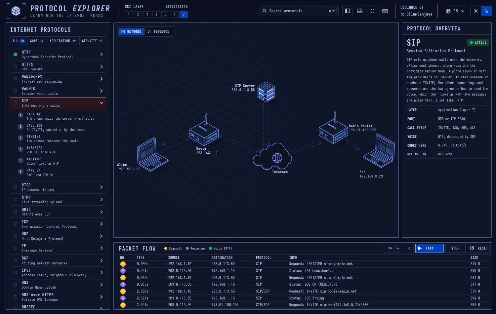
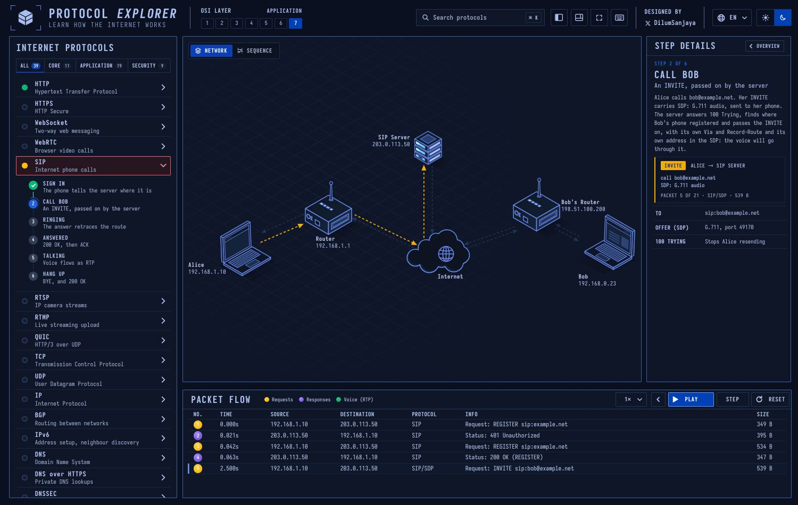
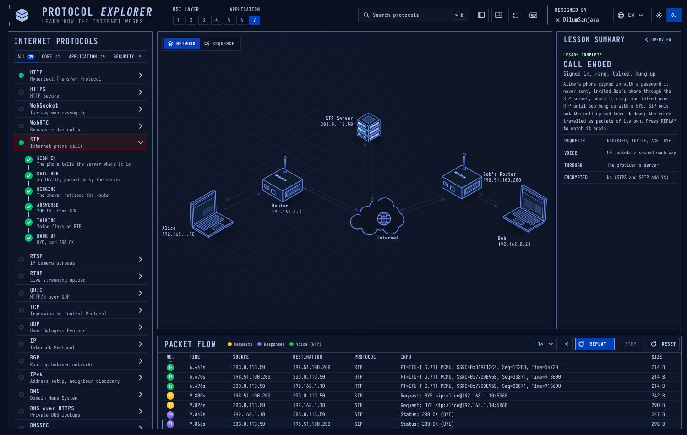
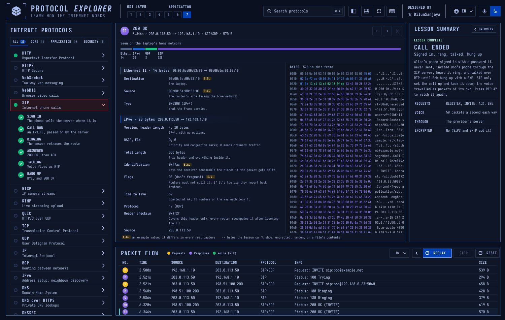
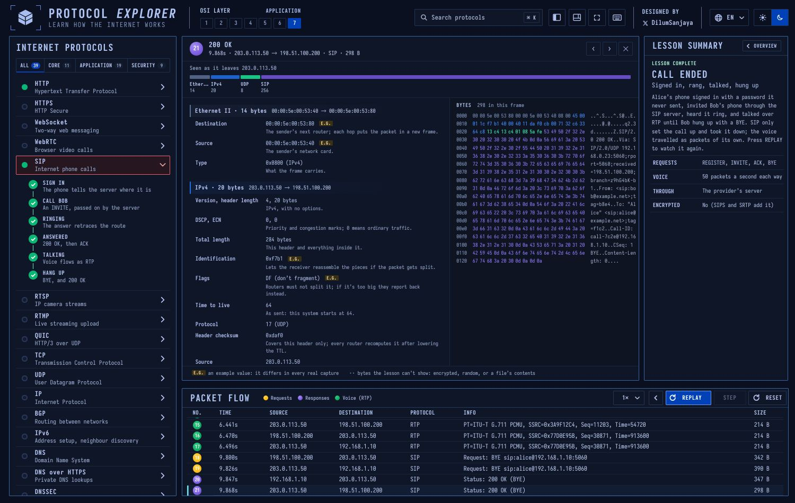

# SIP – Internet phone calls

<!-- nav -->
⬅ [04 WebRTC](04-webrtc.md) · [Index](00_Protocols_Index.md) · [06 RTSP](06-rtsp.md) ➡
<!-- nav -->

*Source: Protocol Explorer – https://protocol-explorer-alpha.vercel.app/ (interactive lesson #5). Screenshots captured from the live lesson; packet decodes are the site's example capture (values marked **E.G.** differ in every real capture).*

## Overview



> PROTOCOL OVERVIEW  
> SIP  
> ACTIVE  
> Session Initiation Protocol  
> SIP sets up phone calls over the internet: office desk phones, phone apps and the providers behind them. A phone signs in with its provider’s SIP server. To call someone it sends an INVITE; the other phone rings and answers, and the two agree on how to send the voice, which then flows as RTP. The messages are plain text, a lot like HTTP.  
> LAYER  
> Application (Layer 7)  
> PORT  
> UDP or TCP 5060  
> CALL SETUP  
> INVITE, 180, 200, ACK  
> VOICE  
> RTP, described by SDP  
> CODEC HERE  
> G.711, 64 kbit/s  
> DEFINED IN  
> RFC 3261  

## In-depth explanation of the example (plain-language version)

### The big picture in one minute
**Alice** uses a phone app on her laptop (`192.168.1.10`) to call **Bob** (`bob@example.net`) who is at `198.51.100.200`. Both are customers of one provider whose **SIP server** is at `203.0.113.50`. The lesson has **21 messages over about 10 seconds**: sign-in, making the call, a few voice packets, and hanging up.

**SIP is only the "switchboard".** It finds the other person, makes their phone ring, and agrees *how* the voice will be sent. The voice itself travels separately in small packets (called **RTP**). SIP messages are plain text that look a lot like HTTP.

Think of an old telephone exchange: the operator (the SIP server) connects you to the person you want and tells both phones how to talk, but the conversation itself doesn't go through the operator's notebook.

> **Words you'll see:** *SIP address* = like an email address for calls (`bob@example.net`). *Codec* = a way to turn voice into numbers. *UDP* = a "just send it" delivery method, ideal for live voice.

---

### Step 1 – Signing in (REGISTER) – packets 1 to 4
**Why sign in?** Phones move and change addresses. Signing in tells the server: "Alice can currently be reached at `192.168.1.10:5060`." Without it, nobody could call her.
- **Packet 1 – `REGISTER`.** Key lines:
  - `Via` → the route taken; replies follow it back. Its `branch` is a unique ID for this request.
  - `From` / `To` → both Alice (she registers herself). `Call-ID` is a unique ID for the conversation and `CSeq` is a running number.
  - `Contact` → **where to reach her**. `Expires: 3600` → "for one hour."
- **Packet 2 – `401 Unauthorized`.** The server says: "Prove it's you." It sends a random challenge (a *nonce*).
- **Packet 3 – REGISTER again,** now with a **digest**: a scrambled fingerprint made from her username, password and the challenge. **Her password is never sent**, only the proof.
- **Packet 4 – `200 OK`.** She's registered for an hour, and the phone will sign in again before it runs out. The server also tells her the public address it saw, which helps with home routers.

### Step 2 – Calling Bob (INVITE) – packets 5, 6, 7
- **Packet 5 – `INVITE sip:bob@example.net`.** It carries an **offer** (in a format called SDP) saying: "Send voice to my address on port 49170, using codec **G.711** (the classic phone-quality codec), and I also understand keypad tones."
- **Packet 6 – `100 Trying`.** The server immediately says "got it, working on it," so Alice's phone doesn't keep re-sending.
- **Packet 7.** The server looks up where Bob is signed in and forwards the INVITE to him. It adds its own address to the route (so replies come back through it) and swaps the voice address in the offer for **its own**, so it can relay the voice. That neatly solves the home-router problem for both sides.

### Step 3 – It rings – packets 8, 9
Bob's phone rings and answers **`180 Ringing`**. The reply retraces the `Via` route back through the server to Alice, whose phone plays the ringing sound.

### Step 4 – Bob answers – packets 10 to 13
- **Packet 10 – `200 OK`** from Bob with his answer: "I accept G.711, send voice to my port 49172." The server relays it (packet 11), again swapping in its own address.
- **Packet 12 – `ACK`** from Alice (forwarded in packet 13).
So a call starts with a three-way greeting: **INVITE → 200 OK → ACK.** The final ACK is needed because ringing can take a long time, so the "answered" message is explicitly confirmed.

### Step 5 – Talking – packets 14 to 17
SIP goes quiet and **voice packets (RTP over UDP)** take over. Every **20 ms** a phone sends one packet with **160 bytes of sound**. Each carries:
- a **sequence number** (+1 each time) so lost or out-of-order packets are noticed,
- a **timestamp** (+160 each time) so the receiver plays at the correct speed,
- an ID for the stream.
UDP is used because a re-sent voice packet would arrive too late to be useful. Here the packets go phone → server → phone.

### Step 6 – Hanging up (BYE) – packets 18 to 21
Bob hangs up: **`BYE`** goes through the server to Alice, her phone replies **`200 OK`**, and both stop sending voice. The call used four kinds of request: **REGISTER, INVITE, ACK, BYE.** The voice was never part of SIP.

---

### The key messages at a glance
| Packets | What | Why |
|---|---|---|
| 1–4 | REGISTER, 401, REGISTER, 200 | sign in safely |
| 5–7 | INVITE, 100 Trying, forwarded INVITE | start the call |
| 8–9 | 180 Ringing | the other phone is ringing |
| 10–13 | 200 OK, ACK | answered and confirmed |
| 14–17 | RTP voice | the actual talking |
| 18–21 | BYE, 200 OK | hang up |

### What to remember
- A call is identified by **Call-ID + the two tags**; each request has a number and method (`CSeq`).
- Response codes are grouped: **1xx** in progress (Trying, Ringing), **2xx** success, **3xx** redirect, **4xx** client problem (401 login needed, 404 not found), **5xx** server problem.
- **SIP = signalling (text, port 5060), SDP = the description of the media, RTP = the voice.** WebRTC borrowed this same offer/answer idea.
- The secure versions are **SIPS/TLS (port 5061)** for signalling and **SRTP** for the voice. This lesson uses the plain version so you can read it.

## Step-by-step walkthrough (screenshots from the lesson)

### Step 1: SIGN IN – The phone tells the server where it is


> STEP 1 OF 6  
> SIGN IN  
> The phone tells the server where it is  
> Alice’s phone, an app on her laptop, registers with her provider’s SIP server: alice@example.net can be reached here. The server answers 401 with a challenge, so the phone asks again with a hash made from the challenge and its password. 200 OK: registered for an hour.  
> PORT  
> UDP 5060  
> LOGIN  
> A hash, not the password  
> GOOD FOR  
> 3600 s, then again  

### Step 2: CALL BOB – An INVITE, passed on by the server



> STEP 2 OF 6  
> CALL BOB  
> An INVITE, passed on by the server  
> Alice calls bob@example.net. Her INVITE carries SDP: G.711 audio, sent to her phone. The server answers 100 Trying, finds where Bob’s phone registered and passes the INVITE on, with its own Via and Record-Route and its own address in the SDP: the voice will go through it.  
> INVITE  
> ALICE → SIP SERVER  
> call bob@example.net  
> SDP: G.711 audio  
> PACKET 5 OF 21 · SIP/SDP · 539 B  
> TO  
> sip:bob@example.net  
> OFFER (SDP)  
> G.711, port 49170  
> 100 TRYING  
> Stops Alice resending  

### Step 3: RINGING – The answer retraces the route


> STEP 3 OF 6  
> RINGING  
> The answer retraces the route  
> Bob’s phone starts ringing and says so: 180 Ringing. Responses follow the Via headers back the way the request came, so it goes to the server, which removes its own Via and passes it on to Alice. Her phone plays the ringing tone.  
> 180 RINGING  
> BOB → SIP SERVER  
> Bob’s phone rings  
> PACKET 8 OF 21 · SIP · 428 B  
> RESPONSE  
> 180 Ringing  
> ROUTE BACK  
> The Via headers, in reverse  
> ALICE HEARS  
> The ringing tone  

### Step 4: ANSWERED – 200 OK, then ACK


> STEP 4 OF 6  
> ANSWERED  
> 200 OK, then ACK  
> Bob picks up. His 200 OK carries his SDP answer: G.711, sent to his phone. The server swaps in its own address again before passing it to Alice. Her phone confirms with an ACK, which the server passes to Bob. The call is set up.  
> 200 OK  
> BOB → SIP SERVER  
> Bob answers  
> SDP: G.711 audio  
> PACKET 10 OF 21 · SIP/SDP · 619 B  
> ANSWER (SDP)  
> G.711, port 49172  
> CONFIRMED BY  
> ACK  
> VOICE GOES TO  
> The server, ports 40000, 40002  

### Step 5: TALKING – Voice flows as RTP


> STEP 5 OF 6  
> TALKING  
> Voice flows as RTP  
> Now the voice: every 20 ms each phone sends an RTP packet with 160 bytes of G.711 sound, a sequence number and a timestamp, over UDP. They go to the server, which passes them on to the other phone. SIP stays quiet while they talk.  
> VOICE  
> ALICE → SIP SERVER  
> 20 ms of Alice  
> PACKET 14 OF 21 · RTP · 214 B  
> EVERY  
> 20 ms, 160 bytes of sound  
> CARRIED BY  
> RTP over UDP  
> SIP MEANWHILE  
> Nothing to say  

### Step 6: HANG UP – BYE, and 200 OK


> STEP 6 OF 6  
> HANG UP  
> BYE, and 200 OK  
> Bob hangs up: his phone sends BYE, routed through the server as the Record-Route asked, and Alice’s phone answers 200 OK. Both stop sending voice. The call took four kinds of request; the voice itself was never part of SIP.  
> BYE  
> BOB → SIP SERVER  
> Bob hangs up  
> PACKET 18 OF 21 · SIP · 342 B  
> REQUEST  
> BYE  
> ANSWER  
> 200 OK  
> THEN  
> No more RTP  

### Lesson summary



> LESSON SUMMARY  
> LESSON COMPLETE  
> CALL ENDED  
> Signed in, rang, talked, hung up  
> Alice’s phone signed in with a password it never sent, invited Bob’s phone through the SIP server, heard it ring, and talked over RTP until Bob hung up with a BYE. SIP only set the call up and took it down; the voice travelled as packets of its own. Press REPLAY to watch it again.  
> 200 OK  
> SIP SERVER → BOB  
> PACKET 21 OF 21 · SIP · 298 B  
> REQUESTS  
> REGISTER, INVITE, ACK, BYE  
> VOICE  
> 50 packets a second each way  
> THROUGH  
> The provider’s server  
> ENCRYPTED  
> No (SIPS and SRTP add it)  

## Packet flow (whole lesson)

| No. | Time | Source | Destination | Protocol | Info | Size |
|---|---|---|---|---|---|---|
| 1 | 0.000s | 192.168.1.10 | 203.0.113.50 | SIP | Request: REGISTER sip:example.net | 349 B |
| 2 | 0.021s | 203.0.113.50 | 192.168.1.10 | SIP | Status: 401 Unauthorized | 395 B |
| 3 | 0.042s | 192.168.1.10 | 203.0.113.50 | SIP | Request: REGISTER sip:example.net | 534 B |
| 4 | 0.063s | 203.0.113.50 | 192.168.1.10 | SIP | Status: 200 OK (REGISTER) | 347 B |
| 5 | 2.500s | 192.168.1.10 | 203.0.113.50 | SIP/SDP | Request: INVITE sip:bob@example.net | 539 B |
| 6 | 2.521s | 203.0.113.50 | 192.168.1.10 | SIP | Status: 100 Trying | 294 B |
| 7 | 2.521s | 203.0.113.50 | 198.51.100.200 | SIP/SDP | Request: INVITE sip:bob@192.168.0.23:5060 | 658 B |
| 8 | 2.560s | 198.51.100.200 | 203.0.113.50 | SIP | Status: 180 Ringing | 428 B |
| 9 | 2.586s | 203.0.113.50 | 192.168.1.10 | SIP | Status: 180 Ringing | 379 B |
| 10 | 6.320s | 198.51.100.200 | 203.0.113.50 | SIP/SDP | Status: 200 OK (INVITE) | 619 B |
| 11 | 6.346s | 203.0.113.50 | 192.168.1.10 | SIP/SDP | Status: 200 OK (INVITE) | 570 B |
| 12 | 6.367s | 192.168.1.10 | 203.0.113.50 | SIP | Request: ACK sip:bob@192.168.0.23:5060 | 340 B |
| 13 | 6.388s | 203.0.113.50 | 198.51.100.200 | SIP | Request: ACK sip:bob@192.168.0.23:5060 | 386 B |
| 14 | 6.420s | 192.168.1.10 | 203.0.113.50 | RTP | PT=ITU-T G.711 PCMU, SSRC=0x3A9F12C4, Seq=11203, Time=54720 | 214 B |
| 15 | 6.441s | 203.0.113.50 | 198.51.100.200 | RTP | PT=ITU-T G.711 PCMU, SSRC=0x3A9F12C4, Seq=11203, Time=54720 | 214 B |
| 16 | 6.470s | 198.51.100.200 | 203.0.113.50 | RTP | PT=ITU-T G.711 PCMU, SSRC=0x77D0E95B, Seq=30871, Time=913600 | 214 B |
| 17 | 6.496s | 203.0.113.50 | 192.168.1.10 | RTP | PT=ITU-T G.711 PCMU, SSRC=0x77D0E95B, Seq=30871, Time=913600 | 214 B |
| 18 | 9.800s | 198.51.100.200 | 203.0.113.50 | SIP | Request: BYE sip:alice@192.168.1.10:5060 | 342 B |
| 19 | 9.826s | 203.0.113.50 | 192.168.1.10 | SIP | Request: BYE sip:alice@192.168.1.10:5060 | 390 B |
| 20 | 9.847s | 192.168.1.10 | 203.0.113.50 | SIP | Status: 200 OK (BYE) | 347 B |
| 21 | 9.868s | 203.0.113.50 | 198.51.100.200 | SIP | Status: 200 OK (BYE) | 298 B |

### Sequence diagram


## Packets decoded byte by byte

Each packet below is the lesson's own decode (headers, field values and the plain-English meaning of each field). Screenshots show the first, middle and last packet in the lesson's decoder view with the raw hex bytes.

### Packet 1: SIP – Request: REGISTER sip:example.net

*192.168.1.10 → 203.0.113.50 · 349 B · t = 0.000s*


<details><summary>Decoded fields</summary>

```text
1
REGISTER
0.000s · 192.168.1.10 → 203.0.113.50 · SIP · 349 B
Seen on the laptop’s home network
Ethernet
14
IPv4
20
UDP
8
SIP
307
Ethernet II · 14 bytes
00:00:5e:00:53:10 → 00:00:5e:00:53:01
Destination
00:00:5e:00:53:01 E.G.

The router: anything beyond the home network goes to it first.

Source
00:00:5e:00:53:10 E.G.

The laptop’s network card.

Type
0x0800 (IPv4)

What the frame carries.

IPv4 · 20 bytes
192.168.1.10 → 203.0.113.50
Version, header length
4, 20 bytes

IPv4, with no options.

DSCP, ECN
0, 0

Priority and congestion marks; 0 means ordinary traffic.

Total length
335 bytes

This header and everything inside it.

Identification
0xd825 E.G.

Lets the receiver reassemble the pieces if the packet gets split.

Flags
none E.G.

Routers may split it if a link is too small.

Time to live
128

Windows starts at 128.

Protocol
17 (UDP)
Header checksum
0x6393

Covers this header only; every router recomputes it after lowering the TTL.

Source
192.168.1.10
Destination
203.0.113.50
UDP · 8 bytes
5060 → 5060
Source port
5060
Destination port
5060
Length
315 bytes

UDP header and data. That is all of UDP: no numbering, no acknowledgements.

Checksum
0x4468

Covers the header, the data and the IP addresses.

SIP
Text
REGISTER sip:example.net SIP/2.0␍␊
Via: SIP/2.0/UDP 192.168.1.10:5060;rport;branch=z9hG4bK-r1␍␊
Max-Forwards: 70␍␊
From: <sip:alice@example.net>;tag=a73k␍␊
To: <sip:alice@example.net>␍␊
Call-ID: reg-5e1f@192.168.1.10␍␊
CSeq: 1 REGISTER␍␊
Contact: <sip:alice@192.168.1.10:5060>␍␊
Expires: 3600␍␊
Content-Length: 0␍␊
␍␊
BYTES 349 in this frame
0000
00
00
5e
00
53
01
00
00
5e
00
53
10
08
00
45
00
.
.
^
.
S
.
.
.
^
.
S
.
.
.
E
.
0010
01
4f
d8
25
00
00
80
11
63
93
c0
a8
01
0a
cb
00
.
O
.
%
.
.
.
.
c
.
.
.
.
.
.
.
0020
71
32
13
c4
13
c4
01
3b
44
68
52
45
47
49
53
54
q
2
.
.
.
.
.
;
D
h
R
E
G
I
S
T
0030
45
52
20
73
69
70
3a
65
78
61
6d
70
6c
65
2e
6e
E
R
s
i
p
:
e
x
a
m
p
l
e
.
n
0040
65
74
20
53
49
50
2f
32
2e
30
0d
0a
56
69
61
3a
e
t
S
I
P
/
2
.
0
.
.
V
i
a
:
0050
20
53
49
50
2f
32
2e
30
2f
55
44
50
20
31
39
32
S
I
P
/
2
.
0
/
U
D
P
1
9
2
0060
2e
31
36
38
2e
31
2e
31
30
3a
35
30
36
30
3b
72
.
1
6
8
.
1
.
1
0
:
5
0
6
0
;
r
0070
70
6f
72
74
3b
62
72
61
6e
63
68
3d
7a
39
68
47
p
o
r
t
;
b
r
a
n
c
h
=
z
9
h
G
0080
34
62
4b
2d
72
31
0d
0a
4d
61
78
2d
46
6f
72
77
4
b
K
-
r
1
.
.
M
a
x
-
F
o
r
w
0090
61
72
64
73
3a
20
37
30
0d
0a
46
72
6f
6d
3a
20
a
r
d
s
:
7
0
.
.
F
r
o
m
:
00a0
3c
73
69
70
3a
61
6c
69
63
65
40
65
78
61
6d
70
<
s
i
p
:
a
l
i
c
e
@
e
x
a
m
p
00b0
6c
65
2e
6e
65
74
3e
3b
74
61
67
3d
61
37
33
6b
l
e
.
n
e
t
>
;
t
a
g
=
a
7
3
k
00c0
0d
0a
54
6f
3a
20
3c
73
69
70
3a
61
6c
69
63
65
.
.
T
o
:
<
s
i
p
:
a
l
i
c
e
00d0
40
65
78
61
6d
70
6c
65
2e
6e
65
74
3e
0d
0a
43
@
e
x
a
m
p
l
e
.
n
e
t
>
.
.
C
00e0
61
6c
6c
2d
49
44
3a
20
72
65
67
2d
35
65
31
66
a
l
l
-
I
D
:
r
e
g
-
5
e
1
f
00f0
40
31
39
32
2e
31
36
38
2e
31
2e
31
30
0d
0a
43
@
1
9
2
.
1
6
8
.
1
.
1
0
.
.
C
0100
53
65
71
3a
20
31
20
52
45
47
49
53
54
45
52
0d
S
e
q
:
1
R
E
G
I
S
T
E
R
.
0110
0a
43
6f
6e
74
61
63
74
3a
20
3c
73
69
70
3a
61
.
C
o
n
t
a
c
t
:
<
s
i
p
:
a
0120
6c
69
63
65
40
31
39
32
2e
31
36
38
2e
31
2e
31
l
i
c
e
@
1
9
2
.
1
6
8
.
1
.
1
0130
30
3a
35
30
36
30
3e
0d
0a
45
78
70
69
72
65
73
0
:
5
0
6
0
>
.
.
E
x
p
i
r
e
s
0140
3a
20
33
36
30
30
0d
0a
43
6f
6e
74
65
6e
74
2d
:
3
6
0
0
.
.
C
o
n
t
e
n
t
-
0150
4c
65
6e
67
74
68
3a
20
30
0d
0a
0d
0a
L
e
n
g
t
h
:
0
.
.
.
.
E.G. an example value: it differs in every real capture
·· bytes the lesson can’t show: encrypted, random, or a file’s contents
```

</details>

### Packet 2: SIP – Status: 401 Unauthorized

*203.0.113.50 → 192.168.1.10 · 395 B · t = 0.021s*

<details><summary>Decoded fields</summary>

```text
2
401
0.021s · 203.0.113.50 → 192.168.1.10 · SIP · 395 B
Seen on the laptop’s home network
Ethernet
14
IPv4
20
UDP
8
SIP
353
Ethernet II · 14 bytes
00:00:5e:00:53:01 → 00:00:5e:00:53:10
Destination
00:00:5e:00:53:10 E.G.

The laptop.

Source
00:00:5e:00:53:01 E.G.

The router’s side facing the home network.

Type
0x0800 (IPv4)

What the frame carries.

IPv4 · 20 bytes
203.0.113.50 → 192.168.1.10
Version, header length
4, 20 bytes

IPv4, with no options.

DSCP, ECN
0, 0

Priority and congestion marks; 0 means ordinary traffic.

Total length
381 bytes

This header and everything inside it.

Identification
0xf7a7 E.G.

Lets the receiver reassemble the pieces if the packet gets split.

Flags
DF (don’t fragment) E.G.

Routers must not split it; if it’s too big they report back instead.

Time to live
52

Started at 64; 12 routers on the way each took 1.

Protocol
17 (UDP)
Header checksum
0x4fe3

Covers this header only; every router recomputes it after lowering the TTL.

Source
203.0.113.50
Destination
192.168.1.10
UDP · 8 bytes
5060 → 5060
Source port
5060
Destination port
5060
Length
361 bytes

UDP header and data. That is all of UDP: no numbering, no acknowledgements.

Checksum
0x4314

Covers the header, the data and the IP addresses.

SIP
Text
SIP/2.0 401 Unauthorized␍␊
Via: SIP/2.0/UDP 192.168.1.10:5060;rport=5060;received=198.51.100.7;branch=z9hG4bK-r1␍␊
From: <sip:alice@example.net>;tag=a73k␍␊
To: <sip:alice@example.net>;tag=s91d␍␊
Call-ID: reg-5e1f@192.168.1.10␍␊
CSeq: 1 REGISTER␍␊
WWW-Authenticate: Digest realm=\"example.net\", nonce=\"7b2e91c4\", qop=\"auth\", algorithm=MD5␍␊
Content-Length: 0␍␊
␍␊
BYTES 395 in this frame
0000
00
00
5e
00
53
10
00
00
5e
00
53
01
08
00
45
00
.
.
^
.
S
.
.
.
^
.
S
.
.
.
E
.
0010
01
7d
f7
a7
40
00
34
11
4f
e3
cb
00
71
32
c0
a8
.
}
.
.
@
.
4
.
O
.
.
.
q
2
.
.
0020
01
0a
13
c4
13
c4
01
69
43
14
53
49
50
2f
32
2e
.
.
.
.
.
.
.
i
C
.
S
I
P
/
2
.
0030
30
20
34
30
31
20
55
6e
61
75
74
68
6f
72
69
7a
0
4
0
1
U
n
a
u
t
h
o
r
i
z
0040
65
64
0d
0a
56
69
61
3a
20
53
49
50
2f
32
2e
30
e
d
.
.
V
i
a
:
S
I
P
/
2
.
0
0050
2f
55
44
50
20
31
39
32
2e
31
36
38
2e
31
2e
31
/
U
D
P
1
9
2
.
1
6
8
.
1
.
1
0060
30
3a
35
30
36
30
3b
72
70
6f
72
74
3d
35
30
36
0
:
5
0
6
0
;
r
p
o
r
t
=
5
0
6
0070
30
3b
72
65
63
65
69
76
65
64
3d
31
39
38
2e
35
0
;
r
e
c
e
i
v
e
d
=
1
9
8
.
5
0080
31
2e
31
30
30
2e
37
3b
62
72
61
6e
63
68
3d
7a
1
.
1
0
0
.
7
;
b
r
a
n
c
h
=
z
0090
39
68
47
34
62
4b
2d
72
31
0d
0a
46
72
6f
6d
3a
9
h
G
4
b
K
-
r
1
.
.
F
r
o
m
:
00a0
20
3c
73
69
70
3a
61
6c
69
63
65
40
65
78
61
6d
<
s
i
p
:
a
l
i
c
e
@
e
x
a
m
00b0
70
6c
65
2e
6e
65
74
3e
3b
74
61
67
3d
61
37
33
p
l
e
.
n
e
t
>
;
t
a
g
=
a
7
3
00c0
6b
0d
0a
54
6f
3a
20
3c
73
69
70
3a
61
6c
69
63
k
.
.
T
o
:
<
s
i
p
:
a
l
i
c
00d0
65
40
65
78
61
6d
70
6c
65
2e
6e
65
74
3e
3b
74
e
@
e
x
a
m
p
l
e
.
n
e
t
>
;
t
00e0
61
67
3d
73
39
31
64
0d
0a
43
61
6c
6c
2d
49
44
a
g
=
s
9
1
d
.
.
C
a
l
l
-
I
D
00f0
3a
20
72
65
67
2d
35
65
31
66
40
31
39
32
2e
31
:
r
e
g
-
5
e
1
f
@
1
9
2
.
1
0100
36
38
2e
31
2e
31
30
0d
0a
43
53
65
71
3a
20
31
6
8
.
1
.
1
0
.
.
C
S
e
q
:
1
0110
20
52
45
47
49
53
54
45
52
0d
0a
57
57
57
2d
41
R
E
G
I
S
T
E
R
.
.
W
W
W
-
A
0120
75
74
68
65
6e
74
69
63
61
74
65
3a
20
44
69
67
u
t
h
e
n
t
i
c
a
t
e
:
D
i
g
0130
65
73
74
20
72
65
61
6c
6d
3d
22
65
78
61
6d
70
e
s
t
r
e
a
l
m
=
"
e
x
a
m
p
0140
6c
65
2e
6e
65
74
22
2c
20
6e
6f
6e
63
65
3d
22
l
e
.
n
e
t
"
,
n
o
n
c
e
=
"
0150
37
62
32
65
39
31
63
34
22
2c
20
71
6f
70
3d
22
7
b
2
e
9
1
c
4
"
,
q
o
p
=
"
0160
61
75
74
68
22
2c
20
61
6c
67
6f
72
69
74
68
6d
a
u
t
h
"
,
a
l
g
o
r
i
t
h
m
0170
3d
4d
44
35
0d
0a
43
6f
6e
74
65
6e
74
2d
4c
65
=
M
D
5
.
.
C
o
n
t
e
n
t
-
L
e
0180
6e
67
74
68
3a
20
30
0d
0a
0d
0a
n
g
t
h
:
0
.
.
.
.
E.G. an example value: it differs in every real capture
·· bytes the lesson can’t show: encrypted, random, or a file’s contents
```

</details>

### Packet 3: SIP – Request: REGISTER sip:example.net

*192.168.1.10 → 203.0.113.50 · 534 B · t = 0.042s*

<details><summary>Decoded fields</summary>

```text
3
REGISTER
0.042s · 192.168.1.10 → 203.0.113.50 · SIP · 534 B
Seen on the laptop’s home network
Ethernet
14
IPv4
20
UDP
8
SIP
492
Ethernet II · 14 bytes
00:00:5e:00:53:10 → 00:00:5e:00:53:01
Destination
00:00:5e:00:53:01 E.G.

The router: anything beyond the home network goes to it first.

Source
00:00:5e:00:53:10 E.G.

The laptop’s network card.

Type
0x0800 (IPv4)

What the frame carries.

IPv4 · 20 bytes
192.168.1.10 → 203.0.113.50
Version, header length
4, 20 bytes

IPv4, with no options.

DSCP, ECN
0, 0

Priority and congestion marks; 0 means ordinary traffic.

Total length
520 bytes

This header and everything inside it.

Identification
0xd826 E.G.

Lets the receiver reassemble the pieces if the packet gets split.

Flags
none E.G.

Routers may split it if a link is too small.

Time to live
128

Windows starts at 128.

Protocol
17 (UDP)
Header checksum
0x62d9

Covers this header only; every router recomputes it after lowering the TTL.

Source
192.168.1.10
Destination
203.0.113.50
UDP · 8 bytes
5060 → 5060
Source port
5060
Destination port
5060
Length
500 bytes

UDP header and data. That is all of UDP: no numbering, no acknowledgements.

Checksum
0xcf98

Covers the header, the data and the IP addresses.

SIP
Text
REGISTER sip:example.net SIP/2.0␍␊
Via: SIP/2.0/UDP 192.168.1.10:5060;rport;branch=z9hG4bK-r2␍␊
Max-Forwards: 70␍␊
From: <sip:alice@example.net>;tag=a73k␍␊
To: <sip:alice@example.net>␍␊
Call-ID: reg-5e1f@192.168.1.10␍␊
CSeq: 2 REGISTER␍␊
Contact: <sip:alice@192.168.1.10:5060>␍␊
Authorization: Digest username=\"alice\", realm=\"example.net\", nonce=\"7b2e91c4\", uri=\"sip:example.net\", response=\"4c1e7a9d02b35f68e1a9c47d0b2f6e13\", qop=auth, nc=00000001, cnonce=\"d3f0\"␍␊
Expires: 3600␍␊
Content-Length: 0␍␊
␍␊
BYTES 534 in this frame
0000
00
00
5e
00
53
01
00
00
5e
00
53
10
08
00
45
00
.
.
^
.
S
.
.
.
^
.
S
.
.
.
E
.
0010
02
08
d8
26
00
00
80
11
62
d9
c0
a8
01
0a
cb
00
.
.
.
&
.
.
.
.
b
.
.
.
.
.
.
.
0020
71
32
13
c4
13
c4
01
f4
cf
98
52
45
47
49
53
54
q
2
.
.
.
.
.
.
.
.
R
E
G
I
S
T
0030
45
52
20
73
69
70
3a
65
78
61
6d
70
6c
65
2e
6e
E
R
s
i
p
:
e
x
a
m
p
l
e
.
n
0040
65
74
20
53
49
50
2f
32
2e
30
0d
0a
56
69
61
3a
e
t
S
I
P
/
2
.
0
.
.
V
i
a
:
0050
20
53
49
50
2f
32
2e
30
2f
55
44
50
20
31
39
32
S
I
P
/
2
.
0
/
U
D
P
1
9
2
0060
2e
31
36
38
2e
31
2e
31
30
3a
35
30
36
30
3b
72
.
1
6
8
.
1
.
1
0
:
5
0
6
0
;
r
0070
70
6f
72
74
3b
62
72
61
6e
63
68
3d
7a
39
68
47
p
o
r
t
;
b
r
a
n
c
h
=
z
9
h
G
0080
34
62
4b
2d
72
32
0d
0a
4d
61
78
2d
46
6f
72
77
4
b
K
-
r
2
.
.
M
a
x
-
F
o
r
w
0090
61
72
64
73
3a
20
37
30
0d
0a
46
72
6f
6d
3a
20
a
r
d
s
:
7
0
.
.
F
r
o
m
:
00a0
3c
73
69
70
3a
61
6c
69
63
65
40
65
78
61
6d
70
<
s
i
p
:
a
l
i
c
e
@
e
x
a
m
p
00b0
6c
65
2e
6e
65
74
3e
3b
74
61
67
3d
61
37
33
6b
l
e
.
n
e
t
>
;
t
a
g
=
a
7
3
k
00c0
0d
0a
54
6f
3a
20
3c
73
69
70
3a
61
6c
69
63
65
.
.
T
o
:
<
s
i
p
:
a
l
i
c
e
00d0
40
65
78
61
6d
70
6c
65
2e
6e
65
74
3e
0d
0a
43
@
e
x
a
m
p
l
e
.
n
e
t
>
.
.
C
00e0
61
6c
6c
2d
49
44
3a
20
72
65
67
2d
35
65
31
66
a
l
l
-
I
D
:
r
e
g
-
5
e
1
f
00f0
40
31
39
32
2e
31
36
38
2e
31
2e
31
30
0d
0a
43
@
1
9
2
.
1
6
8
.
1
.
1
0
.
.
C
0100
53
65
71
3a
20
32
20
52
45
47
49
53
54
45
52
0d
S
e
q
:
2
R
E
G
I
S
T
E
R
.
0110
0a
43
6f
6e
74
61
63
74
3a
20
3c
73
69
70
3a
61
.
C
o
n
t
a
c
t
:
<
s
i
p
:
a
0120
6c
69
63
65
40
31
39
32
2e
31
36
38
2e
31
2e
31
l
i
c
e
@
1
9
2
.
1
6
8
.
1
.
1
0130
30
3a
35
30
36
30
3e
0d
0a
41
75
74
68
6f
72
69
0
:
5
0
6
0
>
.
.
A
u
t
h
o
r
i
0140
7a
61
74
69
6f
6e
3a
20
44
69
67
65
73
74
20
75
z
a
t
i
o
n
:
D
i
g
e
s
t
u
0150
73
65
72
6e
61
6d
65
3d
22
61
6c
69
63
65
22
2c
s
e
r
n
a
m
e
=
"
a
l
i
c
e
"
,
0160
20
72
65
61
6c
6d
3d
22
65
78
61
6d
70
6c
65
2e
r
e
a
l
m
=
"
e
x
a
m
p
l
e
.
0170
6e
65
74
22
2c
20
6e
6f
6e
63
65
3d
22
37
62
32
n
e
t
"
,
n
o
n
c
e
=
"
7
b
2
0180
65
39
31
63
34
22
2c
20
75
72
69
3d
22
73
69
70
e
9
1
c
4
"
,
u
r
i
=
"
s
i
p
0190
3a
65
78
61
6d
70
6c
65
2e
6e
65
74
22
2c
20
72
:
e
x
a
m
p
l
e
.
n
e
t
"
,
r
01a0
65
73
70
6f
6e
73
65
3d
22
34
63
31
65
37
61
39
e
s
p
o
n
s
e
=
"
4
c
1
e
7
a
9
01b0
64
30
32
62
33
35
66
36
38
65
31
61
39
63
34
37
d
0
2
b
3
5
f
6
8
e
1
a
9
c
4
7
01c0
64
30
62
32
66
36
65
31
33
22
2c
20
71
6f
70
3d
d
0
b
2
f
6
e
1
3
"
,
q
o
p
=
01d0
61
75
74
68
2c
20
6e
63
3d
30
30
30
30
30
30
30
a
u
t
h
,
n
c
=
0
0
0
0
0
0
0
01e0
31
2c
20
63
6e
6f
6e
63
65
3d
22
64
33
66
30
22
1
,
c
n
o
n
c
e
=
"
d
3
f
0
"
01f0
0d
0a
45
78
70
69
72
65
73
3a
20
33
36
30
30
0d
.
.
E
x
p
i
r
e
s
:
3
6
0
0
.
0200
0a
43
6f
6e
74
65
6e
74
2d
4c
65
6e
67
74
68
3a
.
C
o
n
t
e
n
t
-
L
e
n
g
t
h
:
0210
20
30
0d
0a
0d
0a
0
.
.
.
.
E.G. an example value: it differs in every real capture
·· bytes the lesson can’t show: encrypted, random, or a file’s contents
```

</details>

### Packet 4: SIP – Status: 200 OK (REGISTER)

*203.0.113.50 → 192.168.1.10 · 347 B · t = 0.063s*

<details><summary>Decoded fields</summary>

```text
4
200 OK
0.063s · 203.0.113.50 → 192.168.1.10 · SIP · 347 B
Seen on the laptop’s home network
Ethernet
14
IPv4
20
UDP
8
SIP
305
Ethernet II · 14 bytes
00:00:5e:00:53:01 → 00:00:5e:00:53:10
Destination
00:00:5e:00:53:10 E.G.

The laptop.

Source
00:00:5e:00:53:01 E.G.

The router’s side facing the home network.

Type
0x0800 (IPv4)

What the frame carries.

IPv4 · 20 bytes
203.0.113.50 → 192.168.1.10
Version, header length
4, 20 bytes

IPv4, with no options.

DSCP, ECN
0, 0

Priority and congestion marks; 0 means ordinary traffic.

Total length
333 bytes

This header and everything inside it.

Identification
0xf7a8 E.G.

Lets the receiver reassemble the pieces if the packet gets split.

Flags
DF (don’t fragment) E.G.

Routers must not split it; if it’s too big they report back instead.

Time to live
52

Started at 64; 12 routers on the way each took 1.

Protocol
17 (UDP)
Header checksum
0x5012

Covers this header only; every router recomputes it after lowering the TTL.

Source
203.0.113.50
Destination
192.168.1.10
UDP · 8 bytes
5060 → 5060
Source port
5060
Destination port
5060
Length
313 bytes

UDP header and data. That is all of UDP: no numbering, no acknowledgements.

Checksum
0x38ce

Covers the header, the data and the IP addresses.

SIP
Text
SIP/2.0 200 OK␍␊
Via: SIP/2.0/UDP 192.168.1.10:5060;rport=5060;received=198.51.100.7;branch=z9hG4bK-r2␍␊
From: <sip:alice@example.net>;tag=a73k␍␊
To: <sip:alice@example.net>;tag=s91d␍␊
Call-ID: reg-5e1f@192.168.1.10␍␊
CSeq: 2 REGISTER␍␊
Contact: <sip:alice@192.168.1.10:5060>;expires=3600␍␊
Content-Length: 0␍␊
␍␊
BYTES 347 in this frame
0000
00
00
5e
00
53
10
00
00
5e
00
53
01
08
00
45
00
.
.
^
.
S
.
.
.
^
.
S
.
.
.
E
.
0010
01
4d
f7
a8
40
00
34
11
50
12
cb
00
71
32
c0
a8
.
M
.
.
@
.
4
.
P
.
.
.
q
2
.
.
0020
01
0a
13
c4
13
c4
01
39
38
ce
53
49
50
2f
32
2e
.
.
.
.
.
.
.
9
8
.
S
I
P
/
2
.
0030
30
20
32
30
30
20
4f
4b
0d
0a
56
69
61
3a
20
53
0
2
0
0
O
K
.
.
V
i
a
:
S
0040
49
50
2f
32
2e
30
2f
55
44
50
20
31
39
32
2e
31
I
P
/
2
.
0
/
U
D
P
1
9
2
.
1
0050
36
38
2e
31
2e
31
30
3a
35
30
36
30
3b
72
70
6f
6
8
.
1
.
1
0
:
5
0
6
0
;
r
p
o
0060
72
74
3d
35
30
36
30
3b
72
65
63
65
69
76
65
64
r
t
=
5
0
6
0
;
r
e
c
e
i
v
e
d
0070
3d
31
39
38
2e
35
31
2e
31
30
30
2e
37
3b
62
72
=
1
9
8
.
5
1
.
1
0
0
.
7
;
b
r
0080
61
6e
63
68
3d
7a
39
68
47
34
62
4b
2d
72
32
0d
a
n
c
h
=
z
9
h
G
4
b
K
-
r
2
.
0090
0a
46
72
6f
6d
3a
20
3c
73
69
70
3a
61
6c
69
63
.
F
r
o
m
:
<
s
i
p
:
a
l
i
c
00a0
65
40
65
78
61
6d
70
6c
65
2e
6e
65
74
3e
3b
74
e
@
e
x
a
m
p
l
e
.
n
e
t
>
;
t
00b0
61
67
3d
61
37
33
6b
0d
0a
54
6f
3a
20
3c
73
69
a
g
=
a
7
3
k
.
.
T
o
:
<
s
i
00c0
70
3a
61
6c
69
63
65
40
65
78
61
6d
70
6c
65
2e
p
:
a
l
i
c
e
@
e
x
a
m
p
l
e
.
00d0
6e
65
74
3e
3b
74
61
67
3d
73
39
31
64
0d
0a
43
n
e
t
>
;
t
a
g
=
s
9
1
d
.
.
C
00e0
61
6c
6c
2d
49
44
3a
20
72
65
67
2d
35
65
31
66
a
l
l
-
I
D
:
r
e
g
-
5
e
1
f
00f0
40
31
39
32
2e
31
36
38
2e
31
2e
31
30
0d
0a
43
@
1
9
2
.
1
6
8
.
1
.
1
0
.
.
C
0100
53
65
71
3a
20
32
20
52
45
47
49
53
54
45
52
0d
S
e
q
:
2
R
E
G
I
S
T
E
R
.
0110
0a
43
6f
6e
74
61
63
74
3a
20
3c
73
69
70
3a
61
.
C
o
n
t
a
c
t
:
<
s
i
p
:
a
0120
6c
69
63
65
40
31
39
32
2e
31
36
38
2e
31
2e
31
l
i
c
e
@
1
9
2
.
1
6
8
.
1
.
1
0130
30
3a
35
30
36
30
3e
3b
65
78
70
69
72
65
73
3d
0
:
5
0
6
0
>
;
e
x
p
i
r
e
s
=
0140
33
36
30
30
0d
0a
43
6f
6e
74
65
6e
74
2d
4c
65
3
6
0
0
.
.
C
o
n
t
e
n
t
-
L
e
0150
6e
67
74
68
3a
20
30
0d
0a
0d
0a
n
g
t
h
:
0
.
.
.
.
E.G. an example value: it differs in every real capture
·· bytes the lesson can’t show: encrypted, random, or a file’s contents
```

</details>

### Packet 5: SIP/SDP – Request: INVITE sip:bob@example.net

*192.168.1.10 → 203.0.113.50 · 539 B · t = 2.500s*

<details><summary>Decoded fields</summary>

```text
5
INVITE
2.500s · 192.168.1.10 → 203.0.113.50 · SIP/SDP · 539 B
Seen on the laptop’s home network
Ethernet
14
IPv4
20
UDP
8
SIP
497
Ethernet II · 14 bytes
00:00:5e:00:53:10 → 00:00:5e:00:53:01
Destination
00:00:5e:00:53:01 E.G.

The router: anything beyond the home network goes to it first.

Source
00:00:5e:00:53:10 E.G.

The laptop’s network card.

Type
0x0800 (IPv4)

What the frame carries.

IPv4 · 20 bytes
192.168.1.10 → 203.0.113.50
Version, header length
4, 20 bytes

IPv4, with no options.

DSCP, ECN
0, 0

Priority and congestion marks; 0 means ordinary traffic.

Total length
525 bytes

This header and everything inside it.

Identification
0xd827 E.G.

Lets the receiver reassemble the pieces if the packet gets split.

Flags
none E.G.

Routers may split it if a link is too small.

Time to live
128

Windows starts at 128.

Protocol
17 (UDP)
Header checksum
0x62d3

Covers this header only; every router recomputes it after lowering the TTL.

Source
192.168.1.10
Destination
203.0.113.50
UDP · 8 bytes
5060 → 5060
Source port
5060
Destination port
5060
Length
505 bytes

UDP header and data. That is all of UDP: no numbering, no acknowledgements.

Checksum
0x521c

Covers the header, the data and the IP addresses.

SIP
Text
INVITE sip:bob@example.net SIP/2.0␍␊
Via: SIP/2.0/UDP 192.168.1.10:5060;rport;branch=z9hG4bK-i1␍␊
Max-Forwards: 70␍␊
From: \"Alice\" <sip:alice@example.net>;tag=f1c2␍␊
To: <sip:bob@example.net>␍␊
Call-ID: call-7c2e@192.168.1.10␍␊
CSeq: 1 INVITE␍␊
Contact: <sip:alice@192.168.1.10:5060>␍␊
Content-Type: application/sdp␍␊
Content-Length: 165␍␊
␍␊
v=0␍␊
o=alice 2890 2890 IN IP4 192.168.1.10␍␊
s=-␍␊
c=IN IP4 192.168.1.10␍␊
t=0 0␍␊
m=audio 49170 RTP/AVP 0 101␍␊
a=rtpmap:0 PCMU/8000␍␊
a=rtpmap:101 telephone-event/8000␍␊
BYTES 539 in this frame
0000
00
00
5e
00
53
01
00
00
5e
00
53
10
08
00
45
00
.
.
^
.
S
.
.
.
^
.
S
.
.
.
E
.
0010
02
0d
d8
27
00
00
80
11
62
d3
c0
a8
01
0a
cb
00
.
.
.
'
.
.
.
.
b
.
.
.
.
.
.
.
0020
71
32
13
c4
13
c4
01
f9
52
1c
49
4e
56
49
54
45
q
2
.
.
.
.
.
.
R
.
I
N
V
I
T
E
0030
20
73
69
70
3a
62
6f
62
40
65
78
61
6d
70
6c
65
s
i
p
:
b
o
b
@
e
x
a
m
p
l
e
0040
2e
6e
65
74
20
53
49
50
2f
32
2e
30
0d
0a
56
69
.
n
e
t
S
I
P
/
2
.
0
.
.
V
i
0050
61
3a
20
53
49
50
2f
32
2e
30
2f
55
44
50
20
31
a
:
S
I
P
/
2
.
0
/
U
D
P
1
0060
39
32
2e
31
36
38
2e
31
2e
31
30
3a
35
30
36
30
9
2
.
1
6
8
.
1
.
1
0
:
5
0
6
0
0070
3b
72
70
6f
72
74
3b
62
72
61
6e
63
68
3d
7a
39
;
r
p
o
r
t
;
b
r
a
n
c
h
=
z
9
0080
68
47
34
62
4b
2d
69
31
0d
0a
4d
61
78
2d
46
6f
h
G
4
b
K
-
i
1
.
.
M
a
x
-
F
o
0090
72
77
61
72
64
73
3a
20
37
30
0d
0a
46
72
6f
6d
r
w
a
r
d
s
:
7
0
.
.
F
r
o
m
00a0
3a
20
22
41
6c
69
63
65
22
20
3c
73
69
70
3a
61
:
"
A
l
i
c
e
"
<
s
i
p
:
a
00b0
6c
69
63
65
40
65
78
61
6d
70
6c
65
2e
6e
65
74
l
i
c
e
@
e
x
a
m
p
l
e
.
n
e
t
00c0
3e
3b
74
61
67
3d
66
31
63
32
0d
0a
54
6f
3a
20
>
;
t
a
g
=
f
1
c
2
.
.
T
o
:
00d0
3c
73
69
70
3a
62
6f
62
40
65
78
61
6d
70
6c
65
<
s
i
p
:
b
o
b
@
e
x
a
m
p
l
e
00e0
2e
6e
65
74
3e
0d
0a
43
61
6c
6c
2d
49
44
3a
20
.
n
e
t
>
.
.
C
a
l
l
-
I
D
:
00f0
63
61
6c
6c
2d
37
63
32
65
40
31
39
32
2e
31
36
c
a
l
l
-
7
c
2
e
@
1
9
2
.
1
6
0100
38
2e
31
2e
31
30
0d
0a
43
53
65
71
3a
20
31
20
8
.
1
.
1
0
.
.
C
S
e
q
:
1
0110
49
4e
56
49
54
45
0d
0a
43
6f
6e
74
61
63
74
3a
I
N
V
I
T
E
.
.
C
o
n
t
a
c
t
:
0120
20
3c
73
69
70
3a
61
6c
69
63
65
40
31
39
32
2e
<
s
i
p
:
a
l
i
c
e
@
1
9
2
.
0130
31
36
38
2e
31
2e
31
30
3a
35
30
36
30
3e
0d
0a
1
6
8
.
1
.
1
0
:
5
0
6
0
>
.
.
0140
43
6f
6e
74
65
6e
74
2d
54
79
70
65
3a
20
61
70
C
o
n
t
e
n
t
-
T
y
p
e
:
a
p
0150
70
6c
69
63
61
74
69
6f
6e
2f
73
64
70
0d
0a
43
p
l
i
c
a
t
i
o
n
/
s
d
p
.
.
C
0160
6f
6e
74
65
6e
74
2d
4c
65
6e
67
74
68
3a
20
31
o
n
t
e
n
t
-
L
e
n
g
t
h
:
1
0170
36
35
0d
0a
0d
0a
76
3d
30
0d
0a
6f
3d
61
6c
69
6
5
.
.
.
.
v
=
0
.
.
o
=
a
l
i
0180
63
65
20
32
38
39
30
20
32
38
39
30
20
49
4e
20
c
e
2
8
9
0
2
8
9
0
I
N
0190
49
50
34
20
31
39
32
2e
31
36
38
2e
31
2e
31
30
I
P
4
1
9
2
.
1
6
8
.
1
.
1
0
01a0
0d
0a
73
3d
2d
0d
0a
63
3d
49
4e
20
49
50
34
20
.
.
s
=
-
.
.
c
=
I
N
I
P
4
01b0
31
39
32
2e
31
36
38
2e
31
2e
31
30
0d
0a
74
3d
1
9
2
.
1
6
8
.
1
.
1
0
.
.
t
=
01c0
30
20
30
0d
0a
6d
3d
61
75
64
69
6f
20
34
39
31
0
0
.
.
m
=
a
u
d
i
o
4
9
1
01d0
37
30
20
52
54
50
2f
41
56
50
20
30
20
31
30
31
7
0
R
T
P
/
A
V
P
0
1
0
1
01e0
0d
0a
61
3d
72
74
70
6d
61
70
3a
30
20
50
43
4d
.
.
a
=
r
t
p
m
a
p
:
0
P
C
M
01f0
55
2f
38
30
30
30
0d
0a
61
3d
72
74
70
6d
61
70
U
/
8
0
0
0
.
.
a
=
r
t
p
m
a
p
0200
3a
31
30
31
20
74
65
6c
65
70
68
6f
6e
65
2d
65
:
1
0
1
t
e
l
e
p
h
o
n
e
-
e
0210
76
65
6e
74
2f
38
30
30
30
0d
0a
v
e
n
t
/
8
0
0
0
.
.
E.G. an example value: it differs in every real capture
·· bytes the lesson can’t show: encrypted, random, or a file’s contents
```

</details>

### Packet 6: SIP – Status: 100 Trying

*203.0.113.50 → 192.168.1.10 · 294 B · t = 2.521s*

<details><summary>Decoded fields</summary>

```text
6
100 TRYING
2.521s · 203.0.113.50 → 192.168.1.10 · SIP · 294 B
Seen on the laptop’s home network
Ethernet
14
IPv4
20
UDP
8
SIP
252
Ethernet II · 14 bytes
00:00:5e:00:53:01 → 00:00:5e:00:53:10
Destination
00:00:5e:00:53:10 E.G.

The laptop.

Source
00:00:5e:00:53:01 E.G.

The router’s side facing the home network.

Type
0x0800 (IPv4)

What the frame carries.

IPv4 · 20 bytes
203.0.113.50 → 192.168.1.10
Version, header length
4, 20 bytes

IPv4, with no options.

DSCP, ECN
0, 0

Priority and congestion marks; 0 means ordinary traffic.

Total length
280 bytes

This header and everything inside it.

Identification
0xf7a9 E.G.

Lets the receiver reassemble the pieces if the packet gets split.

Flags
DF (don’t fragment) E.G.

Routers must not split it; if it’s too big they report back instead.

Time to live
52

Started at 64; 12 routers on the way each took 1.

Protocol
17 (UDP)
Header checksum
0x5046

Covers this header only; every router recomputes it after lowering the TTL.

Source
203.0.113.50
Destination
192.168.1.10
UDP · 8 bytes
5060 → 5060
Source port
5060
Destination port
5060
Length
260 bytes

UDP header and data. That is all of UDP: no numbering, no acknowledgements.

Checksum
0x6918

Covers the header, the data and the IP addresses.

SIP
Text
SIP/2.0 100 Trying␍␊
Via: SIP/2.0/UDP 192.168.1.10:5060;rport=5060;received=198.51.100.7;branch=z9hG4bK-i1␍␊
From: \"Alice\" <sip:alice@example.net>;tag=f1c2␍␊
To: <sip:bob@example.net>␍␊
Call-ID: call-7c2e@192.168.1.10␍␊
CSeq: 1 INVITE␍␊
Content-Length: 0␍␊
␍␊
BYTES 294 in this frame
0000
00
00
5e
00
53
10
00
00
5e
00
53
01
08
00
45
00
.
.
^
.
S
.
.
.
^
.
S
.
.
.
E
.
0010
01
18
f7
a9
40
00
34
11
50
46
cb
00
71
32
c0
a8
.
.
.
.
@
.
4
.
P
F
.
.
q
2
.
.
0020
01
0a
13
c4
13
c4
01
04
69
18
53
49
50
2f
32
2e
.
.
.
.
.
.
.
.
i
.
S
I
P
/
2
.
0030
30
20
31
30
30
20
54
72
79
69
6e
67
0d
0a
56
69
0
1
0
0
T
r
y
i
n
g
.
.
V
i
0040
61
3a
20
53
49
50
2f
32
2e
30
2f
55
44
50
20
31
a
:
S
I
P
/
2
.
0
/
U
D
P
1
0050
39
32
2e
31
36
38
2e
31
2e
31
30
3a
35
30
36
30
9
2
.
1
6
8
.
1
.
1
0
:
5
0
6
0
0060
3b
72
70
6f
72
74
3d
35
30
36
30
3b
72
65
63
65
;
r
p
o
r
t
=
5
0
6
0
;
r
e
c
e
0070
69
76
65
64
3d
31
39
38
2e
35
31
2e
31
30
30
2e
i
v
e
d
=
1
9
8
.
5
1
.
1
0
0
.
0080
37
3b
62
72
61
6e
63
68
3d
7a
39
68
47
34
62
4b
7
;
b
r
a
n
c
h
=
z
9
h
G
4
b
K
0090
2d
69
31
0d
0a
46
72
6f
6d
3a
20
22
41
6c
69
63
-
i
1
.
.
F
r
o
m
:
"
A
l
i
c
00a0
65
22
20
3c
73
69
70
3a
61
6c
69
63
65
40
65
78
e
"
<
s
i
p
:
a
l
i
c
e
@
e
x
00b0
61
6d
70
6c
65
2e
6e
65
74
3e
3b
74
61
67
3d
66
a
m
p
l
e
.
n
e
t
>
;
t
a
g
=
f
00c0
31
63
32
0d
0a
54
6f
3a
20
3c
73
69
70
3a
62
6f
1
c
2
.
.
T
o
:
<
s
i
p
:
b
o
00d0
62
40
65
78
61
6d
70
6c
65
2e
6e
65
74
3e
0d
0a
b
@
e
x
a
m
p
l
e
.
n
e
t
>
.
.
00e0
43
61
6c
6c
2d
49
44
3a
20
63
61
6c
6c
2d
37
63
C
a
l
l
-
I
D
:
c
a
l
l
-
7
c
00f0
32
65
40
31
39
32
2e
31
36
38
2e
31
2e
31
30
0d
2
e
@
1
9
2
.
1
6
8
.
1
.
1
0
.
0100
0a
43
53
65
71
3a
20
31
20
49
4e
56
49
54
45
0d
.
C
S
e
q
:
1
I
N
V
I
T
E
.
0110
0a
43
6f
6e
74
65
6e
74
2d
4c
65
6e
67
74
68
3a
.
C
o
n
t
e
n
t
-
L
e
n
g
t
h
:
0120
20
30
0d
0a
0d
0a
0
.
.
.
.
E.G. an example value: it differs in every real capture
·· bytes the lesson can’t show: encrypted, random, or a file’s contents
```

</details>

### Packet 7: SIP/SDP – Request: INVITE sip:bob@192.168.0.23:5060

*203.0.113.50 → 198.51.100.200 · 658 B · t = 2.521s*

<details><summary>Decoded fields</summary>

```text
7
INVITE
2.521s · 203.0.113.50 → 198.51.100.200 · SIP/SDP · 658 B
Seen as it leaves 203.0.113.50
Ethernet
14
IPv4
20
UDP
8
SIP
616
Ethernet II · 14 bytes
00:00:5e:00:53:40 → 00:00:5e:00:53:80
Destination
00:00:5e:00:53:80 E.G.

The sender’s next router; each hop puts the packet in a new frame.

Source
00:00:5e:00:53:40 E.G.

The sender’s network card.

Type
0x0800 (IPv4)

What the frame carries.

IPv4 · 20 bytes
203.0.113.50 → 198.51.100.200
Version, header length
4, 20 bytes

IPv4, with no options.

DSCP, ECN
0, 0

Priority and congestion marks; 0 means ordinary traffic.

Total length
644 bytes

This header and everything inside it.

Identification
0xf7aa E.G.

Lets the receiver reassemble the pieces if the packet gets split.

Flags
DF (don’t fragment) E.G.

Routers must not split it; if it’s too big they report back instead.

Time to live
64

As sent: this system starts at 64.

Protocol
17 (UDP)
Header checksum
0xd98f

Covers this header only; every router recomputes it after lowering the TTL.

Source
203.0.113.50
Destination
198.51.100.200
UDP · 8 bytes
5060 → 5060
Source port
5060
Destination port
5060
Length
624 bytes

UDP header and data. That is all of UDP: no numbering, no acknowledgements.

Checksum
0x3d54

Covers the header, the data and the IP addresses.

SIP
Text
INVITE sip:bob@192.168.0.23:5060 SIP/2.0␍␊
Record-Route: <sip:203.0.113.50;lr>␍␊
Via: SIP/2.0/UDP 203.0.113.50;branch=z9hG4bK-p1␍␊
Via: SIP/2.0/UDP 192.168.1.10:5060;rport=5060;received=198.51.100.7;branch=z9hG4bK-i1␍␊
Max-Forwards: 69␍␊
From: \"Alice\" <sip:alice@example.net>;tag=f1c2␍␊
To: <sip:bob@example.net>␍␊
Call-ID: call-7c2e@192.168.1.10␍␊
CSeq: 1 INVITE␍␊
Contact: <sip:alice@192.168.1.10:5060>␍␊
Content-Type: application/sdp␍␊
Content-Length: 165␍␊
␍␊
v=0␍␊
o=alice 2890 2890 IN IP4 203.0.113.50␍␊
s=-␍␊
c=IN IP4 203.0.113.50␍␊
t=0 0␍␊
m=audio 40002 RTP/AVP 0 101␍␊
a=rtpmap:0 PCMU/8000␍␊
a=rtpmap:101 telephone-event/8000␍␊
BYTES 658 in this frame
0000
00
00
5e
00
53
80
00
00
5e
00
53
40
08
00
45
00
.
.
^
.
S
.
.
.
^
.
S
@
.
.
E
.
0010
02
84
f7
aa
40
00
40
11
d9
8f
cb
00
71
32
c6
33
.
.
.
.
@
.
@
.
.
.
.
.
q
2
.
3
0020
64
c8
13
c4
13
c4
02
70
3d
54
49
4e
56
49
54
45
d
.
.
.
.
.
.
p
=
T
I
N
V
I
T
E
0030
20
73
69
70
3a
62
6f
62
40
31
39
32
2e
31
36
38
s
i
p
:
b
o
b
@
1
9
2
.
1
6
8
0040
2e
30
2e
32
33
3a
35
30
36
30
20
53
49
50
2f
32
.
0
.
2
3
:
5
0
6
0
S
I
P
/
2
0050
2e
30
0d
0a
52
65
63
6f
72
64
2d
52
6f
75
74
65
.
0
.
.
R
e
c
o
r
d
-
R
o
u
t
e
0060
3a
20
3c
73
69
70
3a
32
30
33
2e
30
2e
31
31
33
:
<
s
i
p
:
2
0
3
.
0
.
1
1
3
0070
2e
35
30
3b
6c
72
3e
0d
0a
56
69
61
3a
20
53
49
.
5
0
;
l
r
>
.
.
V
i
a
:
S
I
0080
50
2f
32
2e
30
2f
55
44
50
20
32
30
33
2e
30
2e
P
/
2
.
0
/
U
D
P
2
0
3
.
0
.
0090
31
31
33
2e
35
30
3b
62
72
61
6e
63
68
3d
7a
39
1
1
3
.
5
0
;
b
r
a
n
c
h
=
z
9
00a0
68
47
34
62
4b
2d
70
31
0d
0a
56
69
61
3a
20
53
h
G
4
b
K
-
p
1
.
.
V
i
a
:
S
00b0
49
50
2f
32
2e
30
2f
55
44
50
20
31
39
32
2e
31
I
P
/
2
.
0
/
U
D
P
1
9
2
.
1
00c0
36
38
2e
31
2e
31
30
3a
35
30
36
30
3b
72
70
6f
6
8
.
1
.
1
0
:
5
0
6
0
;
r
p
o
00d0
72
74
3d
35
30
36
30
3b
72
65
63
65
69
76
65
64
r
t
=
5
0
6
0
;
r
e
c
e
i
v
e
d
00e0
3d
31
39
38
2e
35
31
2e
31
30
30
2e
37
3b
62
72
=
1
9
8
.
5
1
.
1
0
0
.
7
;
b
r
00f0
61
6e
63
68
3d
7a
39
68
47
34
62
4b
2d
69
31
0d
a
n
c
h
=
z
9
h
G
4
b
K
-
i
1
.
0100
0a
4d
61
78
2d
46
6f
72
77
61
72
64
73
3a
20
36
.
M
a
x
-
F
o
r
w
a
r
d
s
:
6
0110
39
0d
0a
46
72
6f
6d
3a
20
22
41
6c
69
63
65
22
9
.
.
F
r
o
m
:
"
A
l
i
c
e
"
0120
20
3c
73
69
70
3a
61
6c
69
63
65
40
65
78
61
6d
<
s
i
p
:
a
l
i
c
e
@
e
x
a
m
0130
70
6c
65
2e
6e
65
74
3e
3b
74
61
67
3d
66
31
63
p
l
e
.
n
e
t
>
;
t
a
g
=
f
1
c
0140
32
0d
0a
54
6f
3a
20
3c
73
69
70
3a
62
6f
62
40
2
.
.
T
o
:
<
s
i
p
:
b
o
b
@
0150
65
78
61
6d
70
6c
65
2e
6e
65
74
3e
0d
0a
43
61
e
x
a
m
p
l
e
.
n
e
t
>
.
.
C
a
0160
6c
6c
2d
49
44
3a
20
63
61
6c
6c
2d
37
63
32
65
l
l
-
I
D
:
c
a
l
l
-
7
c
2
e
0170
40
31
39
32
2e
31
36
38
2e
31
2e
31
30
0d
0a
43
@
1
9
2
.
1
6
8
.
1
.
1
0
.
.
C
0180
53
65
71
3a
20
31
20
49
4e
56
49
54
45
0d
0a
43
S
e
q
:
1
I
N
V
I
T
E
.
.
C
0190
6f
6e
74
61
63
74
3a
20
3c
73
69
70
3a
61
6c
69
o
n
t
a
c
t
:
<
s
i
p
:
a
l
i
01a0
63
65
40
31
39
32
2e
31
36
38
2e
31
2e
31
30
3a
c
e
@
1
9
2
.
1
6
8
.
1
.
1
0
:
01b0
35
30
36
30
3e
0d
0a
43
6f
6e
74
65
6e
74
2d
54
5
0
6
0
>
.
.
C
o
n
t
e
n
t
-
T
01c0
79
70
65
3a
20
61
70
70
6c
69
63
61
74
69
6f
6e
y
p
e
:
a
p
p
l
i
c
a
t
i
o
n
01d0
2f
73
64
70
0d
0a
43
6f
6e
74
65
6e
74
2d
4c
65
/
s
d
p
.
.
C
o
n
t
e
n
t
-
L
e
01e0
6e
67
74
68
3a
20
31
36
35
0d
0a
0d
0a
76
3d
30
n
g
t
h
:
1
6
5
.
.
.
.
v
=
0
01f0
0d
0a
6f
3d
61
6c
69
63
65
20
32
38
39
30
20
32
.
.
o
=
a
l
i
c
e
2
8
9
0
2
0200
38
39
30
20
49
4e
20
49
50
34
20
32
30
33
2e
30
8
9
0
I
N
I
P
4
2
0
3
.
0
0210
2e
31
31
33
2e
35
30
0d
0a
73
3d
2d
0d
0a
63
3d
.
1
1
3
.
5
0
.
.
s
=
-
.
.
c
=
0220
49
4e
20
49
50
34
20
32
30
33
2e
30
2e
31
31
33
I
N
I
P
4
2
0
3
.
0
.
1
1
3
0230
2e
35
30
0d
0a
74
3d
30
20
30
0d
0a
6d
3d
61
75
.
5
0
.
.
t
=
0
0
.
.
m
=
a
u
0240
64
69
6f
20
34
30
30
30
32
20
52
54
50
2f
41
56
d
i
o
4
0
0
0
2
R
T
P
/
A
V
0250
50
20
30
20
31
30
31
0d
0a
61
3d
72
74
70
6d
61
P
0
1
0
1
.
.
a
=
r
t
p
m
a
0260
70
3a
30
20
50
43
4d
55
2f
38
30
30
30
0d
0a
61
p
:
0
P
C
M
U
/
8
0
0
0
.
.
a
0270
3d
72
74
70
6d
61
70
3a
31
30
31
20
74
65
6c
65
=
r
t
p
m
a
p
:
1
0
1
t
e
l
e
0280
70
68
6f
6e
65
2d
65
76
65
6e
74
2f
38
30
30
30
p
h
o
n
e
-
e
v
e
n
t
/
8
0
0
0
0290
0d
0a
.
.
E.G. an example value: it differs in every real capture
·· bytes the lesson can’t show: encrypted, random, or a file’s contents
```

</details>

### Packet 8: SIP – Status: 180 Ringing

*198.51.100.200 → 203.0.113.50 · 428 B · t = 2.560s*

<details><summary>Decoded fields</summary>

```text
8
180 RINGING
2.560s · 198.51.100.200 → 203.0.113.50 · SIP · 428 B
Seen as it leaves their router’s internet side
Ethernet
14
IPv4
20
UDP
8
SIP
386
Ethernet II · 14 bytes
00:00:5e:00:53:41 → 00:00:5e:00:53:81
Destination
00:00:5e:00:53:81 E.G.

Their internet provider’s router, the next hop.

Source
00:00:5e:00:53:41 E.G.

Their router’s internet-facing port.

Type
0x0800 (IPv4)

What the frame carries.

IPv4 · 20 bytes
198.51.100.200 → 203.0.113.50
Version, header length
4, 20 bytes

IPv4, with no options.

DSCP, ECN
0, 0

Priority and congestion marks; 0 means ordinary traffic.

Total length
414 bytes

This header and everything inside it.

Identification
0xa567 E.G.

Lets the receiver reassemble the pieces if the packet gets split.

Flags
DF (don’t fragment) E.G.

Routers must not split it; if it’s too big they report back instead.

Time to live
64

As sent: this system starts at 64.

Protocol
17 (UDP)
Header checksum
0x2cb9

Covers this header only; every router recomputes it after lowering the TTL.

Source
198.51.100.200
Destination
203.0.113.50
UDP · 8 bytes
5060 → 5060
Source port
5060
Destination port
5060
Length
394 bytes

UDP header and data. That is all of UDP: no numbering, no acknowledgements.

Checksum
0x9596

Covers the header, the data and the IP addresses.

SIP
Text
SIP/2.0 180 Ringing␍␊
Via: SIP/2.0/UDP 203.0.113.50;branch=z9hG4bK-p1␍␊
Via: SIP/2.0/UDP 192.168.1.10:5060;rport=5060;received=198.51.100.7;branch=z9hG4bK-i1␍␊
Record-Route: <sip:203.0.113.50;lr>␍␊
From: \"Alice\" <sip:alice@example.net>;tag=f1c2␍␊
To: <sip:bob@example.net>;tag=b8e4␍␊
Call-ID: call-7c2e@192.168.1.10␍␊
CSeq: 1 INVITE␍␊
Contact: <sip:bob@192.168.0.23:5060>␍␊
Content-Length: 0␍␊
␍␊
BYTES 428 in this frame
0000
00
00
5e
00
53
81
00
00
5e
00
53
41
08
00
45
00
.
.
^
.
S
.
.
.
^
.
S
A
.
.
E
.
0010
01
9e
a5
67
40
00
40
11
2c
b9
c6
33
64
c8
cb
00
.
.
.
g
@
.
@
.
,
.
.
3
d
.
.
.
0020
71
32
13
c4
13
c4
01
8a
95
96
53
49
50
2f
32
2e
q
2
.
.
.
.
.
.
.
.
S
I
P
/
2
.
0030
30
20
31
38
30
20
52
69
6e
67
69
6e
67
0d
0a
56
0
1
8
0
R
i
n
g
i
n
g
.
.
V
0040
69
61
3a
20
53
49
50
2f
32
2e
30
2f
55
44
50
20
i
a
:
S
I
P
/
2
.
0
/
U
D
P
0050
32
30
33
2e
30
2e
31
31
33
2e
35
30
3b
62
72
61
2
0
3
.
0
.
1
1
3
.
5
0
;
b
r
a
0060
6e
63
68
3d
7a
39
68
47
34
62
4b
2d
70
31
0d
0a
n
c
h
=
z
9
h
G
4
b
K
-
p
1
.
.
0070
56
69
61
3a
20
53
49
50
2f
32
2e
30
2f
55
44
50
V
i
a
:
S
I
P
/
2
.
0
/
U
D
P
0080
20
31
39
32
2e
31
36
38
2e
31
2e
31
30
3a
35
30
1
9
2
.
1
6
8
.
1
.
1
0
:
5
0
0090
36
30
3b
72
70
6f
72
74
3d
35
30
36
30
3b
72
65
6
0
;
r
p
o
r
t
=
5
0
6
0
;
r
e
00a0
63
65
69
76
65
64
3d
31
39
38
2e
35
31
2e
31
30
c
e
i
v
e
d
=
1
9
8
.
5
1
.
1
0
00b0
30
2e
37
3b
62
72
61
6e
63
68
3d
7a
39
68
47
34
0
.
7
;
b
r
a
n
c
h
=
z
9
h
G
4
00c0
62
4b
2d
69
31
0d
0a
52
65
63
6f
72
64
2d
52
6f
b
K
-
i
1
.
.
R
e
c
o
r
d
-
R
o
00d0
75
74
65
3a
20
3c
73
69
70
3a
32
30
33
2e
30
2e
u
t
e
:
<
s
i
p
:
2
0
3
.
0
.
00e0
31
31
33
2e
35
30
3b
6c
72
3e
0d
0a
46
72
6f
6d
1
1
3
.
5
0
;
l
r
>
.
.
F
r
o
m
00f0
3a
20
22
41
6c
69
63
65
22
20
3c
73
69
70
3a
61
:
"
A
l
i
c
e
"
<
s
i
p
:
a
0100
6c
69
63
65
40
65
78
61
6d
70
6c
65
2e
6e
65
74
l
i
c
e
@
e
x
a
m
p
l
e
.
n
e
t
0110
3e
3b
74
61
67
3d
66
31
63
32
0d
0a
54
6f
3a
20
>
;
t
a
g
=
f
1
c
2
.
.
T
o
:
0120
3c
73
69
70
3a
62
6f
62
40
65
78
61
6d
70
6c
65
<
s
i
p
:
b
o
b
@
e
x
a
m
p
l
e
0130
2e
6e
65
74
3e
3b
74
61
67
3d
62
38
65
34
0d
0a
.
n
e
t
>
;
t
a
g
=
b
8
e
4
.
.
0140
43
61
6c
6c
2d
49
44
3a
20
63
61
6c
6c
2d
37
63
C
a
l
l
-
I
D
:
c
a
l
l
-
7
c
0150
32
65
40
31
39
32
2e
31
36
38
2e
31
2e
31
30
0d
2
e
@
1
9
2
.
1
6
8
.
1
.
1
0
.
0160
0a
43
53
65
71
3a
20
31
20
49
4e
56
49
54
45
0d
.
C
S
e
q
:
1
I
N
V
I
T
E
.
0170
0a
43
6f
6e
74
61
63
74
3a
20
3c
73
69
70
3a
62
.
C
o
n
t
a
c
t
:
<
s
i
p
:
b
0180
6f
62
40
31
39
32
2e
31
36
38
2e
30
2e
32
33
3a
o
b
@
1
9
2
.
1
6
8
.
0
.
2
3
:
0190
35
30
36
30
3e
0d
0a
43
6f
6e
74
65
6e
74
2d
4c
5
0
6
0
>
.
.
C
o
n
t
e
n
t
-
L
01a0
65
6e
67
74
68
3a
20
30
0d
0a
0d
0a
e
n
g
t
h
:
0
.
.
.
.
E.G. an example value: it differs in every real capture
·· bytes the lesson can’t show: encrypted, random, or a file’s contents
```

</details>

### Packet 9: SIP – Status: 180 Ringing

*203.0.113.50 → 192.168.1.10 · 379 B · t = 2.586s*

<details><summary>Decoded fields</summary>

```text
9
180 RINGING
2.586s · 203.0.113.50 → 192.168.1.10 · SIP · 379 B
Seen on the laptop’s home network
Ethernet
14
IPv4
20
UDP
8
SIP
337
Ethernet II · 14 bytes
00:00:5e:00:53:01 → 00:00:5e:00:53:10
Destination
00:00:5e:00:53:10 E.G.

The laptop.

Source
00:00:5e:00:53:01 E.G.

The router’s side facing the home network.

Type
0x0800 (IPv4)

What the frame carries.

IPv4 · 20 bytes
203.0.113.50 → 192.168.1.10
Version, header length
4, 20 bytes

IPv4, with no options.

DSCP, ECN
0, 0

Priority and congestion marks; 0 means ordinary traffic.

Total length
365 bytes

This header and everything inside it.

Identification
0xf7ab E.G.

Lets the receiver reassemble the pieces if the packet gets split.

Flags
DF (don’t fragment) E.G.

Routers must not split it; if it’s too big they report back instead.

Time to live
52

Started at 64; 12 routers on the way each took 1.

Protocol
17 (UDP)
Header checksum
0x4fef

Covers this header only; every router recomputes it after lowering the TTL.

Source
203.0.113.50
Destination
192.168.1.10
UDP · 8 bytes
5060 → 5060
Source port
5060
Destination port
5060
Length
345 bytes

UDP header and data. That is all of UDP: no numbering, no acknowledgements.

Checksum
0x936e

Covers the header, the data and the IP addresses.

SIP
Text
SIP/2.0 180 Ringing␍␊
Via: SIP/2.0/UDP 192.168.1.10:5060;rport=5060;received=198.51.100.7;branch=z9hG4bK-i1␍␊
Record-Route: <sip:203.0.113.50;lr>␍␊
From: \"Alice\" <sip:alice@example.net>;tag=f1c2␍␊
To: <sip:bob@example.net>;tag=b8e4␍␊
Call-ID: call-7c2e@192.168.1.10␍␊
CSeq: 1 INVITE␍␊
Contact: <sip:bob@192.168.0.23:5060>␍␊
Content-Length: 0␍␊
␍␊
BYTES 379 in this frame
0000
00
00
5e
00
53
10
00
00
5e
00
53
01
08
00
45
00
.
.
^
.
S
.
.
.
^
.
S
.
.
.
E
.
0010
01
6d
f7
ab
40
00
34
11
4f
ef
cb
00
71
32
c0
a8
.
m
.
.
@
.
4
.
O
.
.
.
q
2
.
.
0020
01
0a
13
c4
13
c4
01
59
93
6e
53
49
50
2f
32
2e
.
.
.
.
.
.
.
Y
.
n
S
I
P
/
2
.
0030
30
20
31
38
30
20
52
69
6e
67
69
6e
67
0d
0a
56
0
1
8
0
R
i
n
g
i
n
g
.
.
V
0040
69
61
3a
20
53
49
50
2f
32
2e
30
2f
55
44
50
20
i
a
:
S
I
P
/
2
.
0
/
U
D
P
0050
31
39
32
2e
31
36
38
2e
31
2e
31
30
3a
35
30
36
1
9
2
.
1
6
8
.
1
.
1
0
:
5
0
6
0060
30
3b
72
70
6f
72
74
3d
35
30
36
30
3b
72
65
63
0
;
r
p
o
r
t
=
5
0
6
0
;
r
e
c
0070
65
69
76
65
64
3d
31
39
38
2e
35
31
2e
31
30
30
e
i
v
e
d
=
1
9
8
.
5
1
.
1
0
0
0080
2e
37
3b
62
72
61
6e
63
68
3d
7a
39
68
47
34
62
.
7
;
b
r
a
n
c
h
=
z
9
h
G
4
b
0090
4b
2d
69
31
0d
0a
52
65
63
6f
72
64
2d
52
6f
75
K
-
i
1
.
.
R
e
c
o
r
d
-
R
o
u
00a0
74
65
3a
20
3c
73
69
70
3a
32
30
33
2e
30
2e
31
t
e
:
<
s
i
p
:
2
0
3
.
0
.
1
00b0
31
33
2e
35
30
3b
6c
72
3e
0d
0a
46
72
6f
6d
3a
1
3
.
5
0
;
l
r
>
.
.
F
r
o
m
:
00c0
20
22
41
6c
69
63
65
22
20
3c
73
69
70
3a
61
6c
"
A
l
i
c
e
"
<
s
i
p
:
a
l
00d0
69
63
65
40
65
78
61
6d
70
6c
65
2e
6e
65
74
3e
i
c
e
@
e
x
a
m
p
l
e
.
n
e
t
>
00e0
3b
74
61
67
3d
66
31
63
32
0d
0a
54
6f
3a
20
3c
;
t
a
g
=
f
1
c
2
.
.
T
o
:
<
00f0
73
69
70
3a
62
6f
62
40
65
78
61
6d
70
6c
65
2e
s
i
p
:
b
o
b
@
e
x
a
m
p
l
e
.
0100
6e
65
74
3e
3b
74
61
67
3d
62
38
65
34
0d
0a
43
n
e
t
>
;
t
a
g
=
b
8
e
4
.
.
C
0110
61
6c
6c
2d
49
44
3a
20
63
61
6c
6c
2d
37
63
32
a
l
l
-
I
D
:
c
a
l
l
-
7
c
2
0120
65
40
31
39
32
2e
31
36
38
2e
31
2e
31
30
0d
0a
e
@
1
9
2
.
1
6
8
.
1
.
1
0
.
.
0130
43
53
65
71
3a
20
31
20
49
4e
56
49
54
45
0d
0a
C
S
e
q
:
1
I
N
V
I
T
E
.
.
0140
43
6f
6e
74
61
63
74
3a
20
3c
73
69
70
3a
62
6f
C
o
n
t
a
c
t
:
<
s
i
p
:
b
o
0150
62
40
31
39
32
2e
31
36
38
2e
30
2e
32
33
3a
35
b
@
1
9
2
.
1
6
8
.
0
.
2
3
:
5
0160
30
36
30
3e
0d
0a
43
6f
6e
74
65
6e
74
2d
4c
65
0
6
0
>
.
.
C
o
n
t
e
n
t
-
L
e
0170
6e
67
74
68
3a
20
30
0d
0a
0d
0a
n
g
t
h
:
0
.
.
.
.
E.G. an example value: it differs in every real capture
·· bytes the lesson can’t show: encrypted, random, or a file’s contents
```

</details>

### Packet 10: SIP/SDP – Status: 200 OK (INVITE)

*198.51.100.200 → 203.0.113.50 · 619 B · t = 6.320s*

<details><summary>Decoded fields</summary>

```text
10
200 OK
6.320s · 198.51.100.200 → 203.0.113.50 · SIP/SDP · 619 B
Seen as it leaves their router’s internet side
Ethernet
14
IPv4
20
UDP
8
SIP
577
Ethernet II · 14 bytes
00:00:5e:00:53:41 → 00:00:5e:00:53:81
Destination
00:00:5e:00:53:81 E.G.

Their internet provider’s router, the next hop.

Source
00:00:5e:00:53:41 E.G.

Their router’s internet-facing port.

Type
0x0800 (IPv4)

What the frame carries.

IPv4 · 20 bytes
198.51.100.200 → 203.0.113.50
Version, header length
4, 20 bytes

IPv4, with no options.

DSCP, ECN
0, 0

Priority and congestion marks; 0 means ordinary traffic.

Total length
605 bytes

This header and everything inside it.

Identification
0xa568 E.G.

Lets the receiver reassemble the pieces if the packet gets split.

Flags
DF (don’t fragment) E.G.

Routers must not split it; if it’s too big they report back instead.

Time to live
64

As sent: this system starts at 64.

Protocol
17 (UDP)
Header checksum
0x2bf9

Covers this header only; every router recomputes it after lowering the TTL.

Source
198.51.100.200
Destination
203.0.113.50
UDP · 8 bytes
5060 → 5060
Source port
5060
Destination port
5060
Length
585 bytes

UDP header and data. That is all of UDP: no numbering, no acknowledgements.

Checksum
0xc02f

Covers the header, the data and the IP addresses.

SIP
Text
SIP/2.0 200 OK␍␊
Via: SIP/2.0/UDP 203.0.113.50;branch=z9hG4bK-p1␍␊
Via: SIP/2.0/UDP 192.168.1.10:5060;rport=5060;received=198.51.100.7;branch=z9hG4bK-i1␍␊
Record-Route: <sip:203.0.113.50;lr>␍␊
From: \"Alice\" <sip:alice@example.net>;tag=f1c2␍␊
To: <sip:bob@example.net>;tag=b8e4␍␊
Call-ID: call-7c2e@192.168.1.10␍␊
CSeq: 1 INVITE␍␊
Contact: <sip:bob@192.168.0.23:5060>␍␊
Content-Type: application/sdp␍␊
Content-Length: 163␍␊
␍␊
v=0␍␊
o=bob 4410 4410 IN IP4 192.168.0.23␍␊
s=-␍␊
c=IN IP4 192.168.0.23␍␊
t=0 0␍␊
m=audio 49172 RTP/AVP 0 101␍␊
a=rtpmap:0 PCMU/8000␍␊
a=rtpmap:101 telephone-event/8000␍␊
BYTES 619 in this frame
0000
00
00
5e
00
53
81
00
00
5e
00
53
41
08
00
45
00
.
.
^
.
S
.
.
.
^
.
S
A
.
.
E
.
0010
02
5d
a5
68
40
00
40
11
2b
f9
c6
33
64
c8
cb
00
.
]
.
h
@
.
@
.
+
.
.
3
d
.
.
.
0020
71
32
13
c4
13
c4
02
49
c0
2f
53
49
50
2f
32
2e
q
2
.
.
.
.
.
I
.
/
S
I
P
/
2
.
0030
30
20
32
30
30
20
4f
4b
0d
0a
56
69
61
3a
20
53
0
2
0
0
O
K
.
.
V
i
a
:
S
0040
49
50
2f
32
2e
30
2f
55
44
50
20
32
30
33
2e
30
I
P
/
2
.
0
/
U
D
P
2
0
3
.
0
0050
2e
31
31
33
2e
35
30
3b
62
72
61
6e
63
68
3d
7a
.
1
1
3
.
5
0
;
b
r
a
n
c
h
=
z
0060
39
68
47
34
62
4b
2d
70
31
0d
0a
56
69
61
3a
20
9
h
G
4
b
K
-
p
1
.
.
V
i
a
:
0070
53
49
50
2f
32
2e
30
2f
55
44
50
20
31
39
32
2e
S
I
P
/
2
.
0
/
U
D
P
1
9
2
.
0080
31
36
38
2e
31
2e
31
30
3a
35
30
36
30
3b
72
70
1
6
8
.
1
.
1
0
:
5
0
6
0
;
r
p
0090
6f
72
74
3d
35
30
36
30
3b
72
65
63
65
69
76
65
o
r
t
=
5
0
6
0
;
r
e
c
e
i
v
e
00a0
64
3d
31
39
38
2e
35
31
2e
31
30
30
2e
37
3b
62
d
=
1
9
8
.
5
1
.
1
0
0
.
7
;
b
00b0
72
61
6e
63
68
3d
7a
39
68
47
34
62
4b
2d
69
31
r
a
n
c
h
=
z
9
h
G
4
b
K
-
i
1
00c0
0d
0a
52
65
63
6f
72
64
2d
52
6f
75
74
65
3a
20
.
.
R
e
c
o
r
d
-
R
o
u
t
e
:
00d0
3c
73
69
70
3a
32
30
33
2e
30
2e
31
31
33
2e
35
<
s
i
p
:
2
0
3
.
0
.
1
1
3
.
5
00e0
30
3b
6c
72
3e
0d
0a
46
72
6f
6d
3a
20
22
41
6c
0
;
l
r
>
.
.
F
r
o
m
:
"
A
l
00f0
69
63
65
22
20
3c
73
69
70
3a
61
6c
69
63
65
40
i
c
e
"
<
s
i
p
:
a
l
i
c
e
@
0100
65
78
61
6d
70
6c
65
2e
6e
65
74
3e
3b
74
61
67
e
x
a
m
p
l
e
.
n
e
t
>
;
t
a
g
0110
3d
66
31
63
32
0d
0a
54
6f
3a
20
3c
73
69
70
3a
=
f
1
c
2
.
.
T
o
:
<
s
i
p
:
0120
62
6f
62
40
65
78
61
6d
70
6c
65
2e
6e
65
74
3e
b
o
b
@
e
x
a
m
p
l
e
.
n
e
t
>
0130
3b
74
61
67
3d
62
38
65
34
0d
0a
43
61
6c
6c
2d
;
t
a
g
=
b
8
e
4
.
.
C
a
l
l
-
0140
49
44
3a
20
63
61
6c
6c
2d
37
63
32
65
40
31
39
I
D
:
c
a
l
l
-
7
c
2
e
@
1
9
0150
32
2e
31
36
38
2e
31
2e
31
30
0d
0a
43
53
65
71
2
.
1
6
8
.
1
.
1
0
.
.
C
S
e
q
0160
3a
20
31
20
49
4e
56
49
54
45
0d
0a
43
6f
6e
74
:
1
I
N
V
I
T
E
.
.
C
o
n
t
0170
61
63
74
3a
20
3c
73
69
70
3a
62
6f
62
40
31
39
a
c
t
:
<
s
i
p
:
b
o
b
@
1
9
0180
32
2e
31
36
38
2e
30
2e
32
33
3a
35
30
36
30
3e
2
.
1
6
8
.
0
.
2
3
:
5
0
6
0
>
0190
0d
0a
43
6f
6e
74
65
6e
74
2d
54
79
70
65
3a
20
.
.
C
o
n
t
e
n
t
-
T
y
p
e
:
01a0
61
70
70
6c
69
63
61
74
69
6f
6e
2f
73
64
70
0d
a
p
p
l
i
c
a
t
i
o
n
/
s
d
p
.
01b0
0a
43
6f
6e
74
65
6e
74
2d
4c
65
6e
67
74
68
3a
.
C
o
n
t
e
n
t
-
L
e
n
g
t
h
:
01c0
20
31
36
33
0d
0a
0d
0a
76
3d
30
0d
0a
6f
3d
62
1
6
3
.
.
.
.
v
=
0
.
.
o
=
b
01d0
6f
62
20
34
34
31
30
20
34
34
31
30
20
49
4e
20
o
b
4
4
1
0
4
4
1
0
I
N
01e0
49
50
34
20
31
39
32
2e
31
36
38
2e
30
2e
32
33
I
P
4
1
9
2
.
1
6
8
.
0
.
2
3
01f0
0d
0a
73
3d
2d
0d
0a
63
3d
49
4e
20
49
50
34
20
.
.
s
=
-
.
.
c
=
I
N
I
P
4
0200
31
39
32
2e
31
36
38
2e
30
2e
32
33
0d
0a
74
3d
1
9
2
.
1
6
8
.
0
.
2
3
.
.
t
=
0210
30
20
30
0d
0a
6d
3d
61
75
64
69
6f
20
34
39
31
0
0
.
.
m
=
a
u
d
i
o
4
9
1
0220
37
32
20
52
54
50
2f
41
56
50
20
30
20
31
30
31
7
2
R
T
P
/
A
V
P
0
1
0
1
0230
0d
0a
61
3d
72
74
70
6d
61
70
3a
30
20
50
43
4d
.
.
a
=
r
t
p
m
a
p
:
0
P
C
M
0240
55
2f
38
30
30
30
0d
0a
61
3d
72
74
70
6d
61
70
U
/
8
0
0
0
.
.
a
=
r
t
p
m
a
p
0250
3a
31
30
31
20
74
65
6c
65
70
68
6f
6e
65
2d
65
:
1
0
1
t
e
l
e
p
h
o
n
e
-
e
0260
76
65
6e
74
2f
38
30
30
30
0d
0a
v
e
n
t
/
8
0
0
0
.
.
E.G. an example value: it differs in every real capture
·· bytes the lesson can’t show: encrypted, random, or a file’s contents
```

</details>

### Packet 11: SIP/SDP – Status: 200 OK (INVITE)

*203.0.113.50 → 192.168.1.10 · 570 B · t = 6.346s*



<details><summary>Decoded fields</summary>

```text
11
200 OK
6.346s · 203.0.113.50 → 192.168.1.10 · SIP/SDP · 570 B
Seen on the laptop’s home network
Ethernet
14
IPv4
20
UDP
8
SIP
528
Ethernet II · 14 bytes
00:00:5e:00:53:01 → 00:00:5e:00:53:10
Destination
00:00:5e:00:53:10 E.G.

The laptop.

Source
00:00:5e:00:53:01 E.G.

The router’s side facing the home network.

Type
0x0800 (IPv4)

What the frame carries.

IPv4 · 20 bytes
203.0.113.50 → 192.168.1.10
Version, header length
4, 20 bytes

IPv4, with no options.

DSCP, ECN
0, 0

Priority and congestion marks; 0 means ordinary traffic.

Total length
556 bytes

This header and everything inside it.

Identification
0xf7ac E.G.

Lets the receiver reassemble the pieces if the packet gets split.

Flags
DF (don’t fragment) E.G.

Routers must not split it; if it’s too big they report back instead.

Time to live
52

Started at 64; 12 routers on the way each took 1.

Protocol
17 (UDP)
Header checksum
0x4f2f

Covers this header only; every router recomputes it after lowering the TTL.

Source
203.0.113.50
Destination
192.168.1.10
UDP · 8 bytes
5060 → 5060
Source port
5060
Destination port
5060
Length
536 bytes

UDP header and data. That is all of UDP: no numbering, no acknowledgements.

Checksum
0x0feb

Covers the header, the data and the IP addresses.

SIP
Text
SIP/2.0 200 OK␍␊
Via: SIP/2.0/UDP 192.168.1.10:5060;rport=5060;received=198.51.100.7;branch=z9hG4bK-i1␍␊
Record-Route: <sip:203.0.113.50;lr>␍␊
From: \"Alice\" <sip:alice@example.net>;tag=f1c2␍␊
To: <sip:bob@example.net>;tag=b8e4␍␊
Call-ID: call-7c2e@192.168.1.10␍␊
CSeq: 1 INVITE␍␊
Contact: <sip:bob@192.168.0.23:5060>␍␊
Content-Type: application/sdp␍␊
Content-Length: 163␍␊
␍␊
v=0␍␊
o=bob 4410 4410 IN IP4 203.0.113.50␍␊
s=-␍␊
c=IN IP4 203.0.113.50␍␊
t=0 0␍␊
m=audio 40000 RTP/AVP 0 101␍␊
a=rtpmap:0 PCMU/8000␍␊
a=rtpmap:101 telephone-event/8000␍␊
BYTES 570 in this frame
0000
00
00
5e
00
53
10
00
00
5e
00
53
01
08
00
45
00
.
.
^
.
S
.
.
.
^
.
S
.
.
.
E
.
0010
02
2c
f7
ac
40
00
34
11
4f
2f
cb
00
71
32
c0
a8
.
,
.
.
@
.
4
.
O
/
.
.
q
2
.
.
0020
01
0a
13
c4
13
c4
02
18
0f
eb
53
49
50
2f
32
2e
.
.
.
.
.
.
.
.
.
.
S
I
P
/
2
.
0030
30
20
32
30
30
20
4f
4b
0d
0a
56
69
61
3a
20
53
0
2
0
0
O
K
.
.
V
i
a
:
S
0040
49
50
2f
32
2e
30
2f
55
44
50
20
31
39
32
2e
31
I
P
/
2
.
0
/
U
D
P
1
9
2
.
1
0050
36
38
2e
31
2e
31
30
3a
35
30
36
30
3b
72
70
6f
6
8
.
1
.
1
0
:
5
0
6
0
;
r
p
o
0060
72
74
3d
35
30
36
30
3b
72
65
63
65
69
76
65
64
r
t
=
5
0
6
0
;
r
e
c
e
i
v
e
d
0070
3d
31
39
38
2e
35
31
2e
31
30
30
2e
37
3b
62
72
=
1
9
8
.
5
1
.
1
0
0
.
7
;
b
r
0080
61
6e
63
68
3d
7a
39
68
47
34
62
4b
2d
69
31
0d
a
n
c
h
=
z
9
h
G
4
b
K
-
i
1
.
0090
0a
52
65
63
6f
72
64
2d
52
6f
75
74
65
3a
20
3c
.
R
e
c
o
r
d
-
R
o
u
t
e
:
<
00a0
73
69
70
3a
32
30
33
2e
30
2e
31
31
33
2e
35
30
s
i
p
:
2
0
3
.
0
.
1
1
3
.
5
0
00b0
3b
6c
72
3e
0d
0a
46
72
6f
6d
3a
20
22
41
6c
69
;
l
r
>
.
.
F
r
o
m
:
"
A
l
i
00c0
63
65
22
20
3c
73
69
70
3a
61
6c
69
63
65
40
65
c
e
"
<
s
i
p
:
a
l
i
c
e
@
e
00d0
78
61
6d
70
6c
65
2e
6e
65
74
3e
3b
74
61
67
3d
x
a
m
p
l
e
.
n
e
t
>
;
t
a
g
=
00e0
66
31
63
32
0d
0a
54
6f
3a
20
3c
73
69
70
3a
62
f
1
c
2
.
.
T
o
:
<
s
i
p
:
b
00f0
6f
62
40
65
78
61
6d
70
6c
65
2e
6e
65
74
3e
3b
o
b
@
e
x
a
m
p
l
e
.
n
e
t
>
;
0100
74
61
67
3d
62
38
65
34
0d
0a
43
61
6c
6c
2d
49
t
a
g
=
b
8
e
4
.
.
C
a
l
l
-
I
0110
44
3a
20
63
61
6c
6c
2d
37
63
32
65
40
31
39
32
D
:
c
a
l
l
-
7
c
2
e
@
1
9
2
0120
2e
31
36
38
2e
31
2e
31
30
0d
0a
43
53
65
71
3a
.
1
6
8
.
1
.
1
0
.
.
C
S
e
q
:
0130
20
31
20
49
4e
56
49
54
45
0d
0a
43
6f
6e
74
61
1
I
N
V
I
T
E
.
.
C
o
n
t
a
0140
63
74
3a
20
3c
73
69
70
3a
62
6f
62
40
31
39
32
c
t
:
<
s
i
p
:
b
o
b
@
1
9
2
0150
2e
31
36
38
2e
30
2e
32
33
3a
35
30
36
30
3e
0d
.
1
6
8
.
0
.
2
3
:
5
0
6
0
>
.
0160
0a
43
6f
6e
74
65
6e
74
2d
54
79
70
65
3a
20
61
.
C
o
n
t
e
n
t
-
T
y
p
e
:
a
0170
70
70
6c
69
63
61
74
69
6f
6e
2f
73
64
70
0d
0a
p
p
l
i
c
a
t
i
o
n
/
s
d
p
.
.
0180
43
6f
6e
74
65
6e
74
2d
4c
65
6e
67
74
68
3a
20
C
o
n
t
e
n
t
-
L
e
n
g
t
h
:
0190
31
36
33
0d
0a
0d
0a
76
3d
30
0d
0a
6f
3d
62
6f
1
6
3
.
.
.
.
v
=
0
.
.
o
=
b
o
01a0
62
20
34
34
31
30
20
34
34
31
30
20
49
4e
20
49
b
4
4
1
0
4
4
1
0
I
N
I
01b0
50
34
20
32
30
33
2e
30
2e
31
31
33
2e
35
30
0d
P
4
2
0
3
.
0
.
1
1
3
.
5
0
.
01c0
0a
73
3d
2d
0d
0a
63
3d
49
4e
20
49
50
34
20
32
.
s
=
-
.
.
c
=
I
N
I
P
4
2
01d0
30
33
2e
30
2e
31
31
33
2e
35
30
0d
0a
74
3d
30
0
3
.
0
.
1
1
3
.
5
0
.
.
t
=
0
01e0
20
30
0d
0a
6d
3d
61
75
64
69
6f
20
34
30
30
30
0
.
.
m
=
a
u
d
i
o
4
0
0
0
01f0
30
20
52
54
50
2f
41
56
50
20
30
20
31
30
31
0d
0
R
T
P
/
A
V
P
0
1
0
1
.
0200
0a
61
3d
72
74
70
6d
61
70
3a
30
20
50
43
4d
55
.
a
=
r
t
p
m
a
p
:
0
P
C
M
U
0210
2f
38
30
30
30
0d
0a
61
3d
72
74
70
6d
61
70
3a
/
8
0
0
0
.
.
a
=
r
t
p
m
a
p
:
0220
31
30
31
20
74
65
6c
65
70
68
6f
6e
65
2d
65
76
1
0
1
t
e
l
e
p
h
o
n
e
-
e
v
0230
65
6e
74
2f
38
30
30
30
0d
0a
e
n
t
/
8
0
0
0
.
.
E.G. an example value: it differs in every real capture
·· bytes the lesson can’t show: encrypted, random, or a file’s contents
```

</details>

### Packet 12: SIP – Request: ACK sip:bob@192.168.0.23:5060

*192.168.1.10 → 203.0.113.50 · 340 B · t = 6.367s*

<details><summary>Decoded fields</summary>

```text
12
ACK
6.367s · 192.168.1.10 → 203.0.113.50 · SIP · 340 B
Seen on the laptop’s home network
Ethernet
14
IPv4
20
UDP
8
SIP
298
Ethernet II · 14 bytes
00:00:5e:00:53:10 → 00:00:5e:00:53:01
Destination
00:00:5e:00:53:01 E.G.

The router: anything beyond the home network goes to it first.

Source
00:00:5e:00:53:10 E.G.

The laptop’s network card.

Type
0x0800 (IPv4)

What the frame carries.

IPv4 · 20 bytes
192.168.1.10 → 203.0.113.50
Version, header length
4, 20 bytes

IPv4, with no options.

DSCP, ECN
0, 0

Priority and congestion marks; 0 means ordinary traffic.

Total length
326 bytes

This header and everything inside it.

Identification
0xd828 E.G.

Lets the receiver reassemble the pieces if the packet gets split.

Flags
none E.G.

Routers may split it if a link is too small.

Time to live
128

Windows starts at 128.

Protocol
17 (UDP)
Header checksum
0x6399

Covers this header only; every router recomputes it after lowering the TTL.

Source
192.168.1.10
Destination
203.0.113.50
UDP · 8 bytes
5060 → 5060
Source port
5060
Destination port
5060
Length
306 bytes

UDP header and data. That is all of UDP: no numbering, no acknowledgements.

Checksum
0x26c6

Covers the header, the data and the IP addresses.

SIP
Text
ACK sip:bob@192.168.0.23:5060 SIP/2.0␍␊
Via: SIP/2.0/UDP 192.168.1.10:5060;rport;branch=z9hG4bK-a1␍␊
Route: <sip:203.0.113.50;lr>␍␊
Max-Forwards: 70␍␊
From: \"Alice\" <sip:alice@example.net>;tag=f1c2␍␊
To: <sip:bob@example.net>;tag=b8e4␍␊
Call-ID: call-7c2e@192.168.1.10␍␊
CSeq: 1 ACK␍␊
Content-Length: 0␍␊
␍␊
BYTES 340 in this frame
0000
00
00
5e
00
53
01
00
00
5e
00
53
10
08
00
45
00
.
.
^
.
S
.
.
.
^
.
S
.
.
.
E
.
0010
01
46
d8
28
00
00
80
11
63
99
c0
a8
01
0a
cb
00
.
F
.
(
.
.
.
.
c
.
.
.
.
.
.
.
0020
71
32
13
c4
13
c4
01
32
26
c6
41
43
4b
20
73
69
q
2
.
.
.
.
.
2
&
.
A
C
K
s
i
0030
70
3a
62
6f
62
40
31
39
32
2e
31
36
38
2e
30
2e
p
:
b
o
b
@
1
9
2
.
1
6
8
.
0
.
0040
32
33
3a
35
30
36
30
20
53
49
50
2f
32
2e
30
0d
2
3
:
5
0
6
0
S
I
P
/
2
.
0
.
0050
0a
56
69
61
3a
20
53
49
50
2f
32
2e
30
2f
55
44
.
V
i
a
:
S
I
P
/
2
.
0
/
U
D
0060
50
20
31
39
32
2e
31
36
38
2e
31
2e
31
30
3a
35
P
1
9
2
.
1
6
8
.
1
.
1
0
:
5
0070
30
36
30
3b
72
70
6f
72
74
3b
62
72
61
6e
63
68
0
6
0
;
r
p
o
r
t
;
b
r
a
n
c
h
0080
3d
7a
39
68
47
34
62
4b
2d
61
31
0d
0a
52
6f
75
=
z
9
h
G
4
b
K
-
a
1
.
.
R
o
u
0090
74
65
3a
20
3c
73
69
70
3a
32
30
33
2e
30
2e
31
t
e
:
<
s
i
p
:
2
0
3
.
0
.
1
00a0
31
33
2e
35
30
3b
6c
72
3e
0d
0a
4d
61
78
2d
46
1
3
.
5
0
;
l
r
>
.
.
M
a
x
-
F
00b0
6f
72
77
61
72
64
73
3a
20
37
30
0d
0a
46
72
6f
o
r
w
a
r
d
s
:
7
0
.
.
F
r
o
00c0
6d
3a
20
22
41
6c
69
63
65
22
20
3c
73
69
70
3a
m
:
"
A
l
i
c
e
"
<
s
i
p
:
00d0
61
6c
69
63
65
40
65
78
61
6d
70
6c
65
2e
6e
65
a
l
i
c
e
@
e
x
a
m
p
l
e
.
n
e
00e0
74
3e
3b
74
61
67
3d
66
31
63
32
0d
0a
54
6f
3a
t
>
;
t
a
g
=
f
1
c
2
.
.
T
o
:
00f0
20
3c
73
69
70
3a
62
6f
62
40
65
78
61
6d
70
6c
<
s
i
p
:
b
o
b
@
e
x
a
m
p
l
0100
65
2e
6e
65
74
3e
3b
74
61
67
3d
62
38
65
34
0d
e
.
n
e
t
>
;
t
a
g
=
b
8
e
4
.
0110
0a
43
61
6c
6c
2d
49
44
3a
20
63
61
6c
6c
2d
37
.
C
a
l
l
-
I
D
:
c
a
l
l
-
7
0120
63
32
65
40
31
39
32
2e
31
36
38
2e
31
2e
31
30
c
2
e
@
1
9
2
.
1
6
8
.
1
.
1
0
0130
0d
0a
43
53
65
71
3a
20
31
20
41
43
4b
0d
0a
43
.
.
C
S
e
q
:
1
A
C
K
.
.
C
0140
6f
6e
74
65
6e
74
2d
4c
65
6e
67
74
68
3a
20
30
o
n
t
e
n
t
-
L
e
n
g
t
h
:
0
0150
0d
0a
0d
0a
.
.
.
.
E.G. an example value: it differs in every real capture
·· bytes the lesson can’t show: encrypted, random, or a file’s contents
```

</details>

### Packet 13: SIP – Request: ACK sip:bob@192.168.0.23:5060

*203.0.113.50 → 198.51.100.200 · 386 B · t = 6.388s*

<details><summary>Decoded fields</summary>

```text
13
ACK
6.388s · 203.0.113.50 → 198.51.100.200 · SIP · 386 B
Seen as it leaves 203.0.113.50
Ethernet
14
IPv4
20
UDP
8
SIP
344
Ethernet II · 14 bytes
00:00:5e:00:53:40 → 00:00:5e:00:53:80
Destination
00:00:5e:00:53:80 E.G.

The sender’s next router; each hop puts the packet in a new frame.

Source
00:00:5e:00:53:40 E.G.

The sender’s network card.

Type
0x0800 (IPv4)

What the frame carries.

IPv4 · 20 bytes
203.0.113.50 → 198.51.100.200
Version, header length
4, 20 bytes

IPv4, with no options.

DSCP, ECN
0, 0

Priority and congestion marks; 0 means ordinary traffic.

Total length
372 bytes

This header and everything inside it.

Identification
0xf7ad E.G.

Lets the receiver reassemble the pieces if the packet gets split.

Flags
DF (don’t fragment) E.G.

Routers must not split it; if it’s too big they report back instead.

Time to live
64

As sent: this system starts at 64.

Protocol
17 (UDP)
Header checksum
0xda9c

Covers this header only; every router recomputes it after lowering the TTL.

Source
203.0.113.50
Destination
198.51.100.200
UDP · 8 bytes
5060 → 5060
Source port
5060
Destination port
5060
Length
352 bytes

UDP header and data. That is all of UDP: no numbering, no acknowledgements.

Checksum
0x993c

Covers the header, the data and the IP addresses.

SIP
Text
ACK sip:bob@192.168.0.23:5060 SIP/2.0␍␊
Via: SIP/2.0/UDP 203.0.113.50;branch=z9hG4bK-p2␍␊
Via: SIP/2.0/UDP 192.168.1.10:5060;rport=5060;received=198.51.100.7;branch=z9hG4bK-a1␍␊
Max-Forwards: 69␍␊
From: \"Alice\" <sip:alice@example.net>;tag=f1c2␍␊
To: <sip:bob@example.net>;tag=b8e4␍␊
Call-ID: call-7c2e@192.168.1.10␍␊
CSeq: 1 ACK␍␊
Content-Length: 0␍␊
␍␊
BYTES 386 in this frame
0000
00
00
5e
00
53
80
00
00
5e
00
53
40
08
00
45
00
.
.
^
.
S
.
.
.
^
.
S
@
.
.
E
.
0010
01
74
f7
ad
40
00
40
11
da
9c
cb
00
71
32
c6
33
.
t
.
.
@
.
@
.
.
.
.
.
q
2
.
3
0020
64
c8
13
c4
13
c4
01
60
99
3c
41
43
4b
20
73
69
d
.
.
.
.
.
.
`
.
<
A
C
K
s
i
0030
70
3a
62
6f
62
40
31
39
32
2e
31
36
38
2e
30
2e
p
:
b
o
b
@
1
9
2
.
1
6
8
.
0
.
0040
32
33
3a
35
30
36
30
20
53
49
50
2f
32
2e
30
0d
2
3
:
5
0
6
0
S
I
P
/
2
.
0
.
0050
0a
56
69
61
3a
20
53
49
50
2f
32
2e
30
2f
55
44
.
V
i
a
:
S
I
P
/
2
.
0
/
U
D
0060
50
20
32
30
33
2e
30
2e
31
31
33
2e
35
30
3b
62
P
2
0
3
.
0
.
1
1
3
.
5
0
;
b
0070
72
61
6e
63
68
3d
7a
39
68
47
34
62
4b
2d
70
32
r
a
n
c
h
=
z
9
h
G
4
b
K
-
p
2
0080
0d
0a
56
69
61
3a
20
53
49
50
2f
32
2e
30
2f
55
.
.
V
i
a
:
S
I
P
/
2
.
0
/
U
0090
44
50
20
31
39
32
2e
31
36
38
2e
31
2e
31
30
3a
D
P
1
9
2
.
1
6
8
.
1
.
1
0
:
00a0
35
30
36
30
3b
72
70
6f
72
74
3d
35
30
36
30
3b
5
0
6
0
;
r
p
o
r
t
=
5
0
6
0
;
00b0
72
65
63
65
69
76
65
64
3d
31
39
38
2e
35
31
2e
r
e
c
e
i
v
e
d
=
1
9
8
.
5
1
.
00c0
31
30
30
2e
37
3b
62
72
61
6e
63
68
3d
7a
39
68
1
0
0
.
7
;
b
r
a
n
c
h
=
z
9
h
00d0
47
34
62
4b
2d
61
31
0d
0a
4d
61
78
2d
46
6f
72
G
4
b
K
-
a
1
.
.
M
a
x
-
F
o
r
00e0
77
61
72
64
73
3a
20
36
39
0d
0a
46
72
6f
6d
3a
w
a
r
d
s
:
6
9
.
.
F
r
o
m
:
00f0
20
22
41
6c
69
63
65
22
20
3c
73
69
70
3a
61
6c
"
A
l
i
c
e
"
<
s
i
p
:
a
l
0100
69
63
65
40
65
78
61
6d
70
6c
65
2e
6e
65
74
3e
i
c
e
@
e
x
a
m
p
l
e
.
n
e
t
>
0110
3b
74
61
67
3d
66
31
63
32
0d
0a
54
6f
3a
20
3c
;
t
a
g
=
f
1
c
2
.
.
T
o
:
<
0120
73
69
70
3a
62
6f
62
40
65
78
61
6d
70
6c
65
2e
s
i
p
:
b
o
b
@
e
x
a
m
p
l
e
.
0130
6e
65
74
3e
3b
74
61
67
3d
62
38
65
34
0d
0a
43
n
e
t
>
;
t
a
g
=
b
8
e
4
.
.
C
0140
61
6c
6c
2d
49
44
3a
20
63
61
6c
6c
2d
37
63
32
a
l
l
-
I
D
:
c
a
l
l
-
7
c
2
0150
65
40
31
39
32
2e
31
36
38
2e
31
2e
31
30
0d
0a
e
@
1
9
2
.
1
6
8
.
1
.
1
0
.
.
0160
43
53
65
71
3a
20
31
20
41
43
4b
0d
0a
43
6f
6e
C
S
e
q
:
1
A
C
K
.
.
C
o
n
0170
74
65
6e
74
2d
4c
65
6e
67
74
68
3a
20
30
0d
0a
t
e
n
t
-
L
e
n
g
t
h
:
0
.
.
0180
0d
0a
.
.
E.G. an example value: it differs in every real capture
·· bytes the lesson can’t show: encrypted, random, or a file’s contents
```

</details>

### Packet 14: RTP – PT=ITU-T G.711 PCMU, SSRC=0x3A9F12C4, Seq=11203, Time=54720

*192.168.1.10 → 203.0.113.50 · 214 B · t = 6.420s*

<details><summary>Decoded fields</summary>

```text
14
VOICE
6.420s · 192.168.1.10 → 203.0.113.50 · RTP · 214 B
Seen on the laptop’s home network
Ethernet
14
IPv4
20
UDP
8
RTP + audio
172
Ethernet II · 14 bytes
00:00:5e:00:53:10 → 00:00:5e:00:53:01
Destination
00:00:5e:00:53:01 E.G.

The router: anything beyond the home network goes to it first.

Source
00:00:5e:00:53:10 E.G.

The laptop’s network card.

Type
0x0800 (IPv4)

What the frame carries.

IPv4 · 20 bytes
192.168.1.10 → 203.0.113.50
Version, header length
4, 20 bytes

IPv4, with no options.

DSCP, ECN
0, 0

Priority and congestion marks; 0 means ordinary traffic.

Total length
200 bytes

This header and everything inside it.

Identification
0xd829 E.G.

Lets the receiver reassemble the pieces if the packet gets split.

Flags
none E.G.

Routers may split it if a link is too small.

Time to live
128

Windows starts at 128.

Protocol
17 (UDP)
Header checksum
0x6416

Covers this header only; every router recomputes it after lowering the TTL.

Source
192.168.1.10
Destination
203.0.113.50
UDP · 8 bytes
49170 → 40000
Source port
49170
Destination port
40000
Length
180 bytes

UDP header and data. That is all of UDP: no numbering, no acknowledgements.

Checksum
covers bytes not shown here

Covers the header, the data and the IP addresses.

RTP + audio
Version etc.
2, no padding, no extension, no CSRCs
Marker, payload type
1, 0 (PCMU: G.711 μ-law, the classic phone codec) E.G.
Sequence number
11203 E.G.

Counts up by one per packet, so the app can spot a missing or late one.

Timestamp
54720 E.G.

Audio clock at 8,000 per second: +160 per 20 ms of sound.

SSRC
0x3a9f12c4 E.G.

Identifies this audio stream.

Audio
160 bytes of G.711 audio (20 ms, one byte per sample)
BYTES 214 in this frame
0000
00
00
5e
00
53
01
00
00
5e
00
53
10
08
00
45
00
.
.
^
.
S
.
.
.
^
.
S
.
.
.
E
.
0010
00
c8
d8
29
00
00
80
11
64
16
c0
a8
01
0a
cb
00
.
.
.
)
.
.
.
.
d
.
.
.
.
.
.
.
0020
71
32
c0
12
9c
40
00
b4
··
··
80
80
2b
c3
00
00
q
2
.
.
.
@
.
.
·
·
.
.
+
.
.
.
0030
d5
c0
3a
9f
12
c4
··
··
··
··
··
··
··
··
··
··
.
.
:
.
.
.
·
·
·
·
·
·
·
·
·
·
0040
··
··
··
··
··
··
··
··
··
··
··
··
··
··
··
··
·
·
·
·
·
·
·
·
·
·
·
·
·
·
·
·
0050
··
··
··
··
··
··
··
··
··
··
··
··
··
··
··
··
·
·
·
·
·
·
·
·
·
·
·
·
·
·
·
·
0060
··
··
··
··
··
··
··
··
··
··
··
··
··
··
··
··
·
·
·
·
·
·
·
·
·
·
·
·
·
·
·
·
0070
··
··
··
··
··
··
··
··
··
··
··
··
··
··
··
··
·
·
·
·
·
·
·
·
·
·
·
·
·
·
·
·
0080
··
··
··
··
··
··
··
··
··
··
··
··
··
··
··
··
·
·
·
·
·
·
·
·
·
·
·
·
·
·
·
·
0090
··
··
··
··
··
··
··
··
··
··
··
··
··
··
··
··
·
·
·
·
·
·
·
·
·
·
·
·
·
·
·
·
00a0
··
··
··
··
··
··
··
··
··
··
··
··
··
··
··
··
·
·
·
·
·
·
·
·
·
·
·
·
·
·
·
·
00b0
··
··
··
··
··
··
··
··
··
··
··
··
··
··
··
··
·
·
·
·
·
·
·
·
·
·
·
·
·
·
·
·
00c0
··
··
··
··
··
··
··
··
··
··
··
··
··
··
··
··
·
·
·
·
·
·
·
·
·
·
·
·
·
·
·
·
00d0
··
··
··
··
··
··
·
·
·
·
·
·
E.G. an example value: it differs in every real capture
·· bytes the lesson can’t show: encrypted, random, or a file’s contents
```

</details>

### Packet 15: RTP – PT=ITU-T G.711 PCMU, SSRC=0x3A9F12C4, Seq=11203, Time=54720

*203.0.113.50 → 198.51.100.200 · 214 B · t = 6.441s*

<details><summary>Decoded fields</summary>

```text
15
VOICE
6.441s · 203.0.113.50 → 198.51.100.200 · RTP · 214 B
Seen as it leaves 203.0.113.50
Ethernet
14
IPv4
20
UDP
8
RTP + audio
172
Ethernet II · 14 bytes
00:00:5e:00:53:40 → 00:00:5e:00:53:80
Destination
00:00:5e:00:53:80 E.G.

The sender’s next router; each hop puts the packet in a new frame.

Source
00:00:5e:00:53:40 E.G.

The sender’s network card.

Type
0x0800 (IPv4)

What the frame carries.

IPv4 · 20 bytes
203.0.113.50 → 198.51.100.200
Version, header length
4, 20 bytes

IPv4, with no options.

DSCP, ECN
0, 0

Priority and congestion marks; 0 means ordinary traffic.

Total length
200 bytes

This header and everything inside it.

Identification
0xf7ae E.G.

Lets the receiver reassemble the pieces if the packet gets split.

Flags
DF (don’t fragment) E.G.

Routers must not split it; if it’s too big they report back instead.

Time to live
64

As sent: this system starts at 64.

Protocol
17 (UDP)
Header checksum
0xdb47

Covers this header only; every router recomputes it after lowering the TTL.

Source
203.0.113.50
Destination
198.51.100.200
UDP · 8 bytes
40002 → 49172
Source port
40002
Destination port
49172
Length
180 bytes

UDP header and data. That is all of UDP: no numbering, no acknowledgements.

Checksum
covers bytes not shown here

Covers the header, the data and the IP addresses.

RTP + audio
Version etc.
2, no padding, no extension, no CSRCs
Marker, payload type
1, 0 (PCMU: G.711 μ-law, the classic phone codec) E.G.
Sequence number
11203 E.G.

Counts up by one per packet, so the app can spot a missing or late one.

Timestamp
54720 E.G.

Audio clock at 8,000 per second: +160 per 20 ms of sound.

SSRC
0x3a9f12c4 E.G.

Identifies this audio stream.

Audio
160 bytes of G.711 audio (20 ms, one byte per sample)
BYTES 214 in this frame
0000
00
00
5e
00
53
80
00
00
5e
00
53
40
08
00
45
00
.
.
^
.
S
.
.
.
^
.
S
@
.
.
E
.
0010
00
c8
f7
ae
40
00
40
11
db
47
cb
00
71
32
c6
33
.
.
.
.
@
.
@
.
.
G
.
.
q
2
.
3
0020
64
c8
9c
42
c0
14
00
b4
··
··
80
80
2b
c3
00
00
d
.
.
B
.
.
.
.
·
·
.
.
+
.
.
.
0030
d5
c0
3a
9f
12
c4
··
··
··
··
··
··
··
··
··
··
.
.
:
.
.
.
·
·
·
·
·
·
·
·
·
·
0040
··
··
··
··
··
··
··
··
··
··
··
··
··
··
··
··
·
·
·
·
·
·
·
·
·
·
·
·
·
·
·
·
0050
··
··
··
··
··
··
··
··
··
··
··
··
··
··
··
··
·
·
·
·
·
·
·
·
·
·
·
·
·
·
·
·
0060
··
··
··
··
··
··
··
··
··
··
··
··
··
··
··
··
·
·
·
·
·
·
·
·
·
·
·
·
·
·
·
·
0070
··
··
··
··
··
··
··
··
··
··
··
··
··
··
··
··
·
·
·
·
·
·
·
·
·
·
·
·
·
·
·
·
0080
··
··
··
··
··
··
··
··
··
··
··
··
··
··
··
··
·
·
·
·
·
·
·
·
·
·
·
·
·
·
·
·
0090
··
··
··
··
··
··
··
··
··
··
··
··
··
··
··
··
·
·
·
·
·
·
·
·
·
·
·
·
·
·
·
·
00a0
··
··
··
··
··
··
··
··
··
··
··
··
··
··
··
··
·
·
·
·
·
·
·
·
·
·
·
·
·
·
·
·
00b0
··
··
··
··
··
··
··
··
··
··
··
··
··
··
··
··
·
·
·
·
·
·
·
·
·
·
·
·
·
·
·
·
00c0
··
··
··
··
··
··
··
··
··
··
··
··
··
··
··
··
·
·
·
·
·
·
·
·
·
·
·
·
·
·
·
·
00d0
··
··
··
··
··
··
·
·
·
·
·
·
E.G. an example value: it differs in every real capture
·· bytes the lesson can’t show: encrypted, random, or a file’s contents
```

</details>

### Packet 16: RTP – PT=ITU-T G.711 PCMU, SSRC=0x77D0E95B, Seq=30871, Time=913600

*198.51.100.200 → 203.0.113.50 · 214 B · t = 6.470s*

<details><summary>Decoded fields</summary>

```text
16
VOICE
6.470s · 198.51.100.200 → 203.0.113.50 · RTP · 214 B
Seen as it leaves their router’s internet side
Ethernet
14
IPv4
20
UDP
8
RTP + audio
172
Ethernet II · 14 bytes
00:00:5e:00:53:41 → 00:00:5e:00:53:81
Destination
00:00:5e:00:53:81 E.G.

Their internet provider’s router, the next hop.

Source
00:00:5e:00:53:41 E.G.

Their router’s internet-facing port.

Type
0x0800 (IPv4)

What the frame carries.

IPv4 · 20 bytes
198.51.100.200 → 203.0.113.50
Version, header length
4, 20 bytes

IPv4, with no options.

DSCP, ECN
0, 0

Priority and congestion marks; 0 means ordinary traffic.

Total length
200 bytes

This header and everything inside it.

Identification
0xa569 E.G.

Lets the receiver reassemble the pieces if the packet gets split.

Flags
DF (don’t fragment) E.G.

Routers must not split it; if it’s too big they report back instead.

Time to live
64

As sent: this system starts at 64.

Protocol
17 (UDP)
Header checksum
0x2d8d

Covers this header only; every router recomputes it after lowering the TTL.

Source
198.51.100.200
Destination
203.0.113.50
UDP · 8 bytes
49172 → 40002
Source port
49172
Destination port
40002
Length
180 bytes

UDP header and data. That is all of UDP: no numbering, no acknowledgements.

Checksum
covers bytes not shown here

Covers the header, the data and the IP addresses.

RTP + audio
Version etc.
2, no padding, no extension, no CSRCs
Marker, payload type
1, 0 (PCMU: G.711 μ-law, the classic phone codec) E.G.
Sequence number
30871 E.G.

Counts up by one per packet, so the app can spot a missing or late one.

Timestamp
913600 E.G.

Audio clock at 8,000 per second: +160 per 20 ms of sound.

SSRC
0x77d0e95b E.G.

Identifies this audio stream.

Audio
160 bytes of G.711 audio (20 ms, one byte per sample)
BYTES 214 in this frame
0000
00
00
5e
00
53
81
00
00
5e
00
53
41
08
00
45
00
.
.
^
.
S
.
.
.
^
.
S
A
.
.
E
.
0010
00
c8
a5
69
40
00
40
11
2d
8d
c6
33
64
c8
cb
00
.
.
.
i
@
.
@
.
-
.
.
3
d
.
.
.
0020
71
32
c0
14
9c
42
00
b4
··
··
80
80
78
97
00
0d
q
2
.
.
.
B
.
.
·
·
.
.
x
.
.
.
0030
f0
c0
77
d0
e9
5b
··
··
··
··
··
··
··
··
··
··
.
.
w
.
.
[
·
·
·
·
·
·
·
·
·
·
0040
··
··
··
··
··
··
··
··
··
··
··
··
··
··
··
··
·
·
·
·
·
·
·
·
·
·
·
·
·
·
·
·
0050
··
··
··
··
··
··
··
··
··
··
··
··
··
··
··
··
·
·
·
·
·
·
·
·
·
·
·
·
·
·
·
·
0060
··
··
··
··
··
··
··
··
··
··
··
··
··
··
··
··
·
·
·
·
·
·
·
·
·
·
·
·
·
·
·
·
0070
··
··
··
··
··
··
··
··
··
··
··
··
··
··
··
··
·
·
·
·
·
·
·
·
·
·
·
·
·
·
·
·
0080
··
··
··
··
··
··
··
··
··
··
··
··
··
··
··
··
·
·
·
·
·
·
·
·
·
·
·
·
·
·
·
·
0090
··
··
··
··
··
··
··
··
··
··
··
··
··
··
··
··
·
·
·
·
·
·
·
·
·
·
·
·
·
·
·
·
00a0
··
··
··
··
··
··
··
··
··
··
··
··
··
··
··
··
·
·
·
·
·
·
·
·
·
·
·
·
·
·
·
·
00b0
··
··
··
··
··
··
··
··
··
··
··
··
··
··
··
··
·
·
·
·
·
·
·
·
·
·
·
·
·
·
·
·
00c0
··
··
··
··
··
··
··
··
··
··
··
··
··
··
··
··
·
·
·
·
·
·
·
·
·
·
·
·
·
·
·
·
00d0
··
··
··
··
··
··
·
·
·
·
·
·
E.G. an example value: it differs in every real capture
·· bytes the lesson can’t show: encrypted, random, or a file’s contents
```

</details>

### Packet 17: RTP – PT=ITU-T G.711 PCMU, SSRC=0x77D0E95B, Seq=30871, Time=913600

*203.0.113.50 → 192.168.1.10 · 214 B · t = 6.496s*

<details><summary>Decoded fields</summary>

```text
17
VOICE
6.496s · 203.0.113.50 → 192.168.1.10 · RTP · 214 B
Seen on the laptop’s home network
Ethernet
14
IPv4
20
UDP
8
RTP + audio
172
Ethernet II · 14 bytes
00:00:5e:00:53:01 → 00:00:5e:00:53:10
Destination
00:00:5e:00:53:10 E.G.

The laptop.

Source
00:00:5e:00:53:01 E.G.

The router’s side facing the home network.

Type
0x0800 (IPv4)

What the frame carries.

IPv4 · 20 bytes
203.0.113.50 → 192.168.1.10
Version, header length
4, 20 bytes

IPv4, with no options.

DSCP, ECN
0, 0

Priority and congestion marks; 0 means ordinary traffic.

Total length
200 bytes

This header and everything inside it.

Identification
0xf7af E.G.

Lets the receiver reassemble the pieces if the packet gets split.

Flags
DF (don’t fragment) E.G.

Routers must not split it; if it’s too big they report back instead.

Time to live
52

Started at 64; 12 routers on the way each took 1.

Protocol
17 (UDP)
Header checksum
0x5090

Covers this header only; every router recomputes it after lowering the TTL.

Source
203.0.113.50
Destination
192.168.1.10
UDP · 8 bytes
40000 → 49170
Source port
40000
Destination port
49170
Length
180 bytes

UDP header and data. That is all of UDP: no numbering, no acknowledgements.

Checksum
covers bytes not shown here

Covers the header, the data and the IP addresses.

RTP + audio
Version etc.
2, no padding, no extension, no CSRCs
Marker, payload type
1, 0 (PCMU: G.711 μ-law, the classic phone codec) E.G.
Sequence number
30871 E.G.

Counts up by one per packet, so the app can spot a missing or late one.

Timestamp
913600 E.G.

Audio clock at 8,000 per second: +160 per 20 ms of sound.

SSRC
0x77d0e95b E.G.

Identifies this audio stream.

Audio
160 bytes of G.711 audio (20 ms, one byte per sample)
BYTES 214 in this frame
0000
00
00
5e
00
53
10
00
00
5e
00
53
01
08
00
45
00
.
.
^
.
S
.
.
.
^
.
S
.
.
.
E
.
0010
00
c8
f7
af
40
00
34
11
50
90
cb
00
71
32
c0
a8
.
.
.
.
@
.
4
.
P
.
.
.
q
2
.
.
0020
01
0a
9c
40
c0
12
00
b4
··
··
80
80
78
97
00
0d
.
.
.
@
.
.
.
.
·
·
.
.
x
.
.
.
0030
f0
c0
77
d0
e9
5b
··
··
··
··
··
··
··
··
··
··
.
.
w
.
.
[
·
·
·
·
·
·
·
·
·
·
0040
··
··
··
··
··
··
··
··
··
··
··
··
··
··
··
··
·
·
·
·
·
·
·
·
·
·
·
·
·
·
·
·
0050
··
··
··
··
··
··
··
··
··
··
··
··
··
··
··
··
·
·
·
·
·
·
·
·
·
·
·
·
·
·
·
·
0060
··
··
··
··
··
··
··
··
··
··
··
··
··
··
··
··
·
·
·
·
·
·
·
·
·
·
·
·
·
·
·
·
0070
··
··
··
··
··
··
··
··
··
··
··
··
··
··
··
··
·
·
·
·
·
·
·
·
·
·
·
·
·
·
·
·
0080
··
··
··
··
··
··
··
··
··
··
··
··
··
··
··
··
·
·
·
·
·
·
·
·
·
·
·
·
·
·
·
·
0090
··
··
··
··
··
··
··
··
··
··
··
··
··
··
··
··
·
·
·
·
·
·
·
·
·
·
·
·
·
·
·
·
00a0
··
··
··
··
··
··
··
··
··
··
··
··
··
··
··
··
·
·
·
·
·
·
·
·
·
·
·
·
·
·
·
·
00b0
··
··
··
··
··
··
··
··
··
··
··
··
··
··
··
··
·
·
·
·
·
·
·
·
·
·
·
·
·
·
·
·
00c0
··
··
··
··
··
··
··
··
··
··
··
··
··
··
··
··
·
·
·
·
·
·
·
·
·
·
·
·
·
·
·
·
00d0
··
··
··
··
··
··
·
·
·
·
·
·
E.G. an example value: it differs in every real capture
·· bytes the lesson can’t show: encrypted, random, or a file’s contents
```

</details>

### Packet 18: SIP – Request: BYE sip:alice@192.168.1.10:5060

*198.51.100.200 → 203.0.113.50 · 342 B · t = 9.800s*

<details><summary>Decoded fields</summary>

```text
18
BYE
9.800s · 198.51.100.200 → 203.0.113.50 · SIP · 342 B
Seen as it leaves their router’s internet side
Ethernet
14
IPv4
20
UDP
8
SIP
300
Ethernet II · 14 bytes
00:00:5e:00:53:41 → 00:00:5e:00:53:81
Destination
00:00:5e:00:53:81 E.G.

Their internet provider’s router, the next hop.

Source
00:00:5e:00:53:41 E.G.

Their router’s internet-facing port.

Type
0x0800 (IPv4)

What the frame carries.

IPv4 · 20 bytes
198.51.100.200 → 203.0.113.50
Version, header length
4, 20 bytes

IPv4, with no options.

DSCP, ECN
0, 0

Priority and congestion marks; 0 means ordinary traffic.

Total length
328 bytes

This header and everything inside it.

Identification
0xa56a E.G.

Lets the receiver reassemble the pieces if the packet gets split.

Flags
DF (don’t fragment) E.G.

Routers must not split it; if it’s too big they report back instead.

Time to live
64

As sent: this system starts at 64.

Protocol
17 (UDP)
Header checksum
0x2d0c

Covers this header only; every router recomputes it after lowering the TTL.

Source
198.51.100.200
Destination
203.0.113.50
UDP · 8 bytes
5060 → 5060
Source port
5060
Destination port
5060
Length
308 bytes

UDP header and data. That is all of UDP: no numbering, no acknowledgements.

Checksum
0x5beb

Covers the header, the data and the IP addresses.

SIP
Text
BYE sip:alice@192.168.1.10:5060 SIP/2.0␍␊
Via: SIP/2.0/UDP 192.168.0.23:5060;rport;branch=z9hG4bK-b1␍␊
Route: <sip:203.0.113.50;lr>␍␊
Max-Forwards: 70␍␊
From: <sip:bob@example.net>;tag=b8e4␍␊
To: \"Alice\" <sip:alice@example.net>;tag=f1c2␍␊
Call-ID: call-7c2e@192.168.1.10␍␊
CSeq: 1 BYE␍␊
Content-Length: 0␍␊
␍␊
BYTES 342 in this frame
0000
00
00
5e
00
53
81
00
00
5e
00
53
41
08
00
45
00
.
.
^
.
S
.
.
.
^
.
S
A
.
.
E
.
0010
01
48
a5
6a
40
00
40
11
2d
0c
c6
33
64
c8
cb
00
.
H
.
j
@
.
@
.
-
.
.
3
d
.
.
.
0020
71
32
13
c4
13
c4
01
34
5b
eb
42
59
45
20
73
69
q
2
.
.
.
.
.
4
[
.
B
Y
E
s
i
0030
70
3a
61
6c
69
63
65
40
31
39
32
2e
31
36
38
2e
p
:
a
l
i
c
e
@
1
9
2
.
1
6
8
.
0040
31
2e
31
30
3a
35
30
36
30
20
53
49
50
2f
32
2e
1
.
1
0
:
5
0
6
0
S
I
P
/
2
.
0050
30
0d
0a
56
69
61
3a
20
53
49
50
2f
32
2e
30
2f
0
.
.
V
i
a
:
S
I
P
/
2
.
0
/
0060
55
44
50
20
31
39
32
2e
31
36
38
2e
30
2e
32
33
U
D
P
1
9
2
.
1
6
8
.
0
.
2
3
0070
3a
35
30
36
30
3b
72
70
6f
72
74
3b
62
72
61
6e
:
5
0
6
0
;
r
p
o
r
t
;
b
r
a
n
0080
63
68
3d
7a
39
68
47
34
62
4b
2d
62
31
0d
0a
52
c
h
=
z
9
h
G
4
b
K
-
b
1
.
.
R
0090
6f
75
74
65
3a
20
3c
73
69
70
3a
32
30
33
2e
30
o
u
t
e
:
<
s
i
p
:
2
0
3
.
0
00a0
2e
31
31
33
2e
35
30
3b
6c
72
3e
0d
0a
4d
61
78
.
1
1
3
.
5
0
;
l
r
>
.
.
M
a
x
00b0
2d
46
6f
72
77
61
72
64
73
3a
20
37
30
0d
0a
46
-
F
o
r
w
a
r
d
s
:
7
0
.
.
F
00c0
72
6f
6d
3a
20
3c
73
69
70
3a
62
6f
62
40
65
78
r
o
m
:
<
s
i
p
:
b
o
b
@
e
x
00d0
61
6d
70
6c
65
2e
6e
65
74
3e
3b
74
61
67
3d
62
a
m
p
l
e
.
n
e
t
>
;
t
a
g
=
b
00e0
38
65
34
0d
0a
54
6f
3a
20
22
41
6c
69
63
65
22
8
e
4
.
.
T
o
:
"
A
l
i
c
e
"
00f0
20
3c
73
69
70
3a
61
6c
69
63
65
40
65
78
61
6d
<
s
i
p
:
a
l
i
c
e
@
e
x
a
m
0100
70
6c
65
2e
6e
65
74
3e
3b
74
61
67
3d
66
31
63
p
l
e
.
n
e
t
>
;
t
a
g
=
f
1
c
0110
32
0d
0a
43
61
6c
6c
2d
49
44
3a
20
63
61
6c
6c
2
.
.
C
a
l
l
-
I
D
:
c
a
l
l
0120
2d
37
63
32
65
40
31
39
32
2e
31
36
38
2e
31
2e
-
7
c
2
e
@
1
9
2
.
1
6
8
.
1
.
0130
31
30
0d
0a
43
53
65
71
3a
20
31
20
42
59
45
0d
1
0
.
.
C
S
e
q
:
1
B
Y
E
.
0140
0a
43
6f
6e
74
65
6e
74
2d
4c
65
6e
67
74
68
3a
.
C
o
n
t
e
n
t
-
L
e
n
g
t
h
:
0150
20
30
0d
0a
0d
0a
0
.
.
.
.
E.G. an example value: it differs in every real capture
·· bytes the lesson can’t show: encrypted, random, or a file’s contents
```

</details>

### Packet 19: SIP – Request: BYE sip:alice@192.168.1.10:5060

*203.0.113.50 → 192.168.1.10 · 390 B · t = 9.826s*

<details><summary>Decoded fields</summary>

```text
19
BYE
9.826s · 203.0.113.50 → 192.168.1.10 · SIP · 390 B
Seen on the laptop’s home network
Ethernet
14
IPv4
20
UDP
8
SIP
348
Ethernet II · 14 bytes
00:00:5e:00:53:01 → 00:00:5e:00:53:10
Destination
00:00:5e:00:53:10 E.G.

The laptop.

Source
00:00:5e:00:53:01 E.G.

The router’s side facing the home network.

Type
0x0800 (IPv4)

What the frame carries.

IPv4 · 20 bytes
203.0.113.50 → 192.168.1.10
Version, header length
4, 20 bytes

IPv4, with no options.

DSCP, ECN
0, 0

Priority and congestion marks; 0 means ordinary traffic.

Total length
376 bytes

This header and everything inside it.

Identification
0xf7b0 E.G.

Lets the receiver reassemble the pieces if the packet gets split.

Flags
DF (don’t fragment) E.G.

Routers must not split it; if it’s too big they report back instead.

Time to live
52

Started at 64; 12 routers on the way each took 1.

Protocol
17 (UDP)
Header checksum
0x4fdf

Covers this header only; every router recomputes it after lowering the TTL.

Source
203.0.113.50
Destination
192.168.1.10
UDP · 8 bytes
5060 → 5060
Source port
5060
Destination port
5060
Length
356 bytes

UDP header and data. That is all of UDP: no numbering, no acknowledgements.

Checksum
0x72c2

Covers the header, the data and the IP addresses.

SIP
Text
BYE sip:alice@192.168.1.10:5060 SIP/2.0␍␊
Via: SIP/2.0/UDP 203.0.113.50;branch=z9hG4bK-p3␍␊
Via: SIP/2.0/UDP 192.168.0.23:5060;rport=5060;received=198.51.100.200;branch=z9hG4bK-b1␍␊
Max-Forwards: 69␍␊
From: <sip:bob@example.net>;tag=b8e4␍␊
To: \"Alice\" <sip:alice@example.net>;tag=f1c2␍␊
Call-ID: call-7c2e@192.168.1.10␍␊
CSeq: 1 BYE␍␊
Content-Length: 0␍␊
␍␊
BYTES 390 in this frame
0000
00
00
5e
00
53
10
00
00
5e
00
53
01
08
00
45
00
.
.
^
.
S
.
.
.
^
.
S
.
.
.
E
.
0010
01
78
f7
b0
40
00
34
11
4f
df
cb
00
71
32
c0
a8
.
x
.
.
@
.
4
.
O
.
.
.
q
2
.
.
0020
01
0a
13
c4
13
c4
01
64
72
c2
42
59
45
20
73
69
.
.
.
.
.
.
.
d
r
.
B
Y
E
s
i
0030
70
3a
61
6c
69
63
65
40
31
39
32
2e
31
36
38
2e
p
:
a
l
i
c
e
@
1
9
2
.
1
6
8
.
0040
31
2e
31
30
3a
35
30
36
30
20
53
49
50
2f
32
2e
1
.
1
0
:
5
0
6
0
S
I
P
/
2
.
0050
30
0d
0a
56
69
61
3a
20
53
49
50
2f
32
2e
30
2f
0
.
.
V
i
a
:
S
I
P
/
2
.
0
/
0060
55
44
50
20
32
30
33
2e
30
2e
31
31
33
2e
35
30
U
D
P
2
0
3
.
0
.
1
1
3
.
5
0
0070
3b
62
72
61
6e
63
68
3d
7a
39
68
47
34
62
4b
2d
;
b
r
a
n
c
h
=
z
9
h
G
4
b
K
-
0080
70
33
0d
0a
56
69
61
3a
20
53
49
50
2f
32
2e
30
p
3
.
.
V
i
a
:
S
I
P
/
2
.
0
0090
2f
55
44
50
20
31
39
32
2e
31
36
38
2e
30
2e
32
/
U
D
P
1
9
2
.
1
6
8
.
0
.
2
00a0
33
3a
35
30
36
30
3b
72
70
6f
72
74
3d
35
30
36
3
:
5
0
6
0
;
r
p
o
r
t
=
5
0
6
00b0
30
3b
72
65
63
65
69
76
65
64
3d
31
39
38
2e
35
0
;
r
e
c
e
i
v
e
d
=
1
9
8
.
5
00c0
31
2e
31
30
30
2e
32
30
30
3b
62
72
61
6e
63
68
1
.
1
0
0
.
2
0
0
;
b
r
a
n
c
h
00d0
3d
7a
39
68
47
34
62
4b
2d
62
31
0d
0a
4d
61
78
=
z
9
h
G
4
b
K
-
b
1
.
.
M
a
x
00e0
2d
46
6f
72
77
61
72
64
73
3a
20
36
39
0d
0a
46
-
F
o
r
w
a
r
d
s
:
6
9
.
.
F
00f0
72
6f
6d
3a
20
3c
73
69
70
3a
62
6f
62
40
65
78
r
o
m
:
<
s
i
p
:
b
o
b
@
e
x
0100
61
6d
70
6c
65
2e
6e
65
74
3e
3b
74
61
67
3d
62
a
m
p
l
e
.
n
e
t
>
;
t
a
g
=
b
0110
38
65
34
0d
0a
54
6f
3a
20
22
41
6c
69
63
65
22
8
e
4
.
.
T
o
:
"
A
l
i
c
e
"
0120
20
3c
73
69
70
3a
61
6c
69
63
65
40
65
78
61
6d
<
s
i
p
:
a
l
i
c
e
@
e
x
a
m
0130
70
6c
65
2e
6e
65
74
3e
3b
74
61
67
3d
66
31
63
p
l
e
.
n
e
t
>
;
t
a
g
=
f
1
c
0140
32
0d
0a
43
61
6c
6c
2d
49
44
3a
20
63
61
6c
6c
2
.
.
C
a
l
l
-
I
D
:
c
a
l
l
0150
2d
37
63
32
65
40
31
39
32
2e
31
36
38
2e
31
2e
-
7
c
2
e
@
1
9
2
.
1
6
8
.
1
.
0160
31
30
0d
0a
43
53
65
71
3a
20
31
20
42
59
45
0d
1
0
.
.
C
S
e
q
:
1
B
Y
E
.
0170
0a
43
6f
6e
74
65
6e
74
2d
4c
65
6e
67
74
68
3a
.
C
o
n
t
e
n
t
-
L
e
n
g
t
h
:
0180
20
30
0d
0a
0d
0a
0
.
.
.
.
E.G. an example value: it differs in every real capture
·· bytes the lesson can’t show: encrypted, random, or a file’s contents
```

</details>

### Packet 20: SIP – Status: 200 OK (BYE)

*192.168.1.10 → 203.0.113.50 · 347 B · t = 9.847s*

<details><summary>Decoded fields</summary>

```text
20
200 OK
9.847s · 192.168.1.10 → 203.0.113.50 · SIP · 347 B
Seen on the laptop’s home network
Ethernet
14
IPv4
20
UDP
8
SIP
305
Ethernet II · 14 bytes
00:00:5e:00:53:10 → 00:00:5e:00:53:01
Destination
00:00:5e:00:53:01 E.G.

The router: anything beyond the home network goes to it first.

Source
00:00:5e:00:53:10 E.G.

The laptop’s network card.

Type
0x0800 (IPv4)

What the frame carries.

IPv4 · 20 bytes
192.168.1.10 → 203.0.113.50
Version, header length
4, 20 bytes

IPv4, with no options.

DSCP, ECN
0, 0

Priority and congestion marks; 0 means ordinary traffic.

Total length
333 bytes

This header and everything inside it.

Identification
0xd82a E.G.

Lets the receiver reassemble the pieces if the packet gets split.

Flags
none E.G.

Routers may split it if a link is too small.

Time to live
128

Windows starts at 128.

Protocol
17 (UDP)
Header checksum
0x6390

Covers this header only; every router recomputes it after lowering the TTL.

Source
192.168.1.10
Destination
203.0.113.50
UDP · 8 bytes
5060 → 5060
Source port
5060
Destination port
5060
Length
313 bytes

UDP header and data. That is all of UDP: no numbering, no acknowledgements.

Checksum
0x7670

Covers the header, the data and the IP addresses.

SIP
Text
SIP/2.0 200 OK␍␊
Via: SIP/2.0/UDP 203.0.113.50;branch=z9hG4bK-p3␍␊
Via: SIP/2.0/UDP 192.168.0.23:5060;rport=5060;received=198.51.100.200;branch=z9hG4bK-b1␍␊
From: <sip:bob@example.net>;tag=b8e4␍␊
To: \"Alice\" <sip:alice@example.net>;tag=f1c2␍␊
Call-ID: call-7c2e@192.168.1.10␍␊
CSeq: 1 BYE␍␊
Content-Length: 0␍␊
␍␊
BYTES 347 in this frame
0000
00
00
5e
00
53
01
00
00
5e
00
53
10
08
00
45
00
.
.
^
.
S
.
.
.
^
.
S
.
.
.
E
.
0010
01
4d
d8
2a
00
00
80
11
63
90
c0
a8
01
0a
cb
00
.
M
.
*
.
.
.
.
c
.
.
.
.
.
.
.
0020
71
32
13
c4
13
c4
01
39
76
70
53
49
50
2f
32
2e
q
2
.
.
.
.
.
9
v
p
S
I
P
/
2
.
0030
30
20
32
30
30
20
4f
4b
0d
0a
56
69
61
3a
20
53
0
2
0
0
O
K
.
.
V
i
a
:
S
0040
49
50
2f
32
2e
30
2f
55
44
50
20
32
30
33
2e
30
I
P
/
2
.
0
/
U
D
P
2
0
3
.
0
0050
2e
31
31
33
2e
35
30
3b
62
72
61
6e
63
68
3d
7a
.
1
1
3
.
5
0
;
b
r
a
n
c
h
=
z
0060
39
68
47
34
62
4b
2d
70
33
0d
0a
56
69
61
3a
20
9
h
G
4
b
K
-
p
3
.
.
V
i
a
:
0070
53
49
50
2f
32
2e
30
2f
55
44
50
20
31
39
32
2e
S
I
P
/
2
.
0
/
U
D
P
1
9
2
.
0080
31
36
38
2e
30
2e
32
33
3a
35
30
36
30
3b
72
70
1
6
8
.
0
.
2
3
:
5
0
6
0
;
r
p
0090
6f
72
74
3d
35
30
36
30
3b
72
65
63
65
69
76
65
o
r
t
=
5
0
6
0
;
r
e
c
e
i
v
e
00a0
64
3d
31
39
38
2e
35
31
2e
31
30
30
2e
32
30
30
d
=
1
9
8
.
5
1
.
1
0
0
.
2
0
0
00b0
3b
62
72
61
6e
63
68
3d
7a
39
68
47
34
62
4b
2d
;
b
r
a
n
c
h
=
z
9
h
G
4
b
K
-
00c0
62
31
0d
0a
46
72
6f
6d
3a
20
3c
73
69
70
3a
62
b
1
.
.
F
r
o
m
:
<
s
i
p
:
b
00d0
6f
62
40
65
78
61
6d
70
6c
65
2e
6e
65
74
3e
3b
o
b
@
e
x
a
m
p
l
e
.
n
e
t
>
;
00e0
74
61
67
3d
62
38
65
34
0d
0a
54
6f
3a
20
22
41
t
a
g
=
b
8
e
4
.
.
T
o
:
"
A
00f0
6c
69
63
65
22
20
3c
73
69
70
3a
61
6c
69
63
65
l
i
c
e
"
<
s
i
p
:
a
l
i
c
e
0100
40
65
78
61
6d
70
6c
65
2e
6e
65
74
3e
3b
74
61
@
e
x
a
m
p
l
e
.
n
e
t
>
;
t
a
0110
67
3d
66
31
63
32
0d
0a
43
61
6c
6c
2d
49
44
3a
g
=
f
1
c
2
.
.
C
a
l
l
-
I
D
:
0120
20
63
61
6c
6c
2d
37
63
32
65
40
31
39
32
2e
31
c
a
l
l
-
7
c
2
e
@
1
9
2
.
1
0130
36
38
2e
31
2e
31
30
0d
0a
43
53
65
71
3a
20
31
6
8
.
1
.
1
0
.
.
C
S
e
q
:
1
0140
20
42
59
45
0d
0a
43
6f
6e
74
65
6e
74
2d
4c
65
B
Y
E
.
.
C
o
n
t
e
n
t
-
L
e
0150
6e
67
74
68
3a
20
30
0d
0a
0d
0a
n
g
t
h
:
0
.
.
.
.
E.G. an example value: it differs in every real capture
·· bytes the lesson can’t show: encrypted, random, or a file’s contents
```

</details>

### Packet 21: SIP – Status: 200 OK (BYE)

*203.0.113.50 → 198.51.100.200 · 298 B · t = 9.868s*



<details><summary>Decoded fields</summary>

```text
21
200 OK
9.868s · 203.0.113.50 → 198.51.100.200 · SIP · 298 B
Seen as it leaves 203.0.113.50
Ethernet
14
IPv4
20
UDP
8
SIP
256
Ethernet II · 14 bytes
00:00:5e:00:53:40 → 00:00:5e:00:53:80
Destination
00:00:5e:00:53:80 E.G.

The sender’s next router; each hop puts the packet in a new frame.

Source
00:00:5e:00:53:40 E.G.

The sender’s network card.

Type
0x0800 (IPv4)

What the frame carries.

IPv4 · 20 bytes
203.0.113.50 → 198.51.100.200
Version, header length
4, 20 bytes

IPv4, with no options.

DSCP, ECN
0, 0

Priority and congestion marks; 0 means ordinary traffic.

Total length
284 bytes

This header and everything inside it.

Identification
0xf7b1 E.G.

Lets the receiver reassemble the pieces if the packet gets split.

Flags
DF (don’t fragment) E.G.

Routers must not split it; if it’s too big they report back instead.

Time to live
64

As sent: this system starts at 64.

Protocol
17 (UDP)
Header checksum
0xdaf0

Covers this header only; every router recomputes it after lowering the TTL.

Source
203.0.113.50
Destination
198.51.100.200
UDP · 8 bytes
5060 → 5060
Source port
5060
Destination port
5060
Length
264 bytes

UDP header and data. That is all of UDP: no numbering, no acknowledgements.

Checksum
0x5afe

Covers the header, the data and the IP addresses.

SIP
Text
SIP/2.0 200 OK␍␊
Via: SIP/2.0/UDP 192.168.0.23:5060;rport=5060;received=198.51.100.200;branch=z9hG4bK-b1␍␊
From: <sip:bob@example.net>;tag=b8e4␍␊
To: \"Alice\" <sip:alice@example.net>;tag=f1c2␍␊
Call-ID: call-7c2e@192.168.1.10␍␊
CSeq: 1 BYE␍␊
Content-Length: 0␍␊
␍␊
BYTES 298 in this frame
0000
00
00
5e
00
53
80
00
00
5e
00
53
40
08
00
45
00
.
.
^
.
S
.
.
.
^
.
S
@
.
.
E
.
0010
01
1c
f7
b1
40
00
40
11
da
f0
cb
00
71
32
c6
33
.
.
.
.
@
.
@
.
.
.
.
.
q
2
.
3
0020
64
c8
13
c4
13
c4
01
08
5a
fe
53
49
50
2f
32
2e
d
.
.
.
.
.
.
.
Z
.
S
I
P
/
2
.
0030
30
20
32
30
30
20
4f
4b
0d
0a
56
69
61
3a
20
53
0
2
0
0
O
K
.
.
V
i
a
:
S
0040
49
50
2f
32
2e
30
2f
55
44
50
20
31
39
32
2e
31
I
P
/
2
.
0
/
U
D
P
1
9
2
.
1
0050
36
38
2e
30
2e
32
33
3a
35
30
36
30
3b
72
70
6f
6
8
.
0
.
2
3
:
5
0
6
0
;
r
p
o
0060
72
74
3d
35
30
36
30
3b
72
65
63
65
69
76
65
64
r
t
=
5
0
6
0
;
r
e
c
e
i
v
e
d
0070
3d
31
39
38
2e
35
31
2e
31
30
30
2e
32
30
30
3b
=
1
9
8
.
5
1
.
1
0
0
.
2
0
0
;
0080
62
72
61
6e
63
68
3d
7a
39
68
47
34
62
4b
2d
62
b
r
a
n
c
h
=
z
9
h
G
4
b
K
-
b
0090
31
0d
0a
46
72
6f
6d
3a
20
3c
73
69
70
3a
62
6f
1
.
.
F
r
o
m
:
<
s
i
p
:
b
o
00a0
62
40
65
78
61
6d
70
6c
65
2e
6e
65
74
3e
3b
74
b
@
e
x
a
m
p
l
e
.
n
e
t
>
;
t
00b0
61
67
3d
62
38
65
34
0d
0a
54
6f
3a
20
22
41
6c
a
g
=
b
8
e
4
.
.
T
o
:
"
A
l
00c0
69
63
65
22
20
3c
73
69
70
3a
61
6c
69
63
65
40
i
c
e
"
<
s
i
p
:
a
l
i
c
e
@
00d0
65
78
61
6d
70
6c
65
2e
6e
65
74
3e
3b
74
61
67
e
x
a
m
p
l
e
.
n
e
t
>
;
t
a
g
00e0
3d
66
31
63
32
0d
0a
43
61
6c
6c
2d
49
44
3a
20
=
f
1
c
2
.
.
C
a
l
l
-
I
D
:
00f0
63
61
6c
6c
2d
37
63
32
65
40
31
39
32
2e
31
36
c
a
l
l
-
7
c
2
e
@
1
9
2
.
1
6
0100
38
2e
31
2e
31
30
0d
0a
43
53
65
71
3a
20
31
20
8
.
1
.
1
0
.
.
C
S
e
q
:
1
0110
42
59
45
0d
0a
43
6f
6e
74
65
6e
74
2d
4c
65
6e
B
Y
E
.
.
C
o
n
t
e
n
t
-
L
e
n
0120
67
74
68
3a
20
30
0d
0a
0d
0a
g
t
h
:
0
.
.
.
.
E.G. an example value: it differs in every real capture
·· bytes the lesson can’t show: encrypted, random, or a file’s contents
```

</details>

---

<!-- nav -->
⬅ [04 WebRTC](04-webrtc.md) · [Index](00_Protocols_Index.md) · [06 RTSP](06-rtsp.md) ➡
<!-- nav -->
